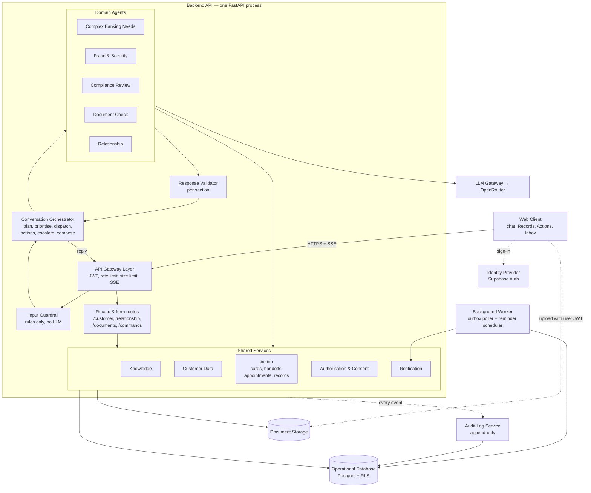
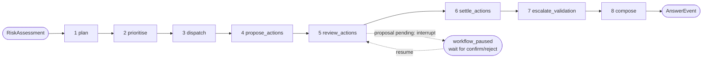
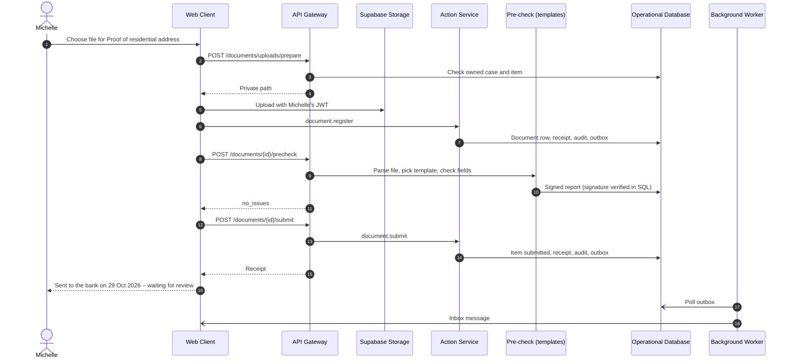
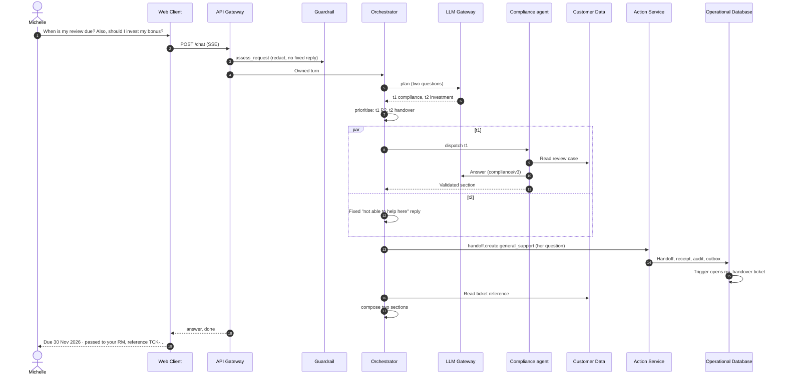
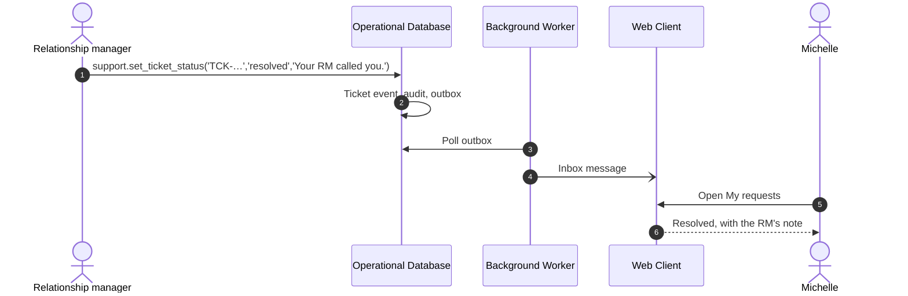
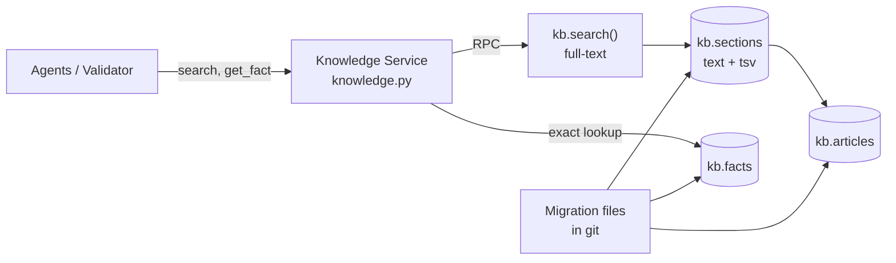

# DemoBank system architecture (v4, as built)

Status: **as built** (2026-10-31; client view CR1–CR17 refined to the finalised product backlog, see §5.1.1). This document describes the system that is in the code today, using the component names of the v3.1 proposal (the draw.io diagram "DemoBank — Proposed Multi-Agent Architecture"). Every place where the build differs from that proposal is listed in [§10](#10-differences-from-the-v31-proposal). `chatbot-architecture.md` describes the original single-path (v1) answer flow; `multi-capability-architecture.md` describes the intent-router step. The stories are in [the product backlog](planning/product-backlog.xlsx); the two workflows (client, relationship manager) are in `docs/workflows/`. Coursework demo with synthetic data only.

v4 changes from v3.1: the document now records what was built rather than what was planned. The overall shape is unchanged (one FastAPI process, the same components and contracts), but the orchestrator has eight nodes instead of four, agents read their data in code and make one model call instead of calling tools themselves, only the Fraud & Security agent proposes actions, most other changes start from forms in the Web Client, the Background Worker sends notifications only, and the multi-agent pipeline is switched on with `PIPELINE=v2` (v1 is still the default).

---

## 0. Design principles

All seven v3.1 principles are implemented; the notes say how.

1. **Deterministic before probabilistic.** Rules and fixed responses run before any LLM. Safety-critical replies (lost card, secrets, human support, a guest asking about "my" balance) never call the model. The planner uses keyword rules first; fraud priority, action proposals and decision wording are chosen by code.
2. **Modular monolith.** Every backend component is a Python module in one FastAPI process. Modules call each other as functions. The only other process is the optional notification worker (same codebase).
3. **Agents reach data only through service functions.** Agents never query tables; they call the Customer Data and Knowledge services, which use the caller's JWT so RLS applies. In the build, the agent code makes these calls itself before the model runs; the model never chooses a tool (§5.6).
4. **Policy check on every tool call.** `authorization.require_permission` checks identity, customer scope, the agent's allow-list and action type, and audits every decision.
5. **No action without a receipt.** Every state change goes through the Action Service and one SQL transaction that writes the change, receipt, audit event and outbox row together. Agents may only propose; only the customer (or, for staff types, a staff member) confirms.
6. **Grounded output only.** Each section is checked against its own evidence; a failed section is withheld, never replaced by stored text. For a signed-in, saved conversation the failure also records a support handoff.
7. **Everything auditable, nothing sensitive in logs.** Audit events and traces hold ids, enums and counts only; redacted chat text lives only in the conversation store.

---

## 1. Naming map

| Draw.io label | Component | Built as | Main code |
|---|---|---|---|
| Customer · chat + inbox | **Web Client** | React SPA: chat, Records, Actions, Relationship, Compliance, Inbox and Data sharing pages | `frontend/src/` |
| — (implicit) | **Identity Provider** | Supabase Auth (hosted) | — |
| API gateway | **API Gateway Layer** | ASGI middleware + `Depends(get_ctx)` | `core/gateway.py`, `core/auth.py`, `core/ratelimit.py`, `core/errors.py` |
| ① Safety guard | **Input Guardrail** | Rules only | `services/guardrail.py`, `privacy.py`, `safety.py` |
| ② Orchestrator | **Conversation Orchestrator** | LangGraph graph, eight nodes, includes the composer | `services/orchestrator.py` |
| shared case state | **Conversation Store** | Saved conversations + signed workflow checkpoints | `services/conversations.py`, `checkpoints.py`, `workflow_store.py` |
| ③ five agents | **Domain Agents** | Five agents: Complex Banking Needs (`retail`), Fraud & Security, Compliance Review, Document Check, Relationship | `services/agents/` |
| ④ Knowledge search | **Knowledge Service** | In-memory library (default) or Postgres `kb` tables | `services/knowledge.py`, `kb.py` |
| ④ Customer 360 tools | **Customer Data Service** | Read functions over audited SQL RPCs | `services/customer_data.py`, `agents/*_records.py` |
| ④ Action ledger | **Action Service** | `run_action()` + SQL executors | `services/actions/` |
| ④ Consent service | **Authorisation & Consent Service** | `decide()` + `has_consent()` | `services/authorization.py`, `consent.py`, `policy.py` |
| ④ Scheduling | — | Slot reads in Customer Data; hold/confirm/cancel in `appointments.py` | `api/relationship.py`, `actions/appointments.py` |
| ④ Notifications | **Notification Service** | In-app inbox + Supabase Realtime | `services/notifications.py`, `api/notifications.py` |
| ⑤ Composer | — | `compose` node of the orchestrator | `orchestrator.answer_for` |
| ⑥ Validator | **Response Validator** | Per-section checks inside each agent + `escalate_validation` node | `services/source_checks.py`, `agents/answer.py` |
| Reply over SSE | **Streaming Response (SSE)** | `fetch` + parser | `api/chat.py`, `frontend/src/lib/chatTools.js` |
| Human handoff queue | **Human Handoff** | `handoffs.py` executor + staff script | `actions/handoffs.py`, `actions/staff.py`, `scripts/staff_support.py` |
| Proactive triggers + event bus + rules | **Background Worker** | Outbox poller + reminder scheduler (no pg_cron) | `app/worker.py`, `core/lifecycle.py` |
| Observability | **Tracing & Evaluation** | LangSmith runs (redacted), JSON request logs, eval harness | `core/observability.py`, `core/langsmith_client.py`, `backend/evaluation/` |
| — (new) | **Audit Log Service** | Append-only hash-chained `audit.events` | `services/audit.py`, migrations `0005`–`0007`, `0054` |
| LLM provider | **LLM Gateway** | One client for planner and agents | `services/llm_gateway.py`, `prompts.py` |
| Supabase Postgres | **Operational Database** | Hosted Supabase Postgres + RLS | `backend/supabase/migrations/` |
| Supabase Storage | **Document Storage** | Private bucket `demobank-compliance-private` | `services/document_uploads.py` |

---

## 2. System architecture

Shown for `PIPELINE=v2` with `CONVERSATION_STORE=database` (the configuration used for the persona workflows). Lines go to and from groups, not to each agent or service.



Lines that are deliberately **not** drawn: every component writes audit events and trace spans (shown once as the dotted `API → Audit` line); the orchestrator also calls the LLM for planning; Notification pushes inbox items to the Web Client through Supabase Realtime; inside Shared Services, Customer Data does every read and the Action Service every write, both asking Authorisation & Consent first. The Background Worker does **not** start orchestrator turns (§5.10).

The second entry point (`REST`) matters: the Web Client reads records and starts most actions directly (hold a slot, confirm a booking, grant consent, save an agenda, mark a checklist item, upload or submit a document, create a request). These calls go through the same gateway, Customer Data, Action Service and audit path as chat, but no agent or model is involved.

---

## 3. Runtime model

| Process | Contains | Notes |
|---|---|---|
| `web` | React SPA | Vite dev server locally; static build for hosting |
| `api` | Gateway, Guardrail, Orchestrator, Agents, all Shared Services, Validator, Audit client, LLM Gateway | `uvicorn app.main:app` |
| `worker` | Background Worker | `python -m app.worker` with its own restricted database login (`WORKER_DATABASE_URL`); or inside `api` with `RUN_WORKER_IN_API=true` |
| Supabase (hosted) | Auth, Postgres, Storage, Realtime | Not built by us. pg_cron is not used |

Communication inside `api` is plain function calls. Network hops: browser ↔ API, browser ↔ Supabase Auth/Storage/Realtime, API ↔ Supabase Data API (PostgREST, always with the caller's JWT), worker ↔ Postgres, API ↔ OpenRouter. Document parsing runs in a short-lived child process with no credentials (§5.6).

**Configuration switches** (`core/config.py`, defaults first):

| Setting | Values | Effect |
|---|---|---|
| `PIPELINE` | `v1` \| `v2` | `v1` is the original single-path `make_answer` flow; `v2` is the orchestrator and agents described here. Personal v2 chat requires saved conversations |
| `KNOWLEDGE_STORE` | `memory` \| `database` | In-memory keyword library, or audited Postgres `kb` sections; works with either pipeline |
| `CONVERSATION_STORE` | `off` \| `database` | Saved conversations, server-side history and durable workflow checkpoints |
| `CHAT_TRANSPORT` | `api` \| `codex` | OpenRouter via LangChain, or the local Codex CLI (manual alternative) |
| `RUN_WORKER_IN_API` | `false` \| `true` | Run the notification worker inside the API process |

Chat has two modes, chosen from the login with no UI switch: `public` (guests, approved knowledge only) and `personal` (signed-in customer: approved knowledge plus own records). Older saved `public` chats of signed-in users reopen in their saved mode; New chat returns to `personal`.

---

## 4. Canonical contracts

Pydantic models in `backend/app/schemas/contracts.py` (shared; change only by a PR reviewed by all developers) and `schemas/events.py`. The examples below are round-tripped by `tests/test_contracts.py`.

**RequestContext** (created by the gateway, passed to every module)
```json
{ "request_id": "uuid", "session_id": "uuid", "case_id": "uuid|null",
  "principal": { "kind": "guest|customer|system", "user_id": "uuid|null", "customer_id": "bigint|null",
                 "auth_session_id": "uuid|null", "aal": "aal1|aal2", "jwt": "<never logged>" },
  "agent": "retail|fraud|compliance|document|relationship|null",
  "locale": "en-SG", "received_at": "iso8601" }
```
`agent` is set only by backend dispatch and never read from model output; Authorisation uses it for the allow-list.

**RiskAssessment** (Input Guardrail → Orchestrator)
```json
{ "redacted_message": "string", "redactions": [{"type": "card_number|password|pin|otp|cvv|nric|email", "count": 1}],
  "risk_flags": ["fraud_suspected","lost_card","secret_shared","human_requested"],
  "priority": "P0|P1|P2|P3", "fixed_response": {"code": "lost_card_v1", "needs_human": true} }
```
`fixed_response` set → the orchestrator is skipped and the fixed reply is returned.

**TaskPlan** (Orchestrator, saved in the workflow checkpoint)
```json
{ "plan_id": "uuid", "tasks": [{ "task_id": "t1", "domain": "fraud|retail|compliance|document|relationship|smalltalk",
  "intent": "report_unrecognised_txn", "priority": "P0", "entities": {"amount": 2400},
  "needs_auth": true, "status": "pending|running|awaiting_confirmation|done|failed" }] }
```
Priority: **P0 fraud > P1 security > P2 regulatory deadline > P3 everything else**; ties keep message order. In the build the planner fills `intent: "answer_question"` and `entities: {question}` (the part of the message for that task); intent and entity extraction were not needed.

**AgentResult** (Agent → Orchestrator)
```json
{ "task_id": "t1", "agent": "fraud", "status": "ok|needs_clarification|needs_confirmation|needs_human|error",
  "answer_kind": "banking|conversation", "text": "string", "question": "string|null",
  "citations": [{"source_id": "kb:card-dispute@v3"}], "tool_calls": [{"call_id": "uuid", "tool": "customer.get_transactions"}],
  "pending_action": {"command_id": "uuid", "type": "card.temporary_block", "summary": "Temporarily block card ending 4821"},
  "receipts": [{"receipt_id": "rcpt_...", "command_id": "uuid"}] }
```
`question` is required exactly when `status` is `needs_clarification`.

**ActionCommand / Receipt** (Action Service; the executor is looked up from `type`, never chosen by the model)
```json
{ "command_id": "uuid", "idempotency_key": "case_id:task_id:type", "type": "card.temporary_block",
  "target": {"card_id": "uuid"}, "state": "proposed|confirmed|succeeded|failed|expired", "expires_at": "iso8601" }
{ "receipt_id": "rcpt_...", "command_id": "uuid", "outcome": "succeeded|failed", "audit_event_id": 1042 }
```
State and `expires_at` are assigned by the database, not by Python. Stored commands can also be `rejected`.

**AuditEvent** — see §6.

**SSE events** (`POST /chat`)

| Event | Payload | When |
|---|---|---|
| `conversation` | saved session/turn metadata | Saved conversations only; before the answer and again after it is stored |
| `status` | text, e.g. "Checking the available information…" | Always first |
| `answer` | `AnswerEvent` + `sections[]` (one per task, priority order; each with `pending_action` or `decision`) | Normal reply |
| `workflow_paused` | `{workflow, actions[ActionRequiredEvent], preview: AnswerEvent}` | A proposed action needs the customer's decision; replaces the proposed `action_required` event |
| `done` / `error` | unchanged | Always last |

`ActionRequiredEvent {command_id, type, summary, expires_at}` exists as proposed, but travels inside `workflow_paused` rather than as its own event. `GET /workflows/{turn_id}/preview` rebuilds the paused preview from the signed checkpoint after a reload.

---

## 5. Component catalogue

Five fields per component: **Category**, **Responsibility & boundaries**, **Inputs / outputs**, **Infrastructure / pattern**, **Dependencies** (↑ callers, ↓ callees).

### 5.1 Web Client
- **Category:** Presentation tier (SPA).
- **Responsibility & boundaries:** Bank-site layout with pages for overview, chat (with Recent chats history), Relationship (guided RM checklist, requests, appointments, Data sharing & permissions), Compliance workspace, Inbox; the Actions drawer reviews and confirms proposals; Records shows the customer's own synthetic data and private documents. `CardBlockDialog` confirms or rejects a card block inside the chat. Client-side redaction preview mirrors the Input Guardrail (`lib/chatTools.js`). No business logic or secrets; only `VITE_` variables.
- **Inputs / outputs:** Out: `POST /chat`, `POST /commands`, `POST /commands/{id}/confirm|reject`, `POST /workflows/{turn}/resume`, record and form routes (`/customer/*`, `/relationship/*`, `/documents/*`, `/consent/*`, `/notifications/*`, `/conversations/*`), `POST /auth/session-end`, each with bearer JWT; direct Storage uploads with the user's JWT. In: SSE stream; Realtime inbox channel.
- **Infrastructure / pattern:** React + Vite. SSE is read with `fetch()` + `ReadableStream` and a small parser, because `EventSource` supports only `GET` without an `Authorization` header.
- **Dependencies:** ↓ Identity Provider, API Gateway Layer, Document Storage, Notification Service (Realtime).

#### 5.1.1 Client view (Michelle) by story — finalised backlog, 31 Oct 2026

The client stories are all implemented. The RM stories (RM1–RM16) are **not built yet**, so the RM side of handovers,
ticket status and meetings is the shared database record plus the support staff queue (`scripts/staff_support.py`).

| Story | Where it lives in the client | How it decides |
|---|---|---|
| CR1 Login | `Login.jsx` (masked password, Show/Hide, Forgot password guidance, one neutral error); sign in from the header, the sidebar and every locked page; sign out from the sidebar | Supabase Auth; personal pages locked without a session |
| CR2 General help | Assistant (guest mode); "Go to …" page buttons (`lib/pageLinks.js`) | Approved articles only; personal questions ask her to sign in |
| CR3–CR6 Compliance | Compliance review: checklist marks, upload, preliminary check, bank status | Her mark, the system's "Submitted", and the bank's decision are separate fields; only the bank sets Accepted/Correction |
| CR7 Reminders | Inbox | Recorded deadlines only |
| CR8–CR10 Handover and tickets | Assistant preview ("Here's what I'd send…") with Send to my RM / Add to TCK / Open a new request / Cancel; My requests | Rules choose RM vs specialist; nothing is sent until she chooses; fraud never goes to the RM |
| CR11 Card limit | Assistant explanation + request form (latest stated amount) | Cards and credit team decides |
| CR12–CR13 Fraud, lost card, pending | Assistant: urgent steps, charge list + "Yes, report it"; lost card "Yes, report my card" | Rules from records; urgent fraud ticket only after she confirms |
| CR14–CR15 Cards and account | Assistant (records answers, "which card?", follow-ups), Overview | Figures copied from records |
| CR16 Loans | Assistant (home, personal, car loan articles) | No eligibility, rate or approval promises |
| CR17 Meetings | Assistant (free times → hold → Confirm booking) and My requests > Meetings | Same hold and confirm actions in both places |

**Rules versus AI.** Actions and safety (handover, fraud and lost-card reports, bookings, confirmations) are decided by rules,
with her explicit confirmation. Explanations are written by the AI from approved articles and her records and checked by the
Response Validator. Several record questions (card figures, transactions, fees, card limit) are currently answered by rules
because the validator withheld correct AI answers; moving them back to AI wording with record facts is the planned next step.

#### 5.1.2 UI conventions (web client)

- **Buttons:** three kinds only. *Primary* (`.primary-button`, red) for the one main action on a screen; *secondary*
  (`.bank-chat-logout`, outline) for everything else; *icon* (`.icon-button`, round) for icon-only actions with an
  `aria-label`. All share one height (38 px), radius (8 px), weight, hover, press (scale .97) and keyboard focus ring.
  One-tap replies in the chat (`.follow-ups button`) are pills.
- **Signing in and out** are offered in the same places: header (Sign in), sidebar session area (Sign in when signed out,
  Sign out when signed in) and every locked page.
- **Motion:** pages settle in when opened (`.page-enter`, 0.3 s, children staggered); replies and one-tap replies rise in;
  loading shows a moving red bar with pulsing text (`.loading`) or shimmering skeletons for lists and cards. All motion is
  switched off under `prefers-reduced-motion`.
- **Colours** are unchanged (`--red`, `--ink`, `--line`, `--canvas`, `--tint`); new tokens are only `--btn-h`,
  `--btn-radius`, `--ease-out` and `--focus-ring`.

### 5.2 Identity Provider
- **Category:** OAuth2 / OIDC identity provider.
- **Responsibility & boundaries:** Sign-in, sign-out, token refresh, JWKS, MFA (`aal2`). Keeps its own auth log. Staff accounts carry an administrator-set `app_metadata.demobank_role=support`. Does not authorise banking operations.
- **Inputs / outputs:** In: credentials. Out: JWT (`sub`, `session_id`, `aal`, `exp`).
- **Infrastructure / pattern:** Supabase Auth (hosted). Persona logins live in a git-ignored `personas.json`.
- **Dependencies:** ↑ Web Client, API Gateway Layer (JWKS). ↓ Operational Database (`auth` schema).

### 5.3 API Gateway Layer
- **Category:** Edge middleware inside the backend.
- **Responsibility & boundaries:** Verifies JWT (cached JWKS), resolves `customer_id`, builds `RequestContext`, rate-limits (in-process token bucket), limits payload size, sets CORS, opens the SSE stream, maps errors to stable codes, and creates the per-request user database client (`request.state.db`). Records `auth.session_started` the first time it sees a new `session_id`. No domain logic.
- **Inputs / outputs:** In: HTTPS. Out: `RequestContext` to the route; SSE events.
- **Infrastructure / pattern:** Pure ASGI middleware + FastAPI dependency (`core/gateway.py`, `core/auth.py`, `core/ratelimit.py`, `core/errors.py`, `api/auth.py`). Error body `{"error": {"code", "message", "request_id"}}`; codes include `auth_invalid`, `auth_expired`, `auth_required`, `profile_missing`, `rate_limited` (with `Retry-After`), `payload_too_large`, `auth_unavailable`, `audit_unavailable`, `conversation_unavailable`, `personal_unavailable`. Guests send an optional `X-Session-Id`; signed-in sessions use the JWT `session_id`. One TLS context is reused for all per-request Supabase clients.
- **Dependencies:** ↑ Web Client. ↓ Identity Provider, Input Guardrail, Conversation Store, Orchestrator, record routes, Action Service, Audit Log Service.

### 5.4 Input Guardrail
- **Category:** Deterministic pre-filter / data loss prevention.
- **Responsibility & boundaries:** `assess_request` redacts secrets and PII, counts redactions, trims history, detects lost card, fraud wording (including informal wording, `guardrail.FRAUD`), human-support requests and guest "my balance" questions, assigns priority and returns fixed responses. Runs before any personal data is loaded. **Never calls an LLM.**
- **Inputs / outputs:** In: `ChatRequest`. Out: `RiskAssessment`.
- **Infrastructure / pattern:** Python rules (`guardrail.py`, `privacy.py`, `safety.py`); fixed reply texts in `answers.py`; shared fixtures `tests/fixtures/privacy-cases.json` used by backend and frontend.
- **Dependencies:** ↑ `/chat`, Conversation Store (`chat_store.prepare` stores the guarded question before any provider work). ↓ Orchestrator (or the fixed reply); Audit Log Service.

### 5.5 Conversation Orchestrator
- **Category:** Supervisor, planner–executor workflow.
- **Responsibility & boundaries:** Turns a message into a `TaskPlan`, runs the agents concurrently, records the proposed actions, pauses for the customer's decision, writes the recorded outcome into the reply, records a handoff for withheld sections and composes one reply. It does not answer banking questions itself. Runtime identity (`RequestContext`, owned turn) is passed as LangGraph runtime context, never stored in checkpoint state.
- **How it works:** a LangGraph `StateGraph` with eight nodes in a straight line. Saved turns use the owned checkpoint saver with synchronous durability, so the state after every node is in Postgres.



| Node | What it does | LLM? |
|---|---|---|
| 1 plan | A document/compliance record selected in the UI routes straight to that agent. Otherwise keyword rules (`simple_issue`) build a one-task plan. Only if no rule fits, one structured-output planner call splits the message into `{domain, question}` issues; English results are re-checked by routing rules (`route_issues`) | Only when unclear |
| 2 prioritise | Adds a fraud task if the Guardrail flagged `fraud_suspected`/`lost_card` and the planner missed it; assigns P0 fraud, P1 security wording, P2 compliance/document deadline wording, P3 otherwise | No |
| 3 dispatch | Runs every task concurrently (`asyncio.TaskGroup`), each bounded by `AGENT_TIMEOUT_S`. Each task loads its own evidence and calls its agent. Expected provider/data failures withhold only that section, with no evidence or proposal released | Agents |
| 4 propose_actions | For each fraud proposal (one per card), calls the Action Service to record a `card.temporary_block` proposal for the owned turn | No |
| 5 review_actions | Loads the ledger; if any proposal is still `proposed`, pauses the graph (`interrupt`). After resume, the ledger, not the resume value, decides what happened | No |
| 6 settle_actions | For each decision writes a fixed-wording decision section (origin `safety`). A succeeded block also records a P0 `card_verification` handoff | No |
| 7 escalate_validation | If any section was withheld by validation in a signed-in customer's saved case, records one `general_support` handoff (no rejected text in its summary) and adds a section saying so | No |
| 8 compose | Deterministic merge: one section per task in priority order, citations kept with their section, decisions written into their own task's section, overall `needs_human`/`source_check`/origin computed | No |

Confirming or rejecting (`POST /commands/{id}/confirm|reject`) resumes the same graph from its checkpoint; `POST /workflows/{turn}/resume` retries a resume that failed. The final reply is stored on the saved turn, and the client reads it from the conversation.

- **Inputs / outputs:** In: `ChatRequest` + `RiskAssessment` + runtime context. Out: `AnswerEvent` or `WorkflowPausedEvent`; checkpoints and workflow rows in the Conversation Store.
- **Infrastructure / pattern:** LangGraph `StateGraph` + owned Data API checkpoint saver (`services/checkpoints.py`) with HMAC-signed envelopes and a closed JSON codec (no pickle).
- **Dependencies:** ↑ `/chat`, `/commands/{id}/confirm|reject`, `/workflows/{turn}/resume`. ↓ Domain Agents, Knowledge Service, LLM Gateway (planner), Action Service, Conversation Store, Audit Log Service.

### 5.6 Domain Agents
- **Category:** Bounded-context agents (five, drawn separately in §2).
- **Responsibility & boundaries:** Each agent owns one business area, has its own versioned prompt and an allow-list of tools (`agents/registry.py`), and returns an `AgentResult` plus the evidence it used. **How agents work in the build:** the agent code reads the records it needs through Customer Data and Knowledge (each read checked against the allow-list by `require_permission` with `ctx.agent` set), turns them into masked evidence, then makes **one** structured-output model call with that evidence. The model never chooses a tool, and no model output executes an action. The draft is then validated (§5.8). In `public` mode and for small talk, every domain uses the shared public answer agent over approved knowledge.

| Agent (`domain`) | Reads (in code) | Model writes | Actions | Must not do |
|---|---|---|---|---|
| **Complex Banking Needs** (`retail`) | Profile, accounts, transactions, credit cards, loans; knowledge | Explanation with citations | None from chat ("Talk to a person" handoffs come from the UI) | Change anything; give investment, legal or tax advice; promise approval; investigate or reverse transactions |
| **Fraud & Security** (`fraud`) | Masked transactions and cards (`fraud_records.py`); fraud articles | Description of the matched charge and urgent steps | Code (`fraud.decision_for`) decides which card to offer for a temporary block; a rule-flagged charge with one eligible card/transaction pair is always offered. The orchestrator records the proposal; a succeeded block records a P0 handoff | Execute without confirmation; claim a block without a receipt; reverse or permanently cancel (staff only) |
| **Compliance Review** (`compliance`) | Client-visible compliance case, requested items, status history; the record the customer selected | Explanation of requests and statuses | None from chat; checklist marks are set by the customer in Records (`compliance.update_checklist_item`) | Invent requirements or deadlines; mark documents accepted; reveal internal fields |
| **Document Check** (`document`) | The recorded precheck report for the selected document (`prechecks.workspace`) | Explanation of the recorded findings | None | See or quote document contents (they never enter model evidence); present results as approval |
| **Relationship** (`relationship`) | RM assignment, introduction/transition notice, requests, appointments, 14-day slot search, consent records | Explanation with per-dataset citations | None from chat; each reply offers a hand-off button to the Relationship page, where holds, bookings, consent, agendas, sharing and requests are done with forms | Share data without consent; book; draft agendas with AI; invent transition reasons |

Document checking itself is not an LLM step. `prechecks.py` and `notice_checks.py` apply source-quoted requirements from the owned compliance notice and approved guidance, plus configured calendar and page checks, optionally with local OCR. Technical inspection (`document_inspection.py`) opens PDF/DOCX/PNG/JPEG files in a bounded child process with no credentials (`document_parser_*`) and returns counts only. Neither produces an approval or changes case status.

Stories without an agent are handled by platform components: CR1 login (Identity Provider, Gateway), CR4 upload (Web Client, Document Storage, `document.register`), CR7 reminders (Background Worker, Notification Service).

- **Inputs / outputs:** In: `{task, history, language, RequestContext with agent, public evidence}`. Out: `(AgentResult, evidence[], prompt_id)`; Fraud also returns a bounded `FraudProposal`.
- **Infrastructure / pattern:** Code-driven reads + one strict-JSON model call per task; prompts in `backend/app/prompts/<agent>/vN` (released versions immutable).
- **Dependencies:** ↑ Orchestrator. ↓ Customer Data, Knowledge, Authorisation, LLM Gateway.

### 5.7 Shared Services

#### 5.7.1 Knowledge Service
- **Category:** Keyword retrieval with citations, plus an exact fact table.
- **Responsibility & boundaries:** Returns ranked article sections with citations and exact fees/limits/rates. Does not write answers. Unrelated questions return nothing. External-publisher articles need `reference_url`, `checked_on`, `review_due` and an allowed domain. Full design and the content each story needs are in the [knowledge base appendix](#appendix-knowledge-base).

| Part | Built as |
|---|---|
| In-memory library (default, `KNOWLEDGE_STORE=memory`) | `services/knowledge.py`: small curated library, keyword search, no embeddings |
| Articles / sections | `kb.articles`, `kb.sections` (versioned, cited as `article_id@vN#anchor`), migration `0008`; approved seed `0009`; Workflow 1 content `0055` |
| Keyword search | Ranked keyword RPCs, called with the caller's JWT and audited (`services/kb.py`) |
| Exact source lookup | Migration `0011`; `GET /knowledge/sections/{article}/{version}/{anchor}` |
| Fact table | `kb.facts`, used for figure checks |
| Read-only access | RLS on `kb` tables; content changes only through migrations |

- **Inputs / outputs:** `search(KnowledgeQuery) → [KbChunk]`; `get_fact`; `GET /knowledge/{id}`.
- **Infrastructure / pattern:** In-memory Python or hosted Postgres; no vector database.
- **Dependencies:** ↑ Orchestrator (`database_evidence`), agents, v1 answer flow. ↓ Operational Database.

#### 5.7.2 Customer Data Service
- **Category:** Entitlement-scoped data access layer.
- **Responsibility & boundaries:** The only way agents and record pages read customer records. Read-only; every write goes through the Action Service.

| Part | Built as |
|---|---|
| Read functions | Profile, accounts, transactions (filtered), credit cards, loans, compliance case, documents metadata, RM assignment/introduction, requests, appointments, slots, meeting options, agendas, consent records (`customer_data.py`, `agents/*_records.py`, `api/customer.py`, `api/relationship.py`) |
| Scope enforcement | `customer_id` comes from the JWT; every query runs with the caller's JWT, invoker RLS **and** an explicit SQL customer predicate (migrations `0028`/`0029`) |
| Field masking | Card numbers → last 4; emails, ids and internal codes excluded from model evidence |
| Read audit + fingerprint | Each read is one SQL call that also writes the `data.read` audit event and returns `{call_id, data, as_of}` |

- **Inputs / outputs:** In: read request + `RequestContext`. Out: `ToolResult {call_id, data, as_of}`.
- **Infrastructure / pattern:** Supabase Data API with the user's JWT (`core/data_api.py`: bounded transient retries). No cache, no read model.
- **Dependencies:** ↑ Agents, record routes. ↓ Authorisation, Operational Database, Audit Log Service.

#### 5.7.3 Action Service
- **Category:** Command processing with confirmation and idempotency.
- **Responsibility & boundaries:** Every state change. `run_action(command, ctx, confirmed)` checks permission, builds the canonical target from the typed executor contract, and calls one SQL function; agents may propose but `confirmed=True` with an agent set is denied. The SQL side checks JWT ownership, confirmation and expiry independently and runs the executor registered in the private `actions.executors` table. Command state, business change, receipt, audit event and outbox row commit in **one transaction** (migrations `0017`–`0019`). Confirmation always reloads the stored target; the client's copy is never used.

| Step | Built as |
|---|---|
| 1 Duplicate check | Unique `idempotency_key`; repeats return the same command/receipt |
| 2 Expiry | Database sets `expires_at` (5 minutes for proposals; 10 minutes for slot holds); confirming after expiry executes nothing |
| 3 Authorise | `require_permission` in Python + ownership checks in SQL; re-checked at confirm time |
| 4 Confirm | *Confirm* types stop as `proposed`; *auto* types (`authorization.AUTO_TYPES`) run immediately |
| 5–6 Execute + record | One SQL transaction: executor, ledger, receipt, audit, outbox |
| 7 Receipt | `Receipt {receipt_id, command_id, outcome, audit_event_id}` |

**Executors** (Python files in `services/actions/` define the typed targets; SQL executors do the writes)

| File | Action types | Confirm? | Business rules |
|---|---|---|---|
| `cards.py` | `card.temporary_block` | confirm | `active → temporarily_blocked`; demo `banking.credit_cards` |
| `handoffs.py` | `handoff.create` | auto | `support.handoffs`, one open handoff per case and reason, priority + redacted label-only summary |
| `appointments.py` | `appointment.hold` | auto | 10-minute hold; GiST exclusion prevents overlaps; working hours and current assignment checked |
| | `appointment.confirm`, `appointment.cancel` | confirm | Booking only while the hold is live; within 366 days |
| `records.py` | `consent.request`, `agenda.save`, `compliance.update_checklist_item`, `document.register`, `document.submit` | auto | Redacted agenda topics with optimistic revision; checklist marks under case/item locks; document registration after upload; submission moves a precheck only to awaiting review |
| | `consent.grant`, `consent.revoke`, `rm.share_summary`, `requests.create` | confirm | Grants never share data; sharing copies one saved revision under one exact grant and rechecks expiry and recipient; requests derive recipient names server-side |
| `staff.py` | `handoff.claim`, `handoff.close`, `card.unblock`, `card.cancel_permanently` | staff only | Requires `demobank_role=support`, `aal2` and a claimed handoff; `temporarily_blocked → active / cancelled` only |

`POST /commands` lets the Web Client propose a confirm-type action (e.g. booking); `POST /actions/cases` and `POST /relationship/holds` create an owned action case without a fabricated chat turn.

- **Inputs / outputs:** In: `ActionCommand` + `RequestContext`. Out: `Receipt` or `ProposedCommand {command_id, expires_at}`; `ActionOutcome` over HTTP.
- **Infrastructure / pattern:** Command pattern; executor registry in SQL; one Postgres transaction per command.
- **Dependencies:** ↑ Orchestrator, record/form routes, staff script. ↓ Authorisation, Operational Database, Audit Log Service.

#### 5.7.4 Authorisation & Consent Service
- **Category:** Attribute-based authorisation + consent check.
- **Responsibility & boundaries:** `decide(subject, action, resource, context)` is pure; `require_permission` audits each decision (`policy.decision`) and raises on deny. Unknown tools, scope mismatches and staff operations from customer/agent paths are denied. `has_consent` checks exact purpose/recipient/category coverage, revocation and wall-clock expiry under JWT + RLS. Grants and revocations are written only by confirmed actions.

| Part | Built as |
|---|---|
| Policy rules | Python, versioned in git: guests get public tools only; each agent has an allow-list; `AUTO_TYPES`, `CONFIRM_TYPES`, `STAFF_TYPES` |
| Decision | `Decision {allow, reasons[], obligations[]}` |
| Consent | `consent.grants`, `consent.requests` (migration `0010`, `0037`–`0040`); `POST /consent/check`, `GET /consent/rm`, `GET /consent/records` |

- **Dependencies:** ↑ Customer Data, Action Service, Knowledge, Orchestrator. ↓ Operational Database, Audit Log Service.

#### 5.7.5 Notification Service
- **Category:** In-app notification delivery.
- **Responsibility & boundaries:** Turns outbox events into inbox items from versioned templates, applies preferences, retries or dead-letters failures. Never writes free-text advice. Only English templates exist; a missing locale fails explicitly.

| Part | Built as |
|---|---|
| Delivery | Transactional delivery + retry + audit in SQL (migration `0023`), called by the worker |
| Templates | Versioned, with typed variables (`notify.templates`, `0026`) |
| Preferences | `notify.preferences` (`0027`); service messages cannot be switched off |
| Inbox | `notify.inbox`; `GET /notifications` (latest 50), `POST /notifications/{id}/read`; Supabase Realtime publication for live updates |

- **Dependencies:** ↑ Background Worker. ↓ Operational Database, Web Client (Realtime), Audit Log Service.

### 5.8 Response Validator
- **Category:** Post-generation grounding checks.
- **Responsibility & boundaries:** Runs **per section, inside each agent** (`agents/answer.validate_draft`, `source_checks.py`): JSON schema valid; source ids exist in that section's evidence and match scope; banking answers cite sources; figures and units appear in the evidence (`unit_matches`); no secrets, URLs or prompt leakage; no claimed actions. A failed section gets `status=error`, origin `validation` and a withheld message; `escalate_validation` then records a handoff for signed-in saved cases. Action outcomes are never model text: decision sections use fixed wording and cite the ledger receipt. These checks do not prove factual correctness.
- **Inputs / outputs:** In: model draft + evidence. Out: `AgentResult` (validated or withheld); `source_check: basic_checks_passed|rejected` and `response_origin: ai|safety|validation` on the reply.
- **Dependencies:** ↑ Agents. ↓ Knowledge (facts), Action Service (`handoff.create` via the orchestrator), Audit Log Service.

### 5.9 Conversation Store
- **Category:** Durable conversation and workflow state.
- **Responsibility & boundaries:** Redacted messages and saved turns, guest access, cases, LangGraph checkpoints and workflow rows. Customers read their own history under RLS; guest capabilities expire after 24 hours. The guarded question is recorded before any provider work; failures are stored explicitly; turns can be cancelled.
- **Inputs / outputs:** `conversation.sessions`, `messages`, `turns`, `cases`, `guest_access` (migrations `0013`/`0014`); `conversation.checkpoints`, `checkpoint_writes` (`0015`/`0016`); `conversation.agent_workflows`, `actions.workflow_commands` (`0020`–`0022`). Routes: `/conversations`, `/conversations/{id}`, `/conversations/{id}/turns/{turn}/cancel`.
- **Infrastructure / pattern:** Postgres via the Data API; HMAC-signed checkpoint envelopes (`CHECKPOINT_SIGNING_KEY`).
- **Dependencies:** ↑ `/chat`, Orchestrator, action confirm/resume. ↓ Operational Database.

### 5.10 Background Worker
- **Category:** Transactional-outbox poller + reminder scheduler.
- **Responsibility & boundaries:** Polls `events.outbox` (`FOR UPDATE SKIP LOCKED`) and delivers each event through the Notification Service; each call commits delivery, event outcome and audit together. A scheduler inside the worker calls the idempotent recorded-deadline producer every minute: one compliance reminder per case/due date/day, from today to seven days ahead (Asia/Singapore), only while checklist items remain outstanding. **It does not start orchestrator turns**, and pg_cron is not installed.
- **Inputs / outputs:** In: outbox rows (ids only). Out: inbox rows; event marked delivered, retried or dead-lettered.
- **Infrastructure / pattern:** Python loop (`app/worker.py`, `core/lifecycle.py`); dedicated LOGIN role that is a member of `demobank_worker`, checked at start-up for excess privileges. Never the postgres owner, service-role key or an app JWT. Unknown SQL failures stop the worker and show in health.
- **Dependencies:** ↑ Action Service (outbox). ↓ Notification Service, Operational Database, Audit Log Service.

### 5.11 LLM Gateway
- **Category:** Model abstraction + prompt registry.
- **Responsibility & boundaries:** `llm_gateway.call` is the one client for planner and agents: loads versioned prompts (`prompts.load(agent, version)`), enforces strict JSON, timeout per attempt, retries on timeouts/429/5xx only, per-request token budget, `llm` span + `llm_call` log and `agent.llm_call` audit event. Raises `LLMError`; failures are reported, never replaced with sample answers.
- **Inputs / outputs:** In: `{prompt, system, history, schema}`. Out: parsed object + `{model, tokens, latency}`.
- **Infrastructure / pattern:** LangChain → OpenRouter (`CHAT_TRANSPORT=api`); local Codex CLI (`CHAT_TRANSPORT=codex`, `services/codex_cli.py`) with no app keys and no coding tools. Focused real-provider checks use `dots-studio/dots-3-note-preview:free`.
- **Dependencies:** ↑ Orchestrator, Agents, v1 answer flow. ↓ OpenRouter, Tracing.

### 5.12 Tracing & Evaluation
- **Category:** Tracing, structured logs, evaluation harness.
- **Responsibility & boundaries:** One LangSmith root run per request with nested runs per node/agent/tool/LLM call (redacted before upload), JSON request logs with ids and counts only, offline and live evaluation sets. Not the compliance record — that is the Audit Log Service.
- **Infrastructure / pattern:** LangSmith (`core/observability.py`, `core/langsmith_client.py`), `backend/evaluation/` (`run.py`, `--live --suite focused`, `langsmith_sync.py`). `ops.traces`/`ops.spans` (`0001`) are retired history; `0074` drops `log_trace`.
- **Dependencies:** ↑ all backend modules. ↓ LangSmith.

### 5.13 Agent tools

In the build a "tool" is a permission name checked by `require_permission`, not a function the model can call. The agent code calls the function directly with `ctx.agent` set.

| Tool | Backend function / route | Agents (allow-list) |
|---|---|---|
| `kb.search`, `kb.get_fact` | `kb.search`, `knowledge.py` | Complex Banking Needs, Compliance Review, Relationship; public for everyone |
| `customer.get_profile` | `customer_data` | Complex Banking Needs, Relationship |
| `customer.get_accounts`, `customer.get_loans` | `customer_data` | Complex Banking Needs |
| `customer.get_transactions`, `customer.get_credit_cards` | `customer_data`, `fraud_records` | Complex Banking Needs, Fraud & Security |
| `compliance.get_case`, `compliance.workspace` | `customer_data`, `prechecks.workspace` | Compliance Review (+ Document Check for workspace) |
| `compliance.update_checklist_item` | Action (auto) | Compliance Review allow-list; used from Records |
| `docs.precheck` | `prechecks.py` | Document Check |
| `rm.get_assignment`, `rm.get_introduction`, `requests.list`, `appointments.find_slots`, `appointments.list`, `consent.check`, `consent.records` | `relationship_records`, `consent` | Relationship |
| `agenda.save`, `consent.request` | Action (auto) | Relationship allow-list; used from forms |
| `actions.propose` | Action (confirm) | Fraud & Security (`card.temporary_block`); Relationship allow-list, not used from chat |
| `handoff.create` | Action (auto) | All personal agents; Orchestrator; "Talk to a person" in the UI |

---

### 5.14 Data

#### Operational Database
- **Category:** PostgreSQL with Row-Level Security, one schema per area.
- **Responsibility & boundaries:** System of record: `banking`, `compliance`, `rm`, `consent`, `conversation`, `actions`, `support`, `notify`, `events`, `kb`, `audit`, `ops`. RLS on every customer table plus `customer_id` predicates in code and SQL. `events` is not exposed through the Data API. Migrations are numbered (`0001`–`0063`), never edited after release.
- **Infrastructure / pattern:** Hosted Supabase Postgres; GiST exclusion for bookings; keyword search for knowledge.
- **Dependencies:** ↑ all services, Identity Provider, Background Worker.

#### Document Storage
- **Category:** Private object storage.
- **Responsibility & boundaries:** Bucket `demobank-compliance-private`, objects at `customer_id/case_id/document_id`. PDF, DOCX, JPEG and PNG up to 10 MiB. Flow: audited preparation (`POST /documents/uploads/prepare`) → browser uploads with the user's JWT → automatic `document.register` action (receipt, audit and outbox together). No customer overwrite or delete; owned registered objects get 60-second download links.
- **Infrastructure / pattern:** Supabase Storage with storage RLS (migrations `0051`–`0052`).
- **Dependencies:** ↑ Web Client, Document Check (inspection reads).

---

## 6. Audit Log Service

### 6.1 Purpose and boundary
A tamper-evident, append-only record of **who did what, to which resource, when, and with what outcome** — for every user, agent, system and staff action. It answers "what happened in this case?" without exposing message text or customer records. Traces (§5.12) answer "why was it slow / wrong?".

### 6.2 Five-field summary
- **Category:** Append-only audit trail.
- **Responsibility & boundaries:** Accepts events from every module and from database triggers; stores them immutably. Does not store raw chat text or full customer records.
- **Inputs / outputs:** In: `AuditEvent` batches (`public.audit_record_batch`) and in-transaction SQL calls. Out: chain verification (`scripts/verify_audit.py`).
- **Infrastructure / pattern:** `audit.events`; insert only through `audit.record(...)` (`SECURITY DEFINER`); `UPDATE`, `DELETE`, `TRUNCATE` revoked; each row stores `prev_hash` and `hash` (migration `0005`). Row triggers on audited tables (`0006`). Canonical UUID tokens allowed in details (`0054`).
- **Dependencies:** ↑ every backend module, SQL executors, worker, triggers. ↓ Operational Database.

### 6.3 AuditEvent schema

As sent by the API (`schemas/contracts.AuditEvent`); `event_id`, `occurred_at`, customer, hashes and (unless an agent is named) the actor are filled in by the database from the caller's JWT.

```json
{ "category": "auth|chat|agent|data|policy|action|row|consent|notification|handoff|document|admin",
  "action": "chat.message_received", "outcome": "success|denied|failed",
  "resource_type": "message", "resource_id": "uuid",
  "details": {"history_len": 4},
  "case_id": "uuid|null", "session_id": "uuid", "request_id": "uuid",
  "actor_type": "agent|null", "actor_id": "fraud|null" }
```

`details` holds ids, enums, counts and changed field names only (`audit.is_safe`).

### 6.4 What is recorded

| Category | Events (examples) | Captured by |
|---|---|---|
| auth | `auth.session_started`, `auth.session_ended` | Gateway, `/auth/session-end` (migration `0007`) |
| chat | `chat.message_received`, `chat.reply_sent`, `chat.workflow_review_ready` | `/chat` |
| agent | `agent.llm_call` (model, prompt version, tokens, ms), `agent.failed` | `/chat` from LLM spans, Orchestrator |
| data | `data.read` (tool, counts) | Customer Data and Knowledge SQL reads |
| policy | `policy.decision` (tool, reasons, policy version) | `require_permission` |
| action | proposed, confirmed, rejected, executed, failed, expired | SQL action functions, same transaction |
| row | insert / update / delete on audited tables | Generic row trigger |
| consent, handoff, document, notification | grants/revocations, handoff created/claimed/closed, upload/register/submit, delivery/read | Respective SQL functions |

### 6.5 Write rules
- **State changes:** audit row in the same transaction as the change.
- **Everything else:** events collected per request and written in one batch before the `answer` (or `workflow_paused`) SSE event.
- **Audit write failure:** the request fails (`audit_unavailable`) rather than continuing unaudited.
- **Retention:** keep all rows for the demo.

---

## 7. End-to-end execution flow

### 7.1 Representative scenario
Workflow 1, the client (Michelle, customer 1002), detailed in [workflows/workflow-1-client.md](workflows/workflow-1-client.md). Configuration: `PIPELINE=v2`, `CONVERSATION_STORE=database`, `PRECHECK_MODE=template`, signed in (`personal` mode). Two parts of one visit:

**Part A – upload a requested document.** On the Compliance review page Michelle uploads her utility bill against *Proof of residential address*. It is checked against the proof-of-address template and, because nothing is missing, sent to the bank.

**Part B – one chat message with two questions.**

> "When is my review due? Also, should I invest my bonus in the new bond fund?"

| Task | Priority | Handled by |
|---|---|---|
| t1 Review deadline | **P2** (compliance deadline) | Compliance Review agent |
| t2 Investment question | **P3**, marked `handover` | No agent: fixed polite reply, handed to her relationship manager |

### 7.2 Step table
S = synchronous, A = asynchronous.

**Part A – upload, check and submit (no model call)**

| # | Caller → callee | Mode | Result |
|---|---|---|---|
| 1 | Web → `POST /documents/uploads/prepare` | S | Gateway verifies the JWT; SQL checks the case and item belong to Michelle and returns the private Storage path |
| 2 | Web → Supabase Storage | S | File uploaded with Michelle's own JWT (Storage RLS; no service key) |
| 3 | Web → Action Service `document.register` | S | Automatic action: document row, receipt, audit and outbox in one transaction |
| 4 | Web → `POST /documents/{id}/precheck` | S | `prechecks.run` reads the item's notice and policy, downloads the bytes and parses them in a separate child process (OCR only for images) |
| 5 | Document templates | S | `template_for` picks *proof of address*; `check` looks for her name, a Singapore postal code, a known issuer and a date within 3 months → no findings |
| 6 | Backend → `document_precheck_record` | S | Report signed with `DOCUMENT_PRECHECK_SIGNING_KEY`; SQL verifies the signature, scope and notice hash before saving |
| 7 | Web → `POST /documents/{id}/submit` | S | Only a fresh `no_issues` report is accepted; `document.submit` sets the item to *submitted – awaiting review* with a receipt |
| 8 | Web | S | Page reloads its record and shows "Sent to the bank on … – waiting for review". Nothing is sent to the chat |
| 9 | Background Worker → Notification Service | A | Outbox event → Inbox message |

**Part B – chat with a handover**

| # | Caller → callee | Mode | Result |
|---|---|---|---|
| 10 | Web → Gateway `POST /chat` | S, SSE opened | Message, `conversation_id`, JWT; `RequestContext` for customer 1002 |
| 11 | `/chat` → Conversation Store + Guardrail | S | `assess_request` redacts and checks the text (no fixed safety reply); the redacted question is saved before any model work |
| 12 | *plan* → LLM Gateway | S | Two questions in one message → one planner call → two issues, re-checked by routing rules |
| 13 | *prioritise* | S | t1 compliance P2 (deadline wording); t2 matches the handover rules (`rm_handover.needs_person`) and is marked `handover` |
| 14 | *dispatch* | S, parallel | t1 and t2 run at the same time, each bounded by `AGENT_TIMEOUT_S` |
| 14a | Compliance agent → Customer Data | S | Reads Michelle's review case and requested items (JWT + RLS); `data.read` audited |
| 14b | Compliance agent → LLM Gateway | S | One call with prompt `compliance/v3`: short plain answer citing the case ("due 30 Nov 2026") |
| 14c | Response Validator | S | Sources exist and every figure and date matches the record → section released |
| 14d | t2 | S | No model call: fixed reply "That's something I'm not able to help with here…" |
| 15 | *propose_actions*, *review_actions*, *settle_actions* | S | No changes proposed, so nothing pauses |
| 16 | *escalate_validation* → Action Service | S | `handoff.create` (`general_support`, summary = her redacted question); receipt, audit and outbox in one transaction |
| 17 | Database trigger | S | Opens an `rm_handover` ticket owned by *Your relationship manager* (migration 0073) |
| 18 | *escalate_validation* → Customer Data | S | Reads the new ticket's `TCK-` reference and adds "I've passed your question to your relationship manager. Your reference is TCK-…" |
| 19 | *compose* → Web | S stream | Two sections in priority order; audit batch flushed; SSE `answer`, `done`; reply saved on the turn |
| 20 | Background Worker → Notification Service | A | Ticket notice → Inbox |

**Failure branches**
- *The check finds a problem* (old bill, no postal code) → `issues_found`; the document is not submitted; the page lists what is missing and offers *Explain in chat*.
- *No readable text* (a photo without OCR) → "upload the PDF from the provider"; no pass or fail.
- *Signing key missing* → 503 "Document checks are not switched on yet"; the upload stays saved.
- *Planner call fails* → the request fails with an explicit error (no guessed plan).
- *The compliance agent fails, times out or its answer fails validation* → that section is withheld and handed to her relationship manager the same way as step 16.
- *A guest asks the investment question* → fixed reply asking them to sign in; no handoff (guests have no case).
- *"I lost my card"* → fixed lost-card reply from the Guardrail; the orchestrator does not run.

### 7.3 Sequence diagram — upload, check and submit
`->>` synchronous call, `-->>` return, `-)` asynchronous.



### 7.4 Sequence diagram — chat turn with a handover to the RM



### 7.5 Sequence diagram — the relationship manager answers
The RM view (Workflow 2) is not built yet; today the RM's answer is recorded with one SQL call by the owner role.



## 8. Latency budget

Still **estimates, not measurements**; latency and report checks remain outstanding (README). Assumes backend on a laptop, hosted Supabase in Singapore.

| Step | Hosted Supabase | Notes |
|---|---|---|
| Gateway (cached JWKS, rate limit) | 1–5 ms | |
| Guardrail | < 5 ms | Pure Python |
| Conversation prepare + checkpoints | 100–400 ms | One Data API call per node with synchronous durability |
| Plan | 0 ms (rules) / 0.5–1.5 s (LLM) | LLM only when no rule fits |
| Reads per agent | 80–300 ms | Agents run concurrently |
| Agent LLM call | 1.5–4 s | One per task; concurrent tasks cost the slowest |
| Action proposal + audit batch | 50–150 ms | |

| Request type | Expected total |
|---|---|
| Fixed safety reply | 50–200 ms |
| Single-intent question | 2–5 s |
| Multi-intent | 3–7 s |
| Free OpenRouter models | add 2–15 s, plus rate limits and occasional failures |
| Codex CLI transport | add several seconds per call |

At most two **sequential** model calls per turn (planner, then the slowest agent). Final text is released after validation, so token streaming is not used.

---

## 9. Local development and deployment

**As built:** processes are started directly (Docker Compose is deferred).

| Process | Command |
|---|---|
| `web` | `npm run dev` in `frontend/` (Node 22) |
| `api` | `uvicorn app.main:app` in `backend/` (Python 3.12, `.venv`); add `PIPELINE=v2` for the multi-agent flow |
| `worker` | `python -m app.worker` with `WORKER_DATABASE_URL`, or `RUN_WORKER_IN_API=true` |

Supabase: the **hosted project** (decision 4). Migrations are applied in prepared batches (`scripts/prepare_hosted_migrations.py`); README records which migrations are active there. Native tests run unchanged migrations against temporary PostgreSQL and a pinned PostgREST. Secrets come from a git-ignored `.env`.

Free hosting of the frontend and API (Vercel/Netlify, Render/Hugging Face) remains a later option; it is not set up.

---

## 10. Differences from the v3.1 proposal

### 10.1 What changed

| # | Area | v3.1 proposal | As built | Why / effect |
|---|---|---|---|---|
| 1 | **Default pipeline** | The orchestrator design *is* the system | Opt-in with `PIPELINE=v2`; `v1` (single `make_answer` path) is still the default. Personal v2 needs `CONVERSATION_STORE=database` | v1 kept as a stable baseline while v2 was built |
| 2 | **Knowledge and conversation storage** | Postgres `kb` and `conversation` tables | Built, but switched on per setting (`KNOWLEDGE_STORE=memory` and `CONVERSATION_STORE=off` by default) | Same reason |
| 3 | **Orchestrator graph** | 4 nodes: plan → prioritise → dispatch → compose | 8 nodes: adds propose_actions, review_actions, settle_actions, escalate_validation | Action recording, pause, outcome wording and validation handoffs are separate checkpointed steps |
| 4 | **Parallel dispatch** | LangGraph `Send` | `asyncio.TaskGroup` inside one node, per-task timeout | Simpler; same "slowest, not sum" latency |
| 5 | **Planner output** | `{domain, intent, entities}` with entity extraction | `{domain, question}` per issue; `intent: answer_question` | Agents read records themselves; extracted entities were not needed |
| 6 | **How agents work** | Tool-calling agents choose tools, with a cap on tool calls | Agent code reads data, then one model call; the model never chooses a tool | Fewer model calls; no prompt-driven data access |
| 7 | **Who proposes actions** | Fraud & Security and Relationship agents call `actions.propose`; Compliance updates checklists | Only Fraud & Security (temporary block). Relationship, Compliance and documents changes start from forms | Customer reviews exact fields before any change; no AI drafting |
| 8 | **Fraud block decision** | The model fills a playbook template | The model writes the description; code chooses the card to offer, and fixed wording reports the outcome | Outcome text never comes from the model |
| 9 | **Response Validator placement** | One step after compose | Per section inside each agent, plus the `escalate_validation` node | Failed sections are withheld before composing |
| 10 | **Planner failure** | Fraud task still runs; others get "please resend" | Request fails with an explicit error | Not implemented |
| 11 | **SSE events** | `action_required`, `status {stage}` | `workflow_paused` (actions + full preview), `conversation`; `status` is text | Preview lets the customer see every section while deciding |
| 12 | **Confirm and resume** | `/commands/{id}/confirm` resumes the graph | Same, plus `/reject` and a retry route `/workflows/{turn}/resume`; the final reply is read from the saved turn | Resume can fail after a recorded decision without losing it |
| 13 | **Action execution** | Python executor files run inside `run_action()` | Python files define typed targets; SQL executors (private registry) do the writes; DB sets state and expiry | Ownership and confirmation are enforced again in the database |
| 14 | **Action types** | Card block, unblock, cancel, replacement; handoff claim/close; appointments; records | Adds `document.register`, `document.submit`; staff types in a separate path; `card.order_replacement` not built | Document upload became an action |
| 15 | **Second entry point** | Changes come from agents | Many REST routes for records and forms (`/customer`, `/relationship`, `/documents`, `/consent`, `/actions/cases`, `/relationship/holds`) | Web Client is a full banking site, not only a chat |
| 16 | **Document Check** | `docs.precheck` uses Storage + LLM | Rule-based prechecks (source-quoted requirements, calendar/page checks, optional local OCR) and credential-free parser process; the model only explains recorded findings | Document contents never enter model evidence; no AI verdicts |
| 17 | **Background Worker** | pg_cron + outbox poller + rules; starts orchestrator turns (RC1, CR7) | Outbox poller + in-worker reminder scheduler; no pg_cron; no worker-started AI turns | Not needed for the demo flows yet |
| 18 | **Notification Service** | Quiet hours, dedup, Realtime | Templates, preferences, retry/dead-letter, Realtime; English only; no email | As proposed for the demo scope |
| 19 | **Staff desk** | Seeded script stands in | `scripts/staff_support.py` with staff role, `aal2` and claimed-handoff ownership | Stricter than proposed; hosted MFA provisioning pending |
| 20 | **Relationship handover note** | Agent drafts summary/agenda | Fixed-code draft (`handover.py`), customer edits; AI drafting pending | No model-written content shared with the RM |
| 21 | **Checkpoint security** | LangGraph Postgres checkpointer | Owned Data API saver, HMAC-signed envelopes, closed JSON codec | Checkpoints cannot be forged or carry code |
| 22 | **Tracing schema** | `observability` | `ops.traces`, `ops.spans` | Name only |
| 23 | **Deployment** | Docker Compose first | Processes started directly; Docker dropped | Not needed |
| 24 | **Contracts** | §4 models | Same, plus `RequestContext.agent`, `AgentResult.question`, more redaction types, more audit categories (`row`, `document`) | Additive |

### 10.2 Built but not in the proposal
- Michelle's compliance workspace: notice-based prechecks, correction uploads, submission to awaiting review, scoped support context (migrations `0056`–`0061`).
- RM-change records (approved transition notices, meeting options; `0062`) and relationship managers for every customer (`0063`). Their client pages were removed on 28 Oct 2026; Workflow 2 (relationship manager) will use them.
- Handover to the relationship manager (`0073`, `services/rm_handover.py`) and template document checks (`services/document_templates.py`).
- Private document uploads, 60-second download links, technical inspection.
- Consent requests with fixed expiry, agenda drafts and confirmed sharing snapshots.
- `/capabilities` so the Web Client knows whether saved conversations are on.

### 10.3 Still pending
Worker-started AI turns, pg_cron, email, replacement-card ordering, AI agenda drafting, agent-initiated changes other than the card block, hosted staff MFA provisioning, the RM view (Workflow 2), measured latency, combined real-provider acceptance and broad accuracy evaluation.

### 10.4 Removed or merged in v3 (unchanged)

| v2 item | Decision |
|---|---|
| Separate microservices, separate gateway proxy | One FastAPI process |
| CQRS read model, per-turn cache | Plain read functions |
| Redis | In-process rate limit; Postgres for holds and dedup |
| Event producers + event bus + rules engine | One Background Worker over an outbox table |
| Separate Response Composer | Orchestrator node |
| Separate Case Escalation, Appointment, Card Adapter services | Executors behind one `run_action()` |
| Policy decision log, data-access audit, action ledger | Unified Audit Log Service |
| Embeddings, vector search, re-ranker | Keyword search in Postgres |
| OPA | Python rules |

---

## 11. Failure modes

| Failure | Behaviour |
|---|---|
| Agent LLM timeout / provider error | That section withheld (`origin: validation`); fraud keeps fixed urgent steps; handoff for saved signed-in cases; error never faked |
| Planner LLM failure | Request fails with an explicit error |
| Tool denied by policy | `PermissionError` withholds the section; `policy.decision` audited as `denied` |
| Validation fails | Section withheld, origin `validation`, handoff |
| Confirm after expiry | No execution; fixed "expired" wording |
| Duplicate confirm | Same receipt returned |
| Resume fails after decision | Decision kept; retry with `/workflows/{turn}/resume` |
| Worker crash | Uncommitted event lock rolls back; picked up on restart |
| Audit write fails | Request fails; no unaudited change |
| Saved conversations off with personal v2 | `personal_unavailable` error |

---

## 12. Build status

| Proposed phase | Scope | Status |
|---|---|---|
| 0 | Gateway, Guardrail, single-path answer, keyword knowledge, validator, traces | Built (v1, still the default) |
| 1 | Audit Log Service, conversation store, auth session events, `kb` tables | Built (`0005`–`0016`) |
| 2 | Orchestrator + Retail agent; sections in SSE | Built (eight nodes) |
| 3 | Customer Data, policy, Action Service (`cards`, `handoffs`), Fraud | Built (`0017`–`0022`, `0028`–`0033`) |
| 4 | Worker + inbox; Compliance and RM agents; `appointments`, `records` executors | Built, except worker-started AI turns and pg_cron (`0023`–`0049`) |
| 5 | Document Check + Storage; consent workflow | Built as rule-based checks (`0037`–`0061`) |

Hosted Supabase status, test commands and known limits are in the README.

## 13. Decisions

| # | Question | Status | Decision |
|---|---|---|---|
| 1 | Worker database access | Closed | Dedicated LOGIN role in `demobank_worker`, privilege-checked at start; never the service-role key |
| 2 | Which actions run without confirmation | Closed | `AUTO_TYPES`: `handoff.create`, `appointment.hold`, `compliance.update_checklist_item`, `agenda.save`, `consent.request`, `document.register`, `document.submit`. Everything else needs confirmation; staff types only through the staff path |
| 3 | Customers viewing their own audit trail | Deferred | Not in the UI; Actions shows receipts and a CSV export of loaded receipts |
| 4 | Hosted or local Supabase | Closed | Hosted for development and the demo; native PostgreSQL/PostgREST for automated tests |
| 5 | Default pipeline | Open | `v1` stays the default; persona workflows run with `PIPELINE=v2` |
| 6 | Agents choosing tools | Closed | Agent code performs reads; one model call per task; model output never executes |

## Appendix: knowledge base

How the approved banking articles are stored, searched and cited, and which articles each story needs.

### Design

Status: **proposal**. Detailed design of the Knowledge Service in §5.7. The content to load is listed under *Requirements* below. Today's code still uses the in-memory keyword library in `backend/app/services/knowledge.py`; this document describes what replaces it.

#### 1. Summary

- **Retrieval-augmented generation (RAG):** agents retrieve approved sections, and the LLM answers only from them, with citations.
- **Keyword retrieval:** Postgres full-text search over article sections. No embeddings or vector search; the library is small enough that keywords, plus today's fallback of sending the whole small library when nothing matches, cover it.
- **No new infrastructure:** everything lives in the hosted Supabase Postgres that the app already uses.
- **Three tables, one search function.** All content is public guidance; the app can only read it.
- **No content workflow:** whatever is in the tables is live. Content changes arrive only through migrations.



#### 2. Data model

| Table | One row is | Key columns |
|---|---|---|
| `kb.articles` | One topic, e.g. "Pending transfers" | `article_id`, `version`, `category`, `type`, `title`, `summary`, source fields |
| `kb.sections` | One searchable part of an article, e.g. "What pending means" | `article_id`, `anchor`, `position`, `heading`, `body`, `tsv` (generated) |
| `kb.facts` | One exact figure, e.g. a card's annual fee | `fact_id`, `value`, `unit`, `article_id` |

```sql
create schema kb;

create table kb.articles (
  article_id text primary key,
  version int not null default 1,
  category text not null,          -- accounts, cards, loans, payments, security, support, compliance, relationship
  type text not null,              -- faq, how_to, troubleshooting, product
  title text not null,
  summary text not null,
  publisher text not null default 'demobank',
  reference_url text, checked_on date, review_due date,
  check (publisher = 'demobank' or (reference_url is not null and checked_on is not null and review_due is not null)));

create table kb.sections (
  article_id text not null references kb.articles on delete cascade,
  anchor text not null,            -- stable id used in citations, e.g. 'check-status'
  position int not null,
  heading text not null,
  body text not null,
  tsv tsvector generated always as (to_tsvector('english', heading || ' ' || body)) stored,
  primary key (article_id, anchor));
create index on kb.sections using gin (tsv);

create table kb.facts (
  fact_id text primary key,        -- e.g. 'card.platinum.annual_fee'
  value numeric not null,
  unit text not null,              -- 'SGD', 'percent_pa', 'days'
  article_id text not null references kb.articles);
```

RLS is enabled on all three tables with a read-only policy for `anon` and `authenticated`; no app role can insert, update or delete. The allowed-domain rule for external publishers (`www.moneysense.gov.sg`, `www.abs.org.sg`) stays in the Python validator, where it already lives (`services/source_checks.py`).

#### 3. Writing sections

A section is the unit the model sees and the unit a citation points to, so its shape matters more than the article's.

| Guideline | Why |
|---|---|
| One idea per section, roughly 50–300 words | Small enough to be precise, large enough to stand alone |
| Heading says what the section answers ("Why a transfer stays pending") | The heading is part of the searchable text |
| Use the words customers use ("stuck", "won't go through") as well as banking terms | Keyword search only matches words that appear |
| Steps as a numbered list inside one section | The agent can quote the steps in order |
| Figures only as a reference to a fact (`card.platinum.annual_fee`), not typed into the body | One place to change a fee; the Validator checks figures against `kb.facts` |
| Never mention a specific customer | Customer details come from Customer Data, not from knowledge |

Example: article `pending-transfers` (type `troubleshooting`, category `payments`):

| anchor | heading |
|---|---|
| `what-pending-means` | What a pending transfer means |
| `how-long` | How long transfers usually take |
| `check-status` | How to check a transfer's status |
| `avoid-duplicates` | Why you should not resend a pending transfer |
| `contact-bank` | When to contact the bank |

Citation format: `article_id@v<version>#anchor`, e.g. `pending-transfers@v2#avoid-duplicates`.

#### 4. Search function

```sql
create function kb.search(q_text text, categories text[] default null, k int default 5)
returns table (cite text, article_id text, title text, heading text, body text, score float)
language sql stable security invoker as $$
  select s.article_id || '@v' || a.version || '#' || s.anchor, s.article_id, a.title, s.heading, s.body,
         ts_rank_cd(s.tsv, websearch_to_tsquery('english', q_text)) as score
  from kb.sections s join kb.articles a using (article_id)
  where s.tsv @@ websearch_to_tsquery('english', q_text)
    and (categories is null or a.category = any(categories))
  order by score desc limit k $$;
```

| Parameter | Meaning |
|---|---|
| `q_text` | The user's question; `websearch_to_tsquery` handles stemming ("transfers" matches "transfer") and ignores stop words |
| `categories` | Agent scope, e.g. the Compliance Review agent searches `compliance` and `support` |
| `k` | Results returned |

An unrelated question matches nothing and returns an empty list instead of the "least bad" section. The `kb` schema must be added to the API's exposed schemas in Supabase, or the function wrapped as `public.kb_search`.

#### 5. Knowledge Service (Python)

`backend/app/services/knowledge.py` becomes a thin client:

| Function | Does |
|---|---|
| `search(query, categories, k)` | Fixes common typos (as today), calls `kb.search`, returns `[{cite, title, heading, body, score}]`. Empty list means no approved content: the agent says so or hands off |
| `get_fact(fact_id)` | Exact lookup in `kb.facts`. Used by agents and by the Response Validator |
| `get_article(article_id)` | Article with its sections, for the sources panel (`GET /knowledge/{id}`) |

Behaviour rules:
- **No match or non-English query:** the `english` full-text setting will not match other languages. Keep today's behaviour of using the small default library when nothing is retrieved. Answers are still generated only from retrieved sections, never from sample text.
- **Logging:** query text is never logged; traces record the number of results, the cites returned and the scores.

#### 6. Content workflow

1. Write or edit articles and sections as a new migration file in `backend/supabase/migrations/` (e.g. `0005_knowledge_seed.sql`, then `0006_knowledge_cards_update.sql`).
2. Editing an existing article: bump its `version` (and `checked_on` / `review_due` for external sources).
3. Apply the migration to the hosted Supabase project.

**Migrations are the only way content changes.** The Supabase dashboard is for viewing. This keeps git and the live database identical, and makes evaluation runs reproducible.

#### 7. Evaluation

Retrieval is measured separately from answer quality.

| Metric | Meaning |
|---|---|
| Hit rate @5 | The expected article appears in the top 5 sections |
| MRR | How high the first correct section ranks (1 / rank, averaged) |
| No-match accuracy | Out-of-scope questions return no sections |

Add an `expected_article` (and where useful `expected_anchor`) to the cases in `backend/evaluation/`, including informal and misspelled rewrites of each question (F22 evaluation set). Misses on informal wording are fixed first by adding customer wording to section text; if they remain common, that is the evidence for adding vector search later.

#### 8. Tests

| Level | What |
|---|---|
| Unit (offline) | Small fixture of articles and sections; checks citation format, typo fixing and empty-result handling |
| Database | Migration applies; app roles can read but not write `kb` tables |
| Live evaluation | Retrieval metrics above against the hosted database |

#### 9. Not included (and why)

| Left out | Reason |
|---|---|
| Embeddings and vector search (pgvector, hybrid ranking) | Small library; keyword search plus the small-library fallback covers it. Revisit only if evaluation shows frequent misses on informal wording |
| Customer-only articles and audience filtering | All knowledge is general guidance; personal details come from Customer Data |
| Separate vector database (Pinecone, Qdrant, Weaviate) | No vector search |
| Draft / review / publish workflow, version history | One author; migrations in git already give history |
| Re-ranker model | Small library; add only if evaluation shows ranking problems |
| Helpful votes, search-miss log | Can be added later without changing these tables |
| Internal (staff-only) articles | No staff desk in the demo |

### Requirements

Companion to the Knowledge Service in §5.7. Lists the approved content the agents need to answer every backlog story. Coursework demo: all content is synthetic or summarised from allowed public sources.

**Knowledge vs customer data.** Knowledge is approved content that is the same for every customer (how pending transfers work, what a review status means). Anything about one customer (their balance, their compliance case, their RM) is Customer Data and is not listed here.

#### 1. Knowledge articles

Status: **exists** = article in today's `knowledge.py`; **partial** = exists but misses part of the story; **new** = to write.

##### Everyday banking (CR2, CR12–CR16, F7)

| Story | Article(s) needed | Status | Current id |
|---|---|---|---|
| CR2 Account products | Account types and features, how interest works, account services | partial | `accounts`, `sg-accounts` |
| CR16 Loan Enquiry | Loan products, eligibility criteria, application steps, "only the bank decides" wording | partial | `loans` |
| CR14 Credit Card Enquiry | Minimum payment, interest, available credit, card fees, card not working | exists | `cards`, `sg-card-payments` |
| CR13 Failed or pending transaction | Failed vs pending, troubleshooting per type | exists | `transactions` |
| CR12 Suspicious charge and lost card | Fraud playbook steps, lost/stolen card steps | partial | `lost-card` |
| CR12 Replacement card | How a replacement card is issued and when it arrives | new | |
| CR2 Transfers | How to make a local / overseas transfer, cut-off times | new | |
| CR2 Update personal details | How to change address, phone, email | new | |
| CR2 Statements | Where to find and download statements | exists | `statements` |
| CR2 Online / mobile banking access | App login failing, account locked, password reset in the official app | new | |
| F7 Privacy | Never share PIN, OTP, password, CVV | exists | `security` |
| Human support | How to reach a person; what the bot cannot do | partial (update when handoffs exist) | `support` |

##### Compliance review (CR3–CR7)

| Story | Article(s) needed | Status |
|---|---|---|
| CR3 Document checklist | Approved guidance per document type: what counts as proof of identity, address, income, source of wealth; accepted formats; how to submit | new |
| CR4 Document upload | Allowed formats, size limits, tips for a legible scan | new |
| CR6 Milestone tracker | What each review status means (`not submitted`, `submitted – awaiting review`, `under review`, `complete`) and what happens at each stage | new |
| CR6 Information requests | How to respond to a clarification request and how to confirm it was received | new |
| CR7 Reminders (questions about a reminder) | Why reminders are sent and how to change preferences | new |

**Summary:** about 10 everyday-banking articles exist; the compliance guidance above is still to write. Approved wording for questions that go to the relationship manager comes from Workflow 2.

#### 2. Fact table (exact figures)

Typed rows the Response Validator checks figures against (`kb.get_fact`). Every row has `fact_id`, `value`, `unit` and the `article_id` it comes from.

| Group | Facts |
|---|---|
| Card fees | Annual fee, late payment fee, foreign transaction fee, cash advance fee |
| Interest rates | Savings rate, card interest rate, indicative loan rates |
| Limits | Daily transfer limit, ATM withdrawal limit |
| Card payments | Minimum payment formula, payment due period |
| Processing times | Typical time for local and overseas transfers to complete (for pending questions) |

#### 3. Fixed templates (shown as written, never searched)

| Template | Used by |
|---|---|
| Loan and fee disclaimers | Orchestrator *Compose* (F18) |
| AI notice at chat start | Web Client (F18) |
| Lost / stolen card urgent response | Input Guardrail (CR12) |
| Secret-detected warning | Input Guardrail (F7) |
| Notification templates (review reminder, card blocked, RM changed, booking reminder) | Notification Service (`notify.templates`) |

#### 4. Configuration (rules, not articles)

| Config | Used by |
|---|---|
| Document Check rules per document type: required pages, required fields, legibility threshold | Document Check agent (CR5) |

#### 5. Article and section fields

Each article has `article_id`, `version`, `category`, `type` (`faq`, `how_to`, `troubleshooting`, `product`), `title`, `summary` and `publisher` (`demobank` or an allowed external publisher). External-publisher articles also need `reference_url`, `checked_on`, `review_due` and an allowed domain (`www.moneysense.gov.sg`, `www.abs.org.sg`). Editing an article bumps `version` (and the dates for external sources).

Each article is split into **sections** (one idea each, about 50–300 words, a heading that says what it answers). Sections are what search returns and what citations point to (`article_id@vN#anchor`). Figures are not typed into sections; they live in the fact table. Writing guidelines and the full schema are in *Design* above.

#### 6. Where it is stored

| What | Where |
|---|---|
| Articles, sections and facts (runtime) | Hosted Supabase Postgres: `kb.articles`, `kb.sections` (with a full-text search column), `kb.facts`. Read-only for the app through RLS |
| Content changes | Migration files in `backend/supabase/migrations/`, committed to git; the only way content changes |
| Fixed templates | Versioned files in the repo, like prompts; notification templates seeded into `notify.templates` |
| Document Check rules | Config file in the repo |
| Offline unit tests | Small fixture, so tests run without the network |

Not Supabase Storage: that holds customer uploads only.

Today the articles are still hard-coded in `backend/app/services/knowledge.py`; moving them to the database is a separate code change.
