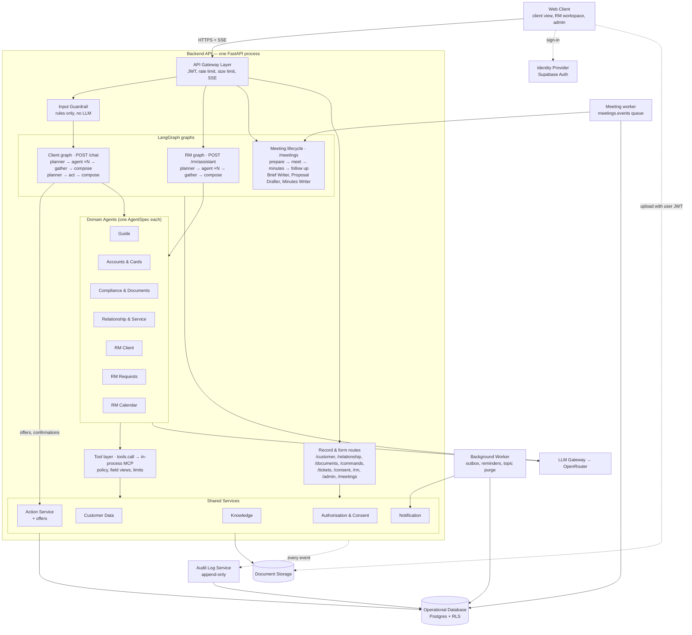
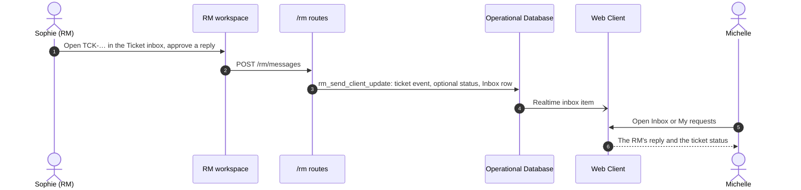

# UBS Connect system architecture (v5, as built)

Status: **as built** (6 Nov 2026). This document describes the system that is in the code today, using the component names of the v3.1 proposal. [§10](#10-differences-from-the-v31-proposal) records how v4 differed from that proposal; §14 records the v5 redesign. The two workflows (client, relationship manager) are in `docs/workflows/`; one chat turn, step by step, is in [how-agents-run.md](how-agents-run.md). Coursework demo with synthetic data only.

v5 as built: client chat runs on a five-node LangGraph graph with four client agents and confirmations as chat turns (§14, built in phases 1–9 on 4 Nov 2026); the RM assistant runs on its own graph with three RM agents (§14.11); the meeting team's lifecycle graph and meeting worker take a confirmed meeting through brief, meeting, minutes and follow-up, with the RM approving each step (§15, migrations 0120–0141); and consent v2 lets the client choose what her RM sees and for how long (§15.2). The multi-agent pipeline is switched on with `PIPELINE=v2`; `v1`, the single-path `make_answer` flow, is still the default.

---

## 0. Design principles

All seven v3.1 principles are implemented; the notes say how.

1. **Deterministic before probabilistic.** Rules and fixed responses run before any LLM. Safety-critical replies (lost card, secrets, human support, a guest asking about "my" balance) never call the model. The planner uses rules first; urgent card priority, offers and outcome wording are chosen by code.
2. **Modular monolith.** Every backend component is a Python module in one FastAPI process. Modules call each other as functions. The only other processes are the optional notification worker and meeting worker (same codebase).
3. **Agents reach data only through service functions.** Agents never query tables; they call tools (`services/tools.py`) over the Customer Data and Knowledge services, which use the caller's JWT so RLS applies. A known intent's reads are fixed in its agent's spec and run in code; only an `open` task lets the model choose reads, from the spec's `loop_tools` and at most `AGENT_TOOL_CALLS` of them (§5.6, §14.5).
4. **Policy check on every tool call.** `authorization.require_permission` checks identity, customer scope, the agent's spec or allow-list and action type, and audits every decision (`policy.decided`).
5. **No action without a receipt.** Every client state change goes through the Action Service and one SQL transaction that writes the change, receipt, audit event and outbox row together. Agents only offer; the customer confirms (a staff member for staff types). RM writes are separate approved SQL functions (`public.rm_*`, §14.11).
6. **Grounded output only.** Each section is checked against its own evidence; a failed section is withheld, never replaced by stored text. With `VALIDATION_HANDOFF=1`, a signed-in, saved conversation also gets a support handoff offer for it.
7. **Everything auditable, nothing sensitive in logs.** Audit events and logs hold ids, enums and counts only. Redacted chat text lives in the conversation store and in LangSmith runs, which go through the redacting client (`core/langsmith_client.py`).

---

## 1. Naming map

The draw.io diagram is `docs/architecture.drawio` (page V4). It labels Guide "General", Relationship & Service "Relationship" and talking points "Chat insights". It draws Authorisation and Consent as two boxes, the Action Service and the RM writes as one box, *Approved Actions* (a change runs only after the client or the RM confirms it), and the tool layer as *Tool layer · MCP Service* (`app/mcp_server.py`) with Internal tools and Zoom tools. In the code the meeting worker and the `/meetings` routes call Zoom through `services/meetings/zoom.py`, not through `tools.call`. Box ⑳ is the meeting worker; box ⑲, the bank's specialist and compliance teams, is outside the prototype (a demo script, `hosted/45_demo_specialist_reply.sql`, records their reply).

| Draw.io label | Component | Built as | Main code |
|---|---|---|---|
| Customer · chat + inbox | **Web Client** | React SPA with three workspaces chosen by role and lazy-loaded: client view (Overview, Assistant, My requests, Compliance, Inbox, Activity, Data sharing), RM workspace, admin dashboard | `frontend/src/` |
| — (implicit) | **Identity Provider** | Supabase Auth (hosted) | — |
| API gateway | **API Gateway Layer** | ASGI middleware + `Depends(get_ctx)` | `core/gateway.py`, `core/auth.py`, `core/ratelimit.py`, `core/errors.py` |
| ① Safety guard | **Input Guardrail** | Rules only | `services/guardrail.py`, `privacy.py`, `safety.py` |
| ② Orchestrator | **Conversation Orchestrator** | LangGraph graph, five nodes (`planner`, `agent`, `gather`, `act`, `compose`); a separate RM graph | `services/orchestrator.py`, `services/rm/graph.py` |
| shared case state | **Conversation Store** | Saved conversations and turns; v5 uses no checkpointer (the v4 checkpoint and workflow tables are history) | `services/conversations.py`, `api/chat_store.py` |
| ③ five agents | **Domain Agents** | Four client agents (Guide, Accounts & Cards, Compliance & Documents, Relationship & Service) and three RM agents (Client, Requests, Calendar), one `AgentSpec` each | `services/agents/` |
| ④ Knowledge search | **Knowledge Service** | Postgres `kb` tables: hybrid search with keyword fallback | `services/kb.py`, `embeddings.py` |
| ④ Customer 360 tools | **Customer Data Service** | Read functions over audited SQL RPCs, reached by agents through the tool layer | `services/customer_data.py`, `agents/*_records.py`, `services/tools.py` |
| ④ Action ledger | **Action Service** | `run_action()` + SQL executors; chat offers on the same ledger | `services/actions/`, `services/offers.py` |
| ④ Consent service | **Authorisation & Consent Service** | `decide()` + `has_consent()`; consent v2 grants | `services/authorization.py`, `consent.py`, `policy.py` |
| ④ Scheduling | — | Slot reads in Customer Data; hold/confirm/cancel in `appointments.py`; meeting requests (`meeting.*`) and the RM Calendar | `api/relationship.py`, `actions/appointments.py`, `actions/meetings.py` |
| ④ Notifications | **Notification Service** | In-app inbox + Supabase Realtime | `services/notifications.py`, `api/notifications.py` |
| ⑤ Composer | — | `compose` node of the orchestrator | `orchestrator.compose` |
| ⑥ Validator | **Response Validator** | Per-section checks inside each agent; with `VALIDATION_HANDOFF=1` a handoff offer for a withheld section | `services/source_checks.py`, `agents/answer.py`, `orchestrator.validation_offer` |
| Reply over SSE | **Streaming Response (SSE)** | `fetch` + parser | `api/chat.py`, `frontend/src/lib/chatTools.js` |
| Human handoff queue | **Human Handoff** | `handoffs.py` executor + staff script | `actions/handoffs.py`, `actions/staff.py`, `scripts/staff_support.py` |
| Proactive triggers + event bus + rules | **Background Worker** | Outbox poller, reminder and renewal scheduler, topic purge (no pg_cron) | `app/worker.py`, `core/lifecycle.py` |
| — (new) | **Meeting worker** | Separate process with a restricted login: claims `meetings.events`, runs the lifecycle graph (Zoom links, transcript fetch, minutes), timers, transcript purge | `services/meetings/worker.py`, `lifecycle.py` |
| Observability | **Tracing & Evaluation** | LangSmith runs (redacted), JSON request logs, eval harness, admin dashboard | `core/observability.py`, `core/langsmith_client.py`, `backend/evaluation/`, `services/quality.py`, `services/insights.py`, `api/admin.py` |
| — (new) | **Audit Log Service** | Append-only hash-chained `audit.events` | `services/audit.py`, migrations `0005`–`0007`, `0054` |
| LLM provider | **LLM Gateway** | One client for planners and agents | `services/llm_gateway.py`, `prompts.py` |
| Supabase Postgres | **Operational Database** | Hosted Supabase Postgres + RLS | `backend/supabase/migrations/` |
| Supabase Storage | **Document Storage** | Private bucket `demobank-compliance-private` | `services/document_uploads.py` |

---

## 2. System architecture

Shown for `PIPELINE=v2` with `CONVERSATION_STORE=database` and `MEETINGS_ENABLED=true`. Lines go to and from groups, not to each agent or service.



Lines that are deliberately **not** drawn: every component writes audit events and LangSmith spans (shown once as the dotted `API → Audit` line); Notification pushes inbox items to the Web Client through Supabase Realtime; inside Shared Services, Customer Data does every read and the Action Service every write, both asking Authorisation & Consent first; every tool call passes through the in-process MCP server (`app/mcp_server.py`, §5.13); `/admin` reads LangSmith runs, not the database. The Background Worker does **not** start orchestrator turns (§5.10), and the meeting worker never holds an RM's JWT (§15.3).

The second entry point (`REST`) matters: the Web Client reads records and starts most changes directly (card freeze and unfreeze, meeting requests, consent grants, checklist marks, document upload and submit, requests and tickets), and the RM approves drafts and calendar cards through `/rm/*`. These calls go through the same gateway, Customer Data, Action Service (or `rm_*` SQL functions) and audit path as chat, but no agent or model is involved.

---

## 3. Runtime model

| Process | Contains | Notes |
|---|---|---|
| `web` | React SPA | Vite dev server locally; static build for hosting |
| `api` | Gateway, Guardrail, the three graphs, Agents, tool layer, all Shared Services, Validator, Audit client, LLM Gateway | `uvicorn app.main:app` |
| `worker` | Background Worker | `python -m app.worker` with its own restricted database login (`WORKER_DATABASE_URL`); or inside `api` with `RUN_WORKER_IN_API=true` |
| `meeting worker` | Meeting worker | `python -m app.services.meetings.worker` with its own restricted login in `demobank_meetings` (`MEETINGS_DATABASE_URL`); or inside `api` with `RUN_MEETING_WORKER_IN_API=true` (needs `MEETINGS_ENABLED=true`) |
| Supabase (hosted) | Auth, Postgres, Storage, Realtime | Not built by us. pg_cron is not used |

Communication inside `api` is plain function calls. Network hops: browser ↔ API, browser ↔ Supabase Auth/Storage/Realtime, API ↔ Supabase Data API (PostgREST, always with the caller's JWT), workers ↔ Postgres, API ↔ OpenRouter, API ↔ the embedding provider, API ↔ LangSmith (tracing and admin reads), API ↔ Zoom (meeting links, when configured). Document parsing runs in a short-lived child process with no credentials (§5.6).

**Configuration switches** (`core/config.py` unless noted, defaults first):

| Setting | Values | Effect |
|---|---|---|
| `PIPELINE` | `v1` \| `v2` | `v1` is the original single-path `make_answer` flow; `v2` is the orchestrator and agents described here. Personal v2 chat requires saved conversations |
| `CONVERSATION_STORE` | `off` \| `database` | Saved conversations and server-side history |
| `CLIENT_INTENT_ROUTING` | `adaptive` \| `rules` | `adaptive`: a planner model call for anything the rules do not decide; `rules`: a clear single-topic English question is planned by rules (`simple_task`) first |
| `CHAT_TRANSPORT` | `api` \| `codex` \| `claude` | OpenRouter via LangChain, or the local Codex or Claude Code CLI (read in `llm_gateway.py`) |
| `EMBEDDING_API_KEY` | key \| empty | Hybrid knowledge search when set; keyword search when empty or the provider fails. Knowledge always comes from audited Postgres `kb` sections (no switch since `0102`) |
| `VALIDATION_HANDOFF` | off \| `1` | With `1`, a withheld section in a signed-in saved chat offers one `general_support` handoff (read in `rm_handover.py`) |
| `RM_HANDOVER_CONFIRM` | `1` \| `0` | `1`: the RM handover preview waits for her choice; `0` records at once, used by native tests (read in `rm_handover.py`) |
| `RUN_WORKER_IN_API` | `false` \| `true` | Run the notification worker inside the API process |
| `MEETINGS_ENABLED` | `false` \| `true` | Meeting lifecycle; while off, the meeting routes (except `/meetings/capabilities`) return 503 `meetings_unavailable` |
| `RUN_MEETING_WORKER_IN_API` | `false` \| `true` | Run the meeting worker inside the API process |

Chat has two modes, chosen from the login with no UI switch: `public` (guests, approved knowledge only) and `personal` (signed-in customer: approved knowledge plus own records). Older saved `public` chats of signed-in users reopen in their saved mode; New chat returns to `personal`.

---

## 4. Canonical contracts

Pydantic models in `backend/app/schemas/contracts.py` (shared) and `schemas/events.py`. Changes stay backwards-compatible within a build phase and are noted here in the same commit; since 3 Nov 2026 they need no separate all-developer review. The examples below are round-tripped by `tests/test_contracts.py`.

**RequestContext** (created by the gateway, passed to every module)
```json
{ "request_id": "uuid", "session_id": "uuid", "case_id": "uuid|null",
  "principal": { "kind": "guest|customer|system", "user_id": "uuid|null", "customer_id": "bigint|null",
                 "auth_session_id": "uuid|null", "aal": "aal1|aal2", "jwt": "<never logged>" },
  "agent": "guide|accounts|compliance|relationship|rm_client|rm_requests|rm_calendar|<v4 name>|null",
  "locale": "en-SG", "received_at": "iso8601" }
```
`agent` is set only by backend dispatch and never read from model output; Authorisation uses it for the spec or allow-list. The v4 names (`retail`, `fraud`, `compliance`, `document`, `relationship`) remain valid because the rules still call the v4 responders under them (§5.6.2). `talking_points` (8 Nov 2026, additive) is the chat insights lane's context (`talking_points.lane`): its allow-list (`registry.TOOLS`) is her topic status only, read through `my_topic_status` and `my_topic_state`.

**RiskAssessment** (Input Guardrail → Orchestrator)
```json
{ "redacted_message": "string", "redactions": [{"type": "card_number|password|pin|otp|cvv|nric|email", "count": 1}],
  "risk_flags": ["fraud_suspected","lost_card","secret_shared","human_requested"],
  "priority": "P0|P1|P2|P3", "fixed_response": {"code": "lost_card_v1", "needs_human": true}, "care": false }
```
`fixed_response` set → the orchestrator is skipped and the fixed reply is returned. `care` (job loss, debt trouble, bereavement, serious illness, money pressure) changes only the UI's suggestions and is never logged. Priority: **P0 urgent card > P2 compliance deadline or RM handover > P3 everything else**; P1 is no longer assigned (build plan 2b); ties keep message order.

**PlanTask** (planner → agent; replaces `TaskPlan`, which remains only for decoding v4 checkpoints)
```json
{ "id": "t1", "agent": "compliance", "intent": "review_status", "question": "When is my review due?",
  "entities": {}, "priority": "P2", "depends_on": null, "condition": null, "for_each": null, "inputs_from": [], "rerouted": false }
```

**AgentOutput** (agent → `gather`/`compose`); its section is an **AgentResult**
```json
{ "task_id": "t1", "agent": "accounts", "status": "ok|needs_clarification|needs_human|out_of_scope|error",
  "result": { "task_id": "t1", "agent": "accounts", "status": "ok", "answer_kind": "banking|conversation", "text": "string",
              "question": "string|null", "citations": [{"source_id": "kb:card-fees@v2#annual-fee"}], "tool_calls": [] },
  "evidence": [], "reads": [], "exports": {"due_in_window": {"value": true, "source_ids": ["trip-checks"]}},
  "decision": "string|null", "proposals": [{"task_id": "t1", "agent": "accounts", "type": "ticket.create", "target": {}, "summary": "string", "chained": false}],
  "origin": "ai|safety|validation", "prompt_id": "accounts/v1", "suggested": null }
```
`question` is required exactly when the section's `status` is `needs_clarification`. `suggested` is valid only for `out_of_scope`. `compose` saves the `proposals` (`OfferProposal`) as one offer group.

**ActionCommand / Receipt** (Action Service; the executor is looked up from `type`, never chosen by the model)
```json
{ "command_id": "uuid", "idempotency_key": "case_id:task_id:type", "type": "ticket.create",
  "target": {"category": "card_limit"}, "state": "proposed|confirmed|succeeded|failed|expired", "expires_at": "iso8601" }
{ "receipt_id": "rcpt_...", "command_id": "uuid", "outcome": "succeeded|failed", "audit_event_id": 1042 }
```
State and `expires_at` are assigned by the database, not by Python: 5 minutes through `action_propose`, 30 minutes for chat offers through `action_offer`. Stored commands can also be `rejected`.

**AuditEvent** — see §6.

**SSE events** (`POST /chat`)

| Event | Payload | When |
|---|---|---|
| `conversation` | saved session/turn metadata | Saved conversations only; before the answer and again after it is stored |
| `status` | text, e.g. "Checking the available information…" | Always first |
| `plan` | `PlanEvent {tasks[]}`: one placeholder per task (id, domain, priority) | v2, once after the planner |
| `section` | `AnswerSection` | v2, as each agent finishes |
| `offer` | `OfferGroupEvent {offer_group, expires_at, offers[ActionRequiredEvent]}` | When the reply makes offers; before `answer` |
| `answer` | `AnswerEvent` + `sections[]` (one per task, priority order) + `offer` + `care` | Final ordered reply |
| `done` / `error` | unchanged | Always last |

`ActionRequiredEvent {command_id, type, summary, expires_at, optional}` travels inside `OfferGroupEvent`. A Confirm or Cancel button sends `ChatRequest.offer = {offer_group, decision, include}` with the typed text. There is no `workflow_paused` event and no `/workflows` route since phase 5.

---

## 5. Component catalogue

Five fields per component: **Category**, **Responsibility & boundaries**, **Inputs / outputs**, **Infrastructure / pattern**, **Dependencies** (↑ callers, ↓ callees).

### 5.1 Web Client
- **Category:** Presentation tier (SPA).
- **Responsibility & boundaries:** Three workspaces, picked by role (`lib/roles.js`, `app_metadata.demobank_role`) and lazy-loaded by `App.jsx`: the client view (`Chat.jsx`: Overview, Assistant with Recent chats, My requests with Meetings, Compliance, Inbox, Activity and Data sharing; Records is a drawer), the RM workspace (`RmWorkspace.jsx`) and the admin dashboard (`AdminWorkspace.jsx`). `OfferBlock` shows one Confirm and one Cancel per reply's offer group; there are no card-block or dispute dialogs. Client-side redaction preview mirrors the Input Guardrail (`lib/chatTools.js`). No business logic or secrets; only `VITE_` variables.
- **Inputs / outputs:** Out: `POST /chat` (with `offer` for Confirm/Cancel), `/commands` (propose, confirm, reject), record and form routes (`/customer/*`, `/relationship/*`, `/documents/*`, `/consent/*`, `/notifications/*`, `/conversations/*`, `/tickets/*`, `/actions/cases`), `/rm/*`, `/admin/*`, `/meetings/*`, `POST /auth/session-end`, each with bearer JWT; direct Storage uploads with the user's JWT. In: SSE stream; Realtime inbox channel.
- **Infrastructure / pattern:** React + Vite. SSE is read with `fetch()` + `ReadableStream` and a small parser, because `EventSource` supports only `GET` without an `Authorization` header.
- **Dependencies:** ↓ Identity Provider, API Gateway Layer, Document Storage, Notification Service (Realtime).

#### 5.1.1 Client view (Michelle) by story — finalised backlog, 31 Oct 2026

The client stories are all implemented. The RM side of handovers, tickets and meetings is the RM workspace (Workflow 2, §14.11); staff-only card changes stay with the support staff path (`scripts/staff_support.py`).

| Story | Where it lives in the client | How it decides |
|---|---|---|
| CR1 Login | `Login.jsx` (masked password, Show/Hide, Forgot password guidance, one neutral error); sign in from the header, the sidebar and every locked page; sign out from the sidebar | Supabase Auth; personal pages locked without a session |
| CR2 General help | Assistant (guest mode); "Go to …" page buttons (`lib/pageLinks.js`) | Approved articles only; personal questions ask her to sign in |
| CR3–CR6 Compliance | Compliance review: checklist marks, upload, preliminary check, bank status | Her mark, the system's "Submitted", and the bank's decision are separate fields; only the bank sets Accepted/Correction |
| CR7 Reminders | Inbox | Recorded deadlines only |
| CR8–CR10 Handover and tickets | Assistant preview ("Here's what I'd send…") with Send to my RM / Add to TCK / Open a new request / Cancel; My requests | Rules choose RM vs specialist; nothing is sent until she chooses; an urgent card case is a separate urgent RM request (CR12) |
| CR11 Card limit | Assistant explanation + request form (latest stated amount) | Cards and credit team decides |
| CR12–CR13 Fraud, lost card, pending | Assistant: fixed urgent steps (freeze the card on Overview or call the fraud line) and one urgent request to her RM, offered for Confirm; the fixed lost-card reply makes the same offer | Rules from records; the urgent request is recorded only when she confirms |
| CR14–CR15 Cards and account | Assistant (records answers, "which card?", follow-ups), Overview (card freeze and unfreeze) | Figures copied from records |
| CR16 Loans | Assistant (property financing and Lombard articles since 0115; personal and car loans retired) | No eligibility, rate or approval promises |
| CR17 Meetings | Assistant (drafts a meeting request: one `meeting.request` offer) and My requests > Meetings (request form, answer a proposed time, withdraw) | Requests only; the RM accepts, proposes another time or declines in the RM workspace |

**Rules versus AI.** Actions and safety (handover, urgent card requests, meeting requests, confirmations) are decided by rules,
with her explicit confirmation. Explanations are written by the AI from approved articles and her records and checked by the
Response Validator. Several record questions (card figures, transactions, fees, card limit) are currently answered by rules
because the validator withheld correct AI answers; moving them back to AI wording with record facts is the planned next step.

#### 5.1.2 UI conventions (web client)

- **Buttons:** three kinds only. *Primary* (`.primary-button`, red) for the one main action on a screen; *secondary*
  (`.bank-chat-logout`, outline) for everything else; *icon* (`.icon-button`, round) for icon-only actions with an
  `aria-label`. All share one height (38 px), radius (8 px), weight, hover, press (scale .97) and keyboard focus ring.
  One-tap replies in the chat (`.follow-ups button`) are pills.
- **Signing in and out** are offered in the same places: header (Sign in), sidebar session area (Sign in when signed out,
  Sign out when signed in) and every locked page.
- **Motion:** pages settle in when opened (`.page-enter`, 0.3 s, children staggered); replies and one-tap replies rise in;
  loading shows a moving red bar with pulsing text (`.loading`) or shimmering skeletons for lists and cards. All motion is
  switched off under `prefers-reduced-motion`.
- **Colours** are unchanged (`--red`, `--ink`, `--line`, `--canvas`, `--tint`); new tokens are only `--btn-h`,
  `--btn-radius`, `--ease-out` and `--focus-ring`.

### 5.2 Identity Provider
- **Category:** OAuth2 / OIDC identity provider.
- **Responsibility & boundaries:** Sign-in, sign-out, token refresh, JWKS, MFA (`aal2`). Keeps its own auth log. Staff accounts carry an administrator-set `app_metadata.demobank_role` (`support`, `rm` or `admin`); RM logins are also linked in `rm.staff_logins`. Does not authorise banking operations.
- **Inputs / outputs:** In: credentials. Out: JWT (`sub`, `session_id`, `aal`, `exp`).
- **Infrastructure / pattern:** Supabase Auth (hosted). Persona logins live in a git-ignored `personas.json`.
- **Dependencies:** ↑ Web Client, API Gateway Layer (JWKS). ↓ Operational Database (`auth` schema).

### 5.3 API Gateway Layer
- **Category:** Edge middleware inside the backend.
- **Responsibility & boundaries:** Verifies JWT (cached JWKS), resolves `customer_id`, builds `RequestContext`, rate-limits (in-process token bucket), limits payload size, sets CORS, opens the SSE stream, maps errors to stable codes, and creates the per-request user database client (`request.state.db`). Records `auth.session_started` the first time it sees a new `session_id`. No domain logic.
- **Inputs / outputs:** In: HTTPS. Out: `RequestContext` to the route; SSE events.
- **Infrastructure / pattern:** Pure ASGI middleware + FastAPI dependency (`core/gateway.py`, `core/auth.py`, `core/ratelimit.py`, `core/errors.py`, `api/auth.py`). Error body `{"error": {"code", "message", "request_id"}}`; codes include `auth_invalid`, `auth_expired`, `auth_required`, `profile_missing`, `rate_limited` (with `Retry-After`), `payload_too_large`, `auth_unavailable`, `audit_unavailable`, `conversation_unavailable`, `personal_unavailable`. Guests send an optional `X-Session-Id`; signed-in sessions use the JWT `session_id`. One TLS context is reused for all per-request Supabase clients.
- **Dependencies:** ↑ Web Client. ↓ Identity Provider, Input Guardrail, Conversation Store, Orchestrator, RM, admin and meeting routes, record routes, Action Service, Audit Log Service.

### 5.4 Input Guardrail
- **Category:** Deterministic pre-filter / data loss prevention.
- **Responsibility & boundaries:** `assess_request` redacts secrets and PII, counts redactions, trims history, detects lost card, fraud wording (including informal wording, `guardrail.FRAUD`), human-support requests and guest "my balance" questions, sets the `care` flag, assigns priority and returns fixed responses. Runs before any personal data is loaded. **Never calls an LLM.**
- **Inputs / outputs:** In: `ChatRequest`. Out: `RiskAssessment`.
- **Infrastructure / pattern:** Python rules (`guardrail.py`, `privacy.py`, `safety.py`); fixed reply texts in `answers.py`; shared fixtures `tests/fixtures/privacy-cases.json` used by backend and frontend.
- **Dependencies:** ↑ `/chat`, Conversation Store (`chat_store.prepare` stores the guarded question before any provider work). ↓ Orchestrator (or the fixed reply); Audit Log Service.

### 5.5 Conversation Orchestrator
- **Category:** Orchestrator–workers (planner–executor) LangGraph graph.
- **Responsibility & boundaries:** Turns a message into at most 5 `PlanTask`s, runs one agent per task in parallel, runs dependants once, confirms or cancels an open offer group, and composes one reply. It does not answer banking questions itself. Runtime identity (`TurnContext`: the `RequestContext` and owned turn) is LangGraph runtime context, never state.
- **How it works:** five nodes and **no checkpointer**: `planner` (rules, else one `planner/v12` call, then `overridden`, `checked`, `linked`) → `agent` (LangGraph `Send` ×N, `runner.run_agent` per task) → `gather` (after wave 1: dependants as wave 2, or `compose`) → `compose`; a yes/no to an open offer goes `planner` → `act` → `compose` with no model and no agents. Full detail in §14.3 and [how-agents-run.md §2](how-agents-run.md#2-the-orchestrator-graph-servicesorchestratorpy).
- **Inputs / outputs:** In: `ChatRequest` + `RiskAssessment` + runtime context. Out: `plan`, `section` and `offer` events, then `AnswerEvent`; one offer group per reply on the action ledger.
- **Infrastructure / pattern:** LangGraph `StateGraph` with merge reducers; the saved conversation and the open offers are the turn's state.
- **Dependencies:** ↑ `/chat`. ↓ Domain Agents, LLM Gateway (planner), Action Service (offers), Conversation Store, Audit Log Service. The RM assistant's graph is in §14.11.

### 5.6 Domain Agents
- Four client agents and three RM agents, one `AgentSpec` each in `agents/registry.py`; their data boundaries are in §5.6.1 and the runner in §14.5.
- The v4 responders survive as rules: `agents/rules.py` answers first for each v5 agent (§5.6.2). Compliance and Relationship still answer through the released v4 prompts (`compliance/v7`, `document/v5`, `relationship/v7`) under the v4 allow-lists (`registry.TOOLS`).
- Document checking itself is not an LLM step: `prechecks.py`, `notice_checks.py` and `document_templates.py` apply fixed and source-quoted rules, technical inspection (`document_inspection.py`) parses files in a credential-free child process and returns counts only, and the agent only explains the recorded findings. Neither produces an approval or changes case status.

<a id="561-target-agents-and-boundaries-agreed-3-nov-2026-not-built-yet"></a>
#### 5.6.1 Agents and boundaries (agreed 3 Nov 2026, built 4–5 Nov 2026)

The agents are split by **the data an agent may see and the harm a mistake could do**: four client agents and three RM agents. They run in the graph of §14 (`planner` → agents in parallel → `gather` → `compose`; confirmations are chat turns through `act`). A known intent runs its spec's default reads in code; only an `open` task runs the bounded tool loop (at most `AGENT_TOOL_CALLS`, default 4). Agents pass typed exports to each other through the graph (§14.6).

| Agent | Replaces | Reason |
|---|---|---|
| **Guide** (public) | shared public answer agent, `smalltalk` | Guests and general questions get an agent with no personal data, instead of borrowing Retail's name |
| **Accounts & Cards** | `retail` without login, tickets and RM requests | One financial data domain |
| ~~**Security**~~ (removed in build plan 2b) | `fraud`, plus login/OTP/phishing from `retail` | Superseded: urgent card cases get fixed steps and an urgent RM request (Relationship, by rules, no model); login, OTP and phishing go to Guide |
| **Compliance & Documents** | `compliance` + `document` | Document only read the compliance workspace; merging loses no protection |
| **Relationship & Service** | `relationship`, plus request/ticket status from `retail` | Everything about a person at the bank |
| **RM Client** (`rm_client`; was RM Client Insight) | part of the RM assistant ([workflow 2](workflows/workflow-2-relationship-manager.md)) | Sensitive per-client reads, including what a client shared under consent; read-only apart from the *Ask the client to share* card (0113) |
| **RM Requests** (`rm_requests`; was RM Service Desk) | part of the RM assistant | Tickets, follow-ups and drafts in the RM's book |
| **RM Calendar** (`rm_calendar`, build plan 3a) | the schedule part of RM Service Desk | Appointments, availability and clients' meeting requests |

**Client agents.** Row scope is the signed-in client only (caller JWT + RLS + explicit customer id checked in code); Guide sees no customer rows.

| Agent | Fields it may see | Tools (bounded) | Offers (confirm-first) |
|---|---|---|---|
| **Guide** | Approved knowledge only | `knowledge_search`, `request_categories` | None; personal questions get "sign in to check" |
| **Accounts & Cards** | Accounts (type, number, balance, currency, status); cards (last 4, name, network, limit, outstanding, minimum payment, due date, status); loans; transactions ≤90 days, ≤100 rows | `my_accounts`, `my_cards`, `my_loans`, `my_transactions`, `request_categories`, `knowledge_search` | Card-limit request, statement copy request (`ticket.create`) |
| ~~**Security**~~ (removed in build plan 2b) | — | — | Urgent card cases: fixed steps and one urgent RM request (`orchestrator.urgent_output`) |
| **Compliance & Documents** | Review case, checklist, bank questions, upload metadata and check results (counts, no file contents); only the profile fields a form needs (name, employment status) | `my_compliance_case`, `my_document_checks`, `document_templates`, `my_profile` (form fields), `knowledge_search` | Checklist mark, answer a bank request, submit a document, compliance handoff. Never a bank decision |
| **Relationship & Service** | RM name, team and phone (no email or ids), appointments, free slots ≤14 days, consent records, own tickets (status and client-safe text, no internal notes), request categories, her Data sharing cards (`consent.sharing`) and her talking points (`insights.read`) | `my_rm`, `my_appointments`, `free_slots`, `my_consents`, `my_tickets`, `request_categories`, `knowledge_search` | Appointment cancel, RM handover (`handoff.create`), ticket follow-up, meeting request (`meeting.request`, with optional share-until-answered switches), share summary with the RM (active consent required), let her RM know about a topic (`insight.share`, added by a compose rule from the topic in her own words, never by the model; Sophie sees list values only), consent grant with a scope and an end, revoke, and topic deletion (`insight.delete`), offered by rules from her own words (`consent_answers`), never by the model |

**Build plan 2b (5 Nov 2026): no Security agent.** A charge she doesn't recognise or a lost card gets fixed steps from code and one urgent request to her RM (a P0 `general_support` handoff that 0082 turns into an urgent `rm_handover` ticket at the top of the RM's inbox). Login, OTP and phishing questions are Guide's (`login_help`, `phishing`).

**RM agents.** Row scope is the RM's own book (`rm.in_book`); a client outside the book gets an audited refusal that reads the same whether or not the client exists.

| Agent | Fields it may see | Tools | Offers (RM approval required) |
|---|---|---|---|
| **RM Client** | 360 profile, products, review status, shared notes (previous RMs' private notes withheld), book facts; under the client's consent only: transaction insights, talking points, cash events ≥10,000 over 180 days, the shared summary, handover sources after a recorded reassignment | `rm_client_profile`, `rm_meeting_notes`, `rm_review_status`, `rm_book_facts`; consent-gated fixed reads `rm_transaction_insights`, `rm_talking_points`, `rm_cash_events`, `rm_shared_summary`, `rm_handover_sources` | Proposes *Ask the client to share* on a consent gap (one card per missing category, a fixed reason); Sophie approves it through `POST /rm/consent-requests`. Everything else is read-only (overview, meeting history, briefs, reviews, book questions) |
| **RM Requests** | Tickets in the book: client-safe status and text; specialist-restricted detail withheld; ticket messages are untrusted data. Never consent-gated data | `rm_tickets`, `rm_ticket`, `rm_followups`, `request_categories`, `knowledge_article` (the approved article a ticket's request type names, read by id); borrowed fixed reads of the profile, notes, availability and appointments for drafts; the ranking from `services/rm/priority.py` over its own tickets and follow-ups plus the Calendar and Client exports (3b: `today` answers her day in rank order) | Draft reply (sent only on Approve), tickets and tasks from notes, prepared requests (duplicate and missing-field checks), status change on her own tickets only |
| **RM Calendar** | Her appointments, availability and working hours, clients' meeting requests (purposes are the client's words). Never client financial data | `rm_appointments`, `rm_availability`, `rm_meeting_requests`; exports `meetings_next_7d` and `requests_to_answer` (ids, dates and codes, never the client's purpose) | Accept a requested time, propose another, decline with a reason; block time, open it again, change weekly hours (cards built by code, approved one by one) |

No RM agent decides approvals or gives investment advice, and none changes specialist-managed fraud tickets.

**Since build plan 3a** each RM data tool has one owner (`registry.RM_OWNER`); Requests holds the profile, notes, availability and appointments only as fixed reads (`BORROWED`). Consent-gated reads (`CONSENT_GATED`) are fixed reads of RM Client only, with `purpose` set by the intent, so no draft carries transaction content. Every client and RM turn traces ids, codes and counts only:
- **planner:** side, plan source, the plan, and dropped links with a reason code;
- **agent:** path, loop stop and limit, reads, refusals, cards, export names;
- **each loop step:** tools, safe arguments, refusals, reads left;
- **each tool call:** allowed or the refusal reason, rows, and for a gated read whether it was shared, under which category, grant and purpose.

The request summary (`observability.request_facts`) adds side, role, tool calls, loop stops, refusals, refused tools and consent gaps. The admin dashboard filters Agents and Failures by side (`client` or `rm`), lists loops that reached their read limit as failures, and counts tool refusals and consent gaps as checks working.

**Rules for every agent**
1. **One declared spec per agent** (`AgentSpec` in `agents/registry.py`): row scope (`public`, `own_customer`, `rm_book`), tool names with the field view each returns, per-call limits (date window, row count), intents with their default reads, loop tools and offer types. Policy (`authorization.decide`) and the tool layer both read it, so permission and tool names cannot drift apart. Compliance and Relationship rules still read under the v4 allow-lists (`registry.TOOLS`).
2. **Fields are projected in the tool layer**, not in the agent: `tools.call` returns only the fields in that agent's `ToolView`, within its `max_days` and `max_rows`. The model never receives more than the spec allows, including inside the tool loop.
3. **No data is shared between agents.** Each agent's evidence stays its own; cross-agent context is a typed export that both specs declare (§14.6).
4. **Agents never write.** They return offers; `act` carries them out on the next turn after Confirm or "yes", with a fixed idempotency key per case, task and type.
5. **No identifiers reach the model.** Cards appear as last 4 digits and tickets as `TCK-` references; NRIC, emails and internal UUIDs are dropped.
6. **Fixed safety replies stay outside the agents.** Lost card, pasted secrets and "talk to a person" remain no-model guardrail routes (§5.4).

**Use-case coverage**

| Agent | QA1 and backlog use cases |
|---|---|
| Guide | General question while logged out; loan enquiry; investment advice (refused, RM offered) |
| Accounts & Cards | Card limit increase; pressure to approve; statement then the other account; two cards and a fee waiver (waiver handed to Relationship & Service) |
| Guide and the urgent card rules (was Security) | Lost card; model unavailable during a fraud message; wrong and forgotten password; password, OTP and NRIC in chat (guardrail first); travel readiness |
| Compliance & Documents | Compliance checklist; uploads with an address mismatch; tax-form pre-fill; unreadable or wrong-format upload; review status with mixed results |
| Relationship & Service | Request a meeting; ticket status with internal notes hidden; RM matter and fraud in one message (with the urgent card task in parallel); claiming to be her assistant (refused, no data) |
| RM Client | Pre-meeting brief with and without consent; client outside the book; 360 overview then switch client; inherited client; transition message |
| RM Requests | Ticket inbox triage; draft and approve a reply; meeting notes into tickets; summarise a ticket without changing it; specialist-managed fraud ticket; prepare requests; instructions hidden in a ticket; her day in rank order |
| RM Calendar | Clients' meeting requests to answer (accept, propose another time, decline); blocking time and weekly hours |

#### 5.6.2 Rules before the model

`agents/rules.py` registers one rules function per agent in `runner.RULES`; `runner.run_agent` calls it first and uses its answer unless it returns `None`. Accounts: card, account and transaction figures from records (`card_answers`, `account_answers`) and card-limit intake. Compliance: the released `compliance/v7` and `document/v5` answers, scoped to the selected record, exporting `check_failed`. Relationship: the RM handover preview and her choice, request status, consent changes (`consent_answers`), meeting requests (`meeting_answers`), then `relationship/v7`. Guide: app guidance. Rules receive the task's imported `inputs` and may return exports through `rules.out`. Urgent card help is not a rule here: the orchestrator answers it with fixed steps (`orchestrator.urgent_output`).

### 5.7 Shared Services

#### 5.7.1 Knowledge Service
- **Category:** Keyword and hybrid retrieval with citations.
- **Responsibility & boundaries:** Returns ranked article sections with citations. Does not write answers. Unrelated questions return nothing. Figures live only in section text (`kb.facts` was dropped in `0102`). External-publisher articles need `reference_url`, `checked_on`, `review_due` and an allowed domain. Summary of storage, search and citations in the [knowledge base appendix](#appendix-knowledge-base).

| Part | Built as |
|---|---|
| Articles / sections | `kb.articles`, `kb.sections` (versioned, cited as `kb:article_id@vN#anchor`), migration `0008`; approved seed `0009`; Workflow 1 content `0055`; later content `0098` |
| Keyword search | Ranked keyword RPCs, called with the caller's JWT and audited (`services/kb.py`); since `0097` a section matches only when a question word is in its heading or keywords. Retrieval quality: `backend/evaluation/retrieval.py` ([results](evaluation/README.md#knowledge-retrieval-offline-no-model)) |
| Hybrid search (default; keyword fallback) | Migration `0099`: pgvector, `kb.section_embeddings` (one vector per section and model, written by the owner with `scripts/embed_knowledge.py`), `kb_hybrid_search` fuses the keyword ranking with embedding similarity (reciprocal rank fusion); a section found only by similarity must reach `EMBEDDING_MIN_SIMILARITY` (0.4). The question is embedded by `services/embeddings.py` with its own key (`EMBEDDING_API_KEY`, never `LLM_API_KEY`). Without a key, or if the embedding call fails, keyword search runs and the audit event records `mode: keyword_only` ([results](evaluation/README.md#3-nov-2026-hybrid-search-migration-0099)) |
| Exact source lookup | Migration `0011`; `GET /knowledge/sections/{article}/{version}/{anchor}` |
| One article by id | `kb_get_article` (`0102`): its published, in-review sections in anchor order, for RM ticket guidance (the RM Requests `knowledge_article` tool, permission `kb.search`) |
| Read-only access | RLS on `kb` tables; content changes only through migrations |

- **Inputs / outputs:** `search(KnowledgeQuery) → [KnowledgeSection]`; `get_article`, `get_section`; `GET /knowledge/sections/{article}/{version}/{anchor}`.
- **Infrastructure / pattern:** Hosted Postgres; pgvector inside the same Postgres for hybrid search, no separate vector database.
- **Dependencies:** ↑ agents (`knowledge_search`, `knowledge_article`), v1 answer flow. ↓ Operational Database, embedding provider.

#### 5.7.2 Customer Data Service
- **Category:** Entitlement-scoped data access layer.
- **Responsibility & boundaries:** The only way agents and record pages read customer records. Read-only; every write goes through the Action Service. Agents reach it through the tool layer (`tools.call`: policy, the agent's field view and limits).

| Part | Built as |
|---|---|
| Read functions | Profile, accounts, transactions (filtered), credit cards, loans, compliance case, documents metadata, RM assignment/introduction, requests, appointments, slots, meeting requests, meeting options, agendas, tickets, consent records (`customer_data.py`, `agents/*_records.py`, `api/customer.py`, `api/relationship.py`, `api/tickets.py`) |
| Scope enforcement | `customer_id` comes from the JWT; every query runs with the caller's JWT, invoker RLS **and** an explicit SQL customer predicate (migrations `0028`/`0029`) |
| Field masking | Card numbers → last 4; emails, ids and internal codes excluded from model evidence |
| Read audit + fingerprint | Each read is one SQL call that also writes the `data.read` audit event and returns `{call_id, data, as_of}` |

- **Inputs / outputs:** In: read request + `RequestContext`. Out: `ToolResult {call_id, data, as_of}`.
- **Infrastructure / pattern:** Supabase Data API with the user's JWT (`core/data_api.py`: bounded transient retries). No cache, no read model.
- **Dependencies:** ↑ Agents (through `services/tools.py`), record routes. ↓ Authorisation, Operational Database, Audit Log Service.

#### 5.7.3 Action Service
- **Category:** Command processing with confirmation and idempotency.
- **Responsibility & boundaries:** Every client state change. `run_action(command, ctx, confirmed)` checks permission, builds the canonical target from the typed executor contract, and calls one SQL function; agents may propose but `confirmed=True` with an agent set is denied. The SQL side checks JWT ownership, confirmation and expiry independently and runs the executor registered in the private `actions.executors` table. Command state, business change, receipt, audit event and outbox row commit in **one transaction** (migrations `0017`–`0019`). Confirmation always reloads the stored target; the client's copy is never used.

| Step | Built as |
|---|---|
| 1 Duplicate check | Unique `idempotency_key`; repeats return the same command/receipt |
| 2 Expiry | Database sets `expires_at` (5 minutes through `action_propose`; 30 minutes for chat offers through `action_offer`; 10 minutes for slot holds); confirming after expiry executes nothing |
| 3 Authorise | `require_permission` in Python + ownership checks in SQL; re-checked at confirm time |
| 4 Confirm | *Confirm* types stop as `proposed`; *auto* types (`authorization.AUTO_TYPES`) run immediately |
| 5–6 Execute + record | One SQL transaction: executor, ledger, receipt, audit, outbox |
| 7 Receipt | `Receipt {receipt_id, command_id, outcome, audit_event_id}` |

**Executors** (Python files in `services/actions/` define the typed targets; SQL executors do the writes; the type → file map is `actions/registry.py`)

| File | Action types | Confirm? | Business rules |
|---|---|---|---|
| `cards.py` | `card.temporary_block`, `card.unblock` | confirm | Client freeze and unfreeze (0096): `active ↔ temporarily_blocked`; SQL refuses unfreezing a card the bank froze |
| | `card.dispute`, `card.cancel_permanently` | bank only | Refused for customers and agents (`BANK_ONLY_CARD_ACTIONS`, 0081); cancellation runs through the staff path |
| `handoffs.py` | `handoff.create` | auto | `support.handoffs`, one open handoff per case and reason, priority + redacted label-only summary |
| `appointments.py` | `appointment.hold` | auto | 10-minute hold; GiST exclusion prevents overlaps; working hours and current assignment checked |
| | `appointment.confirm`, `appointment.cancel` | confirm | Booking only while the hold is live; within 366 days |
| `records.py` | `consent.request`, `consent.decline_ask`, `agenda.save`, `compliance.update_checklist_item`, `compliance.answer_request`, `document.register`, `document.submit` | auto | Redacted agenda topics with optimistic revision; checklist marks under case/item locks; redacted answers to bank requests; document registration after upload; submission moves a precheck only to awaiting review |
| | `consent.grant`, `consent.revoke`, `rm.share_summary`, `requests.create`, `ticket.create` | confirm | Grants never share data (scope and end since 0109); sharing copies one saved revision under one exact grant and rechecks expiry and recipient; requests derive recipient names server-side; tickets follow the 0071 categories |
| `meetings.py` | `meeting.request`, `meeting.withdraw`, `meeting.counter_reply` | confirm | Purpose, topics and 1–3 preferred times; at most 3 open requests (§15.1) |
| `insights.py` | `insight.delete`, `insight.mute`, `insight.resume`, `insight.restore` | auto | Her own talking-point controls (0108, 0110) |
| | `insight.share` | confirm | Creates or upgrades a confirmed talking point and notifies her RM (0108) |
| `staff.py` | `handoff.claim`, `handoff.close`, `card.unblock`, `card.cancel_permanently` | staff only | Requires `demobank_role=support`, `aal2` and a claimed handoff; `temporarily_blocked → active / cancelled` only |

`POST /commands` lets the Web Client propose a confirm-type action; `POST /actions/cases` and `POST /relationship/holds` create an owned action case without a fabricated chat turn. Chat offers (`services/offers.py`) are proposed commands with `offer_group` and `group_order` (0100), saved by `compose` and confirmed or cancelled by `act` through `offer_group_confirm` (§14.7).

- **Inputs / outputs:** In: `ActionCommand` + `RequestContext`. Out: `Receipt` or `ProposedCommand {command_id, expires_at}`; `ActionOutcome` over HTTP.
- **Infrastructure / pattern:** Command pattern; executor registry in SQL; one Postgres transaction per command.
- **Dependencies:** ↑ Orchestrator (`compose`, `act`), record/form routes, staff script. ↓ Authorisation, Operational Database, Audit Log Service.

#### 5.7.4 Authorisation & Consent Service
- **Category:** Attribute-based authorisation + consent check.
- **Responsibility & boundaries:** `decide(subject, action, resource, context)` is pure; `require_permission` audits each decision (`policy.decided`) and raises on deny. Unknown tools, scope mismatches and staff operations from customer/agent paths are denied. `has_consent` checks exact purpose/recipient/category coverage, revocation and wall-clock expiry under JWT + RLS. Grants and revocations are written only by confirmed actions. RM reads of consent-gated categories are checked inside SQL by `rm.consent_active` (§15). The PDPA obligations this service is built to, how each is met and what is not built: [PDPA baseline](pdpa-baseline.md).

| Part | Built as |
|---|---|
| Policy rules | Python, versioned in git: guests get public tools only; each v5 agent's spec (`registry.SPECS`, `TOOL_PERMISSION`) or, for Compliance and Relationship rules, the v4 allow-list (`registry.TOOLS`); `AUTO_TYPES`, `CONFIRM_TYPES`, `STAFF_TYPES`, `BANK_ONLY_CARD_ACTIONS`; every agent offer gets `require:confirmation` |
| Decision | `Decision {allow, reasons[], obligations[]}` |
| Consent | `consent.grants`, `consent.requests` (migration `0010`, `0037`–`0040`); consent v2 (`0109`–`0114`, §15.2). `POST /consent/check`, `GET /consent/rm`, `GET /consent/records`, `GET /consent/sharing`, `GET /consent/access-log`, `GET /consent/asks` |

- **Dependencies:** ↑ Customer Data, Action Service, Knowledge, Orchestrator, tool layer. ↓ Operational Database, Audit Log Service.

#### 5.7.5 Notification Service
- **Category:** In-app notification delivery.
- **Responsibility & boundaries:** Turns outbox events into inbox items from versioned templates, applies preferences, retries or dead-letters failures. Never writes free-text advice. Only English templates exist; a missing locale fails explicitly.

| Part | Built as |
|---|---|
| Delivery | Transactional delivery + retry + audit in SQL (migration `0023`), called by the worker |
| Templates | Versioned, with typed variables (`notify.templates`, `0026`) |
| Preferences | `notify.preferences` (`0027`); service messages cannot be switched off |
| Inbox | `notify.inbox`; `GET /notifications` (latest 50), `POST /notifications/{id}/read`; Supabase Realtime publication for live updates |

- **Dependencies:** ↑ Background Worker. ↓ Operational Database, Web Client (Realtime), Audit Log Service.

### 5.8 Response Validator
- **Category:** Post-generation grounding checks.
- **Responsibility & boundaries:** Runs **per section, inside each agent** (`agents/answer.checked_model_answer` with one evidence-aware repair, `validate_draft`, `source_checks.py`): JSON schema valid; source ids exist in that section's evidence and match scope; banking answers cite sources; figures and units appear in the evidence (`unit_matches`); no secrets, URLs or prompt leakage; no claimed actions. Exports passed from another agent count as evidence with their provenance. A failed section gets `status=error`, origin `validation` and a withheld message; with `VALIDATION_HANDOFF=1`, `orchestrator.validation_offer` offers one `general_support` handoff for a signed-in saved case, recorded only when she confirms. Action outcomes are never model text: decision sections use fixed wording and cite the ledger receipt. These checks do not prove factual correctness.
- **Inputs / outputs:** In: model draft + evidence. Out: `AgentResult` (validated or withheld); `source_check: basic_checks_passed|rejected` and `response_origin: ai|safety|validation` on the reply.
- **Dependencies:** ↑ Agents. ↓ Knowledge (section text), Action Service (handoff offer via the orchestrator), Audit Log Service.

### 5.9 Conversation Store
- **Category:** Durable conversation state.
- **Responsibility & boundaries:** Redacted messages and saved turns, guest access and cases. Customers read their own history under RLS; guest capabilities expire after 24 hours. The guarded question is recorded before any provider work; failures are stored explicitly; turns can be cancelled. v5 writes no checkpoints: the saved turn and the open offers are the turn's state. The v4 checkpoint and workflow tables are kept as history.
- **Inputs / outputs:** `conversation.sessions`, `messages`, `turns`, `cases`, `guest_access` (migrations `0013`/`0014`); history only: `conversation.checkpoints`, `checkpoint_writes` (`0015`/`0016`), `conversation.agent_workflows`, `actions.workflow_commands` (`0020`–`0022`). Routes: `/conversations`, `/conversations/{id}`, `/conversations/{id}/turns/{turn}/cancel`.
- **Infrastructure / pattern:** Postgres via the Data API. Personal v2 chat still checks that `CHECKPOINT_SIGNING_KEY` is set (`chat_store.prepare`), although v5 writes no checkpoints.
- **Dependencies:** ↑ `/chat`, Orchestrator. ↓ Operational Database.

### 5.10 Background Worker
- **Category:** Transactional-outbox poller + scheduler.
- **Responsibility & boundaries:** Polls `events.outbox` (`FOR UPDATE SKIP LOCKED`) and delivers each event through the Notification Service; each call commits delivery, event outcome and audit together. A scheduler inside the worker runs every minute: the idempotent recorded-deadline producer (one compliance reminder per case/due date/day, from today to seven days ahead, Asia/Singapore, only while checklist items remain outstanding, and one renewal notice per dated consent grant 7 days before it ends, 0109), then the purge of talking points removed more than 7 days ago (`events.purge_removed_topics`, 0110). **It does not start orchestrator turns**, and pg_cron is not installed. The meeting worker is a separate process (§15.3).
- **Inputs / outputs:** In: outbox rows (ids only). Out: inbox rows; event marked delivered, retried or dead-lettered.
- **Infrastructure / pattern:** Python loop (`app/worker.py`, `core/lifecycle.py`); dedicated LOGIN role that is a member of `demobank_worker`, checked at start-up for excess privileges. Never the postgres owner, service-role key or an app JWT. Unknown SQL failures stop the worker and show in health.
- **Dependencies:** ↑ Action Service (outbox). ↓ Notification Service, Operational Database, Audit Log Service.

### 5.11 LLM Gateway
- **Category:** Model abstraction + prompt registry.
- **Responsibility & boundaries:** `llm_gateway.call` is the one client for planners and agents: loads versioned prompts (`prompts.load(agent, version)`), enforces strict JSON, timeout per attempt, retries on timeouts/429/5xx only, per-request token budget, an `llm` LangSmith span and a model-call record that `/chat` and `/rm/assistant` write as `agent.llm_call` audit events. Raises `LLMError`; failures are reported, never replaced with sample answers. `reasoning=False` asks OpenRouter to turn the model's hidden reasoning off for one call: those tokens count against `MAX_TOKENS` and vary per call (1,300–2,700 on the RM `today` answer, which truncated about half the time). The CLI transports cannot turn thinking off and other providers keep their default, so the span records `reasoning` as `off` only where it took effect. The RM assistant sets it per intent in one code table (`rm/handlers.REASONING`), off for every RM answer: with reasoning on, 7 and 9 of 11 QA1 RM cases hit the limit in two runs and 3 of 5 call notes (R13) did; off, all passed in about a third of the time. An intent turns it back on only with evaluation evidence and output headroom. The RM planner and the open loop's steps keep the default (short outputs).
- **Inputs / outputs:** In: `{prompt, system, history, schema}`. Out: parsed object + `{model, tokens, latency}`.
- **Infrastructure / pattern:** LangChain → OpenRouter (`CHAT_TRANSPORT=api`); local Codex CLI (`CHAT_TRANSPORT=codex`, `services/codex_cli.py`) or Claude Code CLI (`CHAT_TRANSPORT=claude`, `services/claude_cli.py`), with no app keys and no coding tools. The planner and agents use `LLM_MODEL`; talking points may use `TALKING_POINTS_MODEL`. Focused real-provider checks use `dots-studio/dots-3-note-preview:free`.
- **Dependencies:** ↑ Orchestrator, RM graph, meeting lifecycle (Brief Writer, Proposal Drafter, Minutes Writer, Minutes Overview), Agents, v1 answer flow. ↓ OpenRouter, Tracing.

### 5.12 Tracing & Evaluation
- **Category:** Tracing, structured logs, evaluation harness.
- **Responsibility & boundaries:** One LangSmith root run per request with nested runs per node/agent/tool/LLM call (redacted before upload), JSON request logs with ids and counts only, offline and live evaluation sets. Not the compliance record — that is the Audit Log Service.
- **Infrastructure / pattern:** LangSmith (`core/observability.py`, `core/langsmith_client.py`), `backend/evaluation/` (`run.py`, `--live --suite focused`, `langsmith_sync.py`). `ops.traces`/`ops.spans` (`0001`) are retired history; `0074` drops `log_trace`. Each root run carries a per-request summary in its metadata (`request_facts`: agents and their worst status, model calls, tokens, prompt ids; plus the route's time to first section and offers) so the admin dashboard (`api/admin.py`, admin role only) reads one run per request; `services/quality.py` does the bounded LangSmith reads and `services/insights.py` the arithmetic (overview, failures and debug cards, evaluation timelines and comparisons, agent scorecards, prompt versions, latency). Read-only; it never writes to LangSmith.
- **Dependencies:** ↑ all backend modules. ↓ LangSmith.

### 5.13 Agent tools

A tool is a function in `services/tools.py`. Every read that feeds a model or an agent's rules is one, and agents, rules and the loaders call it only through `tools.call`: the agent's spec first (`require_tool`, `bounded` limits, `shaped` field view), then policy, the caller's JWT and RLS, and audit inside the tool. Every call is a real MCP `tools/call` to the in-process server `app/mcp_server.py`, on one client shared by the event loop (the `tool_call` span says `transport=mcp`; there is no transport setting since 8 Nov 2026). The server runs the tool inline in the caller's task, so the caller's span, audit batch and trace apply. It finds the caller's `RequestContext` per call from a one-time key in the request's `_meta` (never a tool argument, never the JWT), refuses a call without one or with a key issued for another tool, and hands the tool's own exception back to the caller. It is read-only: actions, offers, approved RM writes, uploads, insight actions and the meeting agents' drafts call their services directly.

The tools: knowledge (`knowledge_search`, `knowledge_article`); her records (`my_profile`, `my_accounts`, `my_cards`, `my_loans`, `my_transactions`, `my_portfolio`, `my_tickets`, `my_rm`, `my_appointments`, `my_consents`, `my_compliance_case`, `my_document_checks`, `free_slots`, `travel_flags`, and since 8 Nov 2026 `my_requests`, `my_introduction`, `my_consent_sharing`, `my_meeting_requests`, `my_talking_points`, `my_topic_status`, `my_topic_state`); `request_categories` and `document_templates`; the RM tools (`rm_*`); and since 8 Nov 2026 the meeting agents' reads (`meeting_preparation_inputs`, `meeting_pack_inputs`, `meeting_notes_context`, below). No tool calls an outside service: the external tools `public_holidays` and `fx_rate` (`services/external.py`, with `EXTERNAL_HOSTS`, `EXTERNAL_TIMEOUT_S`, `AgentSpec.external`, the Accounts `fx_rate` intent and the `external_down` evaluation fault) were removed on 8 Nov 2026. Every record tool returns `call_id` and `as_of`. A rule validates a result with `tools.snapshot` (`CustomerEnvelope[model]`); `retail_records` and `relationship_records` build `RetailRecords` and `RelationshipRecords` from five tool reads each. Each agent's tools are in its `AgentSpec` (§5.6.1) and their permission names in `registry.TOOL_PERMISSION`. Compliance and Relationship rules still use the v4 allow-lists in `registry.TOOLS`; Relationship's adds `tickets.list` and `customer.get_credit_cards` for the RM handover (`rm_handover` reads as Relationship), and the chat-insights lane runs as `talking_points` with `insights.status` only. `tests/test_tool_boundary.py` fails if agent, rule, orchestrator, RM, chat-insights or meeting code reads `customer_data` or `kb` directly, or if meeting code sends a meeting read past MCP; it checks that client and RM turns and every meeting read trace `transport=mcp`, and that the meeting worker's modules import no tool, MCP or client-record service.

The meeting agents' reads (§15.3) are the assigned RM's own meeting records for Brief Writer, Proposal Drafter and Minutes Writer, chosen by code, never a model. They are in `tools.MEETING_READS`, not `TOOLS`, so the server serves them in-process only, never through `tools.call` or the stdio server. `tools.meeting_read` (called by `ApplicationDatabase.agent_read`) sends one with the RM's `RequestContext` and the agent's `MeetingRmAccess` under the call's one-time key, and the tool runs the meeting policy (`registry.MEETING_TOOLS`, `require_permission`) before the SQL reader runs with her JWT; the `meeting.tool_call` span says `transport=mcp`, with the same refusal facts as before. Their drafts and the meeting worker's lease-fenced calls on its private login stay direct (`tools.meeting_call`, `transport=direct`). Not yet through the tools: the v1 pipeline's knowledge search (`answers.py`, `kb.search`), a follow-up. `scripts/mcp_server.py` serves the same functions over stdio to an external MCP client without agent specs, so with no field views or limits. Measured on 8 Nov 2026 without the network, the MCP layer adds about 1 ms per call (3 to 30 rows) and 4 ms for 200 transactions. The SDK import, server build and client open (about 1.8 s cold) happen once at API startup (`core/lifecycle.tool_lifespan`). On six live QA1 turns (C07, C12, C20, R01, R10, R11) the first-section and total turn times did not change measurably; model calls and hosted Data API reads (0.25 to 3 s each) dominate.

---

### 5.14 Data

#### Operational Database
- **Category:** PostgreSQL with Row-Level Security, one schema per area.
- **Responsibility & boundaries:** System of record: `banking`, `compliance`, `rm`, `consent`, `conversation`, `actions`, `support`, `notify`, `events`, `kb`, `insights`, `meetings`, `audit`, `ops`. RLS on every customer table plus `customer_id` predicates in code and SQL. The Data API exposes `public`, `banking`, `compliance`, `rm`, `consent`, `conversation`, `actions`, `support`, `notify` and `kb` (as in `tests/data_api_support.py`); `events`, `insights`, `meetings`, `audit` and `ops` are not exposed. Migrations are numbered (`0001`–`0124`; `0111` and `0115`–`0119` unused so far), never edited after release.
- **Infrastructure / pattern:** Hosted Supabase Postgres; GiST exclusion for bookings; keyword and pgvector search for knowledge.
- **Dependencies:** ↑ all services, Identity Provider, Background Worker, meeting worker.

#### Document Storage
- **Category:** Private object storage.
- **Responsibility & boundaries:** Bucket `demobank-compliance-private`, objects at `customer_id/case_id/document_id`. PDF, DOCX, JPEG and PNG up to 10 MiB. Flow: audited preparation (`POST /documents/uploads/prepare`) → browser uploads with the user's JWT → automatic `document.register` action (receipt, audit and outbox together). No customer overwrite or delete; owned registered objects get 60-second download links.
- **Infrastructure / pattern:** Supabase Storage with storage RLS (migrations `0051`–`0052`).
- **Dependencies:** ↑ Web Client, Compliance & Documents (inspection reads).

---

## 6. Audit Log Service

### 6.1 Purpose and boundary
A tamper-evident, append-only record of **who did what, to which resource, when, and with what outcome** — for every user, agent, system and staff action. It answers "what happened in this case?" without exposing message text or customer records. Traces (§5.12) answer "why was it slow / wrong?".

### 6.2 Five-field summary
- **Category:** Append-only audit trail.
- **Responsibility & boundaries:** Accepts events from every module and from database triggers; stores them immutably. Does not store raw chat text or full customer records.
- **Inputs / outputs:** In: `AuditEvent` batches (`public.audit_record_batch`) and in-transaction SQL calls. Out: chain verification (`scripts/verify_audit.py`).
- **Infrastructure / pattern:** `audit.events`; insert only through `audit.record(...)` (`SECURITY DEFINER`); `UPDATE`, `DELETE`, `TRUNCATE` revoked; each row stores `prev_hash` and `hash` (migration `0005`). Row triggers on audited tables (`0006`). Canonical UUID tokens allowed in details (`0054`).
- **Dependencies:** ↑ every backend module, SQL executors, workers, triggers. ↓ Operational Database.

### 6.3 AuditEvent schema

As sent by the API (`schemas/contracts.AuditEvent`); `event_id`, `occurred_at`, customer, hashes and (unless an agent is named) the actor are filled in by the database from the caller's JWT.

```json
{ "category": "auth|chat|agent|data|policy|action|row|consent|notification|handoff|document|admin",
  "action": "chat.message_received", "outcome": "success|denied|failed",
  "resource_type": "message", "resource_id": "uuid",
  "details": {"history_len": 4},
  "case_id": "uuid|null", "session_id": "uuid", "request_id": "uuid",
  "actor_type": "agent|null", "actor_id": "accounts|null" }
```

`details` holds ids, enums, counts and changed field names only (`audit.is_safe`).

### 6.4 What is recorded

| Category | Events (examples) | Captured by |
|---|---|---|
| auth | `auth.session_started`, `auth.session_ended` | Gateway, `/auth/session-end` (migration `0007`) |
| chat | `chat.message_received`, `chat.reply_sent`, `chat.fixed_response`, `chat.rm_message_received`, `chat.rm_reply_sent` | `/chat`, `/rm/assistant` |
| agent | `agent.llm_call` (model, prompt version, transport, tokens, ms), `agent.failed`, `agent.export_passed` (from, to, name, count), `agent.talking_points_extracted`, `agent.talking_points_skipped` | `/chat` and `/rm/assistant` from the model-call records, Orchestrator, talking points |
| data | `data.read` (tool, counts; knowledge search `mode`), `data.insight_purged` | Customer Data and Knowledge SQL reads, worker purge (0110) |
| policy | `policy.decided` (tool, reasons, policy version), `policy.rm_consent_gap`, `policy.rm_client_denied` | `require_permission`, RM SQL readers |
| action | proposed, confirmed, rejected, executed, failed, expired | SQL action functions, same transaction |
| row | insert / update / delete on audited tables | Generic row trigger |
| consent, handoff, document, notification | grants/revocations, handoff created/claimed/closed, upload/register/submit, delivery/read | Respective SQL functions |

### 6.5 Write rules
- **State changes:** audit row in the same transaction as the change.
- **Everything else:** events collected per request and written in one batch before the `answer` SSE event.
- **Audit write failure:** the request fails (`audit_unavailable`) rather than continuing unaudited.
- **Retention:** keep all rows for the demo.

---

## 7. End-to-end execution flow

### 7.1 Representative scenario
Workflow 1, the client (Michelle, customer 1002), detailed in [workflows/workflow-1-client.md](workflows/workflow-1-client.md). Configuration: `PIPELINE=v2`, `CONVERSATION_STORE=database`, `PRECHECK_MODE=template`, `RM_HANDOVER_CONFIRM` on (the default), signed in (`personal` mode). Two parts of one visit:

**Part A – upload a requested document.** On the Compliance review page Michelle uploads her utility bill against *Proof of residential address*. It is checked against the proof-of-address template and, because nothing is missing, sent to the bank.

**Part B – one chat message with two questions, then her confirmation.**

> "When is my review due? Also, should I invest my bonus in the new bond fund?"

| Task | Priority | Handled by |
|---|---|---|
| t1 Review deadline | **P2** (deadline wording) | Compliance & Documents: rules, released `compliance/v7` answer |
| t2 Investment question | **P2** (`handover: rm`) | Relationship & Service: rules show the RM handover preview; nothing is sent until she chooses |

A card-limit turn through Accounts & Cards is worked through in [how-agents-run.md §8](how-agents-run.md#8-worked-example-michelle-raises-her-card-limit).

### 7.2 Step table
S = synchronous, A = asynchronous.

**Part A – upload, check and submit (no model call)**

| # | Caller → callee | Mode | Result |
|---|---|---|---|
| 1 | Web → `POST /documents/uploads/prepare` | S | Gateway verifies the JWT; SQL checks the case and item belong to Michelle and returns the private Storage path |
| 2 | Web → Supabase Storage | S | File uploaded with Michelle's own JWT (Storage RLS; no service key) |
| 3 | Web → Action Service `document.register` | S | Automatic action: document row, receipt, audit and outbox in one transaction |
| 4 | Web → `POST /documents/{id}/precheck` | S | `prechecks.run` reads the item's notice and policy, downloads the bytes and parses them in a separate child process (OCR only for images) |
| 5 | Document templates | S | `template_for` picks *proof of address*; `check` looks for her name, a Singapore postal code, a known issuer and a date within 3 months → no findings |
| 6 | Backend → `document_precheck_record` | S | Report signed with `DOCUMENT_PRECHECK_SIGNING_KEY`; SQL verifies the signature, scope and notice hash before saving |
| 7 | Web → `POST /documents/{id}/submit` | S | Only a fresh `no_issues` report is accepted; `document.submit` sets the item to *submitted – awaiting review* with a receipt |
| 8 | Web | S | Page reloads its record and shows "Sent to the bank on … – waiting for review". Nothing is sent to the chat |
| 9 | Background Worker → Notification Service | A | Outbox event → Inbox message |

**Part B – turn 1: two sections, a preview and nothing sent**

| # | Caller → callee | Mode | Result |
|---|---|---|---|
| 10 | Web → Gateway `POST /chat` | S, SSE opened | Message, `conversation_id`, JWT; `RequestContext` for customer 1002 |
| 11 | `/chat` → Conversation Store + Guardrail | S | `assess_request` redacts and checks the text (no fixed safety reply); the redacted question is saved before any model work |
| 12 | `planner` → LLM Gateway | S | No rule decides a two-question message, so one `planner/v12` call plans it; `overridden` turns the investment part into a Relationship handover task (`rm_handover.needs_person`, P2); `checked` gives the compliance task P2 (deadline wording); SSE `plan` |
| 13 | `agent` ×2 | S, parallel (`Send`) | Each run bounded by `AGENT_TIMEOUT_S` |
| 13a | Compliance & Documents → Customer Data, LLM Gateway | S | Rules read her review case and requested items (JWT + RLS, `data.read` audited), one `compliance/v7` call; the validator checks sources and the date → SSE `section` |
| 13b | Relationship & Service | S | Rules, no model: a fixed "not able to help here" line and the preview "Here's what I'd send to your relationship manager…" with *Send to my RM* / *Cancel*; nothing recorded |
| 14 | `gather` → `compose` → Web | S stream | No dependants; two sections in priority order (ties keep message order); audit batch flushed; SSE `answer`, `done`; reply saved on the turn |

**Part B – turn 2: "Send to my RM"**

| # | Caller → callee | Mode | Result |
|---|---|---|---|
| 15 | `planner` | S | Rule `follow_up` reads her choice from our preview (`rm_handover.pending_choice`); no model. The task goes `agent` → `gather` → `compose` (`act` is only for offer groups) |
| 16 | Relationship rules → Action Service | S | `rm_handover.choose` → `handoff.create` (`general_support`, summary = her quoted, redacted question); receipt, audit and outbox in one transaction |
| 17 | Database trigger | S | Opens an `rm_handover` ticket for her RM (migration 0073) |
| 18 | `compose` → Web | S stream | "…Your reference is TCK-…"; SSE `answer`, `done` |
| 19 | Background Worker → Notification Service | A | Ticket notice → Inbox |

**Failure branches**
- *The check finds a problem* (old bill, no postal code) → `issues_found`; the document is not submitted; the page lists what is missing and offers *Explain in chat*.
- *No readable text* (a photo without OCR) → "upload the PDF from the provider"; no pass or fail.
- *Signing key missing* → 503 "Document checks are not switched on yet"; the upload stays saved.
- *Planner call fails* → a clear single-topic question falls back to rules (`simple_task`); this two-question message gets the fixed `REPHRASE` line. No guessed plan.
- *The compliance agent fails, times out or its answer fails validation* → that section is withheld (origin `validation`); the handover section still shows. With `VALIDATION_HANDOFF=1` she is also offered a support handoff.
- *She replies Cancel* → "nothing has been sent"; no handoff.
- *A guest asks* → guests get Guide only (`checked`): no records and no handover (guests have no case).
- *"I lost my card"* → fixed lost-card reply from the Guardrail, with one urgent RM request offered; the orchestrator does not run.

### 7.3 Sequence diagram — upload, check and submit
Part A is a straight request sequence with no agent or model; its order is steps 1–9 of the step table above.

### 7.4 Sequence diagram — chat turn with a handover to the RM

```mermaid
sequenceDiagram
  autonumber
  actor M as Michelle
  participant WEB as Web Client
  participant API as /chat (Gateway, Guardrail)
  participant PL as planner
  participant CA as Compliance & Documents
  participant RS as Relationship & Service
  participant LLM as LLM Gateway
  participant ACT as Action Service
  participant DB as Operational Database

  M->>WEB: When is my review due? Also, should I invest my bonus?
  WEB->>API: POST /chat (SSE)
  API->>PL: Redacted message, owned turn
  PL->>LLM: planner/v12
  LLM-->>PL: compliance task, investment task
  PL->>PL: overridden: investment → Relationship handover (P2)
  API-->>WEB: plan
  par t1
    PL->>CA: Send t1
    CA->>DB: Read review case (JWT + RLS)
    CA->>LLM: compliance/v7
    CA-->>WEB: section (validated)
  and t2
    PL->>RS: Send t2
    RS-->>WEB: section: preview, nothing sent
  end
  API-->>WEB: answer, done
  M->>WEB: Send to my RM
  WEB->>API: POST /chat
  API->>PL: follow_up rule (no model)
  PL->>RS: Send t1 (handover_choice: send)
  RS->>ACT: handoff.create general_support
  ACT->>DB: Handoff, receipt, audit, outbox; trigger opens rm_handover ticket
  RS-->>WEB: Passed to your RM, reference TCK-…
```

### 7.5 Sequence diagram — the relationship manager answers
The RM answers in her workspace (Workflow 2, §14.11). The RM assistant can draft a reply; nothing is sent until she approves it.



## 8. Latency budget

**Estimates, not measurements**; the admin dashboard's Latency page shows measured times from LangSmith runs. Assumes backend on a laptop, hosted Supabase in Singapore.

| Step | Hosted Supabase | Notes |
|---|---|---|
| Gateway (cached JWKS, rate limit) | 1–5 ms | |
| Guardrail | < 5 ms | Pure Python |
| Conversation prepare and save | 100–400 ms | Data API calls for the saved turn; v5 writes no checkpoints |
| Plan | 0 ms (rules) / 0.5–1.5 s (LLM) | LLM only when no rule fits |
| Reads per agent | 80–300 ms | Agents run concurrently; each read is an in-process MCP call, about 1 ms more than a direct call (4 ms for 200 rows, §5.13) |
| Agent LLM call | 1.5–4 s | One per task when rules do not answer; an `open` task adds up to 4 loop steps |
| Offer save + audit batch | 50–150 ms | |

| Request type | Expected total |
|---|---|
| Fixed safety reply | 50–200 ms |
| Single-intent question | 2–5 s |
| Multi-intent | 3–7 s |
| Free OpenRouter models | add 2–15 s, plus rate limits and occasional failures |
| Codex or Claude Code CLI transport | add several seconds per call |

Sequential model calls per turn: the planner, then the slowest agent (its loop steps, then its answer), then wave 2 if a dependant runs. Sections stream as each agent finishes (`section`), so the first section can arrive before the slowest; final text is released after validation, so token streaming is not used.

---

## 9. Local development and deployment

**As built:** processes are started directly (Docker Compose is deferred).

| Process | Command |
|---|---|
| `web` | `npm run dev` in `frontend/` (Node 22) |
| `api` | `uvicorn app.main:app` in `backend/` (Python 3.12, `.venv`); add `PIPELINE=v2` for the multi-agent flow |
| `worker` | `python -m app.worker` with `WORKER_DATABASE_URL`, or `RUN_WORKER_IN_API=true` |
| `meeting worker` | `python -m app.services.meetings.worker` with `MEETINGS_DATABASE_URL` and `MEETINGS_ENABLED=true`, or `RUN_MEETING_WORKER_IN_API=true` |

Supabase: the **hosted project** (decision 4). Migrations are applied in prepared batches (`scripts/prepare_hosted_migrations.py`); README records which migrations are active there. Native tests run unchanged migrations against temporary PostgreSQL and a pinned PostgREST. Secrets come from a git-ignored `.env`.

Free hosting of the frontend and API (Vercel/Netlify, Render/Hugging Face) remains a later option; it is not set up.

---

## 10. Differences from the v3.1 proposal

This section is the historical v3.1 → v4 record and is not updated for v5; the v5 changes are in §14.

### 10.1 What changed

| # | Area | v3.1 proposal | As built | Why / effect |
|---|---|---|---|---|
| 1 | **Default pipeline** | The orchestrator design *is* the system | Opt-in with `PIPELINE=v2`; `v1` (single `make_answer` path) is still the default. Personal v2 needs `CONVERSATION_STORE=database` | v1 kept as a stable baseline while v2 was built |
| 2 | **Knowledge and conversation storage** | Postgres `kb` and `conversation` tables | Knowledge is database-only since `0102`; saved conversations are switched on per setting (`CONVERSATION_STORE=off` by default) | Same reason |
| 3 | **Orchestrator graph** | 4 nodes: plan → prioritise → dispatch → compose | 8 nodes: adds resume_pending, propose_actions, review_actions and act, with conditional edges | Action recording, pause, outcome wording and validation handoffs are separate checkpointed steps |
| 4 | **Parallel dispatch** | LangGraph `Send` | `asyncio.TaskGroup` inside one node, per-task timeout | Simpler; same "slowest, not sum" latency |
| 5 | **Planner output** | `{domain, intent, entities}` with entity extraction | `{domain, question}` per issue; `intent: answer_question` | Agents read records themselves; extracted entities were not needed |
| 6 | **How agents work** | Tool-calling agents choose tools, with a cap on tool calls | Agent code reads data, then one model call; the model never chooses a tool | Fewer model calls; no prompt-driven data access |
| 7 | **Who proposes actions** | Fraud & Security and Relationship agents call `actions.propose`; Compliance updates checklists | Only Fraud & Security (temporary block). Relationship, Compliance and documents changes start from forms | Customer reviews exact fields before any change; no AI drafting |
| 8 | **Fraud block decision** | The model fills a playbook template | The model writes the description; code chooses the card to offer, and fixed wording reports the outcome | Outcome text never comes from the model |
| 9 | **Response Validator placement** | One step after compose | Per section inside each agent, plus the `act` node | Failed sections are withheld before composing |
| 10 | **Planner failure** | Fraud task still runs; others get "please resend" | Request fails with an explicit error | Not implemented |
| 11 | **SSE events** | `action_required`, `status {stage}` | `workflow_paused` (actions + full preview), `conversation`; `status` is text | Preview lets the customer see every section while deciding |
| 12 | **Confirm and resume** | `/commands/{id}/confirm` resumes the graph | Same, plus `/reject` and a retry route `/workflows/{turn}/resume`; the final reply is read from the saved turn | Resume can fail after a recorded decision without losing it |
| 13 | **Action execution** | Python executor files run inside `run_action()` | Python files define typed targets; SQL executors (private registry) do the writes; DB sets state and expiry | Ownership and confirmation are enforced again in the database |
| 14 | **Action types** | Card block, unblock, cancel, replacement; handoff claim/close; appointments; records | Adds `document.register`, `document.submit`; staff types in a separate path; `card.order_replacement` not built | Document upload became an action |
| 15 | **Second entry point** | Changes come from agents | Many REST routes for records and forms (`/customer`, `/relationship`, `/documents`, `/consent`, `/actions/cases`, `/relationship/holds`) | Web Client is a full banking site, not only a chat |
| 16 | **Document Check** | `docs.precheck` uses Storage + LLM | Rule-based prechecks (source-quoted requirements, calendar/page checks, optional local OCR) and credential-free parser process; the model only explains recorded findings | Document contents never enter model evidence; no AI verdicts |
| 17 | **Background Worker** | pg_cron + outbox poller + rules; starts orchestrator turns (RC1, CR7) | Outbox poller + in-worker reminder scheduler; no pg_cron; no worker-started AI turns | Not needed for the demo flows yet |
| 18 | **Notification Service** | Quiet hours, dedup, Realtime | Templates, preferences, retry/dead-letter, Realtime; English only; no email | As proposed for the demo scope |
| 19 | **Staff desk** | Seeded script stands in | `scripts/staff_support.py` with staff role, `aal2` and claimed-handoff ownership | Stricter than proposed; hosted MFA provisioning pending |
| 20 | **Relationship handover note** | Agent drafts summary/agenda | Fixed-code draft (`handover.py`), customer edits; AI drafting pending | No model-written content shared with the RM |
| 21 | **Checkpoint security** | LangGraph Postgres checkpointer | Owned Data API saver, HMAC-signed envelopes, closed JSON codec | Checkpoints cannot be forged or carry code |
| 22 | **Tracing schema** | `observability` | `ops.traces`, `ops.spans` | Name only |
| 23 | **Deployment** | Docker Compose first | Processes started directly; Docker dropped | Not needed |
| 24 | **Contracts** | §4 models | Same, plus `RequestContext.agent`, `AgentResult.question`, more redaction types, more audit categories (`row`, `document`) | Additive |

### 10.2 Built but not in the proposal
- Michelle's compliance workspace: notice-based prechecks, correction uploads, submission to awaiting review, scoped support context (migrations `0056`–`0061`).
- RM-change records (approved transition notices, meeting options; `0062`) and relationship managers for every customer (`0063`). Their client pages were removed on 28 Oct 2026; the records stay in the backend for Workflow 2 (§14.11).
- Handover to the relationship manager (`0073`, `services/rm_handover.py`) and template document checks (`services/document_templates.py`).
- Private document uploads, 60-second download links, technical inspection.
- Consent requests with fixed expiry, agenda drafts and confirmed sharing snapshots.
- `/capabilities` so the Web Client knows whether saved conversations are on.

### 10.3 Still pending
Worker-started AI turns, pg_cron, email, replacement-card ordering, AI agenda drafting, hosted staff MFA provisioning, measured latency, combined real-provider acceptance and broad accuracy evaluation. Built since v4: the RM view (Workflow 2, §14.11) and agent offers beyond the card block (v5 offers, §14.7).

### 10.4 Removed or merged in v3 (unchanged)

| v2 item | Decision |
|---|---|
| Separate microservices, separate gateway proxy | One FastAPI process |
| CQRS read model, per-turn cache | Plain read functions |
| Redis | In-process rate limit; Postgres for holds and dedup |
| Event producers + event bus + rules engine | One Background Worker over an outbox table |
| Separate Response Composer | Orchestrator node |
| Separate Case Escalation, Appointment, Card Adapter services | Executors behind one `run_action()` |
| Policy decision log, data-access audit, action ledger | Unified Audit Log Service |
| Embeddings, vector search, re-ranker | Keyword search in Postgres; optional hybrid keyword + pgvector search (`0099`); no re-ranker |
| OPA | Python rules |

---

## 11. Failure modes

| Failure | Behaviour |
|---|---|
| Agent timeout / provider error | That section withheld (`origin: validation`, `agent.failed` audited); the other sections still show; error never faked |
| Planner model failure | A clear single-topic question falls back to rules (`simple_task`); otherwise the fixed `REPHRASE` line |
| Tool denied by policy | `PermissionError` withholds the section; `policy.decided` audited as `denied` |
| Validation fails | Section withheld, origin `validation`; with `VALIDATION_HANDOFF=1` a handoff offer in a signed-in saved case |
| Upstream not ok, export unknown or condition false | The dependant is skipped with fixed wording (`UPSTREAM_UNKNOWN`, `CONDITION_FALSE`); a link the specs do not declare is dropped (`UNLINKED`) |
| Confirm after expiry | No execution; fixed `EXPIRED` line ("Ask again if you still want this") |
| Yes/no with several open offer groups | Fixed `ASK_WHICH` line; buttons only |
| Duplicate confirm | One lock per group; recorded once |
| A chained step fails | Later steps fail with `earlier_offer_failed`; fixed `CHAIN_STOPPED` line |
| Worker crash | Uncommitted event lock rolls back; picked up on restart |
| Meeting worker crash | A claimed event is taken again after its 10-minute lease; failed and audited after 5 attempts |
| Audit write fails | Request fails; no unaudited change |
| Saved conversations off with personal v2 | `personal_unavailable` error |

---

## 12. Build status

- **19–31 Oct 2026:** v4 phases 0–5 (migrations `0001`–`0088`): gateway, guardrail, single-path answer, audit, conversation store, orchestrator and five agents, Customer Data, Action Service, worker and inbox, compliance workspace and document checks, consent, tickets, RM handover.
- **1–2 Nov:** RM workspace for Sophie (`0089`–`0095`); client card freeze and unfreeze (`0096`).
- **3 Nov:** knowledge search precision and hybrid search (`0097`–`0099`).
- **4 Nov:** v5 phases 1–9 (offers `0100`, travel notice `0101`, offer fixes `0103`–`0104`); knowledge without facts (`0102`); the meeting seam (`0105`); admin dashboard slices 1–3.
- **5 Nov:** admin dashboard slices 4–6; RM copilot build plan 1–4 and 6 (`0106`–`0114`; 6c shipped by the meeting side in `0122`): meeting requests, no Security agent, three RM agents and priorities, talking points, consent v2; the meeting team's minutes slice (`0120`–`0124`).
- **6 Nov:** hidden reasoning off for RM answers, ranked-lower records in the RM `today` answer, admin dashboard reads through LangSmith's v2 run query.

Current status, hosted batches and open items: [planning/status.md](planning/status.md). Test commands and known limits are in the README.

## 13. Decisions

| # | Question | Status | Decision |
|---|---|---|---|
| 1 | Worker database access | Closed | Dedicated LOGIN role in `demobank_worker` (`demobank_meetings` for the meeting worker), privilege-checked at start; never the service-role key |
| 2 | Which actions run without confirmation | Closed | `AUTO_TYPES`: `handoff.create`, `appointment.hold`, `compliance.update_checklist_item`, `compliance.answer_request`, `agenda.save`, `consent.request`, `consent.decline_ask`, `document.register`, `document.submit`, and her talking-point controls `insight.delete`, `insight.mute`, `insight.resume`, `insight.restore`. Everything else needs confirmation; staff types only through the staff path; bank-only card actions never from a customer or agent |
| 3 | Customers viewing their own audit trail | Deferred | Not in the UI; Activity shows receipts and a CSV export of loaded receipts; Data sharing shows the RM's reads of shared categories (`GET /consent/access-log`, 0112) |
| 4 | Hosted or local Supabase | Closed | Hosted for development and the demo; native PostgreSQL/PostgREST for automated tests |
| 5 | Default pipeline | Open | `v1` stays the default; persona workflows run with `PIPELINE=v2` |
| 6 | Agents choosing tools | Closed (v5) | A known intent's reads are fixed by its spec and run in code; only an `open` task runs a bounded tool loop over the spec's `loop_tools` (at most `AGENT_TOOL_CALLS`); model output never executes |

<a id="14-target-architecture-v5-redesign-agreed-3-nov-2026-not-built-yet"></a>
## 14. v5 design record (agreed 3 Nov 2026, built 4 Nov 2026)

This section records the v5 redesign as agreed and built (phases 1–9, one commit per phase on 4 Nov 2026; plan with files, tests and done criteria: [planning/v5-build-plan.md](planning/v5-build-plan.md)). The stack (FastAPI, LangGraph, Supabase, OpenRouter) and the Input Guardrail are unchanged; the orchestrator, agent definitions, tool layer and confirmations changed. The agents and their data boundaries are in §5.6.1.

### 14.1 Why

Response time came from sequential model calls, a synchronous checkpoint write after every node, and waiting for the slowest agent before anything was shown, not from node count. The v4 graph also ran every node on every turn, kept a LangGraph pause that chat no longer used (0081), and let agents read only what their code fetched in advance.

### 14.2 Pattern and naming

**Orchestrator–workers** (planner–executor): a single-pass `planner` decides *what* happens; the graph (code) decides *how and when*. The planner is not a supervisor: it does not get control back after each agent, run agents one after another or write the final reply.

### 14.3 One chat turn

```mermaid
flowchart TD
  IN(["RiskAssessment<br/>(fixed safety replies never get here)"]) --> PL["planner<br/>rules → 1 model call → rules → plan check"]
  PL -->|confirms an open offer| ACT["act<br/>(no model)"]
  PL -->|tasks| W1["agent × N in parallel<br/>(Send)"]
  W1 --> GA["gather<br/>(join, next_wave)"]
  GA -->|a condition, input or for_each is ready<br/>(wave 2 at most)| W1
  GA -->|nothing left| CO["compose<br/>(no model)"]
  ACT --> CO
  CO --> OUT(["AnswerEvent + offers"])
```

| Node | What it does | Model? |
|---|---|---|
| `planner` | Rules first: replies to our own question (offer confirmation, handover choice, which card, meeting draft), a selected record, urgent card and login wording, explicit RM requests, greetings. Otherwise one structured `planner/v12` call returning `PlanTask`s (on `LLM_MODEL`: `PLANNER_MODEL` is defined in `core/config.py` but not read). Rules then set priority (P0 urgent card, P2 compliance deadlines or RM handover, P3 the rest; no Security agent and no P1 since build plan 2b) and RM handover flags (`overridden`), guests get Guide only (`checked`), and code checks the links against the agent catalogue (`linked`). A confirmation goes straight to `act` | Only when rules cannot decide |
| `agent` | One run per task through LangGraph `Send` (`runner.run_agent`): rules first (§5.6.2), then the intent's default reads or, for `open`, the bounded tool loop (§14.5), then the Response Validator against that agent's own evidence. Returns an `AgentOutput` | When rules do not answer |
| `gather` | Join node after each wave: merges the outputs; after wave 1, `next_wave` sends the dependants (wave 2) and `after_gather` routes to them or to `compose` (a conditional edge on `agent` itself would fire once per `Send`) | No |
| `act` | Confirmation turns only. Confirms or cancels the open offer group through `offer_group_confirm` in `group_order`; a later step may use an earlier receipt | No |
| `compose` | Sections in priority order, a dependent section straight after the one it depends on; fixed "skipped" lines; saves the agents' offers as one group, shown with one Confirm and one Cancel | No |

State holds outputs, exports and offers keyed by task id with merge reducers, so parallel runs do not overwrite each other. **No checkpointer** is used for chat turns: the saved conversation and the open offers are the turn's state. A crash mid-turn marks the turn failed and the client retries; offers are idempotent.

The web client receives a `plan` event after the planner, a `section` event as each agent finishes, then the final ordered `answer`, so urgent sections appear first.

### 14.4 Components

| Layer | Component | Change from v4 |
|---|---|---|
| Edge | Web Client | Streams sections; Confirm/Cancel buttons send the reply's `offer_group` (`ChatRequest.offer`); card-block and dispute dialogs removed |
| | API Gateway, Input Guardrail | Unchanged |
| Orchestrator | `planner`, `agent`, `gather`, `act`, `compose` | Replaces the eight v4 nodes |
| Agent runtime | **Agent catalogue** (`AgentSpec` per agent, `agents/registry.py`) | New. Single source for policy, tool field views, the planner prompt and plan checks |
| | **Tool loop runner** (`agents/runner.py`) | New. Shared bounded loop for `open` tasks, client and RM |
| | Response Validator | Unchanged rules; exports count as evidence with provenance (§14.6) |
| Tools | Internal tools (`services/tools.py`) | Return a **field view** per agent and enforce per-call limits (date window, rows) |
| Shared services | Customer Data, Knowledge, Action Service, Audit, Notifications | Unchanged |
| | **Offers** (`services/offers.py`) | Proposed commands on the Action Service ledger through the `action_offer` RPC (0100), with `offer_group`, `group_order` and `turn_id`; owned under RLS, 30-minute expiry. No new table |
| LLM Gateway | One model setting in use | The planner and agents use `LLM_MODEL`; `PLANNER_MODEL` exists but is not read. Same strict JSON check, retries and token budget |

### 14.5 Agents and the tool loop

The agents are the set in §5.6.1 (Guide, Accounts & Cards, Compliance & Documents, Relationship & Service; RM Client, RM Requests and RM Calendar since build plan 3a; Security was removed in build plan 2b). Inside one agent (`runner.run_agent`):

1. **Rules first** (§5.6.2). Records answers that must not be withheld (card figures, which card, meeting times, request status) return without a model call.
2. **Reads.** A known intent runs its spec's default reads in code, with no step call. Only an `open` task runs the tool loop: a strict-JSON step through `llm_gateway` (`calls` or `answer`; not native function calling, so any model and the CLI transports work) picks the next tools from the spec's `loop_tools`, at most `AGENT_TOOL_CALLS` (default 4); the calls in one step run in parallel. Each call goes through `tools.call` (policy, caller JWT + RLS, audit) and returns only the agent's field view. The model sees results as untrusted evidence. The whole run is bounded by `AGENT_TIMEOUT_S` (default 65 s); `TURN_BUDGET_S` is defined but not used.
3. **Answer.** One strict-JSON answer (`runner_common/v2` plus the agent's prompt: `guide/v2`, `accounts/v1`) validated against all evidence gathered; one repair attempt; otherwise the section is withheld.

Agents never write. They return **offers**; nothing changes until `act` runs on a later turn.

### 14.6 Agent interactions

Agents never call each other. They pass small typed values through the graph, and code decides what runs next.

```python
class AgentSpec(BaseModel):
    name: TargetAgent
    exports: dict[str,str]           # name -> export type, e.g. {'due_in_window': 'bool', 'due_dates': 'list[date]'}
    sort_by: dict[str,str]           # list export -> the field a fan-out sorts on
    imports: frozenset[str]          # exports this agent may receive
    hands_to: frozenset[TargetAgent] # agents it may pass a task to
```

| Interaction | Planner writes | Router does | Example |
|---|---|---|---|
| **Conditional** | `depends_on`, `condition` (a `bool` export) | Runs the task only if the export is `true`; `false` or unknown skips it with a fixed line | "If a payment falls due while I'm away, move my meeting"; "if I'd have less than 5k in savings after paying my cards, book a time with my RM" (`below_threshold`); "if my address proof failed its check, tell my RM" (`check_failed`) |
| **Input** | `depends_on` | Passes only the exports in the receiver's `imports` | Tax self-certification listing `account_refs` (type, currency, last 4; no balances) |
| **Fan-out** | `depends_on`, `for_each` (a list export) | One task per item, **at most 5**, in the spec's `sort_by` order; "first 5 of N" | RM: a reminder draft per client with a review due |
| **Handoff** | — | An agent returns `out_of_scope` with a `suggested` agent from `hands_to`; the task is reassigned **once**, question only, no planner call | Fee waiver sent to Accounts & Cards, passed to Relationship & Service |
| **Confirmation chain** | — (a proposal sets `chained`) | `act` executes in `group_order`; an earlier receipt fills a later offer (`after_receipt`); if the earlier one fails, the later one is not executed | A meeting request, then the share-until-answered switches she turned on (0114) |

The router is code: `orchestrator.gather`, `next_wave` and `after_gather`.

Rules:
1. **Exports are computed by code** (`agents/derived.py`) from the agent's records (never written by the model), typed and small: booleans, dates, references, labels. Never raw rows, balances or free text.
2. **Exports carry provenance** (the source ids they came from), so the receiving agent's validator accepts a passed date or reference as evidence (`runner.input_evidence`).
3. **The plan is checked before anything runs** (`orchestrator.linked`). Every `depends_on`, `condition`, `for_each` and import must exist in the specs; the upstream must be another independent task on the same side; a link that fails is dropped with the fixed `UNLINKED` line; at most 2 waves (a reroute counts as a wave).
4. **Unknown means no.** A failed, withheld or missing upstream export skips the dependent task, and the client is told in fixed wording (for example "I couldn't check what this part depends on, so I haven't gone ahead with it").
5. **No crossing roles.** Client exports never reach RM agents in the same turn, or the other way round. Guests get no dependent tasks.
6. **Audit records names and counts**, never values: `agent.export_passed {from, to, name, count}`.
7. **More than one upstream (build plan 3b).** A dependant may name further wave-1 upstreams in `PlanTask.inputs_from`, for inputs only (no condition or fan-out). Each one passes the same link checks and must export something the receiver imports. `gather` skips the dependant if any upstream is not ok, and records `agent.export_passed` per upstream.
8. **Rules take part too (batch 3).** An agent's rules (`agents/rules.py`, which answer before the runner's model) receive the same `inputs` and may return exports through `rules.out`, released only with an `ok` answer and only for names the spec declares. Accounts exports `account_refs` from the records its rules answered from (`retail-accounts`); Compliance adds imported values to its evidence (`input-account_refs`, citable under compliance v7) and exports `check_failed` from the `document-prechecks` rows of the document the question names (`derived.check_failed`: issues found or unable to assess is true, no issues is false, no current check or no single match is unknown).
9. **The export decides the upstream's intent.** When a condition or `for_each` export is computed by one intent only (`registry.EXPORT_INTENT`: `due_in_window`/`due_dates` → `trip_due_dates`, `below_threshold` → `savings_after_cards`, `check_failed` → `document_findings`), `orchestrator.export_intents` gives the upstream task that intent before the link check, and the planner span records it as `intent_set`.
10. **Client exports (batch 3).** Accounts: `due_in_window`, `due_dates`, `account_refs` and `below_threshold` (`savings_after_cards`: her active SGD savings minus every card's outstanding balance, against the planner's `threshold` entity; another or unrecorded currency is not checked, and a missing amount is a fixed question). Compliance: `check_failed`; it imports `account_refs`. Relationship imports `due_dates`. The planner's agent list shows each agent's exports and imports (planner v10).

### 14.7 Confirmations as chat turns

There is no LangGraph pause. On the first turn, agents return offers and `compose` saves them as one group and shows it: what would be done, one **Confirm** and one **Cancel**, and "or reply *yes*". Nothing is executed.

On the next turn the planner's rules recognise the confirmation and go straight to `act`, with no model call and no agents:
- the button sends the group's `offer_group` (`ChatRequest.offer`, with `include` for the switches she turned on);
- all of one reply's offers form one group; optional switches (0114) stay off unless she turns them on, and a typed yes includes none;
- a typed "yes" (English yes/no words only) counts only if exactly one offer group is open; with several, buttons only (`ASK_WHICH`); "no" cancels; a new topic lets the offer lapse;
- the stored offer (a proposed command: type, exact target, 30-minute expiry; an expired one is offered again only if she asks) is executed, never text re-read from the earlier reply;
- the group is confirmed under one lock (`offer_group_confirm`), so a double click or a repeated "yes" records once; each offer's idempotency key is `case:task:type`.

### 14.8 Contracts (`schemas/contracts.py`)

| Contract | Fields |
|---|---|
| `AgentSpec` | `name`, `role` (public/client/rm), `scope` (public/own_customer/rm_book), `answers` (what it handles; builds the planner prompt), `tools` (tool → `ToolView`: `fields`, `max_days`, `max_rows`, `free_text`), `intents` (intent → default reads), `loop_tools`, `exports`, `sort_by`, `imports`, `hands_to`, `offers` (action types), `prompt` |
| `PlanTask` | `id`, `agent`, `intent`, `question`, `entities`, `priority`, `depends_on`, `condition`, `for_each`, `inputs_from` (3b), `rerouted` |
| `AgentOutput` | `task_id`, `agent`, `status` (`ok`, `needs_clarification`, `needs_human`, `out_of_scope`, `error`), `result` (the section, an `AgentResult`), `evidence`, `reads`, `exports` (`Export`: value + `source_ids`), `decision`, `proposals`, `offers`, `origin`, `prompt_id`, `suggested`, `reply` (RM) |
| `OfferProposal` | `task_id`, `agent`, `type`, `target`, `summary`, `chained`; saved by `compose` as offers |
| `Offer` | `offer_id`, `type`, `target`, `summary`, `expires_at`, `after_offer` |

`TaskPlan` remains only for decoding v4 checkpoints (`checkpoint_codec.py`); `AgentResult` is the section inside `AgentOutput`; the SSE events are in §4. Contract changes no longer need a separate all-developer review (decided 3 Nov 2026).

Build plans 2b and 3a: `TargetAgent` is `guide`, `accounts`, `compliance`, `relationship`, `rm_client`, `rm_requests`, `rm_calendar` (`security` removed; the two RM agents split into three). `Priority` keeps P0–P3, but P1 is no longer assigned: P0 urgent card, P2 compliance deadline or RM handover, P3 the rest.

### 14.9 Data and migrations

- **New:** `0100` adds `offer_group`, `group_order` and `turn_id` to `actions.commands`, an `action_offer` RPC with a TTL (`action_propose` keeps its 5 minutes), a `customer_open_offers` read, and expires turns still paused for a decision; `0101` adds the `travel_notice` request category. Each offer is a command with its own idempotency key.
- **Kept, never edited:** the checkpoint and workflow tables (`0015`–`0016`, `0020`–`0022`). Chat stopped writing to them.
- **Rules in code:** trip window, due dates inside it and their weekend shifts (public holidays are not checked) are computed like `retail_checks` (`agents/trip_checks.py`), never by the model.

### 14.10 Removed

`propose_actions`, `review_actions`, `interrupt` and `WorkflowPausedEvent`; `/workflows/{turn}/preview|resume`; the card-block and dispute dialogs; the `smalltalk` domain; the separate Document agent; the `linked: card_fraud` flag; in build plan 2b, the Security agent itself (login help to Guide, urgent card cases to fixed rules and the RM); `resume_pending` and `prioritise` as separate nodes (their rules moved into `planner`); on 8 Nov 2026, the external tools `public_holidays` and `fx_rate` (`services/external.py`, with `EXTERNAL_HOSTS`, `EXTERNAL_TIMEOUT_S`, `AgentSpec.external`, the Accounts `fx_rate` intent and the `external_down` evaluation fault).

### 14.11 RM side

The RM assistant runs on its own graph (`services/rm/graph.py`): `planner` → `agent` (Send ×N) → `orchestrator.gather` → `compose`, with no `act` node, on `POST /rm/assistant` for a verified `rm` login. It reuses the client graph's `after_planner`, `gather` and link checks, so RM fan-out uses the same waves; it replaced the separate `services/rm/assistant.py` pipeline. The planner checks the book first: a client outside the book is refused and audited, with no model call.

Since build plan 3a the RM side has three agents split by the data they read (`registry.RM_SPECS`):
- **Client** (`rm_client`) reads profiles, meeting notes, reviews and book facts, plus what a client shared under consent: transaction insights, talking points, large cash movements and the handover note. Its only card is *Ask the client to share* on a consent gap (0113). Talking points (*Client chat insights* on the RM side) arrive as list values only (`TalkingPoint`: topic, stage, timeframe, kind since 0143, concerns, origin, dates; never her words), with `pending` as a gap (0108); an on-hold point is not shown and is not counted as pending.
- **Requests** (`rm_requests`) reads tickets, follow-ups, request types and approved guidance. It prepares message drafts, interaction records and follow-up tasks or service requests.
- **Calendar** (`rm_calendar`) reads her appointments, availability and clients' meeting requests. It prepares answer cards (accept a client's time, propose a free time, decline with a reason) and availability cards (block, open again, weekly hours) from the records, without a model.

The planner (`rm_planner/v5`) maps each intent to its agent. A question no intent covers becomes an `open` task on the agent whose records answer it. That agent runs the shared bounded loop (`runner.loop`, at most `AGENT_TOOL_CALLS` reads):
- clients are named as in her book and resolved by code;
- free-text records are shown to the step model only as id and title;
- a loop that stops at the limit says so in the reply.

Every RM answer runs with hidden reasoning off (`handlers.REASONING`, §5.11).

Four links are declared:
- reviews due → one Requests draft per client (`clients_due`, at most 5);
- a brief → follow-ups from its latest note (`latest_note`);
- a handover brief → the shared note under consent (`consent_active`);
- reviews due → an `open` Requests task on those clients' tickets (`reviews_due`).

Build plan 3b adds the RM's priority score in code (`services/rm/priority.py`): urgent 50, past target or overdue 30, respond-by passed 30, review within 14 days 20, meeting within 2 days 20, and 1 a day waiting, up to 10. Each item carries its score parts and ties are fixed (score, date, kind, client, key). The model only explains the parts, and code keeps its items in rank order. Since the prompt writes one item per record, the answer's length follows her queue, so the model is given only the top 10 ranked records (`handlers.RANKED_SHOWN`) and, for `priorities`, the first 5 other follow-ups (`FOLLOWUPS_SHOWN`); code ends the reply with one fixed *Not listed here* line counting the rest by kind and pointing to the Today page (its See all list) and Ticket inbox (`not_listed`). In `today`, whose task file asks for every section, a category whose records all ranked lower is a count record of its own (`meeting-requests-ranked-lower`, `meetings-ranked-lower`, …), so the model says they are not listed instead of guessing that there are none, and the span records `ranked_shown` and `not_shown` (and, for `priorities`, `followups_not_shown`). `today` (Requests) and `priorities` are linked by code, never by the planner (`graph.FEEDS`): code reuses an independent task of the fed intent or adds a feed task that only does fixed reads (no model, not shown). `today` gets the Calendar's `meetings_next_7d` and `requests_to_answer` and the Client's `reviews_due`; `priorities` gets `requests_to_answer`. The Today page reads the same ranking from `GET /rm/priorities`.

Since the RM answer speed slices (6 Nov 2026, [rm-answer-speed.md](planning/rm-answer-speed.md), `rm_assistant/v6`), the client reports follow the same rule: code writes what is already a record, and the model writes only what needs judgement. On the Claude Code transport a call's time follows its output tokens, so this keeps each report's model call small.
- The meeting brief, client overview, handover brief and meeting history are built by `services/rm/brief_facts.py` from the reads the handler already makes, run together (`asyncio.gather`). Each item cites its record id, list sections stop at 5 items and add a count line, and consent gaps come from the gated reads as before (with `ask_cards`).
- The model gets a bounded extract with the full records' ids (`brief_facts.facts`): the latest note only (the newest 3 for a handover, 5 for a history), the first 3 open tickets in the record section's order (hers first) however many are open, list records cut to 3, the 3 largest movements, ticket summaries cut to 200 characters, no account numbers. It writes the summary and a few points: conversation starters, discussion points and questions for a brief; up to 3 points worth raising for an overview; introductory topics and outdated records for a handover; gaps for a history. `checks.check_sections` checks those points against the extract; the reply's sources are the full records.
- An overview request is a report, and a question about the client ("When is her review due?") is answered by the model from the full records (`handlers.wants_report`: a button, report wording without a question mark, or no topic beyond names). A question about a meeting is answered the same way.
- Follow-ups from a note (`actions_from_note`, the brief's second wave) send the model the selected note, the request types and the open work counted by category (`handlers.open_by_category`); code lists the note's items and its date and format, and `documentation_reply` checks each action against every open ticket and task as before.
- A one-request message ("brief me on Michelle", "overview of David", "plan my day"), or a brief followed by follow-ups from the latest note (the declared `latest_note` link, R22), is planned by a rule when the words taken as the client are only her book name and nothing else is asked (`graph.rule_plan`, plan source `rule`); anything else goes to `rm_planner/v5`.
- `POST /rm/assistant` streams `section` events (task id, sections, sources) between `status` and `answer`: code sections once the records are read, then the checked points. Only checked text is streamed, and `answer` stays the reply of record. The trace sets `first_section_ms`, which Admin → Latency reads. The UI shows the parts in the pending reply (`lib/rm.js` `partialReply`).
- On the Claude Code transport the `llm` span also records `thinking_tokens` (the part of `output_tokens` that was hidden thinking, from the CLI's `usage.output_tokens_details`), `num_turns`, `api_ms` and `answer_chars` (the visible answer's size).

Calendar cards are approved one by one through the 2a routes (`/rm/meeting-requests/{id}/decide`, `/rm/availability/blocks`, `/rm/availability/hours`), and consent asks through `POST /rm/consent-requests`. The assistant writes nothing.

### 14.12 Evaluation

- Trajectories name `planner`, `agent` (each agent and its wave), `act` and `compose`, plus tools per agent, external calls and the order `act` ran in.
- A **planner-only dataset** (`planner_cases.json`, P01–P16; `targets.plan_only` runs the planner node alone): message → expected route, agents, intents, entities, priority and dependencies, with no agents run.
- The **graph set** (`graph_cases.json`): C28 fee-waiver handoff; RM R21 review reminders (fan-out), R22 brief and ticket drafts (input), R23 inherited client and consent (conditional), and R23a with the `consent_revoked` fault. The client cases C23–C27 (travel and reschedule, tax self-certification, affordability then a meeting, failed document check then the RM, chained confirmation) were removed on 4 Nov; P05–P07 in the planner set cover those links, and `targets.py` keeps the `upstream_withheld` and `receipt_failed` faults (`external_down` was removed with the external tools on 8 Nov 2026).
- LangSmith spans per wave and per tool call; time to first section and total time compared before and after.

### 14.13 Build order

Built in phases 0–9 on 4 Nov 2026, one commit per phase; the plan with files, tests and done criteria per phase is [planning/v5-build-plan.md](planning/v5-build-plan.md).

<a id="15-meeting-lifecycle-seam-rm-copilot-target-agreed-4-nov-2026-not-built-yet"></a>
## 15. Meeting lifecycle seam (RM copilot target, hybrid slice implemented)

The next target centres the product on the relationship manager: a client's meeting request, a consent-gated pre-meeting brief, the meeting itself, and RM-approved minutes. The meeting lifecycle runs as its own LangGraph graph (durable, one thread per meeting, pauses for the RM's approvals), separate from the chat graphs, because it is started by events and lives for days. Migration `0105` and the shared files below define the original seam. The opt-in implementation in §15.3 provides separate preparation and minutes agents, durable approval waits, reviewed recovery and tracked follow-ups. Deployment and live provider capture are verified separately from local candidate tests.

| Part | Where | Rule |
|---|---|---|
| Shared models | `schemas/meetings.py` | `MeetingRef`, `MeetingEvent`, `BriefCard` (items labelled record, client said, AI suggestion or gap; every non-gap item cited), `MinutesDraft`, `ActionItem` (supporting quote required), `Decision`, `MeetingStatus`. Additive changes only |
| Public API | `services/meetings/__init__.py` | `on_event`, `prepare`, `decide`, `status`. `MeetingsUnavailable` while `MEETINGS_ENABLED=false`; decisions require the exact reviewed version/hash/revision and command ID |
| Event queue | `meetings.events` (0105) | Private schema, not in the Data API. `enqueue` (payload of ids, codes and dates; `dedupe_key` for provider or command ids), `claim_next` (10-minute lease), `finish` (backoff, failed and audited after 5 attempts). Role `demobank_meetings` for the runner |
| Consent by category | `rm.consent_active`, `rm_consent_status` (0105) | Client in the RM's book and an active `rm_brief` grant to that RM covering `transaction_insights`, `chat_topics` or `meeting_recording`. Checked inside SQL reads, so a gated reader returns nothing, never filtered in the prompt |
| Identity | — | Steps that read client records run with the RM's JWT. The meeting worker has no user JWT and reads no client records |
| Ownership | — | Meeting side: `services/meetings/**`, `api/meetings.py`, its prompts and UI, migrations 0120–0139. Client, consent and copilot side: the rest, migrations 0106–0119 |

### 15.1 What the client and copilot side provides (0106, 0107, build plan phase 1)

Agreed additions to the seam ([build plan](planning/rm-copilot-build-plan.md), phase 1a), built in `0106_meeting_requests.sql` and finalised in `0107_talking_point_contract.sql` (1d):

| Part | Where | Rule |
|---|---|---|
| Meeting requests | `rm.meeting_requests`; client actions `meeting.request`, `meeting.withdraw`, `meeting.counter_reply` | The client asks with a purpose (her words, redacted, 1–200 characters), 1–5 topic codes (`rm.meeting_topics()`: `home_loan`, `investments`, `fixed_deposit`, `insurance`, `term_sheet`, `compliance_review`, `account_review`, `card_review`, `other`), a format and 1–3 preferred times. Status `requested` → `scheduled`, `countered`, `declined` or `withdrawn`; `respond_by` is one business day later and a late request reads as `overdue` (it stays open). At most 3 open requests per client |
| RM decisions | `public.rm_meeting_request_decide(decision_id, request_id, outcome, starts_at, reason)` | `accept` one of the preferred times (creates the confirmed meeting with purpose and topics), `counter` with another time (a held meeting the client accepts or declines within two business days; an unanswered proposal can be decided again) or `decline` with `answered_by_message`, `redirected` or `not_needed`. Book check, working hours, blocks, overlap and the weekly limit (`rm.slot_problem`). Idempotent on `decision_id`; the client gets an Inbox notice. Called by `POST /rm/meeting-requests/{id}/decide` and `POST /rm/appointments/{id}/reschedule` (2a); a refused time is 409 `rm_slot_unavailable` |
| Reschedule | `public.rm_meeting_reschedule(change_id, appointment_id, starts_at, reason)` | An upcoming confirmed meeting moves to another free time; reason `client_asked`, `rm_unavailable` or `other` |
| Events we queue | `meetings.enqueue` from our SQL, same transaction as the change | `meeting.scheduled` when a meeting becomes confirmed (RM accept, client accepts a proposed time, or a direct booking), `meeting.rescheduled`, `meeting.cancelled` (the client cancels a confirmed meeting). `dedupe_key` is `decision:<id>`, `command:<id>` or `change:<id>`. Payload: `starts_at`, `ends_at` (UTC), `format`, `topics`, `request_id`, `by` (`client` or `rm`), and `reason` on a reschedule; never the purpose. `brief.requested` and `transcript.ready` are the meeting side's |
| Purpose and topics | `rm.appointments.purpose` (0089), `rm.appointments.topics` (0106) | `MeetingRef` is filled from the row. Direct bookings have no purpose and no topics |
| Readers the brief calls | `rm_client_profile`, `rm_review_status`, `rm_tickets`, `rm_meeting_notes` (exist); `rm_transaction_insights(customer, purpose, days)` (0106; `purpose` since 0107), `rm_talking_points(customer, purpose)` (0106; final shape 0107) | All with the RM's JWT. `purpose` is `meeting_prep` (the brief) or `client_view`: set by code from the intent, never by a model, and audited. Transaction insights return `{"shared": false, "category": ..., "data": null}` when `rm.consent_active` is false, audited as `policy.rm_consent_gap`; when shared, the data with `grant_id`, audited as `data.read` with category, grant id and purpose. **Talking points are the one exception to that shape:** `data` is always a list of `TalkingPoint` (`schemas/meetings.py`: topic, stage, timeframe, concerns, origin, first and last seen, and since 0143 an optional `kind` that `line()` adds after the stage; no text field) and is filled since 0108 (build plan phase 4). With the `chat_topics` grant, `data` holds her confirmed points plus inferred points that are past their 24-hour hold and not paused (audited `data.read` with grant id and purpose). Without it, `shared: false` with the consent-gap audit, and `data` holds only topics she shared herself (`origin: confirmed`, audited `data.read` with basis `client_shared` and the share command ids). An additive `pending: true` says some inferred topic is on hold or paused, never which or why; the copilot shows it as a gap. Render each point with `TalkingPoint.line()` and label it with `brief_label()` (inferred → `ai_suggestion`, confirmed → `client_said`). `rm_cash_events` has the `transaction_insights` gate (audited as `client_view`). Tools of the same names in `services/tools.py`; `rm/evidence.py` turns a gap into consent evidence and drops (and counts) any point that fails the contract |
| Talking points, called Client chat insights in the app (0108, build plan phase 4; v2 0143; label 0144) | Private `insights` schema (not in the Data API; RLS on every table): `talking_points`, `talking_point_evidence` (the turns a point came from; since 0142 turn and time only, no words; no RM role has a grant and no `rm_*` function reads it), `topic_mutes`, `opportunity_pauses`, `share_prompts`; `rm.topic_shares` | **Inferred (lane 1):** after the `answer` event of a signed-in saved chat, a background task runs consent and pause checks, a code pre-filter, one `talking_points/v1` call (`TALKING_POINTS_MODEL`, no retry) and validators (exact quote of her words with a word from the topic's list, no sensitive word, not muted, amounts masked), then `customer_record_talking_point` under her JWT (rechecks the grant, idempotent on turn and topic, at most 3 quotes, stage only moves up). **Since 0143 (lane 1 v2, the default):** `customer_topic_state` adds her current points and the topics active in this chat's last 4 turns; a follow-up with no topic word runs while a topic is active; one `talking_points/v2` call sees her points and her last 5 messages in this chat and proposes add, update or on hold, with a kind per topic and the concerns lock-in, down payment, tenure and risk; `talking_points_state.validate` and `customer_apply_talking_point` re-check each change (carry-over only to an active topic, on hold only with her words that the plan is off, confirmed points untouched). An on-hold point is shown to her, hidden from the RM (`rm_point_status` says `not_shared`) and cleared by her next mention. 0144 renames the `chat_topics` label to *Chat insights*. Until 0145 a care signal called `customer_pause_suggestions` (60 days, nothing stored); 0145 retired that pause: it ended every open pause and dropped the setter, and her care flag no longer changes either lane. **Shared (lane 2):** a compose rule offers `insight.share` (confirmed); it makes a confirmed point and sends an RM notice that names no topic (at most 20 per RM per day). **Her controls:** `insight.delete`, `insight.restore` (Undo for 7 days, 0110), `insight.mute`, `insight.resume` (automatic, with receipts); `customer_read_talking_points`, `customer_topic_status`. **Today:** `rm_shared_topics()` lists confirmed shares only (book, 30 days, latest per point, at most 20). **Withdrawal:** since 0110 the trigger `forget_chat_topics` on `consent.grants` calls `insights.grant_changed`: when no `chat_topics` grant to her current RM remains, inferred points are removed softly (purged after 7 days) and their evidence is deleted at once; confirmed points stay until she deletes them or they expire (90 days after last seen). Seed: Michelle's inferred home-loan point, Mei Ling's confirmed investments share; `rm.reset_meeting_demo` re-seeds both |
| Client-written text | `rm.meeting_requests.purpose`, ticket messages | Shown to the RM as written and never put in `meetings.events`. RM-side models, the meeting side's `brief_writer` included, get it only as quoted data, never as instructions; `topics` (codes) drive the brief |
| Writes after minutes | `rm_create_tasks`, `rm_send_client_update` (0089) | The meeting side uses these existing approved RM writes for follow-ups and the recap (0121); no new write paths |
| Recording consent | `meeting_recording` category | Since 0109 a notice-based `meeting_recording` grant is recorded when a meeting is confirmed and cannot be revoked. The meeting side keeps its own notice acknowledgements and recording grants (0122) and does not read `consent.grants` for recording; the client revokes only the transcript (`public.meeting_transcript_revoke`, §15.3) |
| Demo data | 0106 seed | Michelle (1002) shares all three categories with Sophie; her request "Home loan options" (topics `home_loan`, `term_sheet`, `compliance_review`) is a confirmed video meeting on the next free Thursday at 15:00, with its `meeting.scheduled` event queued. Mei Ling (1007) has an open fixed deposit request and no category grant, so her gated reads show the gap. The dates are fixed on the day the seed runs; `rm.reset_meeting_demo()` (0107, owner only; hosted `34_reset_meeting_demo.sql`) removes both clients' meeting requests, their meetings and events, and seeds them again from today |


**Client side (2a).** The client chat drafts a request (`agents/meeting_answers.py`) and her confirmation records it through `action_offer`; the Meetings tab proposes and confirms `meeting.request`, `meeting.withdraw` and `meeting.counter_reply` directly. `AnswerEvent.care` (from `guardrail.CARE`) switches the UI's suggestions to a person.

**Copilot side (3a).** The RM Client agent calls the consent-gated readers with a purpose set by the intent (`client_view` for an overview, `meeting_prep` for a brief), never by a model. Without consent the evidence records a gap, and the answer states what the client has not shared. The Calendar agent's decision and availability cards use the 0106 routes and `rm.slot_problem`, so a time SQL refuses is shown as not acceptable. Recording a decision enqueues the meeting events as in 2a.

### 15.2 Consent v2 (agreed 5 Nov 2026, build plan phase 6, 0109–0114; built 5 Nov 2026)

The client decides per category what her RM may see, for how long, and can take it back. The PDPA rules this follows, and the gaps, are in the [PDPA baseline](pdpa-baseline.md). Grants are per RM (recipient = `advisor_id`) under the `rm_brief` purpose; `rm.consent_active` stays the only check, made scope-aware. Revoking or expiry **stops access at once**; anything that must be deleted is soft-deleted and purged within 7 days.

**Built 5 Nov 2026.** 6c (transcript revoke) shipped on the meeting side as `meeting_transcript_revoke` (`0122`, §15.3) instead of a ledger action, so `0111` stays unused.
- **0109:** grants with a scope and an end (`until`): a date up to 12 months ahead, until a meeting ends, or until a meeting request is answered (then until the meeting it becomes). One grant per category and RM, at most `max_months` back, only to her current RM and under the current notice. `rm.consent_scope(customer, category, advisor)` returns the scope and the gated readers filter by it in SQL. Also `consent.categories`, the renewal notice 7 days before a dated end, notice-based recording, reassignment ending access, and `customer_read_consent_sharing` (`GET /consent/sharing`).
- **0110:** soft delete with `insight.restore` (Undo for 7 days). The worker purges through `events.purge_removed_topics`, audited `data.insight_purged`, and keeps a tombstone of ids, dates and reason. Revoking `chat_topics` or narrowing its topic areas removes the inferred topics softly. `rm_point_status` serves the meeting side's re-check.
- **0112:** `my_consent_access_log(p_customer_id)` (`GET /consent/access-log`), built from existing `data.read` audit events: who, when, category, purpose, meeting; ids, codes and dates only.
- **0113:** `consent.asks` and `rm_ask_consent`, with fixed reason codes, one open ask per client, RM and category, a 14-day lapse (`rm_consent_request` tickets, 0071 pattern) and `consent.decline_ask`. Also a `data_deletion` request category (10 business days), removed in 0147.
- **0114:** offer switches through `offer_group_confirm(group, include)`. A switch is a `consent.grant` until `request` after the first step, and stays off unless she turns it on; a typed yes includes none.
- **Chat:** offers come from rules in `agents/consent_answers.py`; `relationship/v7` only explains.
- **0147 (instant consent only, 8 Nov 2026):** removes the two requests to the Data protection team, *Stop using my data* (`consent_withdrawal`, 0146) and *Delete all my data* (`data_deletion`, 0113). Open tickets of both are closed with a note that the request changed nothing; the categories, their target triggers, `support.add_internal_note`, `consent.withdraw_by_request` and `consent.recording_opt_outs` are dropped, and `consent.after_appointment` is back to its 0109 body. Consent is now changed only by controls that act at once: the Data sharing switches and, for recording, *I agree* / *Withdraw* on each meeting (0122). In the chat, "stop recording my meetings" gets a fixed reply that says where *Withdraw* is (`consent_answers.RECORDING`, no offer); the Relationship agent no longer offers `ticket.create`. `consent.revoked` v2 is the plain-words notice.
- **Built 7 Nov (0118):** the brief's `grants_used`, the topics it showed, and the *Removed by client on <date>* rendering (§15.4).
- **Hosted:** batches `36`–`40` were applied on 5 Nov 2026.

| Category | Default | Granularity | Revoke or delete | Expiry |
|---|---|---|---|---|
| `transaction_insights` | Off | Accounts (all or chosen) and a look-back of 3, 6 or 12 months | Revoke hides the data at once. Nothing is deleted: the insights are computed from her own records on each read | An end date of at most 12 months, until a meeting (at the latest 30 days after the meeting ends; cancelling the meeting closes it; closing on minutes approval is not wired yet), or until a meeting request is answered. Inbox renewal notice 7 days before a dated end; a renewal is a new grant |
| `chat_topics` | Off | Per topic area (fixed list of about 6–8 areas, e.g. home and property, investments, deposits, insurance, cards, everyday banking). Sensitive areas (health, family, legal) are never stored | Delete one topic: hidden at once, *Undo* for 7 days, then purged. Revoke: stops extraction and soft-deletes every inferred topic (same 7-day purge). Topics she shared herself stay (each yes was consent for that one disclosure) | Each topic expires 90 days after it was last seen; the grant itself up to 12 months |
| `meeting_recording` | **On**, notice-based: the invite carries a recording notice and its `notice_version` | Per meeting | The grant cannot be switched off on Data sharing: the choice is per meeting. A transcript is used only when both people chose *I agree* for that meeting's notice and nobody withdrew (`meetings.recording_allowed`, 0122). The client can revoke **the transcript** of one meeting (`POST /meetings/{id}/transcript-revoke`, 0122): raw cues purged within 7 days. Approved minutes are the bank's record of the meeting and have no client delete path. Revoked before drafting: the RM documents the call by hand. Revoked after drafting, before approval: the draft stays but cannot be regenerated | Without revocation, the raw transcript is deleted 30 days after the minutes are approved |

**Briefs and what was already shown (target, with the Brief Writer).** A brief stores references and `grants_used`, never copies of gated data, and re-checks consent and deletions when it is opened. A removed item renders as *Removed by client on <date>*; an AI suggestion that rested only on removed items is dropped. Shared client packs and approved minutes are not rewritten; if the topic behind a pack was removed, the RM sees a flag.

**Deletion practice.** Access stops at once; purge within 7 days by a worker job (audited `data.insight_purged`, and `document.meeting_transcript_purged` for transcripts since 0122; ids only). There is no *delete all my data* request (removed in 0147). Background: the PDPA has no right to erasure; withdrawing consent does not oblige the bank to delete (Guidelines ¶12.54), and keeping data is governed by retention limitation (s25). The rules and how each is met: [PDPA baseline](pdpa-baseline.md).

### 15.3 Meeting lifecycle (explicit runtime opt-in)

`MEETINGS_ENABLED` keeps the existing client and RM chat graphs independent. The existing client action ledger and RM Calendar own scheduling, with a dynamic purpose, agreed topic codes, free time and client confirmation. The shared Meeting workspace uses the existing product theme. Meeting routes use the verified gateway and caller-JWT Data API; no owner/service key or lab identity enters the application.

`services/meetings/lifecycle.py` is a separate persistent parent LangGraph. A fenced queue claim selects Zoom scheduling/cancellation, authorised note discovery/fetch, the Minutes Writer, or lifecycle projection. `project_durable_phase` reads the SQL phase, then `wait_for_lifecycle_event` calls a real LangGraph `interrupt`; only the next fenced event can resume it. `MeetingCheckpointSaver` (0137) stores synchronous HMAC-signed, closed-codec checkpoints and pending writes in private tables. State contains meeting/event identifiers and lifecycle status, never credentials, banking evidence or transcript cues. SQL business rows (0132) remain authoritative for consent, exact-version approvals and effects; they are distinct from LangGraph execution checkpoints. Queue acknowledgement waits for durable checkpoint persistence, including recovery when the checkpoint survived but acknowledgement did not. The Minutes Writer runs directly in the parent node and persists fenced chunks/drafts in SQL; it does not create a second inherited checkpointer. The separate interactive RM-notes graph remains caller-authenticated. `brief.requested` waits for an authenticated RM request and never gives the runner banking readers. Restart resumes leased events and completed chunks; a model step interrupted before persistence may run again, so exactly-once model billing is not promised.

The shared `registry.SPECS` includes Brief Writer, Proposal Drafter, Minutes Writer and Minutes Overview. The client and RM planners still read only their chat specs. Meeting code chooses fixed, internal tool calls, and the shared authorisation policy checks the agent, execution identity and meeting ID before the connector runs. The three RM reads (preparation inputs, pack inputs, notes context) are MCP `tools/call`s through the in-process server (§5.13): the RM's context and the agent's access travel only as the call's one-time key, the tool runs the policy, then reads with her JWT, and the `meeting.tool_call` span says `transport=mcp`. The drafts (brief, pack, reviewed minutes) and the worker's job context and job draft stay off MCP (`tools.meeting_call`, `transport=direct`): the server is read-only, and the worker's private login never reaches it. The RM tools use a verified caller JWT. The transcript tools use a restricted worker login and a claim for one `transcript.ready` event. SQL rechecks live assignment, consent, revisions and leases. The models receive structured inputs only. Approval, sharing, and task creation remain separate participant actions. Admin → Agents shows the meeting permissions and live agent and tool activity. Meeting tools are private to the workflow.

| Agent | Input boundary | Output and approval |
|---|---|---|
| Brief Writer | Assigned RM JWT, the six existing scoped readers plus current approved open commitments and assigned RM tasks (0134); typed talking-point codes and consented aggregate insights only. No raw chats, merchant transactions, document contents or earlier RMs’ private notes | IDs and supported question codes only. The structured selection schema enumerates only the source IDs in the current authorised frame. The model returns one flat array of at most thirty selections, with membership and source/kind uniqueness checked before SQL rechecks the current records; code groups it into the existing section-based SQL plan. Current records render cited items with record/client-said/AI-suggestion/gap labels. Private plans retain references and grant provenance, never copies of gated facts. Every read/approval rechecks current sources; withdrawn/deleted items and dependent questions are withheld. |
| Proposal Drafter | Purpose, agreed topics, approved catalogue product identities and explicitly entered amount currencies. No internal brief, private notes, compliance gaps or transaction insights | Code inserts current versioned catalogue figures and explicitly entered amounts into a stored client-safe pack. Exact version/hash/revision approval and a separate share action are required. A later catalogue change flags a delivered immutable document rather than rewriting it. No transaction or suitability decision is executed. |
| Minutes Writer | One meeting’s redacted transcript or explicit RM recollection; verified speaker metadata and bounded RM correction feedback. No banking records or tools | Exact supporting quotes, speaker-owned actions and preserved conditions/dates. SQL validates again. Approval, selected follow-up creation and client recap sharing remain separate explicit actions. |

Meeting-owned migrations 0120–0139 keep all queues, evidence, chunks, documents, timers and checkpoints private with RLS enabled and no direct app-role grants. Queue payloads remain IDs/codes/dates only. A restricted `demobank_meetings` runtime login reads one claimed transcript, never an RM JWT or banking readers; a separate restricted ingress login records verified provider events. Signed Zoom webhooks validate the raw-body signature, timestamp and registered original account/host/meeting UUID. My Notes retrieval checks the configured OAuth owner and exact registered note before downloading anything. Ending a call does not imply that a transcript exists: a participant must capture and complete My Notes, and the UI retains waiting/failure states.

The RM assistant’s `pre_meeting_brief` intent, Schedule’s briefing button and the Meeting workspace all use `services/meetings/preparation.py` and the same persisted brief ID/version/hash. No second assistant-only brief is generated. An explicit selected appointment that is unavailable is never substituted with another meeting. Canonical sections stream unchanged, and current consent gaps retain the existing RM-reviewed request cards without repeating banking reads. Open approved commitments from earlier meetings and other open assigned-RM tasks appear as a mandatory cited section even if the model selects different source records. Completion or a record/consent change alters the input hash and blocks stale approval. The reader returns the first 25 current commitments in a stable due-date order with an explicit overflow count; the complete preparation frame remains bounded to 128 sources.

`ZOOM_CAPTURE_ENABLED` connects confirmed future video appointments to the configured own-user Zoom grant through the restricted queue worker (0138). Start time, duration, purpose and topics come from current agreed records. Creation reserves the exact meeting/revision before the provider request; an uncertain result is reconciled by the exact registered topic and owner, never blindly recreated. Both participants read the same saved join URL and the client receives an Inbox notice. Rescheduling updates the same bound meeting; cancellation deletes only that registered provider meeting. Provisioning an agreed appointment does not acknowledge the recording notice or grant transcript access.

The dedicated `zoom_events:create_app` listener accepts the four registered started/ended/My Notes events after raw-byte HMAC, timestamp and original account/host/occurrence checks. An ingress LOGIN cannot claim jobs or read evidence. A note enqueues one ID-only `transcript.fetch` event, waits while the call is open and rechecks current notice/permission before fetch and fenced commit. Retrieval uses the exact original occurrence and registered note, with `zoom_my_notes_api` provenance. Speaker roles remain unmapped until the assigned RM reviews provider speaker keys and saves an immutable mapped source version. The writer never trusts spoken role claims over metadata.

Private timers (0136) deliver an RM preparation reminder one day before a confirmed meeting and check missing evidence two hours after its recorded end. Rescheduling/cancellation replaces or cancels the relevant deadline. Authorised note discovery uses the configured provider owner and exact occurrence; absent or ambiguous notes remain visible for RM recovery. The workspace also offers an explicit completed-My-Notes recheck. Acknowledging a reminder is separate from preparing a brief or supplying a transcript. The worker polls deadlines durably; duplicate polls do not send duplicate notices.

Server-rendered PDFs (`services/meetings/documents.py`, 0135) use exact persisted versions/hashes and embedded licensed fonts. The internal brief is RM-only; the discussion pack reaches the client only after approval and sharing; the recap requires exact minutes approval and separate sharing, and includes only that participant’s follow-up rows. All downloads use authenticated routes and private/no-store responses. Changes to live inputs make an old download request stale rather than silently substituting another document.

Both participants acknowledge the current notice before transcript intake. Client withdrawal blocks further transcript generation, removes cached chunks immediately and schedules raw-evidence purging within seven days. Approved minutes remain retained. Normal transcript retention is thirty days after exact minutes approval, which also closes meeting-bound consent-v2 grants. The restricted worker performs audited retention. A hosted rehearsal uses `registered_worker` with an owner-only runtime file listing one to twenty explicit test meeting IDs; both claims and purges stay within that list and reuse the same fenced SQL helpers as the regular worker. The Brief Writer rechecks each gated category before model input and again before approval; consent is not implemented as an instruction to ignore already-disclosed records.

Transcript intake accepts UTF-8 TXT/VTT up to 1 MiB raw input, 1000 cues and 128000 bytes of redacted JSON evidence, with no truncation. Written recollections allow 100 statements. The Minutes Writer processes every cue in bounded chunks (at most 80 cues / 12000 bytes each), persists completed chunks by source/hash/prompt under a renewable fenced claim, and selects a short overview after every multi-chunk source while preserving distinct actions and decisions. Its internal `minutes_overview` prompt sees source-quoted candidates and bounded RM feedback and chooses only existing indices. Code groups identical supporting quotes, preserves one decision per decision group, and rejects repeated or missing groups. Summary selection covers the remaining groups when at most four fit; larger inputs receive a bounded selection while the original source remains retained. Selected decisions also enter the client recap, so an agenda represented as a decision is not omitted or repeated in the overview. This selection step has no tools or separate actor privileges. The final approved-write bounds remain four summary items, ten decisions and ten actions; exceeding them fails explicitly. Each model step is sent its schema without `pattern` keywords (`writer.model_schema`). On the API transport, OpenRouter's providers reject MinutesProposal's ten non-blank `\S` patterns as "Schema is too complex", and only after 2 to 3 minutes, so the 30-second gateway timeout reported it as a timeout (8 Nov 2026). Every reply is still validated against the full Pydantic model, so a blank field fails as `generated_draft_invalid`. `MEETING_MODEL_TOKEN_BUDGET` limits generation charge; unknown provider usage is recorded as unknown and charged conservatively. The full recap may contain 5000 characters; Inbox delivery remains a short notice and the shared workspace renders the exact approved recap.

Recovery controls require an RM reason and exact current revision/times: reconcile a saved provider timeline, correct documented times only before evidence/active claims, or retry a failed event only after its blocking cause is resolved. Minutes returned for changes or rejected cannot be approved. Reviewed regeneration rechecks the current source and feedback, invalidates old chunk results and saves a new immutable version. Each participant completes only their own follow-ups with evidence; the lifecycle waits for the remaining owner.

`evaluation/meeting_cases.json` and `evaluation/meetings.py` cover normal follow-ups, conditions, ambiguous speakers, roleplay, prompt injection, pending bank decisions, explicit/relative dates, tentative wording, questions and sparse evidence. Native evaluations drive the real API/SQL and Codex writer, followed by a distinct `JUDGE_MODEL`. The 22 cases in `evaluation/meeting_boundary_cases.json` exercise the tool allow-list, caller role, meeting scope and worker event independently of the model. Native integration tests also exercise assignment withdrawal and claim fencing. Deterministic quote/owner/date/condition/action checks remain separate from semantic judge scores. Only an explicitly requested publication sends redacted synthetic results to LangSmith; normal tests disable tracing. Functional and semantic passes do not prove fresh live speech, webhook delivery or a deployed runtime. Capture must be completed in Zoom; a caption plugin is a separate optional input connector. No migration is applied automatically and no credentials are packaged with source. The normal API and worker can use the same owner-only operator configuration via `python -m scripts.run_meeting_api --runtime /private/runtime.json --port 8000` and `python -m scripts.run_meeting_worker --runtime /private/runtime.json`. It supplies the approved OAuth directory, transport and stable `MEETINGS_CHECKPOINT_SIGNING_KEY` without editing `.env`; only the worker receives its restricted database credential. API and worker serialize token refresh against the same owner-only file lock. Deployment must apply the matching migrations before enabling that runtime. A Mac LaunchAgent supervises the local worker only while the Mac is awake and the user session is running; it is not an always-on cloud service.
### 15.4 One saved briefing across RM entry points

The RM assistant, lifecycle workspace, Schedule's Briefing screen and Today preparation use the same reference-only `meetings.briefs` version (0129). `services/meetings/brief_workspace.py` adapts the Briefing routes to that contract. Preparing an unchanged meeting reuses the saved version; an explicit refresh or automatic preparation of changed sources creates a new draft. Approval always checks the selected ID/version and current source hash. Today reports preparation failures and retries on a later visit; it does not retain a completed preparation promise across RM sessions. Opening a workflow from an agreed appointment does not acknowledge the recording notice or permit capture.

The separate historical copilot snapshots remain in `meetings.copilot_briefs`. Migration 0118's source matches its already-deployed repaired release; it does not create the lifecycle's table. Migration 0139 filters historical text inside SQL when source access, talking points or assignment changed, before any authenticated Data API response. Historical approval is refused under the same condition, including replay of an earlier approval. Old text is never copied into a current model input or treated as approval of a current lifecycle brief.

Current financing products, the aggregate investment portfolio and Lombard coverage are read through the existing own-book `rm_client_profile` reader. They exclude individual portfolio holdings and merchant transactions from model input. A recorded collateral shortfall is a mandatory cited brief item even if the writer omits it; only a human bank reviewer decides any required banking action. Brief Writer v4 selects concise agenda-specific references and supported questions. The collateral-review question is accepted by SQL only against a current collateral-alert source. Product or collateral changes invalidate an earlier briefing's source hash and require a fresh review.

### 15.5 Storyline alignment (7 Nov 2026, migrations 0115-0117)

Private-client products in the demo, following a Singapore private bank's offer (research: [ubs-practices.md](research/ubs-practices.md) §12–14):

- **Financing (0115):** `loans` v3 (property financing and borrowing against investments; no personal or car loans), `home-loans` v2 (uncommitted, variable rate, no early repayment penalty; RM → mortgage specialist's borrowing plan → valuation and conveyancing → credit decision; documents) and `lombard-financing` v1 (variable loan facility, fixed term advance, collateral and lending values decided by the bank). No rates, amounts, limits or periods.
- **Portfolio (0116):** `banking.portfolio_holdings` (mandate, asset class, market value, the bank's lending value per holding; RLS own rows), `customer_read_portfolio` (Overview → Investments; lending values are not returned to her), and `portfolio`/`financing` in `rm.client_data` (client page and brief). `rm.check_collateral` adds or clears a `collateral_alert` milestone when Lombard borrowing exceeds the lending value (audited `policy.collateral_alert[_cleared]`); `services/rm/priority.py` scores it `collateral` (40). Demo helpers (owner only): `banking.reset_portfolio_demo`, `rm.demo_lombard_scenario`.
- **Demo data (0117):** "time deposit" wording; Michelle's meeting "Property financing options" (topics `home_loan`, `investments`) in the seed and every `rm.reset_meeting_demo`; topic labels *Property financing* and *Time deposit* (codes unchanged); the `financing_specialist` request type (owner team *Mortgage and Lombard specialists*) for the RM's hand-off after a meeting.

## Appendix: knowledge base

How the approved banking articles are stored, searched and cited. The article list, figures, retired versions and gaps are in [knowledge-articles.md](knowledge-articles.md); retrieval results are in [evaluation/README.md](evaluation/README.md#knowledge-retrieval-offline-no-model).

**Storage.** Articles live only in the database (the in-memory library was removed in `0102`):
- `kb.articles`: `article_id`, `version`, `title`, `categories[]`, `publisher`, `scope`, `kind` (`demo` or `external`), `status`, and for external publishers `reference_url`, `checked_on`, `review_due`.
- `kb.sections`: `article_id`, `version`, `anchor`, `heading`, `body`, `keywords`; the search vector weights heading and keywords (A) above the body (B).
- `kb.section_embeddings` (`0099`): one vector per section and model (pgvector in the `extensions` schema), written by the owner with `scripts/embed_knowledge.py`.
- RLS is read-only for app roles. An external publisher needs an allowed domain (`www.moneysense.gov.sg`, `www.abs.org.sg`), checked in SQL (`0008`) and in `schemas/knowledge.py`.

**Search.** `services/kb.search` respells the question (`typos.respell`, unless `KNOWLEDGE_RESPELL` is off), embeds it and calls `kb_hybrid_search`: the keyword and similarity rankings (top 20 each) are fused by reciprocal rank fusion (k = 60), and a section found only by similarity must reach `EMBEDDING_MIN_SIMILARITY` (0.4). Without `EMBEDDING_API_KEY`, or when the provider fails, it calls `kb_search` (keyword only). Since `0097` a section matches by keyword only when a question word is in its heading or keywords, so broad words ("bank", "account", "change") stay out of them. Every search is audited as `data.read` with `mode` `hybrid` or `keyword_only`. No match means no evidence; nothing is substituted.

**Citations.** `kb:article_id@vN#anchor`. `kb_get_section` (`0011`, `GET /knowledge/sections/{article}/{version}/{anchor}`) returns the exact cited version; `kb_get_article` (`0102`) returns one published article whole, for RM ticket guidance. Figures live only in section text (`kb.facts` was dropped in `0102`), and the validator checks answer figures against the cited text. Fixed safety replies keep their own text and pinned citations (`answers.PINNED`: `security` v2, `lost-card` v4, `support` v5, `accounts` v1, `unrecognised-charge` v3); `tests/test_knowledge_checks.py` fails if a revision leaves them behind.

**Writing sections.** One idea per section with a heading that says what it answers, in the words customers use; steps as a numbered list inside one section; never a specific customer (personal details come from Customer Data).

**Changing content.** Only through migrations: a keyword-only change keeps the article version (`0097` pattern); a content change retires the published version and inserts vN+1 (`0098` pattern), with new dates for an external source. After each knowledge migration, re-run `scripts/embed_knowledge.py` and `python -m evaluation.retrieval` (tune on `split=tune` only; floors in `tests/test_retrieval_eval.py`).

**Not included.** Customer-specific or staff-only articles, a separate vector database (pgvector in the same Postgres), a draft/review/publish workflow (migrations in git give the history) and a re-ranker.
