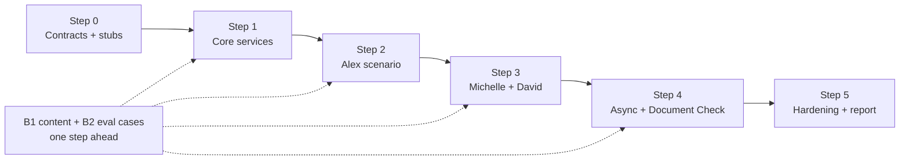

# DemoBank delivery plan

Status: **proposal**. How the team builds the design in [system-architecture.md](system-architecture.md), [knowledge-base-design.md](knowledge-base-design.md) and [user-story-mapping.md](user-story-mapping.md). Team: three developers (D1–D3) and two business members (B1–B2). Dates are not set yet; steps are in order, and steps on the same row run in parallel.

## 1. Approach

- **Scoped ownership.** Each developer owns one persona end to end plus one shared platform piece, so everyone builds at least one AI agent with its own prompt, some backend and some UI.
- **Vertical slices.** Each step ends in something that works and can be demonstrated.
- **Contracts first.** The shared Pydantic contracts and stub functions are agreed in Step 0, so all three developers can work in parallel from the start.
- **Business one slice ahead.** Content and evaluation cases for the next step are ready before developers start it.

## 2. Effort sizing

Relative points (1 = small); used only to balance the work, not as time estimates.

| Work item | Points | Difficulty |
|---|---|---|
| Orchestrator (LangGraph: plan, prioritise, dispatch, compose, pause/resume) | 8 | Hard |
| Knowledge base (keyword RAG, fact table, retrieval evaluation) | 3 | Medium |
| Document Check agent (OCR, legibility, rules) | 5 | Medium–hard |
| Everyday Banking + Fraud & Security agents | 5 | Medium |
| Action Service (`run_action()`, `cards.py`, `handoffs.py`, confirm endpoint) | 5 | Medium |
| Customer Data + Authorisation (`decide()`), RLS, synthetic seed | 5 | Medium |
| Worker + Notification + Realtime inbox | 5 | Medium |
| Response Validator (sections, receipts, facts) | 3 | Medium |
| Compliance Review agent | 3 | Medium |
| Relationship agent | 3 | Medium |
| Appointments + records executors | 3 | Medium |
| Chat UI: sections, sources, confirm dialog | 3 | Easy–medium |
| Michelle UI (upload, checklist) | 3 | Easy–medium |
| David UI (slots, consent, agenda) | 3 | Easy–medium |
| Audit Log | 2 | Easy |
| Compliance tables + seed | 2 | Easy |
| CR6 reminder job | 2 | Easy |

## 3. Scoped ownership

| | **D1: Alex + conversation core** | **D2: Michelle + knowledge** | **D3: David + platform services** |
|---|---|---|---|
| **Persona scope** | EB2–EB7: Everyday Banking + Fraud & Security agents (5) | CR1, CR2, CR4, CR6: Compliance Review agent (3), Document Check agent (5), compliance tables (2) | RC1–RC4: Relationship agent (3), appointments + records executors (3) |
| **Shared piece** | Orchestrator (8), Response Validator (3), Audit Log (2) | Knowledge base, keyword RAG (3), CR6 reminder job (2) | Customer Data + Authorisation (5), Action Service (5), Worker + Notification (3) |
| **UI** | Chat UI: sections, sources, confirm dialog (3) | Upload + checklist (3) | Slots, consent, agenda (3) |
| **Total** | **~21** | **~18** | **~22** |
| **Folders owned** | `services/orchestrator/`, `services/agents/everyday*`, `services/agents/fraud*`, `source_checks.py`, `frontend/src/Chat.jsx` and chat components | `services/knowledge.py`, `services/agents/compliance*`, `services/agents/document*`, compliance UI components | `services/customer_data.py`, `services/authorisation.py`, `services/actions/`, `services/notifications.py`, `app/worker.py`, `backend/supabase/` conventions, relationship UI components |

| | **B1: content** | **B2: quality** |
|---|---|---|
| **Pairs with** | D2 (knowledge base) | D1 (evaluation of the core flow) |
| **Owns** | Knowledge articles and sections, fact values, templates, synthetic persona data spec | Acceptance criteria, evaluation cases, UAT walkthroughs, backlog, report evidence |

Why this split is balanced:
- The hardest item (Orchestrator) sits with the persona that needs it most: Alex's multi-issue message. D1 has no knowledge-base or data-layer work to make up for it.
- D3's platform pieces are medium difficulty but many; the Relationship agent is the simplest agent.
- D2 carries the medium–hard Document Check agent and the knowledge base, but no orchestration.

## 4. Step by step

### Step 0: Foundation (everyone, must finish before parallel work)

| Owner | Task | Output |
|---|---|---|
| D1 + D2 + D3 | Contracts from architecture §4 as Pydantic models: `RequestContext`, `RiskAssessment`, `TaskPlan`, `AgentResult`, `ActionCommand` / `Receipt`, SSE events (`sections`, `action_required`) | `backend/app/schemas/`, one PR reviewed by all three |
| D3 | Folder layout and stub functions with the agreed signatures (`kb.search()`, `customer_data.get_*()`, `run_action()`, `decide()`) returning fixed sample values | Everyone codes against the stubs from day 1 |
| D3 | Migration number ranges per developer | Line in README |
| D1 | Feature flag `PIPELINE=v1\|v2`; today's `make_answer` keeps working | Demo never breaks during the rebuild |
| D1 | LangGraph spike: pause and resume from a checkpoint | Risk checked before Step 2 |
| D2 + B1 | Content template (spreadsheet or Markdown) with columns matching `kb.articles`, `kb.sections`, `kb.facts` | B1 can write content without SQL |
| B1 + B2 | Synthetic data spec for Alex, Michelle and David (accounts, cards, the $2,400 charge, pending transfer, compliance case, RM) | Seed spec for D3 |
| B2 | Acceptance criteria per story in testable form | Checklist reused in every step |

Stubs exist only so developers can work in parallel. They never replace the real AI client, and browser model checks still use the real provider (AGENTS.md).

### Step 1: Core services

| Owner | Task |
|---|---|
| D1 | Orchestrator skeleton on stubs: plan → prioritise → dispatch → compose for one task |
| D2 | `kb` migration (3 tables, read-only RLS, keyword `kb.search()`), `knowledge.py` client; load B1's Alex content as a migration |
| D3 | Synthetic seed for the three personas; Customer Data Service (reads, masking, RLS); `decide()`; Audit table ready for D1 |
| B1 | Alex's articles as sections (knowledge-requirements.md) + fact values |
| B2 | Retrieval evaluation cases: 2–3 informal or misspelled rewrites per question + `expected_article` |

**Done when:** EB2, EB4 and EB6 answer with section citations from the hosted knowledge base.

### Step 2: Alex's multi-issue scenario

| Owner | Task |
|---|---|
| D1 | Everyday Banking + Fraud & Security agents and prompts (new `vN` dirs + prompt-log); multi-task dispatch; pause/resume on confirmation; Response Validator for sections, receipts and facts; chat sections + confirm dialog |
| D2 | Retrieval evaluation (hit rate, MRR, no-match); fix misses by improving section wording; tune `k`; support D1 with the knowledge integration |
| D3 | `run_action()` + `cards.py` + `handoffs.py`; `POST /commands/{id}/confirm`; RLS tests |
| B1 | Fraud playbook wording, replacement-card article, disclaimer templates; start Michelle's content |
| B2 | Multi-intent and priority eval cases; Alex UAT walkthrough |

**Done when:** Alex's message passes all seven success criteria in user-story-mapping.md §5, live; the retrieval comparison table exists.

### Step 3: Persona slices (in parallel)

| Owner | Task |
|---|---|
| D1 | Alex edge cases: EB7 rewrites, F7 follow-ups; Audit Log wiring across modules |
| D2 | Compliance Review agent; compliance tables + seed; upload + checklist UI |
| D3 | Relationship agent; `appointments.py`, `records.py`; slots, consent and agenda UI |
| B1 | Michelle's compliance articles and Document Check rules; David's RM wording, meeting formats, request types |
| B2 | CR1, CR2, CR4 and RC1–RC4 eval cases; Michelle and David UAT walkthroughs |

**Done when:** Michelle's checklist/status questions and David's consent → share → book flow work live.

### Step 4: Async features and Document Check

| Owner | Task |
|---|---|
| D1 | Worker-started system turns in the Orchestrator (RC1 "your RM changed") |
| D2 | Document Check agent (`docs.precheck`, OCR, rules); CR6 reminder job |
| D3 | Background Worker (outbox poller, rules), Notification Service, Realtime inbox UI; `RUN_WORKER_IN_API=true` |
| B1 | Notification templates |
| B2 | CR2 and CR6 tests; card-blocked notification check |

**Done when:** a card block produces an inbox notification, a review deadline produces a reminder, and an upload gets a preliminary check in the same chat.

### Step 5: Hardening and report

| Owner | Task |
|---|---|
| D1 | Playwright e2e for Alex's scenario; full live evaluation run; prompt-log entries |
| D2 | Playwright e2e for Michelle's scenario; final retrieval evaluation |
| D3 | Playwright e2e for David's scenario; RLS and audit-trail checks |
| B1 | Final content review: `checked_on` / `review_due` dates, allowed domains |
| B2 | Results review, demo script, report evidence (retrieval table, scenario pass rates, failure modes) |

## 5. Dependencies

| Dependency | Mitigation |
|---|---|
| D1 needs D3's Customer Data and Action Service by Step 2 | D3 builds platform pieces first and David's features later; D1 works on stubs until then |
| Everyone needs D2's knowledge base by Step 2 | D2 builds it in Step 1 |
| D3 is on the critical path in Steps 1–2 | If D3 falls behind, D2 takes the Audit Log or the synthetic seed |

## 6. Team working rules

1. Contracts change by PR only, reviewed by all three developers.
2. One owner per folder; others open a PR or ask the owner.
3. Short-lived feature branches and small PRs, merged at least every few days.
4. Weekly integration session: run the current step's scenario end to end, with B2 checking the acceptance criteria.
5. Content goes through D2: B1 fills in the template, D2 turns it into a migration. Only migrations change content.
6. Today's pipeline stays working behind `PIPELINE=v1` until Step 2 passes.

## 7. Risks

| Risk | Checked in | Owner |
|---|---|---|
| LangGraph pause/resume harder than expected | Step 0 spike | D1 |
| Supabase free tier pauses when idle | Before every demo and eval run | D3 |
| OCR quality too low for Document Check | Start of Step 4 | D2 |
| Running out of time | Any step | All: Step 4 (worker, Document Check) is the first to cut or describe as future work |
