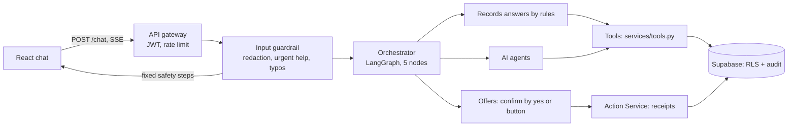
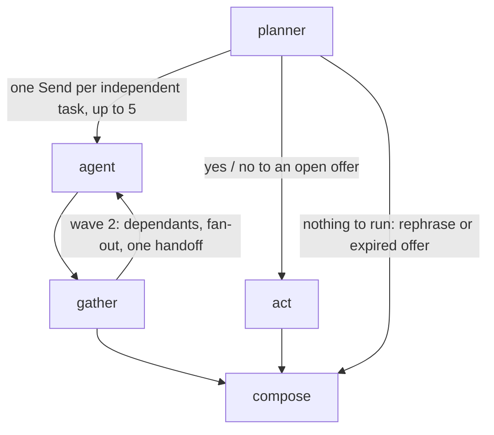
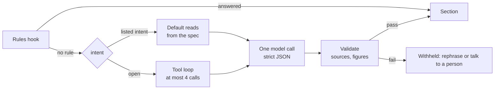

# How the agents run

One page for the team: what happens when a client sends a message, which agent or rule answers, and how actions and tickets fit in. Code is under `backend/app/`. The system overview is in [architecture.md](architecture.md).

## 1. The request path

The guardrail runs first and never calls the model. Lost card and pasted secrets get fixed safety wording (signed in, a lost card also offers one urgent request to her RM); "talk to a person" shows the RM preview. Urgent words are matched on a typo-tolerant copy (`services/typos.py`), so "i lsot my crad" is still a lost card.

After the `answer` event of a new reply in a signed-in saved chat, `/chat` runs one background step with her JWT: talking points lane 1 (`services/talking_points.after_reply`, 0108). It never changes the reply. A care signal pauses topic suggestions; otherwise, only while her consent covers chat topics and a code pre-filter passes, one `talking_points/v1` call classifies her redacted message, and code keeps list values plus her exact quote (hers only) for her RM's meeting topics.

## 2. The orchestrator graph (`services/orchestrator.py`)

There is no checkpointer and no paused turn: an offer is saved on the Action Service and her next message (a typed yes or no, or the offer button) confirms or cancels it.

| # | Node | What it does | Model? |
|---|---|---|---|
| 1 | `planner` | Rules first: an open offer plus a whole short yes/no (or the `offer` button) goes to `act`; a "yes" after an expired offer gets a fixed line; a reply to our own question (which card, card limit, meeting time, RM preview choice) goes back to that agent; a selected record goes to Compliance; a charge she doesn't recognise or a lost card becomes the urgent card task (fixed steps by code, never the model); login, OTP and phishing wording go to Guide; an explicit RM request goes to Relationship; greetings go to Guide. Otherwise one `planner/v9` call returns up to 5 tasks (agent + intent from `registry.SPECS`, or `open`; a task may depend on an earlier one). Then the rule overrides (urgent card → P0, login → Guide, RM handover) and the plan check (`checked`: guests get Guide only, every task planned for a personal agent merged into one Guide task; unknown intents fixed; entities bounded; an Accounts task is told when Relationship also has a task, so it drops its fee-waiver hint; `linked`: a dependency the specs do not declare is dropped with a fixed line). If the planner fails and no rule matched, a fixed rephrase line | Yes, unless a rule decides |
| 2 | `agent` | `runner.run_agent` for one task, in parallel with the others, within `AGENT_TIMEOUT_S`. History is the client's last 3 redacted messages (the task's own question when one message held several issues); assistant text only for a reply to our own question. An urgent card task is answered in the node by `urgent_output` (no runner, no model) | Inside agents |
| 3 | `gather` | After wave 1, once: the dependent tasks with only the exports they import (computed by code, `agents/derived.py`), skipped with a fixed line when their condition is false or unknown; at most 5 per list export ("first 5 of N"); an `out_of_scope` task handed once to an agent in its spec's `hands_to`, question only. After wave 2 it goes to `compose` | No |
| 4 | `act` | Confirm or cancel the open offer group in order (`offers.confirm` / `cancel`); SQL checks owner, expiry and order, and a double confirm records once; a chained step receives the earlier receipt, and is not run when the earlier one fails. Fixed outcome lines quote the receipt or ticket reference | No |
| 5 | `compose` | Sections in priority order (P0 urgent card, P2 compliance deadline or RM handover, P3 the rest), the agents' offers saved as one group with "Reply yes to confirm", fixed lines last. With no other offer in a saved chat, a rule may add one *Let your RM know* (`insight.share`) offer (talking points lane 2, 0108). `/chat` streams a `plan` event after the planner (task ids, domains, priorities: the UI shows a placeholder per task), a `section` event as each agent finishes (filling its placeholder), then the `answer` (with `offer`: the UI shows one Confirm and one Cancel) | No |

## 3. Who answers what

| Agent | Rules first (no model, `agents/rules.py`) | Model answer | Prompt |
|---|---|---|---|
| `guide` | `client_guidance` (signed in) | Public products, fees, how-to, greetings, sign-in/OTP help, phishing; guests get only this agent (plus the fixed urgent card steps) | `guide/v2` + `runner_common/v2` |
| `accounts` | `card_answers.py` (balance, limit, minimum payment, due date, annual fee, which card, card limit guidance), `transaction_answers.py`, `account_answers.py` | Transfers and due-day checks (`retail_checks`) on the released `retail/v10`; everything else on the runner | `accounts/v1` + `runner_common/v2`, `retail/v10` |
| `compliance` | Pre-check rules (`document_templates.py`); selected document → document responder | Review status, requests, deadlines, document findings | `compliance/v5`, `document/v5` |
| `relationship` | RM handover (preview, then her choice), request status from her tickets, `consent_answers.py` (consent v2: share with a scope and an end, stop sharing, delete a topic, each one offer from her records), `meeting_answers.py` (meeting request drafts, with optional "share until this request is answered" switches); the urgent card task (fixed steps and one urgent RM request, `orchestrator.urgent_output`) | RM, requests, meetings, data sharing | `relationship/v7` |

The rules call the v4 responders under their v4 names (`retail`, `compliance`, `document`, `relationship`), so their audits and allow-lists are unchanged; Guide, Accounts & Cards and the RM agents are enforced from their specs. There is no Security agent since build plan 2b.

## 4. Inside one AI agent (`services/agents/runner.py`)

Reads use the caller's JWT and RLS through `services/tools.py`, shaped to the spec's field view (last 4 digits, no `customer_id`). An agent may also return offers (`OfferProposal`), which `compose` saves; nothing runs until she confirms.

## 5. Multi-turn conversation

- Each turn carries the chat history (saved chats: server's redacted history, about 29 messages); the planner and agents receive it.
- A yes or no answers the one open offer in the chat (no need to read the previous reply). For our own questions (which card, meeting time, RM preview), the planner's rules read the previous reply to know what is being answered (§2 node 1), and only that agent gets the full history.
- Corrections: the card limit request uses the latest amount she stated (`ticketData.limitSummary`).
- The fixed reply phrases these rules look for are pinned by tests (`test_card_answers.py`, `test_fraud_confirmation.py`, `test_rm_handover.py`; native `test_card_dispute.py` for the urgent ticket).

## 6. Confirm-first and tickets

| Journey | Her choice | Result |
|---|---|---|
| RM matter | Send to my RM / Add to TCK-… / Open a new request / Cancel | `rm_handover` ticket; same topic adds to the open one (`customer_ticket_follow_up`); different topic opens a new one, even in the same chat (`customer_open_rm_ticket`) |
| Unrecognised charge | Confirm, or a typed yes | Urgent `rm_handover` ticket to her RM (P0 `general_support` handoff, topic *Urgent card*), from the saved offer |
| Lost card | Confirm, or a typed yes | The same urgent RM ticket; an open urgent lost-card request is quoted instead |
| Meeting | Confirm the drafted request, with any switches she turned on | `meeting.request` (her RM accepts a time, proposes another or declines in the workspace); no ticket. Each category she does not share yet is a switch under the request (`consent.grant` until the request is answered, chained after it); switches are off unless she turns them on, a typed yes sends the request only, and a left-off switch is recorded as her no without stopping the rest (`offer_group_confirm(group, include)`, 0114) |
| Data sharing in chat (6e) | Confirm, or a typed yes | "Share my chat topics with Sophie for 3 months" → `consent.grant` with a scope and an end (every account and 6 months, or the topic areas she named; the date, period or meeting she named, at most 12 months, else 3 months); "stop sharing my transactions" → `consent.revoke` of her grant, with what changes at once; "delete the home loan topic" → `insight.delete` (Undo for 7 days on Data sharing). A rule plans it (`orchestrator.fixed_task`, `consent_answers.wanted`); questions about sharing and shares with anyone but her RM are left to `relationship/v7`, which never claims a change |
| Let her RM know (0108) | *Let her know* / *Not now*, or a typed yes | `insight.share`: a confirmed topic line (list values only) on her RM's Today, with a notice that names no topic. `compose` adds it by rule (`talking_points.share_offer`) only when the reply has no other offer and her message names a topic and a plan in her own words; no model, no care flag, mute, pause, 30-day repeat or open meeting request on that topic |
| Card limit | Raise a card limit request (form) | `card_limit_change` ticket for the cards and credit team |

What the RM receives: topic, her question, up to three earlier messages (redacted, never the assistant's replies), her open requests with status, and the selected document as an attachment (0082). If sending fails, she's told nothing was sent and offered Talk to a person. For an urgent card request: the topic, what happened, her cards (last 4 and status) and her own redacted words.

**Talk to a person** (header): routes by topic; for RM topics it shows a drafted message she can edit before sending.

## 7. Tools

Agents and rules read through `services/tools.py` (`my_cards`, `my_transactions`, `my_tickets`, `free_slots`, `knowledge_search`, …). `TOOL_TRANSPORT=direct` is the **default**; `mcp` sends the same calls through `app/mcp_server.py`. Every tool checks policy (`require_permission`), uses the caller's JWT and writes audit events. All tools are read-only; changes go through the Action Service.

## 8. Worked example: Michelle raises her card limit

1. "i wan to raise my card limit to 15000" → the planner sends it to Accounts & Cards.
2. `card_answers.limit_change` answers without the model: the cards and credit team decides, no guarantee, with **Raise a card limit request**.
3. "actually make it 12000" → the button's form now says "Requested new limit: SGD 12,000 (corrected from SGD 15,000)".
4. She completes the form and confirms; SQL checks the card is hers and records the ticket, receipt, audit and inbox notice in one transaction.
5. My requests shows the reference and "the cards and credit team decides".

## 9. RM side (Persona 2)

Since build plan phase 9, Sophie's assistant runs on the same kind of graph as the client side (`services/rm/graph.py`): `planner` → `agent` (Send ×N) → `gather` → [`agent` wave 2 → `gather` →] `compose`. Since build plan 3a there are three RM agents, split by the data they read (`registry.RM_SPECS`): **Client** (`rm_client`: profiles, meeting notes, reviews, book facts and what a client shared under consent: transaction insights, chat topics, large movements, the handover note), **Requests** (`rm_requests`: tickets, follow-ups, request types and guidance; drafts, documentation and follow-up actions) and **Calendar** (`rm_calendar`: appointments, her availability and clients' meeting requests). Each RM data tool has one owner (`registry.RM_OWNER`); Requests reads a client's profile, notes, availability and appointments only as fixed reads for its drafts (`registry.BORROWED`), and no agent but Client can read consent-gated data, so a draft never carries transaction content. A verified `rm` login reaches it through `POST /rm/assistant`; a client never does. The planner first runs a SQL book check on names in her message (outside the book: refused and audited, no model), then takes a workspace button's intent or asks `rm_planner/v5` for up to 5 tasks; each intent belongs to one agent, and an `open` task names the agent whose records answer it. Each agent resolves the client, ticket, meeting or note (asking when several match), then runs its intent's handler (`services/rm/handlers.py`): the RM tools read the records with the agent's own context, so it can call only its spec's tools; one model call (`rm_assistant/v5` + task file) writes a structured answer, and `services/rm/checks.py` withholds any item whose figures, dates or references are not in its records, or that advises, decides or claims an action. A consent-gated read takes its purpose (`client_view` or `meeting_prep`) from the intent, never from a model; without consent the record says so and the answer states the gap. An `open` question runs the same bounded loop as a client agent (`runner.loop`, at most `AGENT_TOOL_CALLS` reads, each step a `loop_step` span): the step names clients as in her book and code resolves them, records written by people are shown to the step only as id and title, and a loop that reaches the limit says it could not answer fully. The Calendar's answer to a meeting request (accept one of the client's times, propose a free time, decline with a reason) and a change to her availability (block, open again, weekly hours) are cards built from the records without a model; she approves each through the Schedule page's routes. Four links are declared: reviews due → one draft per client (`clients_due`, at most 5), a brief → follow-ups from its latest note (`latest_note`), a handover brief → the client's shared note only under consent (`consent_active`; quoted from the record, no model), and reviews due → an `open` Requests task that checks those clients' tickets (`reviews_due`). Drafts, documentation, tasks, service requests and Calendar cards are proposals; each write is a separate request the RM approves in the workspace.

Since build plan 3b, Sophie's day has one ranking, computed by code (`services/rm/priority.py`): her requests, meeting requests to answer, reviews due within 14 days, meetings in the next 7 days, her tasks and milestones each get points from six factors (urgent 50, past target or overdue 30, respond-by passed 30, review due within 14 days 20, meeting within 2 days 20, 1 a day waiting up to 10) and carry those points as score parts (factor code, points, reason); ties go to the earlier date, then the kind, the client and the key. The model only explains the parts, and code puts its items back in rank order (`handlers.in_rank_order`). The `today` intent (Requests; the *Plan my day* button or `rm_planner/v5`) reads her tickets and follow-ups and gets the rest from the other agents: the planner adds hidden feed tasks by code (`graph.FEEDS`, `with_feeds`: Calendar `schedule` and `meeting_requests`, Client `reviews`; fixed reads, no model, left out of the reply) and links them with `depends_on` plus `PlanTask.inputs_from`, so `gather` passes `meetings_next_7d`, `requests_to_answer` and `reviews_due` (ids, dates and codes, never a client's words) to the one `today` task. `priorities` uses the same score with a `meeting_requests` feed. The Today page reads the same ranking from `GET /rm/priorities` and shows each item's parts as its reasons; it never scores. See [workflow-2-relationship-manager.md](workflows/workflow-2-relationship-manager.md).
