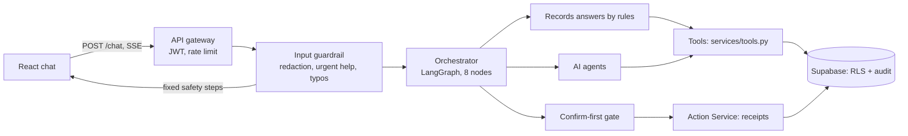
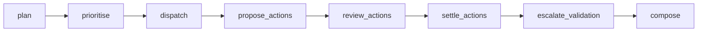
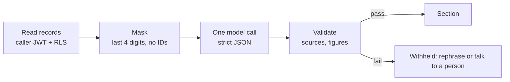

# How the agents run

One page for the team: what happens when a client sends a message, which agent or rule answers, and how actions and tickets fit in. Code is under `backend/app/`. The system overview is in [architecture.md](architecture.md).

## 1. The request path

The guardrail runs first and never calls the model. Lost card and pasted secrets get fixed safety wording; "talk to a person" shows the RM preview. Urgent words are matched on a typo-tolerant copy (`services/typos.py`), so "i lsot my crad" is still a lost card.

## 2. The orchestrator graph (`services/orchestrator.py`)

| # | Node | What it does | Model? |
|---|---|---|---|
| 1 | `plan` | If her message answers a pending question (fraud yes/no, lost card yes/no, RM preview choice, which card, meeting time), routes it straight back to that flow. Otherwise rules route clear questions (`simple_issue`, on the typo-tolerant copy); only unclear or multi-topic messages go to the planner | Only when rules can't decide |
| 2 | `prioritise` | P0 fraud, P1 security, P2 compliance deadline, P3 the rest. Marks RM matters (`rm_handover.needs_person`) as `handover`. Builds confirmation tasks for pending answers | No |
| 3 | `dispatch` | Runs tasks in parallel with timeouts. Each agent first tries **records answers by rules**, then makes one model call if needed. A confirmed lost-card report runs here | Inside agents |
| 4–5 | `propose_actions`, `review_actions` | Kept for older saved turns; chat no longer proposes card blocks (0081) | No |
| 6 | `settle_actions` | Fraud: lists the charges for her to confirm (`ask_to_confirm`); after "Yes, report it", records the urgent fraud ticket (`report_to_fraud_team`) | No |
| 7 | `escalate_validation` | RM matters: shows the **preview**, then carries out her choice. Withheld answers get "try asking differently or talk to a person", with **no ticket** (`VALIDATION_HANDOFF=1` restores the old behaviour for tests) | No |
| 8 | `compose` | One reply in priority order, with sources and page buttons | No |

## 3. Who answers what

| Domain | Rules first (no model) | AI agent | Prompt |
|---|---|---|---|
| `retail` | `card_answers.py`: balance, limit, minimum payment, due date, annual fee, which card, follow-ups, card limit guidance. `transaction_answers.py`: recent transactions, fees, charge by amount/date | Explanations from articles and records | `retail/v7` |
| `fraud` | `fraud_reports.py`: charge list to confirm, confirmed report, lost-card report | Urgent steps and description of the charge | `fraud/v7` |
| `compliance` | — | Review status, requests, deadlines | `compliance/v3` |
| `document` | Pre-check rules (`document_templates.py`), incl. certification and translation | Explains recorded findings | `document/v4` |
| `relationship` | `meeting_answers.py`: free times, hold, confirm | RM introduction and requests | `relationship/v5` |

Guests use the shared answer agent with approved articles only. Rules exist where a wrong or withheld answer would hurt most (figures, urgent help, bookings); everything else is the AI.

## 4. Inside one AI agent

## 5. Multi-turn conversation

- Each turn carries the chat history (saved chats: server's redacted history, about 29 messages); the planner and agents receive it.
- When the assistant asked something, the next turn reads the assistant's **own previous reply** to know what is being answered (§2 node 1). Only that reply counts, and only if her message is about it, so a new topic is never mixed with the old one.
- Corrections: the card limit request uses the latest amount she stated (`ticketData.limitSummary`).
- The fixed reply phrases these rules look for are pinned by tests (`test_card_answers.py`, `test_fraud_confirmation.py`, `test_rm_handover.py`).

## 6. Confirm-first and tickets

| Journey | Her choice | Result |
|---|---|---|
| RM matter | Send to my RM / Add to TCK-… / Open a new request / Cancel | `rm_handover` ticket; same topic adds to the open one (`customer_ticket_follow_up`); different topic opens a new one, even in the same chat (`customer_open_rm_ticket`) |
| Unrecognised charge | Yes, report it | Urgent `suspected_fraud` ticket |
| Lost card | Yes, report my card | Urgent `card_lost` ticket |
| Meeting | Book … → Confirm booking | `appointment.hold` → `appointment.confirm`; no ticket |
| Card limit | Raise a card limit request (form) | `card_limit_change` ticket for the cards and credit team |

What the RM receives: topic, her question, up to three earlier messages (redacted, never the assistant's replies), her open requests with status, and the selected document as an attachment (0082). If sending fails, she's told nothing was sent and offered Talk to a person.

**Talk to a person** (header): routes by topic; for RM topics it shows a drafted message she can edit before sending.

## 7. Tools

Agents and rules read through `services/tools.py` (`my_cards`, `my_transactions`, `my_tickets`, `free_slots`, `knowledge_search`, …). `TOOL_TRANSPORT=direct` is the **default**; `mcp` sends the same calls through `app/mcp_server.py`. Every tool checks policy (`require_permission`), uses the caller's JWT and writes audit events. All tools are read-only; changes go through the Action Service.

## 8. Worked example: Michelle raises her card limit

1. "i wan to raise my card limit to 15000" → rules route to `retail`.
2. `card_answers.limit_change` answers without the model: the cards and credit team decides, no guarantee, with **Raise a card limit request**.
3. "actually make it 12000" → the button's form now says "Requested new limit: SGD 12,000 (corrected from SGD 15,000)".
4. She completes the form and confirms; SQL checks the card is hers and records the ticket, receipt, audit and inbox notice in one transaction.
5. My requests shows the reference and "the cards and credit team decides".

## 9. RM side today

The RM assistant (RM1–RM16) is not built. RM tickets and meetings sit in the same records an RM screen will read. Fraud and support handoffs are worked with `scripts/staff_support.py`; an RM ticket can be answered with `support.set_ticket_status('TCK-…','resolved','…')`.