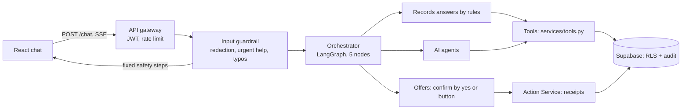
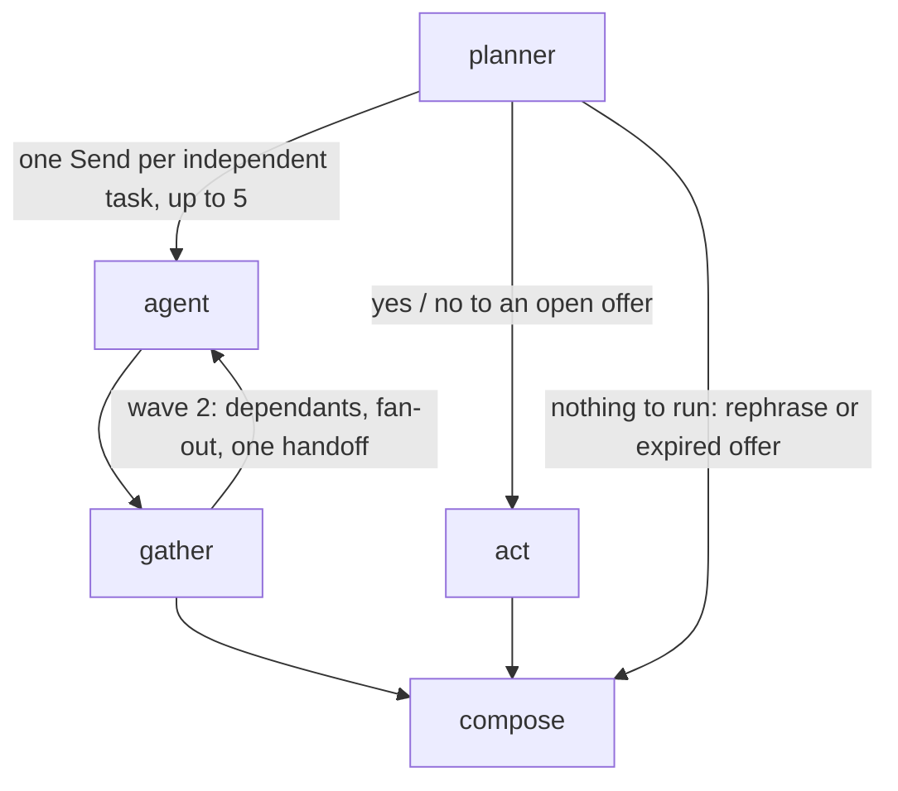
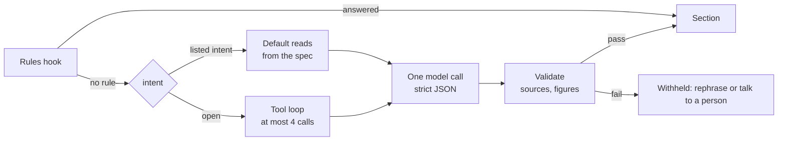

# How the agents run

One page for the team: what happens when a client sends a message, which agent or rule answers, and how actions and tickets fit in. Code is under `backend/app/`. The system overview is in [architecture.md](architecture.md).

## 1. The request path

The guardrail runs first and never calls the model. Lost card and pasted secrets get fixed safety wording (a lost card also offers an urgent report); "talk to a person" shows the RM preview. Urgent words are matched on a typo-tolerant copy (`services/typos.py`), so "i lsot my crad" is still a lost card.

## 2. The orchestrator graph (`services/orchestrator.py`)

There is no checkpointer and no paused turn: an offer is saved on the Action Service and her next message (a typed yes or no, or the offer button) confirms or cancels it.

| # | Node | What it does | Model? |
|---|---|---|---|
| 1 | `planner` | Rules first: an open offer plus a whole short yes/no (or the `offer` button) goes to `act`; a "yes" after an expired offer gets a fixed line; a reply to our own question (which card, card limit, meeting time, RM preview choice) goes back to that agent; a selected record goes to Compliance; fraud and login wording go to Security; an explicit RM request goes to Relationship; greetings go to Guide. Otherwise one `planner/v7` call returns up to 5 tasks (agent + intent from `registry.SPECS`, or `open`; a task may depend on an earlier one). Then the rule overrides (fraud → Security P0, login → Security P1, RM handover) and the plan check (`checked`: guests get Guide only; unknown intents fixed; entities bounded; `linked`: a dependency the specs do not declare is dropped with a fixed line). If the planner fails and no rule matched, a fixed rephrase line | Yes, unless a rule decides |
| 2 | `agent` | `runner.run_agent` for one task, in parallel with the others, within `AGENT_TIMEOUT_S`. History is the client's last 3 redacted messages (the task's own question when one message held several issues); assistant text only for a reply to our own question | Inside agents |
| 3 | `gather` | After wave 1, once: the dependent tasks with only the exports they import (computed by code, `agents/derived.py`), skipped with a fixed line when their condition is false or unknown; at most 5 per list export ("first 5 of N"); an `out_of_scope` task handed once to an agent in its spec's `hands_to`, question only. After wave 2 it goes to `compose` | No |
| 4 | `act` | Confirm or cancel the open offer group in order (`offers.confirm` / `cancel`); SQL checks owner, expiry and order, and a double confirm records once; a chained step receives the earlier receipt, and is not run when the earlier one fails. Fixed outcome lines quote the receipt or ticket reference | No |
| 5 | `compose` | Sections in priority order (P0 fraud, P1 login, P2 compliance deadline, P3 the rest), the agents' offers saved as one group with "Reply yes to confirm", fixed lines last. `/chat` streams a `plan` event after the planner (task ids, domains, priorities: the UI shows a placeholder per task), a `section` event as each agent finishes (filling its placeholder), then the `answer` (with `offer`: the UI shows one Confirm and one Cancel) | No |

## 3. Who answers what

| Agent | Rules first (no model, `agents/rules.py`) | Model answer | Prompt |
|---|---|---|---|
| `guide` | `client_guidance` (signed in) | Public products, fees, how-to, greetings; guests get only this agent | `guide/v1` |
| `accounts` | `card_answers.py` (balance, limit, minimum payment, due date, annual fee, which card, card limit guidance), `transaction_answers.py`, `account_answers.py` | Transfers and due-day checks (`retail_checks`) on the released `retail/v10`; everything else on the runner | `accounts/v1`, `retail/v10` |
| `security` | Unrecognised charges: the released fraud responder lists the charges and offers the fraud-team report | Login, OTP, phishing | `security/v1`, `fraud/v7` |
| `compliance` | Pre-check rules (`document_templates.py`); selected document → document responder | Review status, requests, deadlines, document findings | `compliance/v5`, `document/v5` |
| `relationship` | RM handover (preview, then her choice), request status from her tickets, `meeting_answers.py` | RM, requests, meetings | `relationship/v5` |

The rules call the v4 responders under their v4 names (`retail`, `fraud`, `compliance`, `document`, `relationship`), so their audits and allow-lists are unchanged; Guide, Accounts & Cards and Security are enforced from their specs.

## 4. Inside one AI agent (`services/agents/runner.py`)

Reads use the caller's JWT and RLS through `services/tools.py`, shaped to the spec's field view (last 4 digits, no `customer_id`). An agent may also return offers (`OfferProposal`), which `compose` saves; nothing runs until she confirms.

## 5. Multi-turn conversation

- Each turn carries the chat history (saved chats: server's redacted history, about 29 messages); the planner and agents receive it.
- A yes or no answers the one open offer in the chat (no need to read the previous reply). For our own questions (which card, meeting time, RM preview), the planner's rules read the previous reply to know what is being answered (§2 node 1), and only that agent gets the full history.
- Corrections: the card limit request uses the latest amount she stated (`ticketData.limitSummary`).
- The fixed reply phrases these rules look for are pinned by tests (`test_card_answers.py`, `test_fraud_confirmation.py`, `test_rm_handover.py`).

## 6. Confirm-first and tickets

| Journey | Her choice | Result |
|---|---|---|
| RM matter | Send to my RM / Add to TCK-… / Open a new request / Cancel | `rm_handover` ticket; same topic adds to the open one (`customer_ticket_follow_up`); different topic opens a new one, even in the same chat (`customer_open_rm_ticket`) |
| Unrecognised charge | Yes (typed, or *Yes, report it*) | Urgent `suspected_fraud` ticket, from the saved offer |
| Lost card | Yes (typed, or *Yes, report my card*) | Urgent `card_lost` ticket, from the saved offer |
| Meeting | Book … → Confirm booking | `appointment.hold` → `appointment.confirm`; no ticket |
| Card limit | Raise a card limit request (form) | `card_limit_change` ticket for the cards and credit team |

What the RM receives: topic, her question, up to three earlier messages (redacted, never the assistant's replies), her open requests with status, and the selected document as an attachment (0082). If sending fails, she's told nothing was sent and offered Talk to a person.

**Talk to a person** (header): routes by topic; for RM topics it shows a drafted message she can edit before sending.

## 7. Tools

Agents and rules read through `services/tools.py` (`my_cards`, `my_transactions`, `my_tickets`, `free_slots`, `knowledge_search`, …). `TOOL_TRANSPORT=direct` is the **default**; `mcp` sends the same calls through `app/mcp_server.py`. Every tool checks policy (`require_permission`), uses the caller's JWT and writes audit events. All tools are read-only; changes go through the Action Service.

## 8. Worked example: Michelle raises her card limit

1. "i wan to raise my card limit to 15000" → the planner sends it to Accounts & Cards.
2. `card_answers.limit_change` answers without the model: the cards and credit team decides, no guarantee, with **Raise a card limit request**.
3. "actually make it 12000" → the button's form now says "Requested new limit: SGD 12,000 (corrected from SGD 15,000)".
4. She completes the form and confirms; SQL checks the card is hers and records the ticket, receipt, audit and inbox notice in one transaction.
5. My requests shows the reference and "the cards and credit team decides".

## 9. RM side (Persona 2)

Since build plan phase 9, Sophie's assistant runs on the same kind of graph as the client side (`services/rm/graph.py`): `planner` → `agent` (Send ×N) → `gather` → [`agent` wave 2 → `gather` →] `compose`, with the two RM agents, RM Client Insight and RM Service Desk (`registry.RM_SPECS`). A verified `rm` login reaches it through `POST /rm/assistant`; a client never does. The planner first runs a SQL book check on names in her message (outside the book: refused and audited, no model), then takes a workspace button's intent or asks `rm_planner/v3` for up to 5 tasks; each intent belongs to one agent. Each agent resolves the client, ticket, meeting or note (asking when several match), then runs its intent's handler (`services/rm/handlers.py`): the RM tools read the records with the agent's own context, so it can call only its spec's tools; one model call (`rm_assistant/v2` + task file) writes a structured answer, and `services/rm/checks.py` withholds any item whose figures, dates or references are not in its records, or that advises, decides or claims an action. Three links are declared: reviews due → one draft per client (`clients_due`, at most 5), a brief → follow-ups from its latest note (`latest_note`), a handover brief → the client's shared note only under consent (`consent_active`; quoted from the record, no model). Drafts, documentation, tasks and service requests are proposals; each write is a separate request the RM approves in the workspace. See [workflow-2-relationship-manager.md](workflows/workflow-2-relationship-manager.md).
