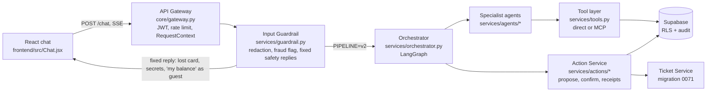
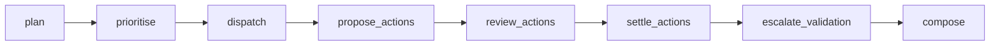
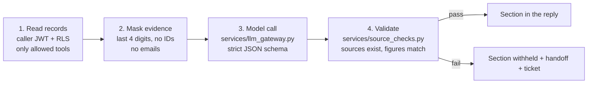
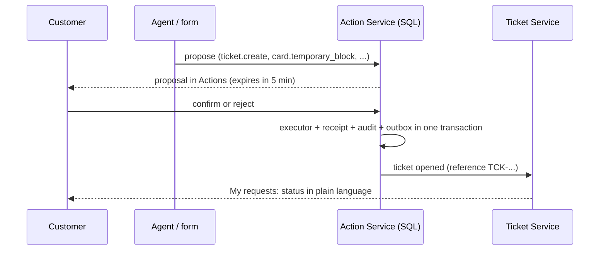

# How the agents are called

One page for the whole team: what happens, in order, when a customer sends a message, which agent runs, and how tools, actions and tickets fit in. Code paths are under `backend/app/`. The longer reference is [system-architecture.md](architecture.md).

## 1. The request path



The guardrail runs first and never calls the model. Safety-critical messages (lost card, a pasted password or OTP, "talk to a person", a guest asking about "my" account) get fixed wording and skip every agent.

## 2. The orchestrator graph (LangGraph, 8 nodes)

`build_graph()` in `services/orchestrator.py` wires these nodes in a straight line. Each node is a plain function you can read on its own.



| # | Node | What it does | Uses the model? |
|---|---|---|---|
| 1 | `plan` | Splits the message into issues. Clear single-topic English messages are planned by rules (`simple_issue`); anything else goes to the planner prompt (`prompts/planner/v2`), whose output is re-checked by rules (`route_issues`). | Only when rules cannot decide |
| 2 | `prioritise` | Turns issues into tasks with priorities: P0 fraud, P1 security/login, P2 compliance deadline, P3 the rest. A fraud flag from the guardrail always creates a P0 fraud task. Questions that need a person (advice, fee or rate requests, complaints, "talk to my RM"; rules in `services/rm_handover.py`) are marked `handover`. | No |
| 3 | `dispatch` | Runs every task's agent at the same time (`asyncio.TaskGroup`), each with its own timeout (`AGENT_TIMEOUT_S`). A failed agent only withholds its own section. A `handover` task skips the model and gets one polite fixed line. | Yes, inside each agent |
| 4 | `propose_actions` | Turns a fraud agent's suggestion into real proposals in the action ledger: temporary card block and, when charges are flagged, a dispute draft. Nothing changes yet. | No |
| 5 | `review_actions` | Pauses the graph (LangGraph `interrupt`) and saves a signed checkpoint. The customer decides in the chat card or in Actions. | No |
| 6 | `settle_actions` | Reads the recorded decisions and writes fixed wording ("blocked" only with a receipt). A successful block records a P0 handoff for fraud staff, which also opens a **ticket** (0071). | No |
| 7 | `escalate_validation` | **RM handover.** For each `handover` task, and each answer where the agent itself said a person is needed (`needs_human`), records a support handoff with the customer's redacted question. Migration 0073 turns it into an `rm_handover` ticket owned by the RM, and the reply quotes its `TCK-` reference. Withheld (failed-validation) sections share one handoff the same way. Guests are asked to sign in. | No |
| 8 | `compose` | Joins the sections in priority order with sources and the disclaimer. | No |

## 3. Which agent handles which task

`AGENT_FOR` in `services/agents/registry.py` maps the planned domain to an agent. `TOOLS` in the same file is each agent's allow-list; `services/authorization.py` refuses anything outside it.

| Domain | Agent | Prompt | Reads | Can propose |
|---|---|---|---|---|
| `retail` (and small talk) | Complex Banking (`agents/retail.py`) | `retail/v6` | profile, accounts, cards, loans, transactions, knowledge | nothing (answers only) |
| `fraud` | Fraud & Security (`agents/fraud.py`) | `fraud/v5` | cards, transactions (masked) | temporary block, dispute draft |
| `compliance` | Compliance Review (`agents/compliance.py`) | `compliance/v3` | review case, checklist, knowledge | checklist marks |
| `document` | Document Check (`agents/document.py`) | `document/v4` | the selected upload's pre-check | nothing |
| `relationship` | Relationship (`agents/relationship.py`) | `relationship/v5` | RM assignment, requests, slots, appointments | nothing; for a meeting it suggests free times and points to My requests → Meetings, where she books it herself |

Public (guest) questions use the shared answer agent (`agents/answer.py`) with approved knowledge only.

## 4. Inside one specialist agent

Every personal agent follows the same four steps, so a reviewer can check one and know them all:



The LLM Gateway is the only model client: per-agent versioned prompts (`app/prompts/<agent>/vN`), strict JSON output, timeouts, limited retries, a per-request token budget and one repair attempt with the validator's feedback. Released prompt versions are never edited; each new version has a note in `docs/prompt-log/`.

## 5. Tools and MCP (F25)

Agents and the orchestrator call tools through `services/tools.py`:

```python
found = await tools.call('knowledge_search', {'query': question, 'k': 4}, ctx)
```

- `TOOL_TRANSPORT=direct` (default): the tool function runs directly.
- `TOOL_TRANSPORT=mcp`: the same call is an MCP `tools/call` to the in-process server in `app/mcp_server.py` (needs `pip install './backend[mcp]'`).
- Either way, the tool itself checks policy (`require_permission`), uses the caller's JWT so RLS applies, and writes audit events. The model never chooses who the customer is.
- External MCP clients can use the same tools over stdio: `python -m scripts.mcp_server` (guest), or with `DEMOBANK_ACCESS_TOKEN` for a signed-in customer.

Tools today: `knowledge_search`, `request_categories`, `my_tickets`, `my_cards`, `my_transactions`. All are read-only; changes only happen through the Action Service.

## 6. Actions, decisions and tickets



- Agents only **propose**. Confirmation always comes from the signed-in customer (`run_action` refuses an agent confirmation).
- Request categories (F24, `support.request_categories`) say which fields are needed, which team owns it and **who decides**. The assistant never approves, rejects or predicts an outcome.
- Every support handoff and RM request automatically gets a ticket, so the customer always has a reference and a status (CR9/CR10). Staff change status; the bot never marks a ticket resolved.

## 7. Traceability and the audit trail (F28)

- Every request has a `request_id` that is carried to every node, agent, tool call and audit event.
- `audit.events` is append-only and hash-chained (migration 0005); `scripts/verify_audit.py` checks the chain.
- `python -m scripts.audit_walkthrough --case-id <id> --database-url ...` prints one case end to end (proposal → decision → receipt → ticket) for an administrator, with `--markdown` for slides. Customers can see their own case through `public.my_case_timeline`.

## 8. Worked example: Michelle asks for a higher card limit

1. "Can you increase my credit card limit to 30k for my Japan trip?" → guardrail: nothing to redact → `plan`: rules route it to `retail` (cards topic).
2. `dispatch`: the Complex Banking agent reads Michelle's own card (masked), retrieves `card-limit-change` guidance through the tool layer, drafts an answer, and the validator checks the sources.
3. The reply explains what is needed and that the cards and credit team decides. The chat shows **Raise a card limit request**.
4. My requests opens the category form (card, new limit, temporary/permanent, until, reason). Submitting proposes `ticket.create`; Michelle confirms the exact request in Actions.
5. SQL validates the fields and that card 7310 is hers, records the ticket (`TCK-...`), the receipt, the audit events and an inbox notice in one transaction.
6. My requests shows "Submitted — no action needed from you; the cards and credit team decides".

## 9. One client persona: what goes to the relationship manager (0073)

There is one client persona. The assistant answers what it can (accounts, cards, loans, compliance, documents) and hands the rest to the client's relationship manager:

1. `rm_handover.needs_person()` matches advice, product recommendations, fee/rate negotiation, complaints and "talk to my RM / call me back". The planner routes those to a `handover` task; the model is not called for it.
2. The reply says kindly that the assistant can't help with that part, then `escalate_validation` records `handoff.create` (`general_support`, the redacted question as summary). An answer where an agent set `needs_human` is handed over the same way.
3. The `support.ticket_for_handoff` trigger opens an **`rm_handover`** ticket owned by *Your relationship manager*. The assistant reads the ticket back (`customer_read_tickets` now returns `handoff_id`) and adds: "I've passed your question to your relationship manager. Your reference is TCK-…".
4. Typing "talk to a person", or using **Talk to a person**, also creates an RM handover. Fraud keeps its own P0 handoff to fraud operations.
5. The RM (or a teammate in the SQL editor) answers and moves the ticket: `select support.set_ticket_status('TCK-001003','resolved','Your RM replied by phone.');`. The client sees it in **My requests**.

## 10. Document checks by template (PRECHECK_MODE=template)

`services/document_templates.py` matches each requested item to a template by its own label and instructions, then checks the extracted text with fixed rules. There is no model call, so results are repeatable.

| Template | Must show | Rule |
|---|---|---|
| Proof of address (SG utility bill or bank statement) | name, SG address with 6-digit postal code, issuer, date ≤ 3 months old | name tokens, `Singapore 123456` or `S(123456)`, known utility/telco/bank, latest date not in the future |
| Bank statements | name, bank, each of the last 3 full months | months from "Jul 2026", full dates or "01 Jul 2026 – 30 Sep 2026" ranges |
| Source of wealth declaration | name, source of wealth, date, signature | keywords, any date, "signature/signed" |
| Tax residency self-certification | name, country of tax residence or TIN, date, signature | keywords, any date, "signature/signed" |
| Identity document | name, expiry date in the future | dates |

Items no template fits use the earlier model notice checks (`notice_checks.py`). `PRECHECK_MODE=notice` switches everything back. `GET /documents/templates` serves the list with a made-up example for the upload screen.
