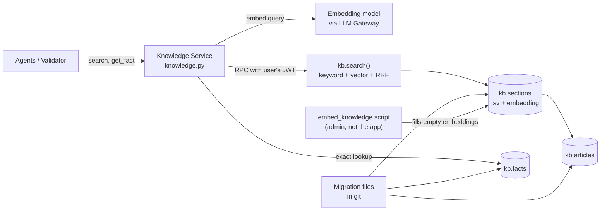

# DemoBank knowledge base design (hybrid RAG)

Status: **proposal**. Detailed design of the Knowledge Service in [system-architecture.md §5.7.1](system-architecture.md#571-knowledge-service). The content to load is listed in [knowledge-requirements.md](knowledge-requirements.md). Today's code still uses the in-memory keyword library in `backend/app/services/knowledge.py`; this document describes what replaces it.

## 1. Summary

- **Retrieval-augmented generation (RAG):** agents retrieve approved sections, and the LLM answers only from them, with citations.
- **Hybrid retrieval:** keyword (Postgres full-text) and semantic (pgvector) search run together and are merged with reciprocal rank fusion. Keyword search catches exact banking terms ("OTP", "GIRO", product names); vector search catches informal wording ("my app won't let me in").
- **No new infrastructure:** everything lives in the hosted Supabase Postgres that the app already uses. There is no separate vector database.
- **Three tables, one search function.** Audience (guest vs signed-in) is enforced by RLS.
- **No content workflow:** whatever is in the tables is live. Content changes arrive only through migrations.



## 2. Data model

| Table | One row is | Key columns |
|---|---|---|
| `kb.articles` | One topic, e.g. "Pending transfers" | `article_id`, `version`, `category`, `type`, `audience`, `title`, `summary`, source fields |
| `kb.sections` | One searchable part of an article, e.g. "What pending means" | `article_id`, `anchor`, `position`, `heading`, `body`, `tsv` (generated), `embedding`, `embedding_model` |
| `kb.facts` | One exact figure, e.g. a card's annual fee | `fact_id`, `value`, `unit`, `article_id` |

```sql
create schema kb;
create extension if not exists vector;

create table kb.articles (
  article_id text primary key,
  version int not null default 1,
  category text not null,          -- accounts, cards, loans, payments, security, support, compliance, relationship
  type text not null,              -- faq, how_to, troubleshooting, product
  audience text not null default 'public' check (audience in ('public', 'customer')),
  title text not null,
  summary text not null,
  publisher text not null default 'demobank',
  reference_url text, checked_on date, review_due date,
  check (publisher = 'demobank' or (reference_url is not null and checked_on is not null and review_due is not null)));

create table kb.sections (
  article_id text not null references kb.articles on delete cascade,
  anchor text not null,            -- stable id used in citations, e.g. 'check-status'
  position int not null,
  heading text not null,
  body text not null,
  tsv tsvector generated always as (to_tsvector('english', heading || ' ' || body)) stored,
  embedding vector(1536),          -- filled by the embed script; null until then
  embedding_model text,
  primary key (article_id, anchor));
create index on kb.sections using gin (tsv);
create index on kb.sections using hnsw (embedding vector_cosine_ops);

create table kb.facts (
  fact_id text primary key,        -- e.g. 'card.platinum.annual_fee'
  value numeric not null,
  unit text not null,              -- 'SGD', 'percent_pa', 'days'
  article_id text not null references kb.articles);
```

The allowed-domain rule for external publishers (`www.moneysense.gov.sg`, `www.abs.org.sg`) stays in the Python validator, where it already lives (`services/source_checks.py`).

## 3. Writing sections

A section is the unit the model sees and the unit a citation points to, so its shape matters more than the article's.

| Guideline | Why |
|---|---|
| One idea per section, roughly 50–300 words | Small enough to be precise, large enough to stand alone |
| Heading says what the section answers ("Why a transfer stays pending") | The heading is in both the keyword and the vector text |
| Steps as a numbered list inside one section | The agent can quote the steps in order |
| Figures only as a reference to a fact (`card.platinum.annual_fee`), not typed into the body | One place to change a fee; the Validator checks figures against `kb.facts` |
| Never mention a specific customer | Customer details come from Customer Data, not from knowledge |

Example: article `pending-transfers` (type `troubleshooting`, category `payments`, audience `public`):

| anchor | heading |
|---|---|
| `what-pending-means` | What a pending transfer means |
| `how-long` | How long transfers usually take |
| `check-status` | How to check a transfer's status |
| `avoid-duplicates` | Why you should not resend a pending transfer |
| `contact-bank` | When to contact the bank |

Citation format: `article_id@v<version>#anchor`, e.g. `pending-transfers@v2#avoid-duplicates`.

## 4. Hybrid search

### 4.1 Search function

Both searches run over the same filtered rows; each returns its top candidates by its own rank; reciprocal rank fusion (RRF) adds `1 / (rrf_k + rank)` from each list, so a section ranked high by either search comes out near the top, and one found by both ranks highest.

```sql
create function kb.search(
  q_text text, q_embedding vector(1536) default null, categories text[] default null,
  k int default 5, rrf_k int default 50, max_distance float default 0.6)
returns table (cite text, article_id text, title text, heading text, body text, score float)
language sql stable security invoker as $$
  with base as (
    select s.* from kb.sections s join kb.articles a using (article_id)
    where categories is null or a.category = any(categories)),
  kw as (
    select article_id, anchor,
           row_number() over (order by ts_rank_cd(tsv, websearch_to_tsquery('english', q_text)) desc) as r
    from base where tsv @@ websearch_to_tsquery('english', q_text)
    order by r limit k * 4),
  vec as (
    select article_id, anchor, row_number() over (order by embedding <=> q_embedding) as r
    from base
    where q_embedding is not null and embedding is not null and embedding <=> q_embedding < max_distance
    order by r limit k * 4),
  fused as (
    select article_id, anchor,
           coalesce(1.0 / (rrf_k + kw.r), 0) + coalesce(1.0 / (rrf_k + vec.r), 0) as score
    from kw full outer join vec using (article_id, anchor))
  select f.article_id || '@v' || a.version || '#' || f.anchor, f.article_id, a.title, s.heading, s.body, f.score
  from fused f join kb.sections s using (article_id, anchor) join kb.articles a using (article_id)
  order by f.score desc limit k $$;
```

| Parameter | Meaning |
|---|---|
| `q_embedding = null` | Keyword-only search (used when the embedding call fails, and for evaluation) |
| `max_distance` | Cosine distance cut-off so an unrelated question returns **nothing** instead of the "least bad" section; tuned with the evaluation set |
| `categories` | Agent scope, e.g. the Compliance Review agent searches `compliance` and `support` |
| `k`, `rrf_k` | Results returned; RRF smoothing constant (50–60 is the usual default) |

### 4.2 Audience through RLS

The function is `security invoker`, and the backend calls it as a Supabase RPC with the **user's JWT**, so RLS decides what each caller may see:

| Role | Can read |
|---|---|
| `anon` (guest) | `kb.articles` and `kb.sections` where the article's `audience = 'public'`; all `kb.facts` linked to public articles |
| `authenticated` (signed-in customer) | `public` and `customer` |
| Any app role | No insert, update or delete |

A guest cannot retrieve customer-only content even if the calling code is wrong. The `kb` schema must be added to the API's exposed schemas in Supabase, or the function wrapped as `public.kb_search`.

## 5. Knowledge Service (Python)

`backend/app/services/knowledge.py` becomes a thin client:

| Function | Does |
|---|---|
| `search(query, categories, k)` | Embeds the query, calls `kb.search`, returns `[{cite, title, heading, body, score}]`. Empty list means no approved content: the agent says so or hands off |
| `get_fact(fact_id)` | Exact lookup in `kb.facts`; never by similarity. Used by agents and by the Response Validator |
| `get_article(article_id)` | Article with its sections, for the sources panel (`GET /knowledge/{id}`) |

Behaviour rules:
- **Embedding failure:** search continues keyword-only (`q_embedding = null`); the trace records `kb.embedding_failed`. Answers are still generated only from retrieved sections, never from sample text.
- **Non-English queries:** the `english` full-text setting will not match; the vector side still may. Keep today's behaviour of using the small default library when nothing is retrieved.
- **Logging:** query text is never logged; traces record the number of results, the cites returned and the scores.

## 6. Embeddings

| Item | Choice |
|---|---|
| Model | A small embedding model, e.g. `text-embedding-3-small` (1536 dimensions). Check that the configured provider (OpenRouter) offers an embeddings endpoint; otherwise use a separate key for embeddings only |
| Text embedded | `title + heading + body` of each section |
| When sections are embedded | `python -m scripts.embed_knowledge` after each content migration: embeds every section whose `embedding` is null or whose `embedding_model` differs from the configured model |
| Script access | An admin database connection string from `.env`, used only by this script, never by the app or the browser, never committed |
| When queries are embedded | Once per `search()` call, through the LLM Gateway (adds roughly 100–300 ms) |
| Cost | About 150 sections; embedding all of them costs a fraction of a cent |

Changing the embedding model means updating the configured model name and re-running the script; the dimension in `vector(1536)` must match the model.

## 7. Content workflow

1. Write or edit articles and sections as a new migration file in `backend/supabase/migrations/` (e.g. `0005_knowledge_seed.sql`, then `0006_knowledge_cards_update.sql`).
2. Editing an existing article: bump its `version` (and `checked_on` / `review_due` for external sources).
3. Apply the migration to the hosted Supabase project.
4. Run `python -m scripts.embed_knowledge`.

**Migrations are the only way content changes.** The Supabase dashboard is for viewing. This keeps git and the live database identical, and makes evaluation runs reproducible.

## 8. Evaluation

The search function supports three modes, so retrieval can be measured separately from answer quality:

| Mode | How |
|---|---|
| Keyword only | `q_embedding = null` |
| Vector only | Empty `q_text` match (or a test flag) |
| Hybrid | Both |

| Metric | Meaning |
|---|---|
| Hit rate @5 | The expected article appears in the top 5 sections |
| MRR | How high the first correct section ranks (1 / rank, averaged) |
| No-match accuracy | Out-of-scope questions return no sections |

Add an `expected_article` (and where useful `expected_anchor`) to the cases in `backend/evaluation/`, including informal and misspelled rewrites of each question (story 7). The keyword vs vector vs hybrid comparison is the evidence for choosing hybrid retrieval.

## 9. Tests

| Level | What |
|---|---|
| Unit (offline) | Small fixture of articles and sections; checks citation format, empty-result handling, and the keyword-only fallback |
| Database | Migration applies; RLS: `anon` cannot read `customer` articles; `authenticated` can |
| Live evaluation | Retrieval metrics above against the hosted database and the real embedding model |

## 10. Not included (and why)

| Left out | Reason |
|---|---|
| Separate vector database (Pinecone, Qdrant, Weaviate) | pgvector in the existing Postgres handles this size; keeps RLS and avoids syncing |
| Draft / review / publish workflow, version history | One author; migrations in git already give history |
| Re-ranker model | Small library; add only if evaluation shows ranking problems |
| Helpful votes, search-miss log | Can be added later without changing these tables |
| Internal (staff-only) articles | No staff desk in the demo |
