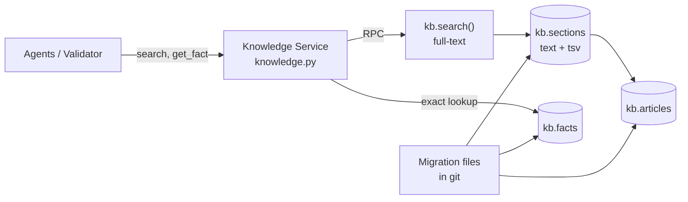

# DemoBank knowledge base design (keyword RAG)

Status: **proposal**. Detailed design of the Knowledge Service in [system-architecture.md §5.7.1](system-architecture.md#571-knowledge-service). The content to load is listed in [knowledge-requirements.md](knowledge-requirements.md). Today's code still uses the in-memory keyword library in `backend/app/services/knowledge.py`; this document describes what replaces it.

## 1. Summary

- **Retrieval-augmented generation (RAG):** agents retrieve approved sections, and the LLM answers only from them, with citations.
- **Keyword retrieval:** Postgres full-text search over article sections. No embeddings or vector search; the library is small enough that keywords, plus today's fallback of sending the whole small library when nothing matches, cover it.
- **No new infrastructure:** everything lives in the hosted Supabase Postgres that the app already uses.
- **Three tables, one search function.** All content is public guidance; the app can only read it.
- **No content workflow:** whatever is in the tables is live. Content changes arrive only through migrations.



## 2. Data model

| Table | One row is | Key columns |
|---|---|---|
| `kb.articles` | One topic, e.g. "Pending transfers" | `article_id`, `version`, `category`, `type`, `title`, `summary`, source fields |
| `kb.sections` | One searchable part of an article, e.g. "What pending means" | `article_id`, `anchor`, `position`, `heading`, `body`, `tsv` (generated) |
| `kb.facts` | One exact figure, e.g. a card's annual fee | `fact_id`, `value`, `unit`, `article_id` |

```sql
create schema kb;

create table kb.articles (
  article_id text primary key,
  version int not null default 1,
  category text not null,          -- accounts, cards, loans, payments, security, support, compliance, relationship
  type text not null,              -- faq, how_to, troubleshooting, product
  title text not null,
  summary text not null,
  publisher text not null default 'demobank',
  reference_url text, checked_on date, review_due date,
  check (publisher = 'demobank' or (reference_url is not null and checked_on is not null and review_due is not null)));

create table kb.sections (
  article_id text not null references kb.articles on delete cascade,
  anchor text not null,            -- stable id used in citations, e.g. 'check-status'
  position int not null,
  heading text not null,
  body text not null,
  tsv tsvector generated always as (to_tsvector('english', heading || ' ' || body)) stored,
  primary key (article_id, anchor));
create index on kb.sections using gin (tsv);

create table kb.facts (
  fact_id text primary key,        -- e.g. 'card.platinum.annual_fee'
  value numeric not null,
  unit text not null,              -- 'SGD', 'percent_pa', 'days'
  article_id text not null references kb.articles);
```

RLS is enabled on all three tables with a read-only policy for `anon` and `authenticated`; no app role can insert, update or delete. The allowed-domain rule for external publishers (`www.moneysense.gov.sg`, `www.abs.org.sg`) stays in the Python validator, where it already lives (`services/source_checks.py`).

## 3. Writing sections

A section is the unit the model sees and the unit a citation points to, so its shape matters more than the article's.

| Guideline | Why |
|---|---|
| One idea per section, roughly 50–300 words | Small enough to be precise, large enough to stand alone |
| Heading says what the section answers ("Why a transfer stays pending") | The heading is part of the searchable text |
| Use the words customers use ("stuck", "won't go through") as well as banking terms | Keyword search only matches words that appear |
| Steps as a numbered list inside one section | The agent can quote the steps in order |
| Figures only as a reference to a fact (`card.platinum.annual_fee`), not typed into the body | One place to change a fee; the Validator checks figures against `kb.facts` |
| Never mention a specific customer | Customer details come from Customer Data, not from knowledge |

Example: article `pending-transfers` (type `troubleshooting`, category `payments`):

| anchor | heading |
|---|---|
| `what-pending-means` | What a pending transfer means |
| `how-long` | How long transfers usually take |
| `check-status` | How to check a transfer's status |
| `avoid-duplicates` | Why you should not resend a pending transfer |
| `contact-bank` | When to contact the bank |

Citation format: `article_id@v<version>#anchor`, e.g. `pending-transfers@v2#avoid-duplicates`.

## 4. Search function

```sql
create function kb.search(q_text text, categories text[] default null, k int default 5)
returns table (cite text, article_id text, title text, heading text, body text, score float)
language sql stable security invoker as $$
  select s.article_id || '@v' || a.version || '#' || s.anchor, s.article_id, a.title, s.heading, s.body,
         ts_rank_cd(s.tsv, websearch_to_tsquery('english', q_text)) as score
  from kb.sections s join kb.articles a using (article_id)
  where s.tsv @@ websearch_to_tsquery('english', q_text)
    and (categories is null or a.category = any(categories))
  order by score desc limit k $$;
```

| Parameter | Meaning |
|---|---|
| `q_text` | The user's question; `websearch_to_tsquery` handles stemming ("transfers" matches "transfer") and ignores stop words |
| `categories` | Agent scope, e.g. the Compliance Review agent searches `compliance` and `support` |
| `k` | Results returned |

An unrelated question matches nothing and returns an empty list instead of the "least bad" section. The `kb` schema must be added to the API's exposed schemas in Supabase, or the function wrapped as `public.kb_search`.

## 5. Knowledge Service (Python)

`backend/app/services/knowledge.py` becomes a thin client:

| Function | Does |
|---|---|
| `search(query, categories, k)` | Fixes common typos (as today), calls `kb.search`, returns `[{cite, title, heading, body, score}]`. Empty list means no approved content: the agent says so or hands off |
| `get_fact(fact_id)` | Exact lookup in `kb.facts`. Used by agents and by the Response Validator |
| `get_article(article_id)` | Article with its sections, for the sources panel (`GET /knowledge/{id}`) |

Behaviour rules:
- **No match or non-English query:** the `english` full-text setting will not match other languages. Keep today's behaviour of using the small default library when nothing is retrieved. Answers are still generated only from retrieved sections, never from sample text.
- **Logging:** query text is never logged; traces record the number of results, the cites returned and the scores.

## 6. Content workflow

1. Write or edit articles and sections as a new migration file in `backend/supabase/migrations/` (e.g. `0005_knowledge_seed.sql`, then `0006_knowledge_cards_update.sql`).
2. Editing an existing article: bump its `version` (and `checked_on` / `review_due` for external sources).
3. Apply the migration to the hosted Supabase project.

**Migrations are the only way content changes.** The Supabase dashboard is for viewing. This keeps git and the live database identical, and makes evaluation runs reproducible.

## 7. Evaluation

Retrieval is measured separately from answer quality.

| Metric | Meaning |
|---|---|
| Hit rate @5 | The expected article appears in the top 5 sections |
| MRR | How high the first correct section ranks (1 / rank, averaged) |
| No-match accuracy | Out-of-scope questions return no sections |

Add an `expected_article` (and where useful `expected_anchor`) to the cases in `backend/evaluation/`, including informal and misspelled rewrites of each question (F18 evaluation set). Misses on informal wording are fixed first by adding customer wording to section text; if they remain common, that is the evidence for adding vector search later.

## 8. Tests

| Level | What |
|---|---|
| Unit (offline) | Small fixture of articles and sections; checks citation format, typo fixing and empty-result handling |
| Database | Migration applies; app roles can read but not write `kb` tables |
| Live evaluation | Retrieval metrics above against the hosted database |

## 9. Not included (and why)

| Left out | Reason |
|---|---|
| Embeddings and vector search (pgvector, hybrid ranking) | Small library; keyword search plus the small-library fallback covers it. Revisit only if evaluation shows frequent misses on informal wording |
| Customer-only articles and audience filtering | All knowledge is general guidance; personal details come from Customer Data |
| Separate vector database (Pinecone, Qdrant, Weaviate) | No vector search |
| Draft / review / publish workflow, version history | One author; migrations in git already give history |
| Re-ranker model | Small library; add only if evaluation shows ranking problems |
| Helpful votes, search-miss log | Can be added later without changing these tables |
| Internal (staff-only) articles | No staff desk in the demo |
