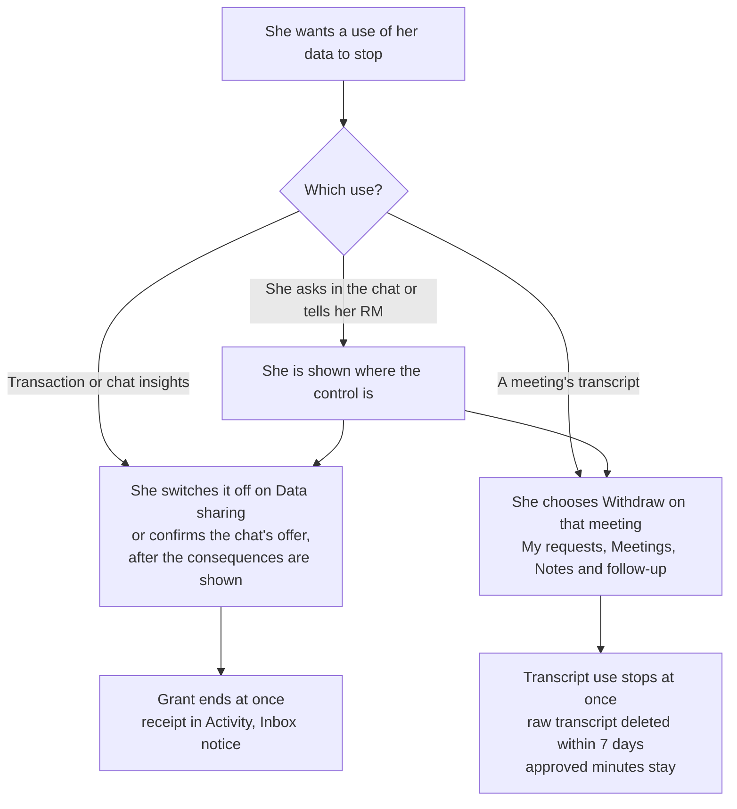

# PDPA baseline

Status: checked against the sources on 8 Nov 2026. DemoBank is a coursework demo with synthetic data. This file is our
design baseline: what Singapore's Personal Data Protection Act (PDPA) asks of an organisation, how DemoBank meets each
obligation, and what is not built. It is not legal advice. Every rule below is paraphrased; read the source for the exact
wording.

A feature that collects, uses or shares a client's personal data checks itself against this file before it is built
(see [How to use this baseline](#how-to-use-this-baseline)).

## Sources

| Source | Version read | Where |
|---|---|---|
| Personal Data Protection Act 2012 ("the Act", s = section) | 2020 Revised Edition, as amended | [Singapore Statutes Online](https://sso.agc.gov.sg/Act/PDPA2012) |
| Personal Data Protection Regulations 2021 | current | [Singapore Statutes Online](https://sso.agc.gov.sg/SL/PDPA2012-S63-2021) |
| Personal Data Protection (Notification of Data Breaches) Regulations 2021 | current | [Singapore Statutes Online](https://sso.agc.gov.sg/SL/PDPA2012-S64-2021) |
| PDPC Advisory Guidelines on Key Concepts in the PDPA ("the Guidelines", ¶ = paragraph) | Revised 29 April 2026. Its consent, notification, access and retention text is the same as the 16 May 2022 edition | [PDPC](https://www.pdpc.gov.sg/organisations/regulations-decisions/regulatory-guidance/advisory-guidelines-on-key-concepts-in-the-personal-data-protection-act) |

**Other law comes first.** Where another written law is inconsistent with the PDPA's data protection rules, the other law
prevails (s4(6)(b)). The Guidelines give the Banking Act's banking secrecy rule (s47 and its Third Schedule) as an
example. A real bank follows those rules and MAS notices as well; they are outside this baseline.

## The obligations at a glance

Status: **Built** (in the demo today), **Partly** (built with a named gap), **Not built**, **Not in force**.

| Obligation | What the PDPA asks | How DemoBank meets it | Status |
|---|---|---|---|
| Accountability (s11–12) | Name at least one data protection officer (DPO) and publish their business contact. Have policies and practices, a process to receive and answer complaints, tell staff about them, and share them on request | A complaint can be raised as a request (*Something else*) or through *Talk to a person*. There is no named DPO, published contact or policy page | Partly |
| Consent (s13–14) | No collecting, using or disclosing without consent, unless the Act or another law requires or allows it. Consent counts only if she was told the purpose. Consent beyond what the service needs must not be a condition of it, and must not be obtained by misleading her | Her RM sees *Transaction insights* and *Chat insights* only under her grant, checked in SQL on every read. Both are off by default and no service depends on them. Switching on shows the exact line her RM will see and asks her to confirm; the grant records the notice version she agreed to. Offer switches in the chat stay off unless she turns them on, and a typed yes includes none | Built |
| Deemed consent (s15, s15A) | Deemed by conduct (she gives the data for a purpose) or by contract (needed to conclude or perform it). Deemed by notification only after an assessment that the use is not likely to harm her, with steps that reduce any harm, kept on file (reg 14), and a notice of the intention, purpose and a reasonable way and time to opt out. Not for direct marketing (reg 13) | *Always shared* items (profile, products, review status, requests, meetings) rest on the account she holds; onboarding is not modelled. Meeting recording is notice-based: every invite carries the notice and its version, and the grant is recorded with `basis` `notice`. There is no written assessment and no stated opt-out period | Partly |
| Withdrawal (s16) | She may withdraw at any time with reasonable notice. The bank tells her the likely consequences, must not prohibit withdrawal, and stops using the data and makes its intermediaries and agents stop, unless the law requires or allows the use | Every consent is withdrawn in the app and takes effect at once: the Data sharing switches, and *Withdraw* on each meeting for its transcript. No request goes to a team (0147). Detail in [Withdrawing consent](#withdrawing-consent) | Built |
| Exceptions (s17, First and Second Schedules) | Use without consent is allowed in listed cases: vital interests, matters affecting the public, legitimate interests (after an assessment, reg 15, disclosed to her), business asset transactions, business improvement | No feature relies on an exception. A feature that would (for example analytics beyond serving her own account) needs a legitimate-interests assessment first | Not used |
| Purpose limitation (s18) | Use only for purposes a reasonable person would consider appropriate and that she was told of | Each grant is for one purpose (`rm_brief`) and one recipient (her current RM); reassignment ends it. Gated readers take a purpose set by code (`meeting_prep`, `client_view`), never by a model, and each read is audited with its category, grant and purpose | Built |
| Notification (s20) | Tell her the purposes on or before collection, and any new purpose before using the data for it. On request, give the contact of someone who can answer her questions | Each category's notice text and version lives in `consent.categories` (`ti-2026-11`, `ct-2026-11`) and is shown before she switches on. While she shares chat insights, a note under the chat composer says insights from the chat may be shared with her RM for her meetings, with a *Manage* link. The meeting invite carries the recording notice. No contact person is shown | Partly |
| Access (s21; regs 3–5) | As soon as reasonably possible, give her the personal data held and how it was or may have been used or disclosed in the year before her request. If it takes more than 30 (calendar) days, tell her in writing within those 30 days when she will get it | She sees her own records on Overview and Records, and her actions in Activity (with a CSV download). *Who looked and when* lists every RM read of what she shares, built from the audit trail. There is no formal access request, and the log covers RM reads of shared categories only | Partly |
| Correction (s22; reg 5) | Correct the data as soon as practicable and send the correction to organisations it was disclosed to in the past year. Same 30-day rule | *Update personal details* request (Client records team, 72-hour target). The change itself is made outside the app | Partly |
| Accuracy (s23) | Make a reasonable effort to keep data accurate and complete if it is used to make a decision about her or disclosed to another organisation | Answers cite the bank's own records and are checked against them. Chat insights are labelled *picked up from your chats* or *shared by you*; she can delete them, and each expires 90 days after it was last seen | Built |
| Protection (s24) | Reasonable security against unauthorised access, use, disclosure, copying, change or disposal, and against loss of storage media | Row-level security on every table and the caller's own token for every read (no service-role key in the app). Customer filters in code and in SQL, and RM book checks. Passwords, PINs, OTPs, CVVs, card numbers, emails and NRIC/FIN numbers are redacted before the model, logs and traces. Audit log with a hash chain. Size and rate limits. RM MFA is not required in the demo | Partly |
| Retention (s25) | Stop keeping the data, or anonymise it, once it is reasonable to assume the purpose is no longer served and there is no legal or business need. There is no fixed period, and no keeping data "just in case" | Removed chat insights are purged after 7 days. Inferred insights expire 90 days after they were last seen. Raw meeting transcripts are deleted 30 days after the minutes are approved, or within 7 days if she withdraws the transcript. Guest access ends after 24 hours. There is no deletion request (the PDPA gives none; s25 is the bank's own duty). Saved chats and audit events have no retention schedule (kept for the demo) | Partly |
| Transfer limitation (s26; regs 9–12) | Send data outside Singapore only with protection comparable to the PDPA: legally enforceable obligations (law, contract, binding corporate rules) or specified certifications | Model calls (OpenRouter), traces (LangSmith) and embeddings go to outside providers. The demo sends synthetic data only, redacted first. There are no transfer contracts | Not built |
| Data breach notification (Part 6A; breach regulations) | Assess a suspected breach reasonably and quickly (the Guidelines say generally within 30 days). Notify the PDPC within 3 calendar days of assessing that it is notifiable: likely significant harm (for example a bank account number with its password) or 500 or more people. Tell the people affected when there is significant harm | No breach process. The audit log and ids-only logs would support an assessment | Not built |
| Data portability (Part 6B) | Moving her data to another organisation on request | Not in force on 8 Nov 2026: the current Act has no Part 6B text and no start date was found | Not in force |

**Penalties.** Since 1 Oct 2022 the PDPC may fine an organisation up to 10% of its annual turnover in Singapore when that
turnover is above S$10 million, and up to S$1 million otherwise (s48J).

## Consent and withdrawal (the rules we build to)

### Who may see what

- **Express consent.** Her RM sees her *Transaction insights* and *Chat insights* only under a grant she gave on Data
  sharing or by confirming an offer in the chat (`consent.grants`, checked inside SQL by `rm.consent_active` on every
  read). Both are off by default. Switching one on shows the exact line her RM will see and asks her to confirm; the
  grant records the notice version she agreed to (`consent.categories`, `notice_version`), and each grant is one
  confirmed action with a receipt.
- **Deemed consent by notification (s15A).** Meeting recording is on for every confirmed meeting under the meeting
  notice: the invite carries the notice and its version, and the grant is recorded with `basis` `notice`. Under s15A
  the bank must first assess whether recording is likely to have an adverse effect on her, and what reduces it; tell her
  what it will do, why, and how and by when she can opt out; and keep that assessment while it relies on it (s15A(4)–(5),
  reg 14, ¶12.23–12.25, ¶12.64–12.69). She can still withdraw after the opt-out period (¶12.24). The demo has the notice
  but no written assessment.
- **Always shared.** Her profile, products, review status, requests and meetings are what the bank needs to serve her
  account. Data sharing lists them as *Always shared*, each with its reason, and they have no switch.

### Withdrawing consent

Every withdrawal happens in the app and takes effect at once. Nothing is sent to a team and nothing waits for a person
(0147 removed the *Stop using my data* and *Delete all my data* requests).

| What the PDPA asks (s16, Guidelines ¶12.38–12.54) | What DemoBank does |
|---|---|
| She may withdraw any consent at any time, including consent that is only deemed, such as under a notice (¶12.38) | Switches on Data sharing for transaction and chat insights. For meeting recording, each meeting asks whether her RM may use a transcript of the call for the minutes; she chooses *I agree* or *Withdraw* on that meeting, before or after the call |
| She gives reasonable notice. As a rule of thumb, at least 10 business days from when the bank receives it is reasonable; if the bank needs longer, telling her when it takes effect is good practice (¶12.41) | No notice period is needed: a switch or *Withdraw* stops use at once, in SQL |
| The bank tells her the likely consequences once she withdraws, even if they are written elsewhere; for example, a service it can no longer give (s16(2), ¶12.50–12.51) | Switching off first says what changes at once. The chat says the same before offering a revoke. *Withdraw* on a meeting says that approved minutes stay. Asked in the chat to stop recording, the assistant says where *Withdraw* is and that approved minutes stay (`consent_answers.RECORDING`) |
| The bank must not prohibit withdrawal, and its process must not be so rigid that it blocks it. A request that comes through another channel still counts (s16(3), ¶12.43–12.47) | The controls are one tap down from where the data is shown (Data sharing; My requests → Meetings → *Notes and follow-up*). The chat answers a request to stop with the way to do it. If she tells her RM instead, the RM points her to the same controls; the RM cannot switch them for her |
| Optional purposes can be withdrawn without giving up the necessary ones (¶12.42(c)) | Each category has its own switch and grant, and each meeting its own transcript choice. *Always shared* items stay |
| Subject to retention (s25), the bank stops collecting, using and disclosing the data, and makes its data intermediaries and agents stop. This applies to continued use and future disclosure (s16(4), ¶12.39(d), ¶12.52) | Ending a grant stops RM reads at once, in SQL. Ending `chat_topics` removes the chat insights picked up from her chats. A meeting's transcript is used only while both people agreed to its notice and nobody withdrew (`meetings.recording_allowed`); after *Withdraw* the raw transcript is deleted within 7 days |
| The duty to stop does not cover use that the PDPA or another law requires or allows without consent (s16(4), ¶12.39(d)). Withdrawal also does not undo its legal consequences (s16(3)) | No consent-based use is kept after withdrawal. Approved minutes stay, as the meeting record of what was agreed |
| Withdrawing consent does not oblige the bank to delete the data; retention is a separate obligation (s25, ¶12.54) | Withdrawal ends access and use. Deletion follows the retention rules in the table above |

### The withdrawal flow

| Step | Who | Where |
|---|---|---|
| Switch off transaction or chat insights | The client | Data sharing → the category → switch (`consent.revoke`), or the chat's offer she confirms |
| Withdraw a meeting's transcript | The client | My requests → Meetings → *Notes and follow-up* → *Withdraw* (`POST /meetings/{id}/transcript-revoke`, 0122) |
| Ask in the chat | The client | A fixed reply with the way to do it (`consent_answers.RECORDING` for recording; a revoke offer for insights) |

Tests: `backend/tests/test_consent_v2.py` (including the 0147 removal), `test_consent_chat.py`, `test_meeting_lifecycle.py`.

## Not built yet

| Gap | Rule | Owner |
|---|---|---|
| A named DPO with a published business contact, a data protection policy page and a stated complaints route | s11(3), s11(5), s12, s20(1)(c) | Bank (not modelled in the demo) |
| A written s15A assessment for meeting recording, kept while the bank relies on it, and an opt-out period stated in the notice | s15A, reg 14 | Bank and meeting side |
| A formal access request with the 30-day clock, covering every use and disclosure in the past year, not only RM reads of shared categories | s21, reg 5 | Client side |
| A retention schedule for saved chats and audit events | s25 | Bank |
| Transfer safeguards (contracts or certifications) for the model, tracing and embedding providers before any real client data is used | s26 | Bank |
| A breach assessment and notification process | Part 6A | Bank |
| MFA for RM logins | s24 | RM side |

## How to use this baseline

Before building a feature that collects, uses or shares a client's personal data, answer these in its design note:

1. **Basis.** Is it consent (which grant or notice), or something she needs to be served (an *Always shared* item)?
2. **Notice.** Where does she see what is used, why and by whom, before it happens?
3. **Withdrawal.** How does she stop it, what stops at once, and who else (another worker, the meeting side, a model) must stop too?
4. **Purpose.** Is the purpose set by code, never by a model, and recorded with each read?
5. **Retention.** When is it deleted or anonymised, and by what?
6. **Outside providers.** Does any of it leave the bank's systems (model, tracing, embeddings), and is it redacted first?

If a rule here changes, update the source row and the date at the top.
