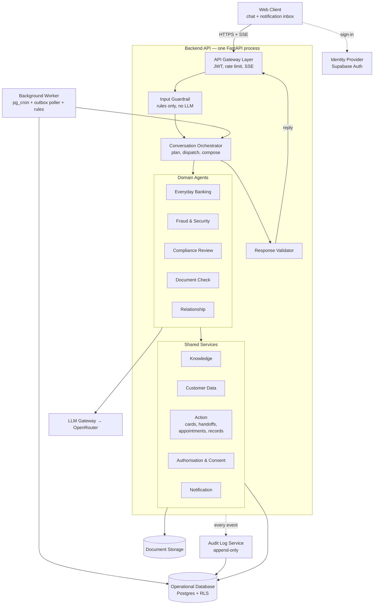
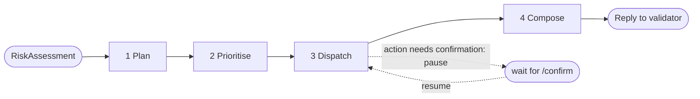
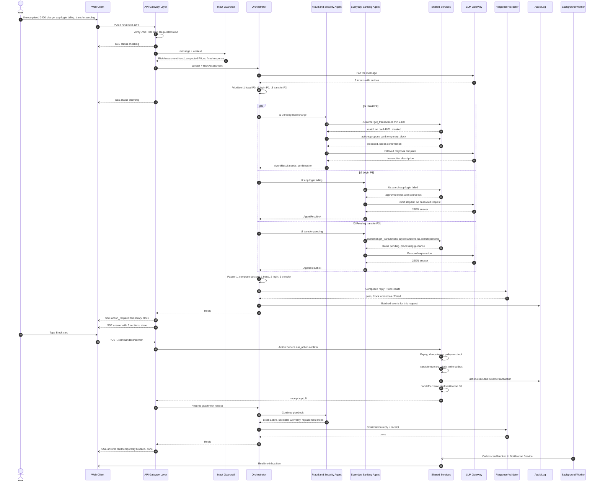
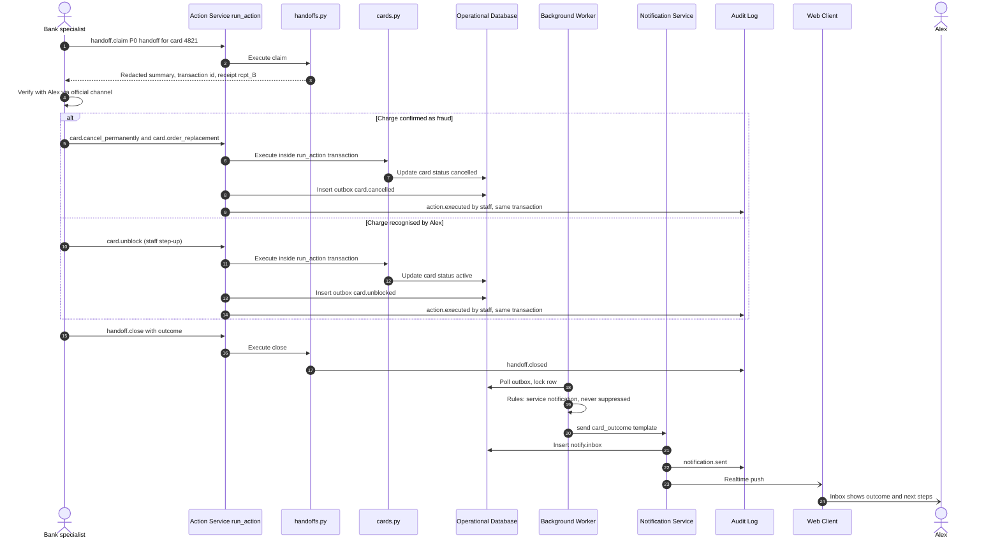

# DemoBank system architecture (v3, simplified)

Status: **proposal**. This document re-specifies the draw.io diagram "DemoBank — Proposed Multi-Agent Architecture" using standard system-design terms. `chatbot-architecture.md` describes what is built today; `multi-capability-architecture.md` describes the intent-router step. How each backlog story maps onto these components is in [user-story-mapping.md](user-story-mapping.md). Coursework demo with synthetic data only.

v3 changes from v2: one deployable backend (modular monolith) instead of separate services; no CQRS read model; no Redis; no separate event bus or rules engine; composer folded into the orchestrator; new **Audit Log Service**; professional service names; latency budget and local Docker deployment added. v3.1: shared services cut to five (Knowledge, Customer Data, Action, Authorisation & Consent, Notification). All reads sit in Customer Data; all writes go through one `run_action()` function in the Action Service, with card, handoff, appointment and records logic in small executor files instead of separate services.

---

## 0. Design principles

1. **Deterministic before probabilistic.** Rules and fixed responses run before any LLM. Safety-critical replies (lost card, secrets, human support) never call the model.
2. **Modular monolith.** Every backend component is a Python module with a clear interface, running in one FastAPI process. Modules call each other as functions, not over HTTP. A module can be split out later without changing its interface.
3. **Agents reach data only through service tools.** No agent queries the database directly.
4. **Policy check on every tool call.** Identity, customer scope, consent and action risk are checked in one place.
5. **No action without a receipt.** State changes go through `run_action()` in the Action Service: propose → customer confirms → execute → receipt. A small, policy-listed set of low-risk actions (e.g. opening a handoff, holding a slot) may skip confirmation. The reply may only claim an action that has a receipt.
6. **Grounded output only.** Figures must come from tool results or the fee/limit fact table. Validation failure means withhold and hand off, never substitute.
7. **Everything auditable, nothing sensitive in logs.** Every login, chat turn, data read, decision and change produces an audit event. Audit events and traces hold ids, enums and counts; the redacted chat text lives only in the conversation store.

---

## 1. Naming map

| Draw.io label | New name | Category | v3 note |
|---|---|---|---|
| Customer · chat + inbox | **Web Client** | Presentation tier (SPA) | |
| — (implicit) | **Identity Provider** | OAuth2 / OIDC | Supabase Auth |
| API gateway | **API Gateway Layer** | Edge middleware | Part of the FastAPI app, not a separate proxy |
| ① Safety guard | **Input Guardrail** | Deterministic pre-filter, DLP | |
| ② Orchestrator | **Conversation Orchestrator** | Supervisor / planner–executor | Includes the composer |
| shared case state | **Conversation Store** | Durable conversation and workflow state | |
| ③ five agents | **Domain Agents** | Bounded-context agents | Everyday Banking, Fraud & Security, Compliance Review, Document Check, Relationship (§5.6) |
| ④ Knowledge search | **Knowledge Service** | Retrieval (RAG) + fact table | |
| ④ Customer 360 tools | **Customer Data Service** | Entitlement-scoped data access | Plain repository layer; no CQRS |
| ④ Action ledger | **Action Service** | Command processing with confirmation | `run_action()` + executor files; ledger moved into Audit Log Service |
| ④ Consent service | **Authorisation & Consent Service** | Authorisation (ABAC) + consent registry | |
| ④ Scheduling | — | | Slot reads in Customer Data; hold/confirm in Action Service (`appointments.py`) |
| ④ Notifications | **Notification Service** | In-app inbox delivery | Email is optional, later |
| ⑤ Composer | — | | Merged into Conversation Orchestrator |
| ⑥ Validator | **Response Validator** | Post-generation grounding checks | |
| Reply over SSE | **Streaming Response (SSE)** | Server-Sent Events over `fetch` | |
| Human handoff queue | **Human Handoff** | Work queue | Executor file in the Action Service (`handoffs.py`) |
| Proactive triggers + event bus + rules | **Background Worker** | Scheduler + outbox poller + rules | One worker replaces three boxes |
| Observability | **Tracing & Evaluation** | Distributed tracing, eval harness | Debugging and quality, not compliance |
| — (new) | **Audit Log Service** | Append-only audit trail | Compliance record of everything that happens |
| LLM provider | **LLM Gateway** | Model abstraction + prompt registry | |
| Supabase Postgres | **Operational Database** | PostgreSQL + RLS | |
| Supabase Storage | **Document Storage** | Private object storage | |

---

## 2. System architecture

Each agent is its own box inside the Domain Agents group; the shared services are one box. Lines go to and from the groups, not to each agent or service. Agents are described in §5.6 and services in §5.7.



Lines that are deliberately **not** drawn: every component writes audit events and trace spans (shown once as the dotted `API → Audit` line); the orchestrator also calls the LLM for planning; the Notification Service pushes inbox items to the Web Client through Supabase Realtime; inside Shared Services, Customer Data does every read and the Action Service every write (§5.7.3), both asking Authorisation & Consent first; Notification is called only by the Background Worker.

---

## 3. Runtime model

| Process | Contains | Notes |
|---|---|---|
| `web` | React SPA | Vite dev server locally; static files when hosted |
| `api` | Gateway, Guardrail, Orchestrator, Agents, all Shared Services, Validator, Audit Log Service, LLM Gateway | One image, one process |
| `worker` | Background Worker | Same image as `api`, different start command. Can run as a background task inside `api` for the demo (`RUN_WORKER_IN_API=true`) |
| Supabase (managed or local) | Auth, Postgres, Storage, Realtime, pg_cron | Not built by us |

Communication inside `api` is plain function calls. The only network hops are browser ↔ API, API ↔ Supabase, API ↔ OpenRouter.

---

## 4. Canonical contracts

Pydantic models in `backend/app/schemas/`.

**RequestContext** (created by the gateway, passed to every module)
```json
{ "request_id": "uuid", "session_id": "uuid", "case_id": "uuid|null",
  "principal": { "kind": "guest|customer|system", "user_id": "uuid|null", "customer_id": "uuid|null",
                 "auth_session_id": "uuid|null", "aal": "aal1|aal2", "jwt": "<never logged>" },
  "locale": "en-SG", "received_at": "iso8601" }
```

**RiskAssessment** (Input Guardrail → Orchestrator)
```json
{ "redacted_message": "string", "redactions": [{"type": "card_number|password|otp|nric", "count": 1}],
  "risk_flags": ["fraud_suspected","lost_card","secret_shared","human_requested"],
  "priority": "P0|P1|P2|P3", "fixed_response": {"code": "lost_card_v1", "needs_human": true} }
```
`fixed_response` set → the orchestrator is skipped; the reply goes straight to the Response Validator.

**TaskPlan** (Orchestrator, saved in the Conversation Store)
```json
{ "plan_id": "uuid", "tasks": [{ "task_id": "t1", "domain": "fraud|retail|compliance|document|relationship|smalltalk",
  "intent": "report_unrecognised_txn", "priority": "P0", "entities": {"amount": 2400},
  "needs_auth": true, "status": "pending|running|awaiting_confirmation|done|failed" }] }
```
Priority: **P0 fraud > P1 security > P2 regulatory deadline > P3 everything else**; ties keep message order.

**AgentResult** (Agent → Orchestrator)
```json
{ "task_id": "t1", "agent": "fraud", "status": "ok|needs_clarification|needs_confirmation|needs_human|error",
  "answer_kind": "banking|conversation", "text": "string",
  "citations": [{"source_id": "kb:card-dispute@v3"}], "tool_calls": [{"call_id": "uuid", "tool": "customer.get_transactions"}],
  "pending_action": {"command_id": "uuid", "type": "card.temporary_block", "summary": "Temporarily block card ending 4821"},
  "receipts": [{"receipt_id": "rcpt_...", "command_id": "uuid"}] }
```

**ActionCommand / Receipt** (Action Service; the executor is looked up from `type` in the registry, never chosen by the model)
```json
{ "command_id": "uuid", "idempotency_key": "case_id:task_id:type", "type": "card.temporary_block",
  "target": {"card_id": "uuid"}, "state": "proposed|confirmed|succeeded|failed|expired", "expires_at": "iso8601" }
{ "receipt_id": "rcpt_...", "command_id": "uuid", "outcome": "succeeded", "audit_event_id": 1042 }
```

**AuditEvent** — see §6.

**SSE events** (additive to today's `status`, `answer`, `done`, `error`)

| Event | Payload |
|---|---|
| `status` | `{stage: "checking|planning|retrieving|validating"}` |
| `answer` | existing object + optional `sections[]` (one per task, priority order) |
| `action_required` | `{command_id, type, summary, expires_at}` |
| `done` / `error` | unchanged |

---

## 5. Component catalogue

Five fields per component: **Category**, **Responsibility & boundaries**, **Inputs / outputs**, **Infrastructure / pattern**, **Dependencies** (↑ callers, ↓ callees).

### 5.1 Web Client
- **Category:** Presentation tier (SPA).
- **Responsibility & boundaries:** Chat UI, guest/sign-in, sources panel, action-confirmation dialog, notification inbox. Client-side redaction preview mirrors the Input Guardrail. No business logic or secrets; only `VITE_` variables.
- **Inputs / outputs:** Out: `POST /chat`, `POST /commands/{id}/confirm`, `POST /auth/session-end`, each with bearer JWT. In: SSE stream; Realtime inbox channel.
- **Infrastructure / pattern:** React + Vite. The SSE stream is read with `fetch()` + `ReadableStream` and a small parser (`lib/chatTools.js`), because the browser `EventSource` API supports only `GET` and cannot send an `Authorization` header or a JSON body.
- **Dependencies:** ↓ Identity Provider, API Gateway Layer, Notification Service (Realtime).

### 5.2 Identity Provider
- **Category:** OAuth2 / OIDC identity provider.
- **Responsibility & boundaries:** Sign-in, sign-out, token refresh, JWKS. Keeps its own auth audit log (sign-in attempts, failures, password changes). Does not authorise banking operations.
- **Inputs / outputs:** In: credentials. Out: JWT (`sub`, `session_id`, `aal`, `exp`).
- **Infrastructure / pattern:** Supabase Auth.
- **Dependencies:** ↑ Web Client, API Gateway Layer (JWKS). ↓ Operational Database (`auth` schema).

### 5.3 API Gateway Layer
- **Category:** Edge middleware inside the backend.
- **Responsibility & boundaries:** Verifies JWT (cached JWKS), resolves `customer_id`, builds `RequestContext`, rate-limits (in-process token bucket), limits payload size, sets CORS, opens the SSE stream, maps errors to stable codes. Records `auth.session_started` the first time it sees a new `session_id`. No domain logic.
- **Inputs / outputs:** In: HTTPS. Out: `RequestContext` + message to the Input Guardrail; SSE events.
- **Infrastructure / pattern:** FastAPI routers + middleware (`api/chat.py`, `core/auth.py`).
- **Dependencies:** ↑ Web Client. ↓ Identity Provider, Input Guardrail, Action Service (confirm), Audit Log Service.

### 5.4 Input Guardrail
- **Category:** Deterministic pre-filter / data loss prevention.
- **Responsibility & boundaries:** Redacts secrets and PII, trims history, detects lost card, fraud wording, human-support requests and guest "my balance" questions, assigns priority, returns fixed responses. **Never calls an LLM.**
- **Inputs / outputs:** In: `RequestContext`, message, history. Out: `RiskAssessment`.
- **Infrastructure / pattern:** Python rules (`services/privacy.py`, `services/safety.py`), shared fixtures `tests/fixtures/privacy-cases.json`.
- **Dependencies:** ↑ API Gateway Layer, Background Worker. ↓ Conversation Orchestrator or Response Validator; Audit Log Service.

### 5.5 Conversation Orchestrator
- **Category:** Supervisor agent, planner–executor workflow.
- **Responsibility & boundaries:** Turns a message (or a worker event) into a `TaskPlan`, runs the right agents, merges their results into one reply, pauses for customer confirmation and resumes. It does not answer banking questions and does not call services directly.
- **How it works:** a LangGraph graph with four nodes; LangGraph saves the state after every node (checkpointing) using the Conversation Store.



| Node | What it does | LLM? | Example |
|---|---|---|---|
| 1 Plan | Keyword rules first. If one clear intent matches, build a one-task plan with no model call. Otherwise one structured-output LLM call returns `{tasks[{domain, intent, entities}]}` | Only when unclear | "$2,400 charge … app login failed … transfer still pending" → 3 tasks |
| 2 Prioritise | Sort tasks P0–P3. Guardrail flags override: a `fraud_suspected` flag always adds a P0 fraud task | No | t1 fraud P0, t2 login P1, t3 transfer P3 |
| 3 Dispatch | Run independent tasks in parallel (LangGraph `Send`), each with a timeout. If an agent proposes an action, mark the task `awaiting_confirmation` and pause the graph (`interrupt`) | Agents may | Fraud & Security + two Everyday Banking tasks in parallel; time ≈ slowest, not the sum |
| 4 Compose | Deterministic merge: one section per task in priority order, citations kept with their section, pending actions listed | No | Fraud section first |

When the customer confirms, `POST /commands/{id}/confirm` executes the action and resumes the same graph from its saved checkpoint, so the fraud agent continues its playbook with the receipt.

- **Inputs / outputs:** In: `RequestContext` + `RiskAssessment`, or a worker event. Out: composed reply to the Response Validator; plan and checkpoints to the Conversation Store.
- **Infrastructure / pattern:** LangGraph `StateGraph` + Postgres checkpointer.
- **Dependencies:** ↑ Input Guardrail, Background Worker, API Gateway Layer (resume). ↓ Domain Agents, LLM Gateway, Conversation Store, Response Validator, Audit Log Service.

### 5.6 Domain Agents
- **Category:** Bounded-context agents (five agents, drawn as separate boxes in §2).
- **Responsibility & boundaries:** Each agent owns one business area, has its own versioned prompt and tool allow-list, and returns an `AgentResult`. Agents only use tools (§5.13); they never touch the database, never execute an action directly, and never decide policy. When a request falls outside an agent's boundary, the agent returns it to the Orchestrator (re-plan) or creates a handoff.

Detailed per-story behaviour lives in [user-story-mapping.md](user-story-mapping.md); this section fixes only what each agent may and may not do.

| Agent | Purpose | Can do | Must not do | Tools | Stories |
|---|---|---|---|---|---|
| **Everyday Banking** | Everyday account, card, loan, transaction and service questions | Explain products, fees, procedures from approved content; read the customer's own accounts, cards, loans, transactions; ask clarifying questions; hand off | Change anything; give investment, legal or tax advice; promise loan approval; investigate or reverse transactions; handle suspected fraud (re-plans it to Fraud & Security) | `kb.*`, `customer.get_*` (accounts, transactions, credit cards, loans, profile), `handoff.create` | EB2–EB6 |
| **Fraud & Security** | Urgent security issues, P0 | Follow a fixed playbook; identify the suspicious transaction; **propose** a temporary card block; create a P0 handoff | Execute the block without confirmation; claim a block without a receipt; investigate, reverse or permanently cancel (human only); replace the Guardrail's fixed lost-card response | `customer.get_transactions`, `customer.get_credit_cards`, `actions.propose(card.temporary_block)`, `handoff.create` | EB8 |
| **Compliance Review** | Explain and track the client's compliance review | Read the client-visible compliance case; explain requests and statuses from the authorised record and approved guidance; update the client's own checklist marks | Invent requirements, statuses, deadlines or estimates; mark documents accepted; reveal internal-only fields (e.g. risk scoring); speculate on reasons | `compliance.get_case`, `compliance.update_checklist_item`, `kb.search` (approved compliance scope), `handoff.create` | CR1, CR4 |
| **Document Check** | Preliminary checks on uploaded documents | Run predefined checks (opens, legible, pages, required fields); explain issues and fixes; record results | Present results as approval; give a verdict when the document cannot be assessed reliably | `docs.precheck` | CR2 |
| **Relationship** | Continuity with the relationship manager | Introduce the assigned RM; draft and edit a summary or agenda with the client; request consent; find and hold slots; propose booking, sharing and request intake; report request status | Share data without consent; confirm a booking before the scheduling system does; invent transition reasons; imply a request is transferred or done unless recorded | `rm.*`, `requests.*`, `consent.*`, `appointments.*`, `agenda.save`, `actions.propose`, `handoff.create` | RC1–RC4 |

Stories without an agent are handled by platform components: EB1 Login (Identity Provider, Gateway), CR7 upload (Web Client, Document Storage), CR6 (Background Worker, Notification Service).

- **Inputs / outputs:** In: `{RequestContext, task, case_snapshot}`. Out: `AgentResult`.
- **Infrastructure / pattern:** Tool-calling agents with strict JSON output and a cap on tool calls; prompts in `backend/app/prompts/<agent>/vN`.
- **Dependencies:** ↑ Conversation Orchestrator. ↓ Shared Services (via tools), LLM Gateway.

### 5.7 Shared Services

#### 5.7.1 Knowledge Service
- **Category:** Retrieval-augmented generation (RAG) with keyword (full-text) search, plus an exact fact table.
- **Responsibility & boundaries:** Returns ranked article sections with citations, and exact fees/limits/rates. Does not write answers. Full design in [knowledge-base-design.md](knowledge-base-design.md); content per story in [knowledge-requirements.md](knowledge-requirements.md).

| Part | Responsibility | Infrastructure |
|---|---|---|
| Articles | One row per topic: `version`, `category`, `type`, source fields for external publishers | `kb.articles` |
| Sections | Searchable parts of an article; cited as `article_id@vN#anchor` | `kb.sections` with a full-text column (GIN) |
| Keyword search | Full-text match ranked by `ts_rank_cd`; unrelated questions return nothing | `kb.search()` SQL function, called as an RPC |
| Read-only access | All knowledge is general guidance; app roles can read but not write | RLS on `kb` tables |
| Fact table | Typed fee/limit/rate rows used for figure validation; exact lookup | `kb.facts` |
| Content | Content only through migration files in git | `backend/supabase/migrations/` |

- **Inputs / outputs:** `search(query, categories, k) → [{cite, title, heading, body, score}]`; `get_fact(fact_id) → {value, unit, article_id}`; `GET /knowledge/{id}`.
- **Infrastructure / pattern:** Python client (`knowledge.py`) + hosted Supabase Postgres full-text search; no embeddings or vector database. Today's code still uses the in-memory keyword library.
- **Dependencies:** ↑ Agents, Response Validator. ↓ Operational Database.

#### 5.7.2 Customer Data Service
- **Category:** Entitlement-scoped data access layer (repository pattern).
- **Responsibility & boundaries:** The only way agents read customer records. Simple typed functions over the normal tables. Read-only; every write goes through the Action Service.

| Part | Responsibility |
|---|---|
| Query functions | `get_profile`, `get_accounts`, `get_transactions(from, to, filters)`, `get_credit_cards`, `get_loans`, `compliance.get_case`, `rm.get_assignment`, `requests.list`, `appointments.find_slots(advisor_id, window)` (working hours minus bookings and live holds), `appointments.next_available` |
| Scope enforcement | `customer_id` comes from the JWT, never from model arguments; every query filters by it **and** runs with the user's JWT so RLS applies |
| Field masking | Card numbers → last 4, account numbers and NRIC masked before agents see them |
| Result fingerprint | Returns `call_id` so the Response Validator can check figures against exactly what was returned |

- **Inputs / outputs:** In: tool call + `RequestContext`. Out: `{call_id, data (masked), as_of}`.
- **Infrastructure / pattern:** Supabase client with the user's JWT (`core/auth.py`). No caching, no read-model projections.
- **Dependencies:** ↑ Agents. ↓ Authorisation & Consent Service, Operational Database, Audit Log Service (`data.read`).

#### 5.7.3 Action Service
- **Category:** Command processing with confirmation and idempotency; one shared `run_action()` function plus one small executor file per business area.
- **Responsibility & boundaries:** Every state change in the system, whether an agent, the Validator or a staff member asks for it. `run_action()` decides **whether and when** a change may run and records it; it holds no business logic. The executor files decide **how**: card rules live only in `cards.py`, booking rules only in `appointments.py`, and so on. The model can never execute anything directly. Adding a new action type means adding an executor function and one registry row; `run_action()` does not change.

**`run_action(command, ctx, confirmed)`: the shared safety steps**

| Step | Responsibility |
|---|---|
| 1 Duplicate check | Unique `idempotency_key`; a repeated request or confirm returns the same receipt |
| 2 Expiry | `proposed` commands expire after 5 minutes; an expired confirm executes nothing |
| 3 Authorise | Calls `decide()` in Authorisation & Consent; re-checked at confirm time |
| 4 Confirm | Types marked *confirm* stop here as `proposed` and send an `action_required` event; *auto* types continue |
| 5 Execute | Looks up the executor in the registry and calls `execute(command, tx)` inside one Postgres transaction |
| 6 Record | In the same transaction: command state, outbox row (for customer notifications), audit event; all commit together or none do |
| 7 Receipt | Returns `receipt_id` linked to the audit event |

**Executor files (`backend/app/services/actions/`)**

| File | Action types | Confirm? | Business rules it owns |
|---|---|---|---|
| `cards.py` | `card.temporary_block`, `card.unblock`, `card.cancel_permanently`, `card.order_replacement` | confirm (unblock and cancel by staff only) | Allowed transitions `active → temporarily_blocked → active / cancelled`; the only code that changes card state. The demo updates `banking.cards` (mock core banking); a real card system would replace only this file |
| `handoffs.py` | `handoff.create`, `handoff.claim`, `handoff.close` | auto | `support.handoffs {handoff_id, case_id, reason, priority, summary (redacted), status}`; one open handoff per case and reason; states `open → claimed → closed`; queue order P0 first, then age; staff-only `list_open()` |
| `appointments.py` | `appointment.hold` | auto | 10-minute hold; Postgres exclusion constraint prevents overlapping bookings |
| | `appointment.confirm`, `appointment.cancel` | confirm | States `held → confirmed → completed / cancelled`; reminders come from a pg_cron job that writes `booking.reminder_due` to the outbox |
| `records.py` | `compliance.update_checklist_item`, `agenda.save`, `consent.request` | auto | Plain writes to the `compliance`, `rm` and `consent` tables |
| | `requests.create`, `rm.share_summary`, `consent.grant`, `consent.revoke` | confirm | Sharing requires an active consent grant (obligation from `decide()`); consent rows are written only here, so every grant has a confirmation and a receipt |

Which types are *auto* is set in the policy rules (§5.7.4), not in the executor.

- **Inputs / outputs:** In: `ActionCommand` + `RequestContext`. Out: `Receipt` or `{command_id, expires_at}`; outbox event.
- **Infrastructure / pattern:** Command pattern + executor registry (one function per action type); one Postgres transaction per command. One module, not a separate process.
- **Dependencies:** ↑ Agents, API Gateway Layer (confirm), Response Validator (`handoff.create`), staff desk (out of scope for the demo; a seeded script stands in). ↓ Authorisation & Consent, Operational Database (`actions`, `banking`, `support`, `rm`, `compliance`, `consent`, `events`), Conversation Store (handoff summary), Audit Log Service.

#### 5.7.4 Authorisation & Consent Service
- **Category:** Authorisation (attribute-based access control) + consent check.
- **Responsibility & boundaries:** One `decide(subject, action, resource, context)` function used by the Customer Data and Action services, plus a check of whether the customer has consented to a data-sharing purpose. It reads the consent registry; grants and revocations are written by the Action Service (`records.py`).

| Part | Responsibility |
|---|---|
| Policy rules | Python rules, versioned in git: guests get no personal data; each agent has a tool allow-list; `card.unblock` requires step-up (`aal2`); the list of *auto* (no-confirmation) action types |
| Decision function | Returns `{allow, reasons[], obligations[]}` such as `mask:pan`, `require:confirmation`, `require:consent:rm_brief` |
| Consent check | `has_consent(customer_id, purpose, recipient)` over `consent.grants {customer_id, purpose, recipient, categories[], granted_at, expires_at, revoked_at}` with RLS |

- **Inputs / outputs:** Decision request → decision; consent check → `{granted, grant_id}`.
- **Infrastructure / pattern:** Python module + Postgres. (OPA is the enterprise option; not needed here.)
- **Dependencies:** ↑ Customer Data, Action Service, Agents (`consent.check`). ↓ Operational Database, Audit Log Service (every decision).

#### 5.7.5 Notification Service
- **Category:** In-app notification delivery.
- **Responsibility & boundaries:** Writes inbox items from versioned templates, applies preferences and quiet hours, deduplicates. Never writes free-text advice itself. Kept separate from the Action Service because notifications need no customer confirmation and are triggered by events, not by agents: actions write an outbox event, and the Background Worker calls this service.

| Part | Responsibility |
|---|---|
| Send function | `send(customer_id, template_id, vars, dedup_key, priority)` |
| Templates | Versioned, locale-aware (`notify.templates`) |
| Preferences | Opt-ins and quiet hours (`notify.preferences`); service messages (e.g. card blocked) cannot be switched off |
| Inbox | Insert into `notify.inbox`; browser receives it through Supabase Realtime |
| Dedup | Unique `dedup_key` per time window |

- **Inputs / outputs:** In: send request. Out: inbox row, Realtime push.
- **Infrastructure / pattern:** Postgres + Supabase Realtime. Email channel is a later option.
- **Dependencies:** ↑ Background Worker. ↓ Operational Database, Web Client, Audit Log Service.

### 5.8 Response Validator
- **Category:** Post-generation grounding checks.
- **Responsibility & boundaries:** Per section: JSON schema valid; source ids exist and match scope; banking claims have citations; figures appear in a tool result or the fact table; action claims have a receipt; no secrets, URLs or prompt leakage. These are grounding checks, not proof of factual correctness. A failed section is withheld, `needs_human` set, origin `validation`, and a handoff created.
- **Inputs / outputs:** In: composed reply + tool results + receipts. Out: `{released_sections[], failed_checks[], origin: ai|safety|validation}`.
- **Infrastructure / pattern:** `services/source_checks.py`, extended to sections.
- **Dependencies:** ↑ Orchestrator, Input Guardrail. ↓ Knowledge Service (facts), Action Service (receipts, `handoff.create`), API Gateway Layer, Audit Log Service.

### 5.9 Conversation Store
- **Category:** Durable conversation and workflow state.
- **Responsibility & boundaries:** The chat history record: redacted messages, task plans, LangGraph checkpoints, cases. Customers can read their own history (RLS). Guest sessions expire.
- **Inputs / outputs:** `conversation.sessions`, `conversation.messages {message_id, session_id, role, redacted_text, created_at}`, `conversation.checkpoints`, `conversation.cases`.
- **Infrastructure / pattern:** Postgres; LangGraph Postgres checkpointer.
- **Dependencies:** ↑ Orchestrator, Action Service (handoff summaries). ↓ Operational Database.

### 5.10 Background Worker
- **Category:** Scheduler + transactional-outbox poller + rules (replaces producers, event bus and rules engine).
- **Responsibility & boundaries:** pg_cron jobs and table triggers write events to `events.outbox`. The worker polls the outbox (`SELECT … FOR UPDATE SKIP LOCKED`), applies a small rules table (preferences, quiet hours, duplicate suppression, open cases), then either sends a template notification or starts a system turn in the Orchestrator (whose reply still passes the Response Validator).
- **Inputs / outputs:** In: outbox rows `{event_id, type, customer_id, payload(ids only), dedup_key}`. Out: notification requests or orchestrator turns; row marked processed.
- **Infrastructure / pattern:** Python loop in the same codebase; at-least-once processing, dedupe on `event_id`, retry count with a dead-letter status. It uses a restricted Postgres role limited to `events`/`notify` tables and narrow `SECURITY DEFINER` functions — not the service-role key.
- **Dependencies:** ↑ pg_cron, Action Service (outbox). ↓ Orchestrator, Notification Service, Operational Database, Audit Log Service.

### 5.11 LLM Gateway
- **Category:** Model abstraction + prompt registry.
- **Responsibility & boundaries:** One client for planner and agents: loads versioned prompts, enforces strict JSON, timeouts, limited retries, per-request token budget, token/cost counts. Failures are reported, never replaced with sample answers.
- **Inputs / outputs:** In: `{prompt_id@version, variables, schema, model}`. Out: parsed object + `{model, tokens, latency_ms}`.
- **Infrastructure / pattern:** LangChain → OpenRouter (`CHAT_TRANSPORT=api`); Codex CLI kept as manual alternative (`CHAT_TRANSPORT=codex`). Released prompt versions immutable.
- **Dependencies:** ↑ Orchestrator, Agents. ↓ OpenRouter, Tracing.

### 5.12 Tracing & Evaluation
- **Category:** Distributed tracing, structured logs, evaluation harness.
- **Responsibility & boundaries:** Debugging and quality: one trace per request with spans per node/agent/tool, latency and token counts, JSON logs, offline/live eval sets. Not the compliance record — that is the Audit Log Service.
- **Infrastructure / pattern:** Existing trace tables (`0001_trace_tables.sql`), `core/observability.py`, `backend/evaluation/`.
- **Dependencies:** ↑ all backend modules. ↓ Operational Database.

### 5.13 Agent tools

| Tool | Responsibility | Inputs → outputs | Service | Agents |
|---|---|---|---|---|
| `kb.search` | Search approved articles and compliance guidance | `{query, scope, k}` → `chunks[]` | Knowledge | Everyday Banking, Compliance Review, Relationship |
| `kb.get_fact` | Exact fee/limit/rate | `{fact_id}` → `{value, unit, source_id}` | Knowledge | Everyday Banking |
| `customer.get_profile` | Profile fields allowed for the task | `{}` → `profile` | Customer Data | Everyday Banking, Relationship |
| `customer.get_accounts` | Accounts and balances (masked) | `{}` → `accounts[]` | Customer Data | Everyday Banking |
| `customer.get_transactions` | Transaction history | `{from, to, filters}` → `txns[]` | Customer Data | Everyday Banking, Fraud & Security |
| `customer.get_credit_cards` | Limit, outstanding balance, minimum payment, due date, status (last 4 only) | `{}` → `cards[]` | Customer Data | Everyday Banking, Fraud & Security |
| `customer.get_loans` | Loans and schedule | `{}` → `loans[]` | Customer Data | Everyday Banking |
| `compliance.get_case` | Notice, requested items, submission status, status history, recorded information requests, deadlines (client-visible fields only) | `{}` → `case` | Customer Data | Compliance Review |
| `compliance.update_checklist_item` | Client marks an item prepared / not prepared | `{item_id, state}` → `item` | Action (auto, `records.py`) | Compliance Review |
| `docs.precheck` | Preliminary document checks | `{document_id, expected_type}` → `{assessable, issues[]}` | Document Storage + LLM | Document Check |
| `rm.get_assignment` / `rm.get_team_profile` | Current RM and team details | `{}` → `{rm_id, name, role, contact}` | Customer Data | Relationship |
| `requests.list` / `requests.get_status` | Outstanding client requests and their status | `{}` → `requests[]` | Customer Data | Relationship |
| `agenda.save` | Store a draft meeting agenda | `{topics[]}` → `{agenda_id}` | Action (auto, `records.py`) | Relationship |
| `consent.check` | Check consent | `{purpose, recipient}` → `{granted}` | Authorisation & Consent | Relationship |
| `consent.request` | Ask the customer for consent (inbox request) | `{purpose, recipient}` → `{request_id}` | Action (auto, `records.py`) | Relationship |
| `appointments.find_slots` / `next_available` | Availability, next free time | `{advisor_id, window}` → `slots[]` / `{at}` | Customer Data | Relationship |
| `appointments.hold` | Hold a slot for 10 minutes | `{slot}` → `{hold_id}` | Action (auto, `appointments.py`) | Relationship |
| `actions.propose` | Propose a state change (`card.temporary_block`, `appointment.confirm`, `rm.share_summary`, `requests.create`, `consent.grant`) | `ActionCommand` → `{command_id, expires_at}` or receipt | Action (confirm; executor by type, §5.7.3) | Fraud & Security, Relationship |
| `handoff.create` | Open human handoff with case summary | `{reason, priority, summary}` → `{handoff_id}` | Action (auto, `handoffs.py`) | All agents, Orchestrator |

Every tool: typed schema, policy decision, `customer_id` from `RequestContext`, one trace span and one audit event.

### 5.14 Data

#### Operational Database
- **Category:** PostgreSQL with Row-Level Security, one schema per area.
- **Responsibility & boundaries:** System of record: `banking`, `compliance`, `rm`, `consent`, `conversation`, `actions`, `support`, `notify`, `events`, `kb`, `audit`, `observability`. RLS on every customer table plus `customer_id` filters in code.
- **Infrastructure / pattern:** Supabase Postgres with `pg_cron` and full-text search (knowledge sections).
- **Dependencies:** ↑ all services, Identity Provider, Background Worker.

#### Document Storage
- **Category:** Private object storage.
- **Responsibility & boundaries:** Compliance uploads at `customer_id/case_id/document_id`; storage RLS; short-lived signed URLs; type/size allow-list. Upload writes `document.uploaded` to the outbox and an audit event.
- **Infrastructure / pattern:** Supabase Storage.
- **Dependencies:** ↑ Web Client, Document Check agent.

---

## 6. Audit Log Service

### 6.1 Purpose and boundary
A tamper-evident, append-only record of **who did what, to which resource, when, and with what outcome** — for every user, agent, system and staff action. It answers "what happened in this case?" without exposing message text or customer records. Traces (§5.12) answer "why was it slow / wrong?"; the audit log answers "what happened and who did it?".

### 6.2 Five-field summary
- **Category:** Append-only audit trail (event log).
- **Responsibility & boundaries:** Accepts audit events from every module and from database triggers; stores them immutably; lets a customer read their own trail and staff read all. Does not store raw chat text or full customer records.
- **Inputs / outputs:** In: `AuditEvent` (below). Out: query by `customer_id`, `case_id`, `request_id`, time range.
- **Infrastructure / pattern:** `audit.events` table in Postgres; insert only through `audit.record(...)` (`SECURITY DEFINER`); `UPDATE`, `DELETE`, `TRUNCATE` revoked from all app roles; each row stores `prev_hash` and `hash` (SHA-256 of the previous hash + row) so edits are detectable.
- **Dependencies:** ↑ every backend module, database triggers, Identity Provider (auth log). ↓ Operational Database.

### 6.3 AuditEvent schema

```json
{ "event_id": 1042, "occurred_at": "iso8601",
  "actor": {"type": "customer|guest|agent|system|staff", "id": "uuid|agent-name"},
  "customer_id": "uuid|null", "session_id": "uuid", "request_id": "uuid", "case_id": "uuid|null",
  "category": "auth|chat|agent|data|policy|action|consent|notification|handoff|admin",
  "action": "chat.message_received", "resource": {"type": "message", "id": "uuid"},
  "outcome": "success|denied|failed", "details": {"redaction_count": 1, "risk_flags": ["fraud_suspected"]},
  "prev_hash": "hex", "hash": "hex" }
```

`details` holds ids, enums, counts and changed field names only. For changes to non-sensitive fields (e.g. card status `active → blocked`) the old and new values are included; sensitive fields are listed by name only.

### 6.4 What is recorded

| Category | Events | Captured by |
|---|---|---|
| auth | `auth.session_started`, `auth.session_ended`, `auth.token_refreshed`, `auth.step_up`; failed sign-ins and password changes | Gateway (new `session_id` in JWT; `/auth/session-end`), plus Supabase Auth's own audit log for attempts that never reach the API |
| chat | `chat.message_received`, `chat.reply_sent` (`origin`, validation outcome), `chat.fixed_response` | Gateway / Validator; text stored in `conversation.messages`, linked by `message_id` |
| agent | `agent.plan_created` (task domains, priorities), `agent.task_completed`, `agent.llm_call` (model, tokens, outcome) | Orchestrator, LLM Gateway |
| data | `data.read` (tool, row count) | Customer Data Service |
| policy | `policy.decision` (allow/deny, policy version, reasons) | Authorisation & Consent |
| action | `action.proposed`, `action.confirmed`, `action.executed`, `action.failed`, `action.expired` | Action Service (`run_action()`) |
| data change | `row.insert / row.update / row.delete` on business tables (table, primary key, changed columns) | Generic Postgres trigger on audited tables — catches changes from any path |
| consent | `consent.requested`, `consent.granted`, `consent.revoked` | Consent registry |
| notification | `notification.sent`, `notification.read` | Notification Service |
| handoff | `handoff.created`, `handoff.claimed`, `handoff.closed` | Action Service (`handoffs.py`) |
| document | `document.uploaded`, `document.checked` | Storage trigger, Document Check |
| admin | prompt version change, policy version change, migration applied | Deploy scripts |

### 6.5 Write rules
- **State changes:** the audit row is written **in the same transaction** as the change, so a change cannot exist without its audit event.
- **Everything else:** events are collected during the request and written in one batched insert before the `done` SSE event.
- **Audit write failure:** the request fails with an error rather than continuing unaudited.
- **Retention:** keep all rows for the demo; production follows the bank's record-retention policy.

---

## 7. End-to-end execution flow

### 7.1 Representative scenario
A representative scenario that exercises most components: gateway, guardrail, LLM planning, parallel agents, Customer Data and Knowledge tools, a confirmed action with a receipt, a human handoff, validation, the audit log and an asynchronous notification. The persona, the stories it covers and its success criteria are in [user-story-mapping.md §5](user-story-mapping.md#5-scenario-alexs-multi-issue-message).

A signed-in customer sends one message with three problems:

> "there's a $2,400 charge on my card i don't recognise?? also the mobile app keeps saying my login failed, and the transfer to my landlord yesterday still says pending — did it go through"

| Task | Priority | Agent |
|---|---|---|
| t1 Unrecognised $2,400 card charge | **P0 fraud** | Fraud & Security |
| t2 Mobile app login failing | **P1 security** | Everyday Banking |
| t3 Transfer still pending | **P3** | Everyday Banking |

Not exercised here: Document Check (upload → precheck), the consent → share → book flow of the Relationship agent, and worker-started turns (RC1, CR6).

### 7.2 Step table
S = synchronous (caller waits), A = asynchronous.

| # | Caller → callee | Mode | State passed / result |
|---|---|---|---|
| 1 | Web → Gateway `POST /chat` | S, SSE opened | message, history, JWT |
| 2 | Gateway | S | Verify JWT, rate limit, build `RequestContext` (`customer_id` of Alex) |
| 3 | Gateway → Web | S stream | `status: checking` |
| 4 | Gateway → Input Guardrail | S | No secrets found; fraud wording ("don't recognise") → `RiskAssessment {risk_flags:[fraud_suspected], priority:P0, fixed_response:null}`. Not a lost-card message, so no fixed response. Redacted message saved to `conversation.messages`; audit `chat.message_received` |
| 5 | Guardrail → Orchestrator | S | `RequestContext` + `RiskAssessment` |
| 6 | Orchestrator → Conversation Store | S | Load session history (F7); create `case_id`; checkpoint |
| 7 | *Plan* → LLM Gateway | S | Three intents, so rules are not enough → one planner call → `[card_txn_unrecognised, app_login_failed, transfer_pending]` with entities (`amount: 2400`, `payee: landlord`, `date: yesterday`); audit `agent.plan_created` |
| 8 | *Prioritise* | S in-process | t1 P0 (also forced by the Guardrail flag), t2 P1, t3 P3; checkpoint; `status: planning` |
| 9 | *Dispatch* → Fraud & Security (t1), Everyday Banking (t2), Everyday Banking (t3) | S, parallel | `{RequestContext, task, case_snapshot}` per task |
| 9a | Fraud → `customer.get_transactions(min_amount 2400, last 30 days)` | S | Policy allow → RLS query → one match: card ending 4821, merchant code, yesterday; audit `policy.decision`, `data.read` |
| 9b | Fraud → `actions.propose(card.temporary_block, card 4821)` | S | `run_action()`: policy obligation `require:confirmation` → command `proposed`, expires in 5 min; nothing executed yet; audit `action.proposed` |
| 9c | Fraud → LLM Gateway | S | Fills the playbook template: describes the matched transaction, "contact the bank immediately through official channels", offers the temporary block. Steps and wording are fixed; the model only fills the transaction description |
| 9d | Everyday Banking (t2) → `kb.search("app login failed")` | S | Approved article: check app version, reset password in the official app, account lock after repeated attempts → official support line. Because t1 is open in the same case, adds "if you did not make the charge, change your password through the official app" from the fraud article |
| 9e | Everyday Banking (t2) → LLM Gateway | S | Short step list with citations. Does **not** ask for the password (F5) |
| 9f | Everyday Banking (t3) → `customer.get_transactions(payee landlord, yesterday)` + `kb.search("pending transfer")` | S | Transfer found, status `pending`; article gives typical processing times and when to contact the bank |
| 9g | Everyday Banking (t3) → LLM Gateway | S | Personal explanation: status is pending, not failed; what pending means; when to contact the bank. Never claims to cancel or speed it up |
| 10 | *Dispatch* | S | t1 `awaiting_confirmation` → graph paused (`interrupt`); t2, t3 `done`; checkpoint |
| 11 | *Compose* | S in-process | Sections in priority order: ① unrecognised charge + block offer, ② login steps, ③ pending transfer. No loan/fee content, so no disclaimer |
| 12 | Response Validator | S | "$2,400", card "4821", transfer amount and `pending` match tool results; login and pending steps cite approved articles; block worded as *offered*, not done (no receipt yet); no secrets or URLs → pass, origin `ai` |
| 13 | Gateway → Web | S stream | `action_required {command_id, card.temporary_block, "Temporarily block card ending 4821"}`, `answer {sections[3]}`; audit batch written; `done` |
| 14 | Web → Gateway `POST /commands/{id}/confirm` | S (new request) | Alex taps **Block card** within 5 minutes |
| 15 | API Gateway Layer → Action Service | S | `run_action()`: not expired, idempotency key unused, policy re-check → calls `cards.temporary_block` inside its transaction; the executor checks `active → temporarily_blocked` is allowed and updates the card. Card update + command state + outbox row (`card.blocked`) + audit `action.executed` + trigger `row.update (cards.status)` commit in **one transaction** → receipt `rcpt_B` |
| 16 | Fraud playbook → Action Service | S | EB8: verification and permanent cancellation go to a person → `handoff.create` (auto, no confirmation) → `handoffs.create` writes `support.handoffs {case_id, reason: card_verification, priority: P0, summary (redacted)}`; audit `handoff.created` |
| 17 | Gateway → Orchestrator resume | S | Graph resumes from checkpoint with `rcpt_B`; Fraud playbook next step: block confirmed, a specialist will verify, how to get a replacement card |
| 18 | Validator → Gateway → Web | S stream | "Card ending 4821 is temporarily blocked" is allowed because `rcpt_B` exists; `answer`, `done` |
| 19 | Background Worker → Notification Service | A | `card.blocked` outbox event → service notification in the inbox (cannot be switched off) |
| 20 | Alex: "what about the other one, the landlord one — should I redo it?" | S, new turn | F7: the Orchestrator loads the case, resolves "the other one" to t3, and the Everyday Banking agent answers from the same transaction record: do not resend while pending, to avoid paying twice |

**Failure branches**
- *Alex had written "I lost my card"* → step 4 returns the EB8 lost-card fixed response (urgent steps + block offer) with **no model call**; steps 5–12 are skipped, and steps 14–18 still apply.
- *The planner LLM times out* → the Guardrail's fraud flag still creates t1, which runs; t2/t3 get a "please resend these questions" section.
- *An agent LLM fails* → that section is withheld with `needs_human`; the other sections are released.
- *The validator finds an unsupported figure in t3* → section ③ is withheld, origin `validation`, handoff created; sections ① and ② are still released.
- *Alex confirms after 5 minutes* → command `expired`, no block; the reply offers the block again.

### 7.3 Sequence diagram — Alex's chat turn and temporary block
`->>` synchronous call, `-->>` return, `-)` asynchronous.



### 7.4 Sequence diagram — asynchronous follow-up: human verification (EB8)
After the block, a person verifies the charge and decides on permanent cancellation (EB8: "verification and permanent cancellation are sent to a human agent, who handles them when available"). The chat does not wait for this; the result reaches Alex through the inbox. Compliance reminders (CR6) and RM-change introductions (RC1) use the same Background Worker path.



The specialist's actions go through the same `run_action()` as the agents, so they get receipts, audit events and outbox notifications in the same way; `cards.py` and `handoffs.py` do the actual work. The staff desk UI itself is out of scope for the demo; for testing, the specialist step can be a seeded script that calls the Action Service.

## 8. Latency budget

Estimates, not measurements; confirm with the existing trace tables. Assumes backend on a laptop, Supabase hosted in Singapore, OpenRouter paid model.

| Step | Local Supabase | Hosted Supabase | Notes |
|---|---|---|---|
| Gateway (JWT with cached JWKS, rate limit) | 1–5 ms | 1–5 ms | |
| Input Guardrail | < 5 ms | < 5 ms | Pure Python |
| Conversation load + save | 5–15 ms | 40–120 ms | 2–3 round trips |
| Plan | 0 ms (rules) / 0.5–1.5 s (LLM) | same | LLM only for unclear or multi-intent messages |
| Tool calls per agent (2–4 queries) | 10–40 ms | 80–300 ms | Agents run in parallel |
| Agent LLM answer | 1.5–4 s | same | Largest cost; parallel agents cost the slowest one, not the sum |
| Compose + validate | < 20 ms | < 20 ms | |
| Audit + trace batch write | 5–15 ms | 30–80 ms | One insert per request |

| Request type | Expected total | First SSE `status` |
|---|---|---|
| Fixed safety reply (lost card, secret) | 50–200 ms | < 50 ms |
| Single-intent question (rules route, one LLM call) | 2–4.5 s | < 150 ms |
| Multi-intent (planner + parallel agents) | 3–6.5 s | < 150 ms |
| Free OpenRouter models | add 2–15 s, plus rate limits | |
| Codex CLI transport | add several seconds per call | |

The layers themselves add roughly 50–500 ms; more than 90% of the time is LLM calls. What matters is the number of **sequential** LLM calls: one for single-intent messages, two for multi-intent. Keeping latency down: rules-first planning, parallel agents, a small fast model for the planner, `status` events while waiting, and running the Supabase region close to the backend. Answers are released after validation, so token-by-token streaming of the final text is intentionally not used.

---

## 9. Local development and deployment

**Run locally first with Docker Compose.** Three services built from the repo; Supabase stays outside compose.

| Service | Image | Command |
|---|---|---|
| `web` | `node:22` (dev) or `nginx` (static build) | `npm run dev` / serve `dist/` |
| `api` | `python:3.12-slim` + `backend/` | `uvicorn app.main:app --host 0.0.0.0 --port 8000` |
| `worker` | same image as `api` | `python -m app.worker` (or `RUN_WORKER_IN_API=true` and drop this service) |

Supabase: the **hosted project already in use** (decision 4, §13). Nothing to run locally; free projects pause after a period of inactivity.

Secrets come from `.env` via `env_file`; never baked into images or committed.

**Free hosting later (check current terms; free tiers change often):**

| Part | Option |
|---|---|
| Frontend | Vercel, Netlify or Cloudflare Pages (static build) |
| Backend API (+ worker inside it) | Render free web service or Hugging Face Spaces (Docker); both sleep when idle, so the first request after a pause is slow |
| Database / Auth / Storage | Supabase free tier |
| LLM | OpenRouter (pay-as-you-go or free models) |

Running the worker inside the API process avoids needing a paid background-worker plan; scheduled jobs still run in Postgres (`pg_cron`), so only outbox processing depends on the API being awake.

---

## 10. Removed or merged from v2

| v2 item | Decision | Reason |
|---|---|---|
| Separate microservices, separate API gateway proxy | One FastAPI process | Same boundaries as modules; fewer network hops and deployments |
| CQRS read model, projections, per-turn cache | Plain repository functions | Data is small; RLS queries are fast enough |
| Redis | Removed | In-process rate limit; Postgres for holds and dedup |
| Event producers + event bus (pgmq) + rules engine | One Background Worker over an outbox table | One process, one table, same behaviour at demo scale |
| Separate Response Composer | Orchestrator node | It is a deterministic merge function |
| Separate Case Escalation Service | `handoffs.py` executor in the Action Service | A table, three action types and a queue order |
| Separate Appointment Service (v3) | Slot reads in Customer Data; `appointments.py` executor (v3.1) | Holds and confirms are writes; double booking is prevented by a database constraint |
| Card Adapter, Human Handoff, records modules as separate services (v3.1 draft) | Executor files behind one `run_action()` | Same rules in fewer boxes; `run_action()` holds the safety steps, each file holds its own business rules |
| Policy decision log, data-access audit, action ledger | Unified Audit Log Service | One trail, one schema |
| Embeddings, vector search, re-ranker, retrieval cache | Dropped; keyword (full-text) search in the same Postgres | Small article library; add vector search only if evaluation shows frequent keyword misses |
| Email channel, calendar sync, throttling counters | Later options | Not needed for the demo |
| OPA | Python rules | Same PDP interface, no extra runtime |

---

## 11. Failure modes

| Failure | Behaviour |
|---|---|
| LLM timeout / provider error | Section withheld, `needs_human`; fixed responses unaffected; error reported, never faked |
| Planner unsure | One `other` task → clarifying question |
| Tool denied by policy | Agent explains the limit or hands off; `policy.decision` audited as `denied` |
| Validation fails | Section withheld, origin `validation`, handoff |
| Confirm after expiry | No execution; customer asked to start again |
| Duplicate confirm | Same receipt returned |
| Worker crash | Unprocessed outbox rows picked up on restart; dedupe on `event_id` |
| Audit write fails | Request fails; no unaudited change |

---

## 12. Phased path from today's code

| Phase | Scope | Touchpoints |
|---|---|---|
| 0 (today) | Gateway, Guardrail, single-path answer, keyword knowledge, validator, traces | `api/chat.py`, `services/answers.py`, `knowledge.py`, `source_checks.py` |
| 1 | Audit Log Service + `conversation.messages`; auth session events; knowledge base (`kb` tables, keyword `kb.search()`) | migrations `audit`, `conversation`, `kb`; `knowledge.py` |
| 2 | Orchestrator (plan → prioritise → dispatch → compose) + Retail agent; `sections` in SSE | `services/orchestrator.py`, `schemas/chat.py` |
| 3 | Customer Data Service tools + policy function; Action Service (`run_action()`, `cards.py`, `handoffs.py`) + Fraud playbooks | `services/tools/`, `services/actions/`, migrations `actions`, `support` |
| 4 | Background Worker + Notification inbox; Compliance, RM agents, `appointments.py` and `records.py` executors | `app/worker.py`, `pg_cron` |
| 5 | Document Check + Storage; consent workflow | Storage policies |

## 13. Decisions

| # | Question | Status | Decision |
|---|---|---|---|
| 1 | Worker database access | Closed | Restricted Postgres role + narrow `SECURITY DEFINER` functions (§5.10); never the service-role key |
| 2 | Which actions execute without confirmation | Closed | Only the *auto* types in §5.7.3: `handoff.create/claim/close`, `appointment.hold`, `compliance.update_checklist_item`, `agenda.save`, `consent.request`. Everything else needs customer confirmation; for `requests.create` the structured-form submit is the confirmation (RC4) |
| 3 | Customers viewing their own audit trail in the UI | Deferred | Not for now; RLS on `audit.events` already allows it later |
| 4 | Hosted Supabase or local Supabase CLI | Closed | Hosted Supabase (already in use) for development and the demo |
