# Workflow 1 – Alex: three separate problems in one message, the urgent one handled first

**Persona:** Alex (synthetic customer 1001, see `docs/synthetic-data-spec.md`)
**Outcome:** Alex knows the $2,400 charge was the urgent problem, his card is protected, and he has a clear next step for the transfer and the app login.

## How to read this

| Colour | Meaning |
|---|---|
| Blue | What the customer does or types |
| Green | What the bot / website shows |
| Yellow | A decision |
| Red | Urgent |

Story IDs (e.g. EB8, CR2, RC1, F12) are the backlog items the step proves.

## Flow

```mermaid
flowchart TD
    start([START: Alex opens DemoBank, not logged in]):::endpoint
    s1[CHAT opens by saying it is an AI assistant and gives general information, not advice]:::bot
    s2[ALEX asks a general question<br/>'wats the monthly fee for a savings acc?']:::user
    s3[BOT answers from the knowledge base; source FAQ / help page shown, collapsed<br/>No login needed · no personal data shown]:::bot
    s4[ALEX asks about his own account<br/>'whats my balance']:::user
    s5[BOT asks Alex to log in first<br/>guests never see personal data]:::bot
    s6[ALEX logs in<br/>wrong password first, then the correct one]:::user
    s7[WEBSITE shows a login error, then opens the Chat page signed in as Alex]:::bot
    s8[ALEX sends ONE message with THREE problems<br/>'theres a $2400 charge i dont recognise, my transfer to my landlord still says pending, and i got locked out of the app on my phone']:::user
    s9[BOT splits the message into THREE answer sections, most urgent first]:::bot

    sec1[SECTION 1 – URGENT: unrecognised $2,400 charge on card ending 4821]:::urgent
    sec2[SECTION 2: transfer to landlord still 'pending']:::bot
    sec3[SECTION 3: locked out of the mobile app]:::bot

    d1{Does Alex want to block the card temporarily?}:::decision
    no[BOT repeats the urgent steps and the official fraud contact<br/>Card stays active]:::bot
    yes[CONFIRM DIALOG: Alex clicks 'Confirm'<br/>Card is blocked only after he confirms]:::urgent
    next[BOT explains next steps, incl. replacement card<br/>Verification and permanent cancellation handed to staff, urgent queue]:::bot

    join([All three problems answered → Alex continues chatting]):::endpoint
    s10[ALEX asks about his credit card<br/>'whats my credit card due date and min payment']:::user
    s11[BOT asks which card if he has more than one, then shows due date, minimum payment, outstanding balance and credit limit]:::bot
    s12[ALEX asks about a loan<br/>'can i get a car loan']:::user
    s13[BOT explains loan products and eligibility; the BANK makes the final decision; links to application channel; adds disclaimer]:::bot
    s14[ALEX clicks 'Talk to a person']:::user
    s15[BOT hands over to a staff member with a short case summary, no sensitive details]:::bot
    s16[ALEX logs out → personal data needs login again]:::user
    finish([END success: urgent charge identified, card protected, clear next steps for transfer and app login]):::endpoint

    start --> s1 --> s2 --> s3 --> s4 --> s5 --> s6 --> s7 --> s8 --> s9
    s9 --> sec1 & sec2 & sec3
    sec1 --> d1
    d1 -- No --> no --> join
    d1 -- Yes --> yes --> next --> join
    sec2 --> join
    sec3 --> join
    join --> s10 --> s11 --> s12 --> s13 --> s14 --> s15 --> s16 --> finish

    classDef user fill:#dbe8fb,stroke:#6c8ebf
    classDef bot fill:#d5e8d4,stroke:#82b366
    classDef urgent fill:#f8cecc,stroke:#b85450
    classDef decision fill:#fff2cc,stroke:#d6b656
    classDef endpoint fill:#e1d5e7,stroke:#9673a6
```

## Steps

### Part A – Guest, then login

| # | Actor | Step | Stories |
|---|---|---|---|
| 0 | Start | Alex opens DemoBank (not logged in). | |
| 1 | Bot | Chat opens by saying it is an AI assistant and gives general information, not advice. | F14 |
| 2 | Alex | Asks a general question: *"wats the monthly fee for a savings acc?"* | |
| 3 | Bot | Answers from the knowledge base; the source (FAQ / help page) is shown, collapsed. No login needed · no personal data shown. | EB6 · F8, F15 |
| 4 | Alex | Asks about his own account: *"whats my balance"* | |
| 5 | Bot | Asks Alex to log in first (guests never see personal data). | EB2 · F5 |
| 6 | Alex | Logs in – first with a wrong password, then the correct one. | |
| 7 | Website | Shows a login error, then opens the Chat page signed in as Alex. | EB1 |

### Part B – One message, three problems

| # | Actor | Step | Stories |
|---|---|---|---|
| 8 | Alex | Sends **one** message containing **three** separate problems: 1. a $2,400 charge on his card that he does not recognise 2. his money transfer to his landlord still shows "pending" 3. he is locked out of the DemoBank mobile app He types: *"theres a $2400 charge i dont recognise, my transfer to my landlord still says pending, and i got locked out of the app on my phone"* | F5, F14 |
| 9 | Bot | Splits the message into **three** answer sections, most urgent first: Section 1 (URGENT – possible fraud): the unrecognised $2,400 charge Section 2: the pending transfer Section 3: the app login problem | F14, F15 |

#### Section 1 – URGENT: unrecognised $2,400 charge on card ending 4821 (red)

Urgent steps first; tells Alex to contact the bank now through official channels; does **not** claim to investigate or reverse the charge. — *EB8 · F10*

**Decision: Does Alex want to block the card temporarily?**

- **No** → Bot repeats the urgent steps and the official fraud contact. Card stays active. — *EB8*
- **Yes** →
  1. **Confirm dialog** (red): Alex clicks "Confirm". The card is blocked only after he confirms; chat then says *"Your card ending 4821 is temporarily blocked"* (backed by a receipt). — *EB8 · F11, F12, F15*
  2. Bot explains next steps, including how to get a replacement card. Verification and permanent cancellation are handed to a staff member (urgent queue). — *EB8 · F12*

#### Section 2 – Transfer to landlord still "pending"

Explains pending vs failed in plain words, using Alex's own transfer record; gives troubleshooting steps; never claims to cancel, reverse or speed it up. — *EB5 · F10*

#### Section 3 – Locked out of the mobile app

Step-by-step login recovery from the knowledge base, with a link; never asks for his password or OTP. — *EB6 · F5, F8*

All three branches rejoin: **all three problems answered → Alex continues chatting.**

### Part C – Follow-up questions, handover and logout

| # | Actor | Step | Stories |
|---|---|---|---|
| 10 | Alex | Asks about his credit card: *"whats my credit card due date and min payment"* | |
| 11 | Bot | Asks which card if he has more than one, then shows due date, minimum payment, outstanding balance and credit limit from his record. | EB4 · F10 |
| 12 | Alex | Asks about a loan: *"can i get a car loan"* | |
| 13 | Bot | Explains loan products and eligibility; says the **bank** makes the final decision; links to the application channel; adds the disclaimer. | EB3 · F14 |
| 14 | Alex | Clicks "Talk to a person". | |
| 15 | Bot | Hands over to a staff member with a short case summary (no sensitive details). | Common criteria · F12 |
| 16 | Alex | Logs out → personal data needs login again. | EB1 |
| End | | **Success:** Alex knows the $2,400 charge was the urgent problem, his card is protected, and he has a clear next step for the transfer and the app login. | |

## Stories covered

| Story | Steps |
|---|---|
| EB1 | 7, 16 |
| EB2 | 5 |
| EB3 | 13 |
| EB4 | 11 |
| EB5 | Section 2 |
| EB6 | 3, Section 3 |
| EB8 | Section 1, block/no-block branches, next steps |
| F5 | 5, 8, Section 3 |
| F8 | 3, Section 3 |
| F10 | Section 1, Section 2, 11 |
| F11 | Confirm dialog |
| F12 | Confirm dialog, next steps, 15 |
| F14 | 1, 8, 9, 13 |
| F15 | 3, 9, confirm dialog |
| Common criteria | 15 |
