# Workflow 1 – Alex: something's wrong with my money (three linked problems, the urgent one first)

**Persona:** Alex (synthetic customer 1001, see `docs/planning/synthetic-data-spec.md`)
**Outcome:** Alex knows the card was used in Singapore and then in Los Angeles about 2 hours later, which cannot both be Alex, so the two US charges (including the SGD 86.40 one Alex did not mention) are flagged; the card is protected, a dispute draft for both and one case summary are with staff, and Alex knows not to resend the rent transfer, that the app lock is protective, to reset the password only in the official app and never to share the one-time code.

## How to read this

| Colour | Meaning |
|---|---|
| Blue | What the customer does or types |
| Green | What the bot / website shows |
| Yellow | A decision |
| Red | Urgent |

Story IDs (e.g. EB8, CR2, RC1, F12) are the backlog items the step proves.

## Flow

```mermaid
flowchart TD
    start([START: Alex opens DemoBank, not logged in]):::endpoint
    s1[CHAT opens by saying it is an AI assistant and gives general information, not advice]:::bot
    s2[ALEX asks a general question<br/>'wats the monthly fee for a savings acc?']:::user
    s3[BOT answers from the knowledge base; source FAQ / help page shown, collapsed<br/>No login needed · no personal data shown]:::bot
    s4[ALEX asks about his own account<br/>'whats my balance']:::user
    s5[BOT asks Alex to log in first<br/>guests never see personal data]:::bot
    s6[ALEX logs in<br/>wrong password first, then the correct one]:::user
    s7[WEBSITE shows a login error, then opens the Chat page signed in as Alex]:::bot
    s8[ALEX sends ONE message with THREE linked problems<br/>'eh why is there a $2,400 charge?? i was in singapore the whole night. my rent transfer still says pending, will it reach by friday? also i got a weird OTP last night and now my app is locked']:::user
    s9[BOT splits the message into THREE answer sections:<br/>urgent charge, then the OTP and locked app as a security step, then the transfer]:::bot

    sec1[SECTION 1 – URGENT: card used in Singapore 7:15 pm, then in the US 9:42 pm and 9:58 pm<br/>impossible travel flagged by a rule, not a fraud decision; both US charges named]:::urgent
    sec2[SECTION 2: weird OTP, then app locked<br/>likely someone else tried to sign in; the lock protects you; reset only in the official app; never share the OTP]:::bot
    sec3[SECTION 3: rent transfer pending since 17 Oct, rent due Friday<br/>don't resend; fall-below check]:::bot

    d1{Does Alex want to block the card temporarily?}:::decision
    no[BOT repeats the urgent steps and the official fraud contact<br/>Card stays active]:::bot
    yes[CONFIRM DIALOG: Alex clicks 'Confirm'<br/>Card is blocked only after he confirms]:::urgent
    d2{Does Alex send the dispute draft?<br/>Do you still have the card?}:::decision
    sent[Dispute draft recorded for staff with his answer<br/>Staff decide refunds and cancellation]:::urgent
    kept[Nothing is sent; the official fraud line still applies]:::bot
    next[ONE case summary goes to staff with the urgent handoff<br/>Alex does not have to repeat the story]:::bot

    join([All three problems answered → Alex continues chatting]):::endpoint
    s10[ALEX asks about his credit card<br/>'whats my credit card due date and min payment']:::user
    s11[BOT asks which card if he has more than one, then shows due date, minimum payment, outstanding balance and credit limit]:::bot
    s12[ALEX asks about a loan<br/>'can i get a car loan']:::user
    s13[BOT explains loan products and eligibility; the BANK makes the final decision; links to application channel; adds disclaimer]:::bot
    s14[ALEX clicks 'Talk to a person']:::user
    s15[BOT hands over to a staff member with a short case summary, no sensitive details]:::bot
    s16[ALEX logs out → personal data needs login again]:::user
    finish([END success: urgent charge identified, card protected, clear next steps for transfer and app login]):::endpoint

    start --> s1 --> s2 --> s3 --> s4 --> s5 --> s6 --> s7 --> s8 --> s9
    s9 --> sec1 & sec2 & sec3
    sec1 --> d1
    d1 -- No --> no --> d2
    d1 -- Yes --> yes --> d2
    d2 -- Yes --> sent --> next --> join
    d2 -- No --> kept --> next
    sec2 --> join
    sec3 --> join
    join --> s10 --> s11 --> s12 --> s13 --> s14 --> s15 --> s16 --> finish

    classDef user fill:#dbe8fb,stroke:#6c8ebf
    classDef bot fill:#d5e8d4,stroke:#82b366
    classDef urgent fill:#f8cecc,stroke:#b85450
    classDef decision fill:#fff2cc,stroke:#d6b656
    classDef endpoint fill:#e1d5e7,stroke:#9673a6
```

## Steps

### Part A – Guest, then login

| # | Actor | Step | Stories |
|---|---|---|---|
| 0 | Start | Alex opens DemoBank (not logged in). | |
| 1 | Bot | Chat opens by saying it is an AI assistant and gives general information, not advice. | F14 |
| 2 | Alex | Asks a general question: *"wats the monthly fee for a savings acc?"* | |
| 3 | Bot | Answers from the knowledge base; the source (FAQ / help page) is shown, collapsed. No login needed · no personal data shown. | EB6 · F8, F15 |
| 4 | Alex | Asks about his own account: *"whats my balance"* | |
| 5 | Bot | Asks Alex to log in first (guests never see personal data). | EB2 · F5 |
| 6 | Alex | Logs in – first with a wrong password, then the correct one. | |
| 7 | Website | Shows a login error, then opens the Chat page signed in as Alex. | EB1 |

### Part B – One message, three linked problems

| # | Actor | Step | Stories |
|---|---|---|---|
| 8 | Alex | Sends **one** message containing **three** problems that may be linked: 1. a $2,400 charge; Alex was in Singapore the whole night 2. the rent transfer still says "pending" and rent is due Friday 3. an OTP Alex never asked for arrived last night, and now the app is locked Alex types: *"eh why is there a $2,400 charge?? i was in singapore the whole night. my rent transfer still says pending, will it reach by friday? also i got a weird OTP last night and now my app is locked"* | F5, F14 |
| 9 | Bot | Splits the message into **three** answer sections in priority order: Section 1 (P0, urgent): the charge, with the travel rule's flags Section 2 (P1, security): the OTP and locked app, linked to the reported charge by a rule Section 3 (P3): the pending rent transfer and the Friday due date | F14, F15 |

#### Section 1 – URGENT: card 4821 used in two countries too close in time (red)

Card 4821 on Fri 17 Oct (SGT): **7:15 pm** `Hawker Delight, Tanjong Pagar` (SG) SGD −12.50, Alex's own; **9:42 pm** `SUNSET GRILL LA` (US) SGD −86.40; **9:58 pm** `TECHVAULT ELECTRONICS` (US) SGD −2,400.00. A deterministic rule (`fraud_records.travel_flags`) flags a card charge made in another country less than 4 hours after a charge on the same card: both US charges are flagged against the Singapore one (2 h 27 min and 2 h 43 min later). The rule decides the pattern; the AI only explains it from `travel-check` evidence: the card was used in Singapore and then in Los Angeles about 2 hours later, which cannot both be Alex in person, and, since Alex says they were in Singapore all night, the US charges are the ones that do not fit. The answer also names the SGD 86.40 charge Alex did not mention. It never calls either charge confirmed fraud.

The travel flag on the reported charge is enough to treat it as a fraud report even though Alex never says "I don't recognise it" (the guardrail also reads "i was in singapore the whole night" after a charge as disowning it). Urgent steps and the official fraud contact come first. Two offers wait in the section, both drawn from records, never from model text. — *EB8 · F10*

**Decision 1: Does Alex want to block the card temporarily?**

- **No** → Card stays active; the bot repeats the urgent steps and the official fraud contact. — *EB8*
- **Yes** → **Confirm dialog** (red): the card is blocked only after he confirms; the chat says *"Your card ending 4821 is temporarily blocked"* (backed by a receipt). — *EB8 · F11, F12, F15*

**Decision 2: Does Alex send the dispute draft?** The dialog lists both flagged US charges (SGD −86.40 and SGD −2,400.00) with dates, merchants and amounts, never the Singapore charge, and asks the only thing the records cannot know: **"Do you still have the card?"** (yes / no, lost or stolen / not sure).

- **Send** → The dispute draft and his answer are recorded for bank staff review (receipt, audit, in-app notice). Staff decide any refund or cancellation; nothing is refunded. — *EB8 · F11, F12*
- **Decline** → Nothing is sent; the official fraud line still applies.

When the block or the dispute is confirmed, **one case summary** goes to staff with an urgent handoff (`card_dispute` when the dispute was sent, otherwise `card_verification`). It is built by code from records and recorded decisions, never from model text: masked card, reported charge, the other charges the travel rule flagged (labelled a flag, not a fraud decision), both decisions, the card answer, the pending transfer and its stated due date, the linked sign-in problem, and Alex's own first words. — *F12 · Common criteria*

#### Section 2 – A weird OTP, then the app is locked (security step)

At about 9:40 pm Alex got an OTP by SMS they never requested; next morning the app says "account locked for your security". Because the same message reports a card charge, a rule links this task to it (`linked: card_fraud`) and it gets the `app-login-recovery` v2 *A one-time code you did not ask for* section by id. The answer says someone else may have tried to sign in with Alex's details, that this is likely linked to the US charges (from what Alex describes, not from records), and that the lock is protecting the account, not a penalty. Next steps: reset the password **only inside the official app** with Forgot password, never through a link in an SMS, email or chat; never share the OTP with anyone, **including this chat**. The assistant has no sign-in, device, location or OTP records, so it must never say anything like "our systems detected a login from LA" (retail v5 and fraud v5 forbid it; the browser check looks for it). A pasted code such as "my OTP is 482913" still gets the fixed privacy reply without any model call. — *EB6 · F5, F8*

#### Section 3 – Rent transfer pending, due Friday

Code computes the facts the model may repeat (`retail-checks`): today's date, that the SGD −1,800.00 transfer has been pending since Saturday 17 Oct (10 calendar days, 7 business days on 27 Oct), and that "Friday" is 30 Oct, 3 days away. Using `transfer-timing` guidance: a transfer pending past one business day needs the bank to check it; the bot cannot say whether it will arrive in time; **do not send it again**; contact the bank through the official app now and tell the landlord. The fall-below check reports that the savings balance (SGD 5,230.45, or SGD 3,430.45 if the pending transfer completes) stays above the SGD 1,000 threshold, and that the $2,400 card charge is billed to the credit card, so it does not change the savings balance. — *EB5 · F10*

All three branches rejoin: **all three problems answered and both decisions recorded → Alex continues chatting.**

### Part C – Follow-up questions, handover and logout

| # | Actor | Step | Stories |
|---|---|---|---|
| 10 | Alex | Asks about his credit card: *"whats my credit card due date and min payment"* | |
| 11 | Bot | Asks which card if he has more than one, then shows due date, minimum payment, outstanding balance (2,563.10 with the seeded charges) and credit limit from his record. | EB4 · F10 |
| 12 | Alex | Asks about a loan: *"can i get a car loan"* | |
| 13 | Bot | Explains loan products and eligibility; says the **bank** makes the final decision; links to the application channel; adds the disclaimer. | EB3 · F14 |
| 14 | Alex | Clicks "Talk to a person". | |
| 15 | Bot | Hands over to a staff member with a short case summary (no sensitive details). | Common criteria · F12 |
| 16 | Alex | Logs out → personal data needs login again. | EB1 |
| End | | **Success:** the impossible travel is flagged by a rule (not judged), both US charges are in the dispute draft, the card is protected, one case summary is with staff, and Alex has clear next steps for the transfer and the locked app. | |

## Stories covered

| Story | Steps |
|---|---|
| EB1 | 7, 16 |
| EB2 | 5 |
| EB3 | 13 |
| EB4 | 11 |
| EB5 | Section 2 |
| EB6 | 3, Section 3 |
| EB8 | Section 1, block/no-block branches, next steps |
| F5 | 5, 8, Section 3 |
| F8 | 3, Section 3 |
| F10 | Section 1, Section 2, 11 |
| F11 | Confirm dialog |
| F12 | Confirm dialog, next steps, 15 |
| F14 | 1, 8, 9, 13 |
| F15 | 3, 9, confirm dialog |
| Common criteria | 15 |

## Follow-up: Alex manages the card himself

After the urgent section, Alex can open **Records** and use the card's controls (migrations `0068`–`0069`). Each change is only proposed there; it runs after he reviews and confirms it in **Actions**, with a receipt and an in-app notice. The chat assistant never proposes or runs these changes.

| Card status | Offered | Result after confirmation |
|---|---|---|
| Temporarily blocked | Unblock card; Cancel card permanently | active; cancelled |
| Active | Cancel card permanently | cancelled |
| Cancelled | Nothing (terminal) | — |

Cancelling shows an "This cannot be undone" warning before the proposal and again in the Actions review. If the card has an open verification or dispute handoff, the change is added to it as a note for staff; the handoff stays open and staff still decide refunds.

**Trade-off:** unblocking is allowed even after a fraud block (decision: full customer unblock). A stolen signed-in session could therefore reverse the block. The review text warns the customer, and the change is visible to staff on the open handoff and in the audit trail.

## Limits

- The travel rule is bounded: another country less than 4 hours after a charge on the same card, using the recorded merchant country and time. It flags a pattern; it is not a fraud classifier, it cannot tell where the cardholder was, and neighbouring countries (Singapore and Malaysia) can trip it.
- The guardrail's alibi wording is a bounded English rule ("I was in … the whole night", "I wasn't even there" after a charge).
- The due-day reader is a bounded English rule; business days ignore public holidays; the fall-below comparison uses balances on one day, not the monthly average.
- The link between the OTP/locked app and the charges comes from Alex's description and the rule that both were raised in one message, not from sign-in records; there are none. The ban on claiming detected sign-ins is a prompt rule plus a browser check, not a validator.
- Only labelled codes ("OTP 482913", "one-time code: …") are caught by the privacy filter; an unlabelled six-digit number is not.
- Staff decide refunds outside this demo; the customer can cancel the card themselves, and staff can still cancel it through the staff tool. There is no staffed queue and no real card network.
- A customer unblock can reverse a fraud block, including from a stolen session (accepted trade-off, above).
- Seed dates are fixed around October 2026; the 90-day record window and the 120-day dispute window must still include them.
- Free-router model answers vary; a section that fails validation is withheld and escalated, and its offers still come from records.

## Live checks (27 October 2026, impossible travel)

Agent-level only, as below: the real planner, fraud and retail agents, validators and OpenRouter (`openrouter/free`), in-memory knowledge, with Alex's post-`0070` records (`tests/test_fraud.alex_records`, `tests/test_workflow1.alex_retail`) passed in place of the Data API read. Not a UI, database or end-to-end run; each line is one sample. The real-provider browser run (`test_workflow1_browser.py`) still needs the Mac setup.

| Run | Planner | Fraud (P0) | OTP / locked app (P1, linked) | Transfer (P3) |
|---|---|---|---|---|
| 1 | 3 issues, OTP routed to retail and linked | Passed: Singapore 7:15 pm then US 9:42 pm / 9:58 pm, too soon to travel; named the SGD 86.40 charge; "a rule flag, not proof of fraud"; cites `travel-check`; block offer and a dispute of `txn_100111` + `txn_100116` | Passed validation, but listed generic lockout steps and did not say "likely linked" (retail v5 wording tightened before release) | Passed: pending 7 business days, due 30 Oct, don't resend |
| 2 | 3 issues, linked | Withheld after an agent error (no offers in that sample; cause not captured) | Passed: someone else may have tried to sign in, likely linked to the reported charges, lock is protective, reset only in the official app, never share the OTP, "this chat cannot see sign-in attempts" | Passed |
| 3 | 3 issues, linked | Passed: both US charges, both offers | Passed validation; said the lock is protective but omitted "likely linked" and "reset only in the app" | Passed |
| 4 | 3 issues, linked | Withheld: `ValidationError` after a successful model call, no offers | Passed | Passed |

Direct fraud-agent runs (same records, four samples) all kept both offers, including two whose drafts failed validation. The runs that withheld the fraud section without offers led to a fix: the customer's own message now narrows the target whenever the planner's question names no single charge, including a question that matches charges on several cards (`fraud_records.scoped_proposals`; the test records include a second card). Whether that was the cause of runs 2 and 4 is not confirmed: the free tier's daily limit (50 requests) was reached before another sample. No answer claimed that DemoBank detected a sign-in or location.

## Live checks (27 October 2026, earlier card-testing scenario)

These runs used the earlier Part B (two small `ONLINE MERCHANT 8831` charges before the $2,400 charge, and a plain lockout), before migration `0070`.

Agent-level only: the real planner, fraud and retail agents, validators and OpenRouter, with Alex's post-`0064` records passed in place of the Data API read (native PostgREST is unavailable on Windows). Not a UI, database or end-to-end run; each line is one sample.

| Model | Planner | Fraud (P0) | Lockout (P1) | Transfer (P3) |
|---|---|---|---|---|
| `openrouter/free` | 3 issues; lockout routed to fraud (fixed by `LOGIN` routing) | Passed: grouped the three charges, cited `fraud-pattern`, "not proof of fraud", both offers | — | Withheld: answered all three issues with unsigned card figures (fixed by `focused_history`) |
| `openrouter/free` | 3 issues, lockout retail P1 linked | Withheld: off-topic draft; both offers still produced from records | Passed: security step, cites `account-security-after-fraud` | Provider error |
| `dots-studio/dots-3-note-preview:free` | 3 issues, lockout retail P1 linked | Withheld: echoed "$2,400" unsigned (fixed by listing charged amounts in `fraud-pattern`; the same draft now passes the validators) | Passed | Passed: pending since 2026-10-17 (7 business days), due 2026-10-30 in 3 days, don't resend, fall-below check |

Four further runs ended in provider errors at the planner. The native browser runs (`test_workflow1_browser.py`) still need the Mac setup.
