# Workflow 1 – Alex: something's wrong with my money (three linked problems, the urgent one first)

**Persona:** Alex (synthetic customer 1001, see `docs/synthetic-data-spec.md`)
**Outcome:** Alex knows the $2,400 charge and the two small charges before it may be a card-testing pattern, his card is protected, a dispute draft and one case summary are with staff, and he knows not to resend the rent transfer and to reset his password in the official app first.

## How to read this

| Colour | Meaning |
|---|---|
| Blue | What the customer does or types |
| Green | What the bot / website shows |
| Yellow | A decision |
| Red | Urgent |

Story IDs (e.g. EB8, CR2, RC1, F12) are the backlog items the step proves.

## Flow

```mermaid
flowchart TD
    start([START: Alex opens DemoBank, not logged in]):::endpoint
    s1[CHAT opens by saying it is an AI assistant and gives general information, not advice]:::bot
    s2[ALEX asks a general question<br/>'wats the monthly fee for a savings acc?']:::user
    s3[BOT answers from the knowledge base; source FAQ / help page shown, collapsed<br/>No login needed · no personal data shown]:::bot
    s4[ALEX asks about his own account<br/>'whats my balance']:::user
    s5[BOT asks Alex to log in first<br/>guests never see personal data]:::bot
    s6[ALEX logs in<br/>wrong password first, then the correct one]:::user
    s7[WEBSITE shows a login error, then opens the Chat page signed in as Alex]:::bot
    s8[ALEX sends ONE message with THREE linked problems<br/>'there's a $2,400 charge i don't recognise and i think there were smaller weird ones before it. my rent transfer still says pending and rent's due friday, will it make it? also locked out of the app, is that related??']:::user
    s9[BOT splits the message into THREE answer sections:<br/>urgent charge, then the lockout as a security step, then the transfer]:::bot

    sec1[SECTION 1 – URGENT: $2,400 charge plus two small earlier charges from the same merchant<br/>possible card-testing pattern, not a fraud decision]:::urgent
    sec2[SECTION 2: locked out of the app, linked to the reported charge<br/>reset the password in the official app first]:::bot
    sec3[SECTION 3: rent transfer pending since 17 Oct, rent due Friday<br/>don't resend; fall-below check]:::bot

    d1{Does Alex want to block the card temporarily?}:::decision
    no[BOT repeats the urgent steps and the official fraud contact<br/>Card stays active]:::bot
    yes[CONFIRM DIALOG: Alex clicks 'Confirm'<br/>Card is blocked only after he confirms]:::urgent
    d2{Does Alex send the dispute draft?<br/>Do you still have the card?}:::decision
    sent[Dispute draft recorded for staff with his answer<br/>Staff decide refunds and cancellation]:::urgent
    kept[Nothing is sent; the official fraud line still applies]:::bot
    next[ONE case summary goes to staff with the urgent handoff<br/>Alex does not have to repeat the story]:::bot

    join([All three problems answered → Alex continues chatting]):::endpoint
    s10[ALEX asks about his credit card<br/>'whats my credit card due date and min payment']:::user
    s11[BOT asks which card if he has more than one, then shows due date, minimum payment, outstanding balance and credit limit]:::bot
    s12[ALEX asks about a loan<br/>'can i get a car loan']:::user
    s13[BOT explains loan products and eligibility; the BANK makes the final decision; links to application channel; adds disclaimer]:::bot
    s14[ALEX clicks 'Talk to a person']:::user
    s15[BOT hands over to a staff member with a short case summary, no sensitive details]:::bot
    s16[ALEX logs out → personal data needs login again]:::user
    finish([END success: urgent charge identified, card protected, clear next steps for transfer and app login]):::endpoint

    start --> s1 --> s2 --> s3 --> s4 --> s5 --> s6 --> s7 --> s8 --> s9
    s9 --> sec1 & sec2 & sec3
    sec1 --> d1
    d1 -- No --> no --> d2
    d1 -- Yes --> yes --> d2
    d2 -- Yes --> sent --> next --> join
    d2 -- No --> kept --> next
    sec2 --> join
    sec3 --> join
    join --> s10 --> s11 --> s12 --> s13 --> s14 --> s15 --> s16 --> finish

    classDef user fill:#dbe8fb,stroke:#6c8ebf
    classDef bot fill:#d5e8d4,stroke:#82b366
    classDef urgent fill:#f8cecc,stroke:#b85450
    classDef decision fill:#fff2cc,stroke:#d6b656
    classDef endpoint fill:#e1d5e7,stroke:#9673a6
```

## Steps

### Part A – Guest, then login

| # | Actor | Step | Stories |
|---|---|---|---|
| 0 | Start | Alex opens DemoBank (not logged in). | |
| 1 | Bot | Chat opens by saying it is an AI assistant and gives general information, not advice. | F14 |
| 2 | Alex | Asks a general question: *"wats the monthly fee for a savings acc?"* | |
| 3 | Bot | Answers from the knowledge base; the source (FAQ / help page) is shown, collapsed. No login needed · no personal data shown. | EB6 · F8, F15 |
| 4 | Alex | Asks about his own account: *"whats my balance"* | |
| 5 | Bot | Asks Alex to log in first (guests never see personal data). | EB2 · F5 |
| 6 | Alex | Logs in – first with a wrong password, then the correct one. | |
| 7 | Website | Shows a login error, then opens the Chat page signed in as Alex. | EB1 |

### Part B – One message, three linked problems

| # | Actor | Step | Stories |
|---|---|---|---|
| 8 | Alex | Sends **one** message containing **three** problems that may be linked: 1. a $2,400 charge he does not recognise, and smaller odd charges before it 2. his rent transfer still says "pending" and rent is due Friday 3. he is locked out of the app and asks whether that is related He types: *"there's a $2,400 charge i don't recognise and i think there were smaller weird ones before it. my rent transfer still says pending and rent's due friday, will it make it? also locked out of the app, is that related??"* | F5, F14 |
| 9 | Bot | Splits the message into **three** answer sections in priority order: Section 1 (P0, urgent): the charge and the earlier small charges Section 2 (P1, security): the app lockout, linked to the reported charge by a rule Section 3 (P3): the pending rent transfer and the Friday due date | F14, F15 |

#### Section 1 – URGENT: a possible card-testing pattern on card ending 4821 (red)

A rule over Alex's records finds the two small charges from `ONLINE MERCHANT 8831` (SGD −1.00 on 12 Oct, SGD −4.99 on 14 Oct) in the 60 days before the SGD −2,400.00 charge on 17 Oct. The answer calls this a **possible** card-testing pattern found by a rule check, never confirmed fraud, and cites `fraud-pattern`. Urgent steps and the official fraud contact come first. Two offers wait in the section, both drawn from records, never from model text. — *EB8 · F10*

**Decision 1: Does Alex want to block the card temporarily?**

- **No** → Card stays active; the bot repeats the urgent steps and the official fraud contact. — *EB8*
- **Yes** → **Confirm dialog** (red): the card is blocked only after he confirms; the chat says *"Your card ending 4821 is temporarily blocked"* (backed by a receipt). — *EB8 · F11, F12, F15*

**Decision 2: Does Alex send the dispute draft?** The dialog lists all three charges with dates, merchant and amounts and asks the only thing the records cannot know: **"Do you still have the card?"** (yes / no, lost or stolen / not sure).

- **Send** → The dispute draft and his answer are recorded for bank staff review (receipt, audit, in-app notice). Staff decide any refund or cancellation; nothing is refunded. — *EB8 · F11, F12*
- **Decline** → Nothing is sent; the official fraud line still applies.

When the block or the dispute is confirmed, **one case summary** goes to staff with an urgent handoff (`card_dispute` when the dispute was sent, otherwise `card_verification`). It is built by code from records and recorded decisions, never from model text: masked card, reported charge, the pattern charges (labelled a pattern flag), both decisions, the card answer, the pending transfer and its stated due date, the linked lockout, and Alex's own first words. — *F12 · Common criteria*

#### Section 2 – Locked out of the app (security step)

Because the same message reports a possibly compromised card, the lockout is answered as a security step: the records cannot show whether the two are linked; reset the password **in the official app first**, never through a link, then check devices and contact details, and keep the card blocked until the bank checks it. Cites `account-security-after-fraud`; never asks for his password or OTP. — *EB6 · F5, F8*

#### Section 3 – Rent transfer pending, due Friday

Code computes the facts the model may repeat (`retail-checks`): today's date, that the SGD −1,800.00 transfer has been pending since Saturday 17 Oct (10 calendar days, 7 business days on 27 Oct), and that "Friday" is 30 Oct, 3 days away. Using `transfer-timing` guidance: a transfer pending past one business day needs the bank to check it; the bot cannot say whether it will arrive in time; **do not send it again**; contact the bank through the official app now and tell the landlord. The fall-below check reports that the savings balance (SGD 5,230.45, or SGD 3,430.45 if the pending transfer completes) stays above the SGD 1,000 threshold, and that the $2,400 card charge is billed to the credit card, so it does not change the savings balance. — *EB5 · F10*

All three branches rejoin: **all three problems answered and both decisions recorded → Alex continues chatting.**

### Part C – Follow-up questions, handover and logout

| # | Actor | Step | Stories |
|---|---|---|---|
| 10 | Alex | Asks about his credit card: *"whats my credit card due date and min payment"* | |
| 11 | Bot | Asks which card if he has more than one, then shows due date, minimum payment, outstanding balance (2,470.19 with the seeded charges) and credit limit from his record. | EB4 · F10 |
| 12 | Alex | Asks about a loan: *"can i get a car loan"* | |
| 13 | Bot | Explains loan products and eligibility; says the **bank** makes the final decision; links to the application channel; adds the disclaimer. | EB3 · F14 |
| 14 | Alex | Clicks "Talk to a person". | |
| 15 | Bot | Hands over to a staff member with a short case summary (no sensitive details). | Common criteria · F12 |
| 16 | Alex | Logs out → personal data needs login again. | EB1 |
| End | | **Success:** the pattern is flagged (not judged), the card is protected, the dispute draft and one case summary are with staff, and Alex has clear next steps for the transfer and the app login. | |

## Stories covered

| Story | Steps |
|---|---|
| EB1 | 7, 16 |
| EB2 | 5 |
| EB3 | 13 |
| EB4 | 11 |
| EB5 | Section 2 |
| EB6 | 3, Section 3 |
| EB8 | Section 1, block/no-block branches, next steps |
| F5 | 5, 8, Section 3 |
| F8 | 3, Section 3 |
| F10 | Section 1, Section 2, 11 |
| F11 | Confirm dialog |
| F12 | Confirm dialog, next steps, 15 |
| F14 | 1, 8, 9, 13 |
| F15 | 3, 9, confirm dialog |
| Common criteria | 15 |

## Limits

- The pattern rule is bounded: same merchant and card, at most SGD 10.00 each, in the 60 days before the reported charge. It flags a pattern; it is not a fraud classifier.
- The due-day reader is a bounded English rule; business days ignore public holidays; the fall-below comparison uses balances on one day, not the monthly average.
- The link between the lockout and the charge is a rule (both raised in one message), not a finding.
- Staff decide refunds and cancellation outside this demo; there is no staffed queue and no real card network.
- Seed dates are fixed around October 2026; the 90-day record window and the 120-day dispute window must still include them.
- Free-router model answers vary; a section that fails validation is withheld and escalated, and its offers still come from records.

## Live checks (27 October 2026)

Agent-level only: the real planner, fraud and retail agents, validators and OpenRouter, with Alex's post-`0064` records passed in place of the Data API read (native PostgREST is unavailable on Windows). Not a UI, database or end-to-end run; each line is one sample.

| Model | Planner | Fraud (P0) | Lockout (P1) | Transfer (P3) |
|---|---|---|---|---|
| `openrouter/free` | 3 issues; lockout routed to fraud (fixed by `LOGIN` routing) | Passed: grouped the three charges, cited `fraud-pattern`, "not proof of fraud", both offers | — | Withheld: answered all three issues with unsigned card figures (fixed by `focused_history`) |
| `openrouter/free` | 3 issues, lockout retail P1 linked | Withheld: off-topic draft; both offers still produced from records | Passed: security step, cites `account-security-after-fraud` | Provider error |
| `dots-studio/dots-3-note-preview:free` | 3 issues, lockout retail P1 linked | Withheld: echoed "$2,400" unsigned (fixed by listing charged amounts in `fraud-pattern`; the same draft now passes the validators) | Passed | Passed: pending since 2026-10-17 (7 business days), due 2026-10-30 in 3 days, don't resend, fall-below check |

Four further runs ended in provider errors at the planner. The native browser runs (`test_workflow1_browser.py`) still need the Mac setup.
