# Workflow 1 – Client (Michelle)

The client side of DemoBank: one persona who uses the assistant for everyday banking within guardrails, her compliance review, and handover to her relationship manager. Stories CR1–CR18 in [the backlog](../planning/product-backlog.xlsx); how the agents run is in [how-agents-run.md](../how-agents-run.md).

Demo login: `demo.michelle@example.com` (customer 1002).

There is one client persona. The relationship manager is not a separate persona in the client view: the assistant hands questions to the RM, and the RM answers through **My requests**.

## Michelle Ng — established private client

| | |
|---|---|
| Profile | Self-employed business owner, long-standing client. Busy; reads the chat on her phone between meetings. Synthetic customer 1002. |
| Situation | Her periodic compliance review is open (due 30 Nov 2026). The bank has asked for proof of address, bank statements for the last 3 months, a source-of-wealth declaration and a tax residency self-certification. She also has everyday questions about her accounts and her card ending 7310. |
| Goals | Get short, clear answers any time without calling the bank. Know exactly which documents are still needed and whether a file is right **before** sending it. Reach her relationship manager when something needs a person, without repeating herself. |
| Frustrations | Long, robotic replies full of codes and disclaimers. Uploading a document only to hear weeks later that it was the wrong one. Being told "contact the bank" with no follow-up. |
| What she uses | Assistant chat · Overview (balances, recent activity, Statements) · Compliance review (checklist, upload, quick check, submit) · My requests (references, status and Meetings) · Inbox · Actions |

## What the assistant does for her

1. **General questions (within guardrails).** Accounts, cards, loans, transactions and banking concepts, from her own records and approved knowledge. No invented figures, no personalised investment, legal or tax advice.
2. **Compliance review.** Explains what is still needed and by when; each requested document shows what it must contain with a made-up example; every upload gets a quick template check (name, Singapore address and postal code, recent date, statement months, signature) before it goes to the bank.
3. **Handover to her RM.** When a question needs a person (advice, fee or rate requests, complaints, "talk to my RM", or anything the assistant can't answer reliably), the assistant says so kindly, passes the question to her RM with the chat context, and gives her a `TCK-` reference to follow in My requests.
4. **Urgent safety.** A lost card or an unrecognised charge still gets the fixed safety steps and the in-chat card block; fraud goes to fraud operations, not the RM.
5. **Meetings and statements.** Asking for a meeting suggests free times and a *Book a time with your RM* button; asking for a statement points to Overview → Statements, or to a statement copy request for older or certified ones.

## Guardrails (acceptance criteria for every reply)

- Answers first, in plain words, usually under 80 words, with one next step.
- Never shows internal codes, never invents a figure, date, fee or reference.
- Never claims to have done something the records don't show; only the bank accepts documents or decides requests.
- Never asks for a PIN, password, OTP or full card number.
- "Talk to a person" is always available and goes to her RM.

## Handover to her relationship manager (CR8)

Questions about advice, fees or rates, complaints, "talk to my RM" or "call me back" are not answered by the model. The assistant says politely it can't help with that part, records a support handoff with her redacted question, and migration 0073 opens an *rm_handover* ticket owned by her RM. The reply quotes the `TCK-` reference; she follows it in **My requests**. Answers the agent marks as needing a person, and answers withheld by the validator, are handed over the same way. "Talk to a person" in the header also goes to the RM. Details: [how-agents-run.md §9](../how-agents-run.md).

## Compliance review and documents (CR3–CR4)

Current implementation uses migrations **0056–0061**. Hosted database migrations through **0061** are applied; the frontend and API run locally against hosted Supabase Auth, private Storage, database and inbox. Only fictional coursework data is supported. Historical bank decisions and old reports/receipts are preserved.

### Workflow and backlog traceability

The supplied Michelle diagram is the acceptance sequence. Product backlog items CR3, CR4, CR5, CR6 and CR7 map as follows; CR3/CR5 are merged into CR3/CR6 in the backlog.

| Diagram requirement | Implementation |
|---|---|
| Sign in, explain the notice using Michelle’s owned case | Caller JWT/RLS plus explicit customer predicates; personal compliance agent; saved real-model chat. A compliance/document answer automatically opens the owned review. |
| Show only recorded requested documents, instructions, file formats/limits, preparation and one submission status | `ComplianceWorkspace.jsx`; `ChecklistPreparation.jsx`; existing immutable private upload boundary. No new document requirements are inferred from a customer upload. |
| Invalid type/size | Browser descriptor validation and API/Storage validation; PDF, DOCX, PNG/JPEG, 10 MiB. |
| Unreadable/uncertain copy gives no pass/fail | Bounded credential-free parser/OCR and grounded evidence validation; `unable_to_assess`, with retry/support. Provider failure is explicit. |
| Preliminary issues and corrections in the same chat | Every completed assessment automatically sends its exact current case/item/document/check selector through normal `/chat`; this is an actual model response saved in the current conversation. Explain buttons use the same selector. |
| Successful check updates only the item to submitted–awaiting review | Signed report, latest current notice/policy/check, expiry and immutable object metadata rechecked under SQL locks; atomic action receipt/audit/outbox. Bank acceptance and case approval remain separate. |
| Repeat uploads; replacement versions stay private | Every upload has a new owned immutable object/document ID. New reports preserve history. Explicit recheck reevaluates bytes; issues/inability are not cached as decisive daily results. |
| Latest status and timestamp, Your action / With the bank; stale/unavailable warning | Owned workspace snapshot plus server-time freshness; policy controls stale threshold. Status is never inferred from an AI response. |
| Explain selected follow-up; do not invent the reason | Typed request selector, ownership validation before saving/model work, then evidence narrowed to that exact request and case. Multiple requests are supported. Missing reasons/instructions are acknowledged and directed to support. |
| Reminder names recorded action, deadline and where to respond | Restricted worker scheduler; distinct case/request deadlines, stale-state recheck, dedupe. Window, timezone, service classification and approved fallback locale are configuration data. Non-service reminders honour channel/quiet-hour preferences. |
| Refuse approval; offer the right team | The assistant cannot approve the case. Reviewed support preparation binds owned case/item/request/document/check context to a real handoff receipt. Only the MFA-authenticated staff member who claims that handoff can read its recorded context. |

The diagram submits after a successful preliminary check. This resolves the backlog’s shorter “successful upload” wording in favour of the supplied diagram: merely storing bytes never declares them accepted or submitted for bank review.

### Generic requirements instead of demo templates

`compliance.notice_text` combines the authorised case notice, selected item label/instructions and optional **bank-published `check_guidance`**. It never combines requirements from other items. A real model derives source-quoted requirements for arbitrary requested content; a separate real call matches exact document evidence. There is no banking-field allow-list and no customer/persona UUID activation list. Every newly inserted checklist item gets the generic notice policy.

`notice_requirements/v2` distinguishes document age from period coverage and preserves alternatives. `document_evidence/v2` supports letters, paragraphs, tables, reordered labels and explicit date intervals. Backend checks verify exact quotes, source-grounded counts/units, unambiguous configured dates, recency/coverage and explicit page counts. Printed page numbering can identify a missing internal page. Periods can be on one page; required months do not imply pages. Presence is not authenticity or identity matching.

A whole-form instruction without its mandatory-field list remains **unable to assess**. An operator can publish approved checking guidance as data. The model must not invent a bank’s legal form requirements. Unsupported constraints, conflicting evidence, ambiguous dates and low-confidence OCR require a clearer copy or manual support. Successful fixture checks are not proof that arbitrary documents or all languages are understood correctly.

Extracted document text exists only during parsing/checking and is sent to the configured interpretation provider, as disclosed in the UI. It never enters reports, application logs, audit events, answers or checkpoints. Reports retain notice quotes/requirement parameters, codes, byte checksum and identifiers/timestamps. Internal requirement references are excluded from model answer evidence, preventing numeric hashes from tripping the checkpoint’s unchanged secret detector. Real provider failures are never replaced with sample answers.

### Policy, expiry and retry behaviour

`compliance.check_policy` is owner-managed, customer-readable configuration. Defaults: Asia/Singapore; 24-hour report validity; seven-day display freshness and reminder windows; completed-month statement coverage; unambiguous ISO/written-month dates, with numeric-date order rejecting ambiguity; service reminders; approved English fallback. These values are adjustable data, not persona rules. OCR language/confidence settings are private environment configuration (`DOCUMENT_OCR_*`). Parser byte/page/time bounds remain technical safety limits.

The notice digest includes the entire policy and approved guidance. Changing either hides old findings and blocks their submission in both API and SQL. Reports have explicit expiry, so crossing Singapore midnight alone does not invalidate a still-valid result. A check crossing the configured calendar-day boundary during interpretation safely gives inability, requiring a new check. Assessment timestamps are recorded after the real provider finishes.

A successful fresh result can be reused for ordinary retry. Explicit recheck always evaluates again. A newer failed check prevents replaying an older passing check, including direct action commands. Stable command identities return existing receipts for exact retries. Replacing a previously submitted file does not erase that historical submission or bank decision; current findings are displayed separately.

### Authorised notice import and support operations

`python -m scripts.prepare_compliance_notice --input /private/tmp/notice.json --output /private/tmp/notice.sql` prepares reviewable SQL only. It validates synthetic input, generates case/item UUIDs, safely quotes source text and performs no database connection or deployment. Input fields are documented in the script. Only the owner publishes approved notices/guidance; customer-uploaded letters cannot authorise requirements. This is an operator import tool, not automatic ingestion from a real bank.

`POST /documents/support` creates an owned action case with a fixed status/finding summary and selected compliance context. The customer reviews the summary before sending. `staff_support.py compliance-context --handoff ...` reads the selected context only after an authorised support user claims that handoff under MFA. It excludes file paths/bytes and internal compliance records. The demo has no staffed queue or human replies; actual staffing/MFA provisioning is an operator responsibility. Formal bank acceptance and real bank integrations are outside this coursework system.

### Activation

1. Apply unchanged migrations in order through 0061. For an existing 0059 deployment:
   ```bash
   cd backend
   ../.venv/bin/python -m scripts.prepare_hosted_migrations --first 60 --last 61 --output /private/tmp/demobank-0060-0061.sql
   ```
2. Keep the existing database-matching private `DOCUMENT_PRECHECK_SIGNING_KEY`, stable `CHECKPOINT_SIGNING_KEY`, `PIPELINE=v2`, `CONVERSATION_STORE=database`, working configured model and restricted worker. No service-role key is used in app/browser.
3. For OCR install the local helper with `../.venv/bin/python -m scripts.install_document_ocr`, configure its private absolute command path and language/confidence settings. Without a usable OCR engine, scans honestly remain unassessable.
4. Restart the API after code/environment changes. Vite/API processes must remain running; no public web/API deployment or unattended OS service was added.

### Verification

Native tests use temporary PostgreSQL, official PostgREST, real JWT/RLS/SQL transactions and actual file bytes. The local storage adapter exercises our byte/ownership boundary; it does not simulate AI or prove hosted Auth/Storage internals. Model acceptance and browser tests use the actual configured Codex transport. The user’s existing provider configuration is preserved.

```bash
cd backend
TEST_DATABASE_LOCAL=1 TEST_DATA_API_LOCAL=1 ../.venv/bin/python -m pytest -q
TEST_DATABASE_LOCAL=1 TEST_DATA_API_LOCAL=1 TEST_BROWSER_LOCAL=1 TEST_MICHELLE_LIVE=1 TEST_MICHELLE_TRANSPORT=codex ../.venv/bin/python -m pytest -q tests/test_notice_checks.py tests/test_michelle.py tests/test_compliance_generic.py tests/test_michelle_browser.py
```

#### Verified results (2026-10-24)

- Complete backend suite with native PostgreSQL/PostgREST enabled: **738 passed, 72 opt-in skips** (`/private/tmp/michelle-regression-complete.log`).
- Focused real-model layouts/API plus generic policy/support/prompt checks: **48 passed** (`/private/tmp/michelle-final-acceptance.log`).
- Frontend units: **54 passed**; production build passed (`/private/tmp/michelle-final-frontend.log`, `/private/tmp/michelle-final-build.log`). The existing large-bundle warning remains.
- Both final integrated browser scenarios passed (**2 passed**, `/private/tmp/michelle-browser-complete.log`) and include automatic selected-document chat, selected information request, approval refusal, scoped support receipt, expiry/recheck, persistence, worker inbox and mobile/desktop layout. Shared UI regressions passed across all **10** scenarios covering checklist, private documents, notifications, Alex's action review and David's appointments (`/private/tmp/michelle-final-shared-browser.log` for nine passing scenarios, `/private/tmp/michelle-inbox-regression-final.log` for both inbox scenarios after its native Realtime timing fix). Native inbox tests use the explicit Reload control because native PostgreSQL lacks hosted Realtime.

Computer Use used the existing Sausage Chrome profile and actual hosted Michelle password login, private Storage, signed reports and worker inbox. A separate **Synthetic workflow verification review** was imported using the operator tool, with random case/item IDs; the previous review/documents were retained. Its four requirements are address evidence, wealth declaration with approved field guidance, **two** months of statements, and tax declaration with approved field guidance. Two distinct information requests verify exact selection. All four documents reached submitted–awaiting review, with real receipt IDs and automatic saved-chat explanations. The two request explanations stayed separate and acknowledged that no extra reason was recorded. Formal approval was declined and the selected-request handoff produced a receipt without claiming a person replied.

Uploaded verification files (all fictional), retained in Michelle's private immutable document history:

| File | Contents / purpose |
|---|---|
| `Missing address DEMO.pdf` | Utility bill with Synthetic Demo and issue date, deliberately no address; missing-address finding, no submission. |
| `Utility letter DEMO.pdf` | Utility bill in letter/recipient layout, Synthetic Demo, 42 Fictional Lane and current issue date; submitted. |
| `Wealth narrative DEMO.pdf` | Synthetic Demo's narrative employment/savings declaration and a signature entry; checked against the operator-published field list, submitted. |
| `Consolidated statements DEMO.pdf` | Fictional Bank name and the two latest completed monthly periods on one PDF page; submitted. |
| `Tax narrative DEMO.pdf` | Synthetic Demo and Fictional Country A tax residency statement; checked against the published field list, submitted. |

Review copies and the exact synthetic notice configuration are in `/private/tmp/michelle-generic-review/`. No real personal documents were uploaded. Screenshots: `/private/tmp/michelle-scoped-support-verified.png`, `/private/tmp/michelle-inbox-generic-verified.png`, and `/private/tmp/michelle-workflow-final-verified.png` after reload and a final recheck under the deployed final prompts. The app/API remain local on ports 5173/8000; no public web deployment or actual staffed support has been added.

#### Integration with incoming page navigation

The merge with `c1b33ed` preserves the incoming account menu, Inbox, Relationship and Data sharing pages. The Compliance page now renders the same live workspace as the chat, replacing its earlier design-only checking placeholders. Selected upload explanations return to the saved chat; a case-scoped submission receipt survives that navigation. Scoped support summaries retain their exact reviewed content. The mobile relationship grid is bounded so the incoming page does not overflow at 320px.

Post-merge verification: 54 frontend unit tests and production build pass; both real-provider Michelle browser scenarios pass (`/private/tmp/michelle-merge-final-browser.log`); nine shared scenarios pass (`/private/tmp/michelle-merge-shared-browser.log`), and the four-width appointment hold/confirm/cancel regression passes after the grid correction (`/private/tmp/michelle-merge-appointments-final.log`). Computer Use verified the merged hosted-connected Compliance page with all four documents still submitted. No source-reference assets or private configuration are included in the commit.

## The bank's decision on a document, and reminders (CR3, CR6, CR7)

After Michelle submits a file, the bank's reviewer records the decision (migration 0076). Until the RM workflow exists this is one call in the SQL editor, owner only; no client, guest or assistant path can call it:

```sql
select compliance.record_bank_decision('<item_id>','accepted');
select compliance.record_bank_decision('<item_id>','rejected','The bill is older than 3 months.');
```

- **Accepted:** the item shows *Accepted by bank*.
- **Correction:** the item shows *Correction requested by bank* and her review gets a *The bank asked you* request, due on the review's due date unless another date is given. It closes by itself when she uploads a new file for that item.
- **Reminders:** while the notification worker runs (README, step 5), any open request or deadline within 7 days sends one reminder a day to her Inbox, only while something is still to send. Once she has sent every document, the deadline reminders disappear from her Inbox; a correction reminder disappears when she sends the new file (0078). A reminder whose deadline has since changed is cleared too, and a new one with the right date follows (0079). A correction given a due date 3 days away shows this at once.

## Answering the bank's questions (CR6)

A question the bank asks (for example "Please explain the source of the SGD 120,000 incoming transfer") shows on her Compliance review as *The bank asked you* with a reply box (migration 0080). How it is passed:

| Step | What she sees | What happens |
|---|---|---|
| Open | The question, the date to reply by, a reply box and *Send to the bank* | Reminders run from 7 days before the date |
| She sends her answer | "Sent to the bank on … – waiting for review", with her answer | Action `compliance.answer_request` with a receipt in Actions, an Inbox notice, reminders for it disappear. Her text is redacted before it is stored |
| Bank accepts | "Accepted by bank" | `compliance.record_request_decision('<request_id>','accepted')` |
| Bank needs more | "The bank asked a follow-up question", and a new open question | `compliance.record_request_decision('<request_id>','more_info','…')` |

Only the bank closes a question; the assistant and her answer cannot. Tests: `test_request_answers.py`, `actions.test.js`.

## Meetings with her RM (CR18)

**My requests → Meetings** lists free times for the next 14 days from her RM's working hours. Picking one holds it for 10 minutes; *Confirm booking* books it and *Cancel meeting* releases it. Each is an action with a receipt in Actions. Two bookings can never share a time. In the chat, "can I book a meeting with my RM?" is not handed over as a ticket: the relationship agent (`relationship/v5`) suggests up to 3 free times and the reply ends with *Book a time with your RM*. Tests: `test_meetings.py`, `test_rm_handover.py`.

## Statements (CR15)

**Overview → Statements**: she picks the account or card and one of the last 3 full months, then *View statement* opens a statement with opening and closing balance, money in and out, and each transaction with a running balance. *Print or save as PDF* prints only the statement. Pending payments are listed as not included. Balances are worked back from today's balance, so they always agree with Overview.

Older months, certified or paper copies are a *Statement or document copy* request in My requests (the link under Statements, or the button the assistant adds when she asks for one). Her July–September activity is seeded by migration 0077, which also replaces the statements article with these steps (v2). Tests: `statements.test.js`, `test_statements.py`.

## Urgent card help and payments (CR12, CR13)

> **Michelle's demo (0075):** on 27 Oct her card 7310 was used at Orchard Bistro, Singapore (12:40 pm) and then at two London merchants, SGD 1.00 at 2:05 pm and SGD 3,850.00 at 2:21 pm, which the impossible-travel rule flags. A SGD 12,000 FAST transfer to Lim Interiors from 28 Oct is still pending. Try "I don't recognise the London charges on my card" and "did my transfer to Lim Interiors go through?". The walkthrough below was recorded earlier with test customer Alex (card 4821); the steps and rules are the same.

**Persona:** Alex (synthetic customer 1001, seeded by migration 0004)
**Outcome:** Alex knows the card was used in Singapore and then in Los Angeles about 2 hours later, which cannot both be Alex, so the two US charges (including the SGD 86.40 one Alex did not mention) are flagged; the card is protected, a dispute draft for both and one case summary are with staff, and Alex knows not to resend the rent transfer, that the app lock is protective, to reset the password only in the official app and never to share the one-time code.

### How to read this

| Colour | Meaning |
|---|---|
| Blue | What the customer does or types |
| Green | What the bot / website shows |
| Yellow | A decision |
| Red | Urgent |

Story IDs (e.g. CR12, CR5, RC1, F16) are the backlog items the step proves.

### Flow

```mermaid
flowchart TD
    start([START: Alex opens DemoBank, not logged in]):::endpoint
    s1[CHAT opens by saying it is an AI assistant and gives general information, not advice]:::bot
    s2[ALEX asks a general question<br/>'wats the monthly fee for a savings acc?']:::user
    s3[BOT answers from the knowledge base; source FAQ / help page shown, collapsed<br/>No login needed · no personal data shown]:::bot
    s4[ALEX asks about his own account<br/>'whats my balance']:::user
    s5[BOT asks Alex to log in first<br/>guests never see personal data]:::bot
    s6[ALEX logs in<br/>wrong password first, then the correct one]:::user
    s7[WEBSITE shows a login error, then opens the Chat page signed in as Alex]:::bot
    s8[ALEX sends ONE message with THREE linked problems<br/>'eh why is there a $2,400 charge?? i was in singapore the whole night. my rent transfer still says pending, will it reach by friday? also i got a weird OTP last night and now my app is locked']:::user
    s9[BOT splits the message into THREE answer sections:<br/>urgent charge, then the OTP and locked app as a security step, then the transfer]:::bot

    sec1[SECTION 1 – URGENT: card used in Singapore 7:15 pm, then in the US 9:42 pm and 9:58 pm<br/>impossible travel flagged by a rule, not a fraud decision; both US charges named]:::urgent
    sec2[SECTION 2: weird OTP, then app locked<br/>likely someone else tried to sign in; the lock protects you; reset only in the official app; never share the OTP]:::bot
    sec3[SECTION 3: rent transfer pending since 17 Oct, rent due Friday<br/>don't resend; fall-below check]:::bot

    d1{Does Alex want to block the card temporarily?}:::decision
    no[BOT repeats the urgent steps and the official fraud contact<br/>Card stays active]:::bot
    yes[CONFIRM DIALOG: Alex clicks 'Confirm'<br/>Card is blocked only after he confirms]:::urgent
    d2{Does Alex send the dispute draft?<br/>Do you still have the card?}:::decision
    sent[Dispute draft recorded for staff with his answer<br/>Staff decide refunds and cancellation]:::urgent
    kept[Nothing is sent; the official fraud line still applies]:::bot
    next[ONE case summary goes to staff with the urgent handoff<br/>Alex does not have to repeat the story]:::bot

    join([All three problems answered → Alex continues chatting]):::endpoint
    s10[ALEX asks about his credit card<br/>'whats my credit card due date and min payment']:::user
    s11[BOT asks which card if he has more than one, then shows due date, minimum payment, outstanding balance and credit limit]:::bot
    s12[ALEX asks about a loan<br/>'can i get a car loan']:::user
    s13[BOT explains loan products and eligibility; the BANK makes the final decision; links to application channel; adds disclaimer]:::bot
    s14[ALEX clicks 'Talk to a person']:::user
    s15[BOT hands over to a staff member with a short case summary, no sensitive details]:::bot
    s16[ALEX logs out → personal data needs login again]:::user
    finish([END success: urgent charge identified, card protected, clear next steps for transfer and app login]):::endpoint

    start --> s1 --> s2 --> s3 --> s4 --> s5 --> s6 --> s7 --> s8 --> s9
    s9 --> sec1 & sec2 & sec3
    sec1 --> d1
    d1 -- No --> no --> d2
    d1 -- Yes --> yes --> d2
    d2 -- Yes --> sent --> next --> join
    d2 -- No --> kept --> next
    sec2 --> join
    sec3 --> join
    join --> s10 --> s11 --> s12 --> s13 --> s14 --> s15 --> s16 --> finish

    classDef user fill:#dbe8fb,stroke:#6c8ebf
    classDef bot fill:#d5e8d4,stroke:#82b366
    classDef urgent fill:#f8cecc,stroke:#b85450
    classDef decision fill:#fff2cc,stroke:#d6b656
    classDef endpoint fill:#e1d5e7,stroke:#9673a6
```



### Steps

#### Part A – Guest, then login

| # | Actor | Step | Stories |
|---|---|---|---|
| 0 | Start | Alex opens DemoBank (not logged in). | |
| 1 | Bot | Chat opens by saying it is an AI assistant and gives general information, not advice. | F18 |
| 2 | Alex | Asks a general question: *"wats the monthly fee for a savings acc?"* | |
| 3 | Bot | Answers from the knowledge base; the source (FAQ / help page) is shown, collapsed. No login needed · no personal data shown. | CR2 · F10, F19 |
| 4 | Alex | Asks about his own account: *"whats my balance"* | |
| 5 | Bot | Asks Alex to log in first (guests never see personal data). | CR15 · F7 |
| 6 | Alex | Logs in – first with a wrong password, then the correct one. | |
| 7 | Website | Shows a login error, then opens the Chat page signed in as Alex. | CR1 |

#### Part B – One message, three linked problems

| # | Actor | Step | Stories |
|---|---|---|---|
| 8 | Alex | Sends **one** message containing **three** problems that may be linked:<br/>1. a $2,400 charge; Alex was in Singapore the whole night<br/>2. the rent transfer still says "pending" and rent is due Friday<br/>3. an OTP Alex never asked for arrived last night, and now the app is locked<br/>Alex types: *"eh why is there a $2,400 charge?? i was in singapore the whole night. my rent transfer still says pending, will it reach by friday? also i got a weird OTP last night and now my app is locked"* | F7, F18 |
| 9 | Bot | Splits the message into **three** answer sections in priority order:<br/>Section 1 (P0, urgent): the charge, with the travel rule's flags<br/>Section 2 (P1, security): the OTP and locked app, linked to the reported charge by a rule<br/>Section 3 (P3): the pending rent transfer and the Friday due date | F18, F19 |

##### Section 1 – URGENT: card 4821 used in two countries too close in time (red)

Card 4821 on Fri 17 Oct (SGT): **7:15 pm** `Hawker Delight, Tanjong Pagar` (SG) SGD −12.50, Alex's own; **9:42 pm** `SUNSET GRILL LA` (US) SGD −86.40; **9:58 pm** `TECHVAULT ELECTRONICS` (US) SGD −2,400.00. A deterministic rule (`fraud_records.travel_flags`) flags a card charge made in another country less than 4 hours after a charge on the same card: both US charges are flagged against the Singapore one (2 h 27 min and 2 h 43 min later). The rule decides the pattern; the AI only explains it from `travel-check` evidence: the card was used in Singapore and then in Los Angeles about 2 hours later, which cannot both be Alex in person, and, since Alex says they were in Singapore all night, the US charges are the ones that do not fit. The answer also names the SGD 86.40 charge Alex did not mention. It never calls either charge confirmed fraud.

The travel flag on the reported charge is enough to treat it as a fraud report even though Alex never says "I don't recognise it" (the guardrail also reads "i was in singapore the whole night" after a charge as disowning it). Urgent steps and the official fraud contact come first. Two offers wait in the section, both drawn from records, never from model text. — *CR12 · F13*

**Decision 1: Does Alex want to block the card temporarily?**

- **No** → Card stays active; the bot repeats the urgent steps and the official fraud contact. — *CR12*
- **Yes** → **Confirm dialog** (red): the card is blocked only after he confirms; the chat says *"Your card ending 4821 is temporarily blocked"* (backed by a receipt). — *CR12 · F15, F16, F19*

**Decision 2: Does Alex send the dispute draft?** The dialog lists both flagged US charges (SGD −86.40 and SGD −2,400.00) with dates, merchants and amounts, never the Singapore charge, and asks the only thing the records cannot know: **"Do you still have the card?"** (yes / no, lost or stolen / not sure).

- **Send** → The dispute draft and his answer are recorded for bank staff review (receipt, audit, in-app notice). Staff decide any refund or cancellation; nothing is refunded. — *CR12 · F15, F16*
- **Decline** → Nothing is sent; the official fraud line still applies.

When the block or the dispute is confirmed, **one case summary** goes to staff with an urgent handoff (`card_dispute` when the dispute was sent, otherwise `card_verification`). It is built by code from records and recorded decisions, never from model text: masked card, reported charge, the other charges the travel rule flagged (labelled a flag, not a fraud decision), both decisions, the card answer, the pending transfer and its stated due date, the linked sign-in problem, and Alex's own first words. — *F16 · Common criteria*

##### Section 2 – A weird OTP, then the app is locked (security step)

At about 9:40 pm Alex got an OTP by SMS they never requested; next morning the app says "account locked for your security". Because the same message reports a card charge, a rule links this task to it (`linked: card_fraud`) and it gets the `app-login-recovery` v2 *A one-time code you did not ask for* section by id. The answer says someone else may have tried to sign in with Alex's details, that this is likely linked to the US charges (from what Alex describes, not from records), and that the lock is protecting the account, not a penalty. Next steps: reset the password **only inside the official app** with Forgot password, never through a link in an SMS, email or chat; never share the OTP with anyone, **including this chat**. The assistant has no sign-in, device, location or OTP records, so it must never say anything like "our systems detected a login from LA" (retail v5 and fraud v5 forbid it; the browser check looks for it). A pasted code such as "my OTP is 482913" still gets the fixed privacy reply without any model call. — *CR2 · F7, F10*

##### Section 3 – Rent transfer pending, due Friday

Code computes the facts the model may repeat (`retail-checks`): today's date, that the SGD −1,800.00 transfer has been pending since Saturday 17 Oct (10 calendar days, 7 business days on 27 Oct), and that "Friday" is 30 Oct, 3 days away. Using `transfer-timing` guidance: a transfer pending past one business day needs the bank to check it; the bot cannot say whether it will arrive in time; **do not send it again**; contact the bank through the official app now and tell the landlord. The fall-below check reports that the savings balance (SGD 5,230.45, or SGD 3,430.45 if the pending transfer completes) stays above the SGD 1,000 threshold, and that the $2,400 card charge is billed to the credit card, so it does not change the savings balance. — *CR13 · F13*

All three branches rejoin: **all three problems answered and both decisions recorded → Alex continues chatting.**

#### Part C – Follow-up questions, handover and logout

| # | Actor | Step | Stories |
|---|---|---|---|
| 10 | Alex | Asks about his credit card: *"whats my credit card due date and min payment"* | |
| 11 | Bot | Asks which card if he has more than one, then shows due date, minimum payment, outstanding balance (2,563.10 with the seeded charges) and credit limit from his record. | CR14 · F13 |
| 12 | Alex | Asks about a loan: *"can i get a car loan"* | |
| 13 | Bot | Explains loan products and eligibility; says the **bank** makes the final decision; links to the application channel; adds the disclaimer. | CR16 · F18 |
| 14 | Alex | Clicks "Talk to a person". | |
| 15 | Bot | Hands over to a staff member with a short case summary (no sensitive details). | Common criteria · F16 |
| 16 | Alex | Logs out → personal data needs login again. | CR1 |
| End | | **Success:** the impossible travel is flagged by a rule (not judged), both US charges are in the dispute draft, the card is protected, one case summary is with staff, and Alex has clear next steps for the transfer and the locked app. | |

### Stories covered

| Story | Steps |
|---|---|
| CR1 | 7, 16 |
| CR15 | 5 |
| CR16 | 13 |
| CR14 | 11 |
| CR13 | Section 2 |
| CR2 | 3, Section 3 |
| CR12 | Section 1, block/no-block branches, next steps |
| F7 | 5, 8, Section 3 |
| F10 | 3, Section 3 |
| F13 | Section 1, Section 2, 11 |
| F15 | Confirm dialog |
| F16 | Confirm dialog, next steps, 15 |
| F18 | 1, 8, 9, 13 |
| F19 | 3, 9, confirm dialog |
| Common criteria | 15 |

### Follow-up: Alex manages the card himself

After the urgent section, Alex can open **Records** and use the card's controls (migrations `0068`–`0069`). Each change is only proposed there; it runs after he reviews and confirms it in **Actions**, with a receipt and an in-app notice. The chat assistant never proposes or runs these changes.

| Card status | Offered | Result after confirmation |
|---|---|---|
| Temporarily blocked | Unblock card; Cancel card permanently | active; cancelled |
| Active | Cancel card permanently | cancelled |
| Cancelled | Nothing (terminal) | — |

Cancelling shows an "This cannot be undone" warning before the proposal and again in the Actions review. If the card has an open verification or dispute handoff, the change is added to it as a note for staff; the handoff stays open and staff still decide refunds.

**Trade-off:** unblocking is allowed even after a fraud block (decision: full customer unblock). A stolen signed-in session could therefore reverse the block. The review text warns the customer, and the change is visible to staff on the open handoff and in the audit trail.

### Limits

- The travel rule is bounded: another country less than 4 hours after a charge on the same card, using the recorded merchant country and time. It flags a pattern; it is not a fraud classifier, it cannot tell where the cardholder was, and neighbouring countries (Singapore and Malaysia) can trip it.
- The guardrail's alibi wording is a bounded English rule ("I was in … the whole night", "I wasn't even there" after a charge).
- The due-day reader is a bounded English rule; business days ignore public holidays; the fall-below comparison uses balances on one day, not the monthly average.
- The link between the OTP/locked app and the charges comes from Alex's description and the rule that both were raised in one message, not from sign-in records; there are none. The ban on claiming detected sign-ins is a prompt rule plus a browser check, not a validator.
- Only labelled codes ("OTP 482913", "one-time code: …") are caught by the privacy filter; an unlabelled six-digit number is not.
- Staff decide refunds outside this demo; the customer can cancel the card themselves, and staff can still cancel it through the staff tool. There is no staffed queue and no real card network.
- A customer unblock can reverse a fraud block, including from a stolen session (accepted trade-off, above).
- Seed dates are fixed around October 2026; the 90-day record window and the 120-day dispute window must still include them.
- Free-router model answers vary; a section that fails validation is withheld and escalated, and its offers still come from records.

### Live checks (27 October 2026, impossible travel)

Agent-level only, as below: the real planner, fraud and retail agents, validators and OpenRouter (`openrouter/free`), in-memory knowledge, with Alex's post-`0070` records (`tests/test_fraud.alex_records`, `tests/test_workflow1.alex_retail`) passed in place of the Data API read. Not a UI, database or end-to-end run; each line is one sample. The real-provider browser run (`test_urgent_help_browser.py`) still needs the Mac setup.

| Run | Planner | Fraud (P0) | OTP / locked app (P1, linked) | Transfer (P3) |
|---|---|---|---|---|
| 1 | 3 issues, OTP routed to retail and linked | Passed: Singapore 7:15 pm then US 9:42 pm / 9:58 pm, too soon to travel; named the SGD 86.40 charge; "a rule flag, not proof of fraud"; cites `travel-check`; block offer and a dispute of `txn_100111` + `txn_100116` | Passed validation, but listed generic lockout steps and did not say "likely linked" (retail v5 wording tightened before release) | Passed: pending 7 business days, due 30 Oct, don't resend |
| 2 | 3 issues, linked | Withheld after an agent error (no offers in that sample; cause not captured) | Passed: someone else may have tried to sign in, likely linked to the reported charges, lock is protective, reset only in the official app, never share the OTP, "this chat cannot see sign-in attempts" | Passed |
| 3 | 3 issues, linked | Passed: both US charges, both offers | Passed validation; said the lock is protective but omitted "likely linked" and "reset only in the app" | Passed |
| 4 | 3 issues, linked | Withheld: `ValidationError` after a successful model call, no offers | Passed | Passed |

Direct fraud-agent runs (same records, four samples) all kept both offers, including two whose drafts failed validation. The runs that withheld the fraud section without offers led to a fix: the customer's own message now narrows the target whenever the planner's question names no single charge, including a question that matches charges on several cards (`fraud_records.scoped_proposals`; the test records include a second card). Whether that was the cause of runs 2 and 4 is not confirmed: the free tier's daily limit (50 requests) was reached before another sample. No answer claimed that DemoBank detected a sign-in or location.

### Live checks (27 October 2026, earlier card-testing scenario)

These runs used the earlier Part B (two small `ONLINE MERCHANT 8831` charges before the $2,400 charge, and a plain lockout), before migration `0070`.


Agent-level only: the real planner, fraud and retail agents, validators and OpenRouter, with Alex's post-`0064` records passed in place of the Data API read (native PostgREST is unavailable on Windows). Not a UI, database or end-to-end run; each line is one sample.

| Model | Planner | Fraud (P0) | Lockout (P1) | Transfer (P3) |
|---|---|---|---|---|
| `openrouter/free` | 3 issues; lockout routed to fraud (fixed by `LOGIN` routing) | Passed: grouped the three charges, cited `fraud-pattern`, "not proof of fraud", both offers | — | Withheld: answered all three issues with unsigned card figures (fixed by `focused_history`) |
| `openrouter/free` | 3 issues, lockout retail P1 linked | Withheld: off-topic draft; both offers still produced from records | Passed: security step, cites `account-security-after-fraud` | Provider error |
| `dots-studio/dots-3-note-preview:free` | 3 issues, lockout retail P1 linked | Withheld: echoed "$2,400" unsigned (fixed by listing charged amounts in `fraud-pattern`; the same draft now passes the validators) | Passed | Passed: pending since 2026-10-17 (7 business days), due 2026-10-30 in 3 days, don't resend, fall-below check |

Four further runs ended in provider errors at the planner. The native browser runs (`test_urgent_help_browser.py`) still need the Mac setup.
