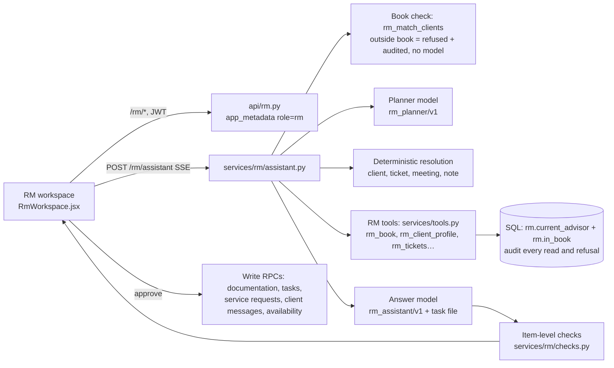

# Workflow 2 – Relationship manager (Sophie)

**Status: built (1 Nov 2026).** Stories RM1–RM12 and RM16 (future scope, built early). Migrations `0089` (access rules, RM reads and approved writes) and `0090` (demo data). Persona 1 (Michelle) is unchanged apart from one addition: an update Sophie approves on a request shows in Michelle's **My requests** as *Latest update*.

## Who she is

Sophie Lim (DEMO), Senior Relationship Manager, Private Clients Team A. Her book: Michelle Ng (1002), David Lee (1003, local database only), Grace Koh (1004), Hafiz Rahman (1005) and Tan Mei Ling (1007, inherited from Rachel Goh on 26 Oct 2026). Ong Wei Ming (1006) and Alex Tan (1001) belong to Priya Nair and are outside her book.

## How it works



- **Identity (RM1).** Sophie signs in with the normal login. The browser shows the RM workspace when the token's administrator-set `app_metadata.demobank_role` is `rm`. The API checks the same claim (never `user_metadata`) and every SQL function resolves her advisor id from the claim **and** `rm.staff_logins.auth_user_id = auth.uid()`; both must agree. Customers cannot call any RM function, and no RM table is readable by a client.
- **Book (RM1).** Every RM function checks `rm.assignments` (current assignment, `ended_on is null`). A client outside the book returns `{"denied": true}` after a `policy.rm_client_denied` audit event; the refusal commits, the data never leaves. Names in a chat message are matched in SQL before the model runs, so "Show me Ong Wei Ming's transactions" is refused with no model call and no record read (R06). The reply is the same whether or not the person exists.
- **Reads (F14).** `rm_book`, `rm_client_profile` (360 view with gaps), `rm_meeting_notes` (previous RMs' shared notes included, private notes withheld and counted), `rm_shared_summary` (only under an active `rm_brief` consent to her; the check is audited), `rm_tickets` / `rm_ticket` (her tickets in full; specialist-managed ones with client-safe status, fraud and login detail withheld), `rm_review_status`, `rm_appointments`, `rm_availability`, `rm_tasks`, `rm_followups`, `rm_handover_sources`. Each returns `call_id` and `as_of`, and writes one `data.read` audit event with the RM as `staff` actor.
- **The assistant is not hard-coded.** Intent is chosen by the planner model; answers are written by the model from the records read for that question. Only three things are fixed: the out-of-book refusal, clarification questions when the records give several candidates (with the candidates as buttons), and "no reassignment recorded" for a handover brief. If the model is unavailable, the RM is told; nothing is substituted.
- **Every item is labelled and cited.** Record, Client said, AI suggestion or Gap, with chips that open the source record (title, recorded time, fields). Items whose figures, dates or TCK- references are not in their cited records (or any supplied record), or that give advice, an approval decision or claim something was done, are withheld and counted ("1 point could not be verified…").
- **Context and switching (RM2-RM4, RM7, RM12).** The active client, ticket and meeting are shown above the chat. Follow-ups stay with that client. Choosing another client (or naming one) starts a clean context; only turns about the same client are sent to the model.
- **Nothing leaves without approval.** Drafts are labelled *AI draft – not sent*; documentation is *not saved* until approved; each task and service request is confirmed separately; a service request needs the identity/authorisation tick and returns its reference only after the ticket exists. Earlier draft revisions are never treated as approved.

## Saved conversations (0091)

Each RM conversation is saved after every reply and listed under **Past conversations** (50 most recent, redacted, Sophie's own only). Reopening shows earlier drafts and review cards read-only (ask again to approve something new). Turns about a client who is no longer in her book are not shown again, and such conversations get a neutral title. Full source records are not stored; asking again re-reads them.

## Story map

| Story | Where | Notes |
|---|---|---|
| RM1 Sign-in and client book | Login → RM workspace; *My clients*; `rm_book`, `rm_match_clients` | Refused lookups audited; active client always shown |
| RM2 360° overview | *My clients* → client; assistant "overview of …" | Sources and as-of on every block; gaps listed; client-stated vs AI labelled |
| RM3 Meeting history | Assistant "summarise past meetings with …" | Previous RM's notes included, private ones withheld; asks which meeting when ambiguous |
| RM4 Meeting briefing | *Schedule* → Prepare briefing; "Brief me for my 10am with David" | Uses the confirmed appointment; consent-checked handover note; suggestions cite records; no advice |
| RM5 Interaction documentation | Paste notes in the assistant (or *Document a call* on a client) | Facts, decisions, commitments, requests separately; confirmed vs tentative; corrections by chat keep the source notes; saved only on approval |
| RM6 Service requests | Documentation → *Review request form* | Prefilled from notes, missing fields and open duplicates checked in SQL, verification tick, reference after creation |
| RM7 Ticket inbox | *Ticket inbox*; "What needs my attention today?" | Her tickets vs specialist-managed (read-only, client-safe status) |
| RM8 Ticket summary | *Summarise* on a ticket | What the bank, the chat assistant and RMs told the client; who decides; required fields present/missing; never closes the ticket |
| RM9 Client communication | *Draft a reply*; "make it shorter" for revisions | Approve and send: on her ticket (optional status), on a non-restricted specialist ticket (message only), or to the Inbox (no ticket). Approval and result recorded; failures recorded as failed |
| RM10 Follow-up tasks | Documentation → tasks; "turn the 2 Sep note into tasks" | Only actions quoting the notes; owner/due flagged when missing; duplicates detected; linked to the saved interaction |
| RM11 Follow-up priorities | *Follow-ups*; *Prioritise with assistant* | Live from records; reason, date and source per item; never suggests a second meeting when one is confirmed; dismiss |
| RM12 Availability | *Schedule* | Weekly hours and blocks for the next 14 days drive the free times Michelle books in My requests → Meetings (CR17); booked or held times cannot be blocked |
| RM16 Handover brief | Inherited client → *Handover brief* | Only with a recorded reassignment; fixed eight sections; consent-filtered handover note (revoked/expired excluded); audited with the sources used |

## Demo data (0090)

- **Sophie's own notes**: Michelle (15 Apr 2026 annual review, 24 Sep 2026 review preparation, 20 Oct 2026 deliberately unclear call), Grace (12 Aug 2026), Hafiz (3 Jun 2026). Rachel's notes for David (0088) and Mei Ling (8 Jul 2025, 19 Jun 2026) plus one **private** note each that Sophie never sees.
- **Client-stated preferences** tied to their notes; **maturities and reviews** (Michelle's fixed deposit ****4410, Mei Ling's ****9051, Grace's check-in, Hafiz's account review, David's annual review).
- **Appointments** relative to the day 0090 is applied: next Tuesday 10:00 David (local only), next Wednesday 14:30 Michelle (video), next Thursday 11:00 Grace (phone, no purpose recorded), the Monday after next 16:00 Hafiz, and a **held** (unconfirmed) Friday slot for Grace.
- **Tasks**: "Send Michelle fixed deposit options" (due in 5 days) and an **overdue** task for Hafiz's fee review.
- **Mei Ling** (1007): request to Rachel with a bank update, a chat question about a renewal rate that the assistant handed to the RM, a consented handover note, and two notes whose consent expired or was revoked.

## Demo script (about 10 minutes)

1. Sign in as `demo.sophie@example.com`. The workspace shows *RM assistant* with her book size.
2. **Ticket triage**: "What needs my attention today?" → her requests first, Grace's urgent fraud case read-only with its detail restricted.
3. **Outside the book**: "Show me Ong Wei Ming's recent transactions" → refused, no records read (audit: `policy.rm_client_denied`).
4. **Overview**: My clients → Michelle → blocks with sources and gaps → *Ask for an overview*; then "what did she say about her mother?" (follow-up on the same client; the 20 Oct note is flagged as unclear).
5. **Briefing**: Schedule → Michelle → *Prepare briefing* → then "add a question about the sale agreement" (refines the same briefing).
6. **Documentation**: Michelle → *Document a call or meeting*, paste:
   `Notes from my call today with Michelle (phone): she will upload the sale agreement this week. She asked the compliance team to confirm whether a sale agreement in Thai with a certified English translation is acceptable for her review. She also wants a copy of her September 2026 statement. She might review her card limit in December, not decided. I'll send her fixed deposit options by Friday.`
   The summary separates facts, commitments and requests, marks the card limit as tentative, proposes a compliance question (service request), flags the statement copy as a duplicate of her open statement request, and flags the fixed deposit task as similar to the open one. Correct by chat ("Correction: the statement is for August 2026") → approve → *Review request form* on the compliance question → fill anything missing → tick verification → submit (the TCK- reference appears only now) → *Create selected tasks*.
7. **Client message**: Ticket inbox → Michelle's statement request → *Draft a reply* → "make it warmer" → edit → tick → *Approve and send*. Sign in as Michelle: My requests shows *Latest update* and an Inbox notice.
8. **Handover**: My clients → Tan Mei Ling → *Handover brief* (eight sections; the revoked and expired notes are excluded; Rachel's private note is counted, not shown).
9. **Availability**: Schedule → block a free half hour → Michelle's *Meetings* tab no longer offers it.

## Set up on the hosted project

1. Apply `backend/supabase/hosted/15_apply_0087_0088_hosted.sql` (if not yet) and `16_apply_0089_0090_hosted.sql` in the SQL editor.
2. Authentication → Users → create `demo.sophie@example.com` with a password.
3. Set her app_metadata (SQL editor, owner role):
   ```sql
   update auth.users set raw_app_meta_data = raw_app_meta_data || '{"demobank_role":"rm","rm_id":"00000000-0000-4000-8000-100200000002"}'
   where email = 'demo.sophie@example.com';
   update rm.staff_logins s set auth_user_id = u.id from auth.users u where s.auth_user_id is null and lower(u.email) = s.demo_email;
   ```
4. Sign out and in again (the role is read from a fresh token). Restart nothing else: the backend needs no new settings.

## Rules that carry over

- The assistant drafts and summarises; Sophie decides and sends. Nothing reaches a client, and nothing is saved or submitted, without her explicit approval of the exact content.
- Every point links to the record it came from; recorded facts, client statements, AI suggestions and gaps are labelled.
- She can never open, search or be told about a client outside her book; the attempt is audited.
- Specialist teams own fraud, login, cards, payments and operations cases; the RM sees client-safe status and never decides or closes them.

## Known limits

- Audio recordings and speech recognition (RM5 stretch) are not built; notes are typed or pasted.
- Checks are conservative format checks (figures, dates, references, wording), not proof that each sentence is true.
- RM MFA (aal2) is not required in the demo; the support role keeps its aal2 requirement.
- The live model has not been run against R01–R10 from this environment; run `qa1_rm_cases.json` on the hosted project and record the results.
