# Workflow 3 – David: meeting his new relationship manager (RM) without repeating himself

**Persona:** David Lee (synthetic customer 1003, see `docs/synthetic-data-spec.md`)
**Outcome:** David knows who his new RM is, his requests are tracked, his note is shared and a meeting is booked – without repeating himself.

Migration **0062** (`0062_workflow3_relationship.sql`) is required.

**UI pattern (hybrid):** the chat introduces the RM and answers questions; every task reply ends with one hand-off button (e.g. *Send this request to Marcus →*) that opens **My relationship manager**. That page has a guided four-step checklist (Meet your RM → Send a request & status → Handover note → Book a meeting; a step shows ✔ only after its server receipt) and an **All requests & appointments** view for the full manager. Confirmations stay in in-page dialogs. Only fictional coursework data is used; no real advisor, calendar or video service is connected.

## Flow

```mermaid
flowchart TD
    start([START: the bank has assigned David a new RM]):::endpoint
    s1[DAVID logs in and opens the chat]:::user
    s2[BOT introduces the new RM from the bank's records: name, role, phone and email]:::bot
    s3[DAVID asks about the change<br/>'why did my old guy leave? will things stay the same?']:::user
    s4[BOT answers with approved wording only: no made-up reason, no unconfirmed promises]:::bot
    s5[DAVID sends a new request<br/>'can someone send me my annual portfolio statement']:::user
    s6[BOT asks what, how urgent and any deadline, then confirms it is in the RM's queue]:::bot
    s7[DAVID asks 'whats happening with my requests?']:::user
    s8[BOT lists each request: Sent · Seen · Answered, plus anything David must do<br/>never says transferred or done unless recorded]:::bot
    s9[DAVID clicks 'Prepare handover note']:::user
    s10[BOT drafts a short note from authorised records]:::bot
    s11[DAVID adds topics; BOT turns them into an agenda; David edits the whole note]:::user
    d1{Share the note with the new RM?}:::decision
    share[CONFIRM DIALOG names recipient and use; consent → 'Shared' only after the system confirms]:::bot
    s12[DAVID asks 'can i meet her next week']:::user
    s13[BOT shows available slots from the RM's calendar]:::bot
    s14[DAVID picks a slot and confirms; held for 10 minutes]:::user
    s15[BOT confirms only after the system does: date, time, format, joining details]:::bot
    finish([END success]):::endpoint
    start --> s1 --> s2 --> s3 --> s4 --> s5 --> s6 --> s7 --> s8 --> s9 --> s10 --> s11 --> d1
    d1 -- Yes --> share --> s12
    d1 -- No: nothing is shared --> s12
    s12 --> s13 --> s14 --> s15 --> finish
    classDef user fill:#dbe8fb,stroke:#6c8ebf
    classDef bot fill:#d5e8d4,stroke:#82b366
    classDef decision fill:#fff2cc,stroke:#d6b656
    classDef endpoint fill:#e1d5e7,stroke:#9673a6
```



## Step-by-step implementation

| # | Step | What happens in the app | Stories |
|---|---|---|---|
| 1 | David logs in, opens chat | Existing sign-in; signed-in users always chat with their records (no mode switch). | EB1 |
| 2 | Bot introduces the new RM | On chat open, `GET /relationship/introduction` (`customer_read_introduction`, audited, JWT + RLS) returns current/previous advisor and the approved wording. A change in the last 60 days shows an assistant message labelled **From your records** with name, role, team, phone and email, the approved explanation and its source. Not an AI answer. | RC1 · F10 |
| 3–4 | "why did my old guy leave? will things stay the same?" | Routed to the relationship agent (new routing rules). Prompt **v3** may explain the change only with the cited `relationship-transition` evidence: approved `rm-change` sections chosen in SQL from the recorded reason code. The code itself never reaches the model or the browser. With no approved mapping, the `unrecorded` wording is used. | RC1 |
| 5–6 | "can someone send me my annual portfolio statement" | Routed to relationship (not retail "statement"). The reply ends with **Send this request to Marcus →**, which opens step 2 of the RM page pre-filled with his words; he sets urgency and an optional deadline → **Review request** → in-chat dialog shows the exact stored, redacted proposal → **Send request**. Only the `requests.create` receipt produces "Received … in Marcus Chua (DEMO)'s request queue, status Sent". The request row's `advisor_id` is the current RM; that is the RM's queue in the data model. | RC4 |
| 7–8 | "whats happening with my requests?" | **My requests** step: Sent → Seen → Answered tracker per request, `customer_action` ("Your action: …" or "Nothing is needed from you"), and recipient. A request raised with the previous RM says "It is not recorded as transferred". On read failure the RM's recorded contact and Talk to a person are shown. | RC4 |
| 9–10 | "Prepare handover note" | `GET /relationship/handover-draft` composes suggestions deterministically (no model) from three audited reads: profile (language), open requests (priority, deadline, status, recorded action) and the introduction (previous RM). Response lists its sources. | RC2 |
| 11 | Topics → agenda, edit whole note | "estate planning, review of fees, how often we meet" becomes numbered `Agenda item n:` lines (`organiseAgenda`). **Edit whole note** edits every line; profile fields are opt-in checkboxes. **Save private draft** records `agenda.save` (shares nothing). | RC2 |
| Decision | Share with the new RM? | Dialog names the recipient and role, how the note is used, data categories, consent duration and the exact saved content. The button is disabled until David ticks the consent statement. Confirm runs `consent.request` → `consent.grant` → `rm.share_summary` (an existing covering grant is reused); **Shared** appears only from the sharing receipt. **Don't share** records nothing. | RC2 · F9, F13 |
| 12–13 | "can i meet her next week" | **Book a meeting** step: "next week" → next Monday–Friday (Singapore time); slots come from `appointments_find_slots` for the current RM (working hours, blocks and other bookings excluded). | RC3 · F10 |
| 14 | Pick a slot | `POST /relationship/holds` reserves it for ten minutes; a countdown shows the server expiry. | RC3 · F13 |
| 15 | Confirmed booking | In-chat dialog shows date, time, format and recorded joining details (`rm.meeting_options`, new). `appointment.confirm` must succeed before **Booked** appears. If no slot or booking fails, the verified alternative (RM's recorded phone/email, Talk to a person) is shown. | RC3 · F13 |

Note: the diagram says "meet *her*"; the seeded new RM is Marcus Chua (DEMO). Intent detection does not depend on the pronoun.

## Acceptance criteria traceability

| Criterion | Evidence |
|---|---|
| RC1 confirmed advisor details from an authorised system | `customer_read_introduction` (invoker RLS, explicit customer predicate, audit `rm.get_introduction`) |
| RC1 name, role and contact details | Intro card; `test_workflow3.py::test_introduction_and_meeting_options_are_owned_and_audited` |
| RC1 approved wording only | `kb` article `rm-change` v1 + `rm.transition_notices`; schema rejects mismatched wording; prompt v3; retired article → explicit failure, not invented text |
| RC1 unavailable details → support channel | `no-advisor` wording + Talk to a person fallback |
| RC2 draft from authorised records | `services/handover.py`, `HandoverDraft.sources` |
| RC2 topics organised into an agenda; whole note editable | `organiseAgenda`, `noteLines`; editor in the note step |
| RC2 recipient named, use explained, consent before sharing, confirmation of sharing | Share dialog; `shareWithConsent`; `rm.share_summary` receipt |
| RC3 slots from authorised scheduling; selection; confirm only after the system does | Existing slots/holds/booking executors; in-chat dialog |
| RC3 date, time, format, joining details; alternative when unavailable | `customer_read_meeting_options`; fallback block |
| RC4 structured request; received and in RM's queue | `requests.create` with `advisor_id` = current RM |
| RC4 status sent/seen/answered + customer action | New `rm.requests.customer_action`; status step |
| RC4 never "transferred"/"completed" unless recorded | Status wording; prompt v3; handover draft wording |
| RC4 status unavailable → follow-up channel | Status-step fallback |

## Files

- SQL: `backend/supabase/migrations/0062_workflow3_relationship.sql`
- Backend: `schemas/relationship_intro.py`, `services/handover.py`, `api/relationship.py` (introduction, meeting-options, handover-draft), `customer_data.py`, `agents/relationship.py` (+ `relationship_records.py`), `prompts/relationship/v3`, `orchestrator.py` (routing), `knowledge.py` (`rm-change`)
- Frontend: `lib/relationshipWorkflow.js`, `components/RelationshipWorkspace.jsx`, `components/RelationshipConfirmDialog.jsx`, `Chat.jsx`, `index.css`
- Tests: `backend/tests/test_workflow3.py`, `backend/tests/test_workflow3_browser.py`, `frontend/tests/workflow3.spec.js`, `frontend/src/lib/relationshipWorkflow.test.js`

## Verification

```bash
cd backend
TEST_DATABASE_LOCAL=1 TEST_DATA_API_LOCAL=1 ../.venv/bin/python -m pytest -q tests/test_workflow3.py
TEST_DATABASE_LOCAL=1 TEST_DATA_API_LOCAL=1 TEST_BROWSER_LOCAL=1 ../.venv/bin/python -m pytest -q tests/test_workflow3_browser.py
cd ../frontend && npm test
```

The browser test drives steps 1–2 and 5–15 at 1280 px and checks layout at 390/320 px, with no `/chat` call. Steps 3–4 and the AI text in 5–13 need the real provider: run the opt-in `TEST_RELATIONSHIP_LIVE=1` suite. That live check was **not** run when this workflow was built.

Hosted deployment: apply 0062 to the hosted project (`scripts/prepare_hosted_migrations.py --first 62 --last 62`) before using the in-chat panel there. Without it the intro silently does not appear and the panel cannot load.
